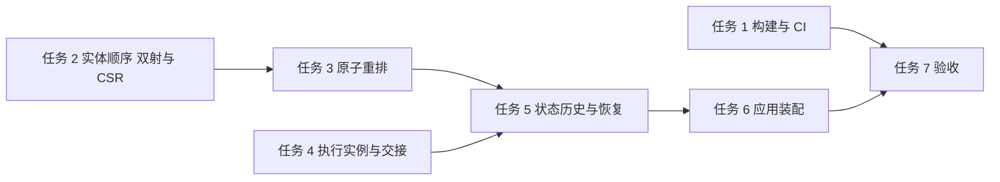

# Nexora 底层数据结构与整体架构开发计划

核查基线为本地 `main` 的 `51dd068dc339ebb33cadb44968fc464e1ca4481a`，提交时间 `2026-11-11T10:55:51+08:00`。核查开始时工作树干净，本地 Git 未配置 remote。下面的开发任务为本阶段建议实施顺序，沿用现行架构的 P1 编号。 [架构总览](overview.md#2-当前实现源码事实) · [Phase 1 任务与验收](phase-1-design-review.md#2-实施任务与依赖)

## 当前开发进展

| 能力 | 已实现并有执行证据 | 当前缺口 |
| --- | --- | --- |
| 构建与安装 | C++20、CMake 3.25.2+、Ninja 和本地 exact Kokkos 5.2.2 Serial-only。已安装并搬迁消费 `core`、`data_schema`、`data`、`participant_api`、`simulation`，`data` 传递 Kokkos 依赖。旧数值容器和 `exec` 已从源码、导出和干净安装中移除。 | CI 缺 Kokkos 供给步骤，Windows 仍传已拒绝的 `NEXORA_GPU_BACKEND=NONE`。其他编译器和设备 profile 需各自验证。 [根 CMake](../../CMakeLists.txt#L14) · [CI](../../.github/workflows/ci.yml#L28) · [安装检查](../../tests/package/VerifyInstall.cmake) |
| 核心值和精度 | 强类型 ID、版本、`LocalIndex`、`Offset`、`Status`/`Result` 和 `TimeInterval` 已存在。`nexora::real` 默认 `float`，构建可选 `double`，由安装配置固定。时间仍为 `double`，积分使用保留的请求步长。 | 完成实体身份、布局代际及容量的统一校验，沿用现有值类型与精度配置。 [核心值类型](../../include/nexora/core/Types.hpp#L38) · [时间](../../include/nexora/core/Time.hpp) · [精度证据](real-numerics-validation.md) |
| 字段与授权 | `FieldDescriptor`/`FieldRegistry` 保存语义，`FieldStamp` 保存动态版本，typed binding 使用原生 Kokkos View，已有 rank-1/2/3 和非连续 subview 测试。私有 `FieldIssuer` 按整个 allocation 仲裁多读或独占写，managed subview 共享仲裁，Serial 外部数组由真实 owner 保活。 | 同一状态内跨字段的布局版本尚未由通用实体集合驱动。阶段链联合授权和设备在途授权仍待实现。 [字段绑定](../../include/nexora/data/FieldBinding.hpp) · [绑定验证](field-binding-validation.md) · [授权实现](../../src/data/FieldAccess.cpp#L85) · [外部 owner](../../src/data/ExternalField.hpp) |
| 实体、拓扑与传输 | Reference 使用固定稳定 ID；本地 pack 生成 `LayoutRight[entity, component]` 的只读快照；receive 检查语义、时间和版本，对 rank-1/2 目标按 ID 校验双射后解包。 | `EntityOrder`、`Permutation`、`CsrAdjacency` 目前是设计声明。接收为每次操作临时构造映射，缺统一的实体顺序、重排与拓扑失效测试。 [实体设计](kokkos-design.md#3-稳定-id局部顺序与版本) · [接收](../../src/data/TransportReceiver.hpp#L81) |
| 执行与窗口 | 内部 reference 用真实 Kokkos Views 执行 `x/q` 试算，覆盖独立 trial、收发失败后恢复、重试和重放。预提交准备下一版只读授权，提交后发布，旧快照可以继续读取。`Simulation` 提供同步单参与者时钟与事务协调。 | Reference 算子和收发仍是 Serial 专用路径。通用可变拓扑、历史与控制状态、缓存失效、快照预算和关闭行为需形成完整的可执行契约。 [参考算子](../../src/methods/reference/State.cpp#L131) · [参考参与者](../../src/participants/reference/Participant.cpp#L234) · [Simulation](../../src/simulation/Simulation.cpp) |
| 应用装配 | CLI 可输出版本、构建能力和诊断信息。Reference 方法与参与者是内部 target，测试直接装配。 | CLI 缺统一的 case 解析、校验、执行计划和 reference 运行入口。 [CLI](../../apps/nexora/main.cpp#L55) · [内部 target](../../src/participants/reference/CMakeLists.txt) |

仓库已记录四个独立构建目录的 Serial 验证，覆盖 float/double × Debug/Release。每组 CTest 15/15、依赖图检查、干净安装搬迁和 80 位 Decimal oracle 均通过。最后一组于 `2026-11-11T10:50:26+08:00` 完成。平台为 Apple M2 Pro arm64、macOS 27.2.1 build 26B131、AppleClang 21.0.0、CMake 4.4.3、Ninja 1.13.2。数值证据覆盖 reference 的固定输入、16/32/64 步和非二进制步长，记录的最大离散分量误差为 float `1.0456617304142321e-7`、double `1.9918532962658262e-16`。该记录使用本地包，尚缺严格禁网验收。 [字段迁移复验](field-migration-review.md#完整工作树验证) · [数值判据](real-numerics-validation.md)

本次在同一台 Apple Silicon 主机用新临时目录复跑 `51dd068` 的两组 Serial 配置，MPI 均关闭。Kokkos 源归档和 `libkokkoscore.a` 摘要与仓库记录吻合。

| 本次复验 | 开始与结束 | 构建与执行 | CTest |
| --- | --- | --- | --- |
| float Debug | `2026-11-11T11:11:59+08:00` 至 `2026-11-11T11:12:17+08:00` | 配置通过，28 个 Ninja 步骤完成，依赖检查和 Decimal 通过 | 15/15，11.01 s，含安装搬迁消费 |
| double Release | `2026-11-11T11:15:50+08:00` 至 `2026-11-11T11:16:12+08:00` | 配置通过，28 个 Ninja 步骤完成，依赖检查和 Decimal 通过 | 15/15，11.78 s，含安装搬迁消费 |

复跑使用以下命令。验证 float Debug 时将 `Release` 改为 `Debug`、`double` 改为 `float`，并去掉双精度选项。

```sh
nexora_build=$(mktemp -d /tmp/nexora-review.XXXXXX)
cmake -S . -B "$nexora_build" -G Ninja \
  -DKokkos_DIR="$PWD/.cache/dependencies/kokkos-5.2.2/install-release/lib/cmake/Kokkos" \
  -DCMAKE_CXX_COMPILER=/usr/bin/c++ -DCMAKE_BUILD_TYPE=Release \
  -DCMAKE_CXX_EXTENSIONS=OFF -DBUILD_TESTING=ON -DNEXORA_ENABLE_MPI=OFF \
  -DNEXORA_ENABLE_DOUBLE_PRECISION=ON
cmake --build "$nexora_build" --parallel 2
python3 tools/check_dependencies.py --graph "$nexora_build/nexora-target-graph.json"
ctest --test-dir "$nexora_build" --output-on-failure
python3 tools/check_reference_precision.py \
  --log "$nexora_build/Testing/Temporary/LastTest.log" \
  --precision double --output "$nexora_build/precision.json"
```

干净目录另复现了两条配置拒绝路径。`NEXORA_GPU_BACKEND=NONE` 触发旧选项移除错误，未供给 `Kokkos_DIR` 且无包可发现时，CMake 因找不到 exact 5.2.2 而停止。两项于 `2026-11-11T11:17:24+08:00` 完成。 [CMake 配置入口](../../CMakeLists.txt#L21)

## 本阶段交付边界

目标是形成一个可安装、可运行、可重复验证的 **Serial CPU 基础设施闭环**。两个小型测试输入提供消费场景。现有 `x/q` reference 验证字段、时间和事务，人工定义的非规则邻接夹具验证局部索引、CSR 和重排。这两个夹具可以推动具体接口落地，不需要选择新的物理公式。完整 SPH、DEM、FVM 求解器、物理耦合、多参与者一致提交、MPI halo、外部引擎及持久重启进入各自后续任务。现行 P1 的 SPH/FVM 代表性数值、CUDA 实机及端到端性能条件继续按原验收执行。 [Phase 1 出口](phase-1-design-review.md#1-当前基础与-phase-1-出口) · [后续阶段](migration-roadmap.md#p2-task-ids)

| 层 | 本阶段职责与依赖边界 |
| --- | --- |
| `core` 与 `data_schema` | 保留可独立消费的 ID、版本、时间、错误及字段语义。实体身份规则可用现有值类型表达，typed 存储和设备句柄留在数值边界。 |
| `data` | 围绕原生 Kokkos View 提供形状与版本校验、字段权限、实体排列及本地交换。复用现有 registry、lease 和 transport。数据布局以 View 为准。 |
| 内部方法和具体参与者 | 方法定义 State、History、Control 及计算用的布局。参与者负责具体 execution instance、授权、准备、发布、恢复与收尾。CSR 先由实际夹具消费，共享代码留在现有 `data` 内部，待出现第二个真实调用者再评估提取。 |
| `participant_api` 与 `simulation` | 同步控制接口、端口语义、时间校验和 accepted 时钟。依赖 `data_schema/core`，设备操作留给具体参与者。 |
| CLI | 应用选择已构建且获验的组合并装配，持有 `Kokkos::ScopeGuard`。销毁参与者、快照和执行实例后结束 runtime。新增的内部装配依赖随 CMake、checker 和安装测试一并更新。 |

[允许的 target 图](overview.md#4-批准后-cmake-target-依赖图) · [Kokkos 职责与关闭契约](kokkos-design.md#10-在途资源保活与关闭)

## 任务 1 固定基线并恢复 CI

对应 `P1-01a`、`P1-02`、`P1-10/11` 的 Serial 子项。可与任务 2 并行。

- **构建输入。** 把上游归档与仓库锁中的 SHA-256 对比，记录 Kokkos 源码 commit、许可、选项、编译器和静态库摘要。显式供给阶段在 runner 上准备 exact 5.2.2 Serial-only，cache key 包含 OS、架构、编译器、构建选项与源摘要。随后只消费本地 `Kokkos_DIR`。移除 Windows 旧参数，Windows/MSVC 与 Linux 不同编译器分别保留验证记录，按实际验证的生成器与 profile 发布结果。
- **验证步骤。** 每次变更跑 Serial float Debug 和 double Release，涉及精度、包或合并验收时跑四组合。依次记录 configure、build、`check_dependencies.py --graph`、CTest、`check_reference_precision.py`、干净 install 和搬迁消费；同一工具链构建 Kokkos 与 Nexora。给离线验收设置可证明禁网的执行环境，供给步骤与禁网执行分开。
- **拒绝路径。** 在干净目录核验缺包、错版本、旧 GPU 参数、错误 precision 消费均失败且错误可定位。新工具链的失败保留日志，任何 skipped 都记录原因。
- **完成条件。** 有可重跑的 CI 或同等受控 runner 记录，至少一条 Serial CI profile 跑完独立消费和数值检查。CI 无法执行的平台按各自状态登记。同步校正迁移清单中 `participants_reference` 的直接边，源码同时链接 `nexora::data`。 [贡献指南](../../CONTRIBUTING.md#current-cpu-checks) · [构建政策](build-and-validation.md) · [目标定义](../../src/participants/reference/CMakeLists.txt#L3) · [迁移清单](migration-roadmap.md#模块构建目标和检查器)

## 任务 2 实体顺序 双射和 CSR 基础

对应 `P1-03` 剩余的身份、拓扑、排列和绑定。落点为现有 `data` 私有实现及测试，具体方法继续持有其实体域和拓扑。

1. **实体命名空间。** 复用 `(DomainId, Association, entity_set, GlobalEntityId)`。`EntityOrder` 持有只读 rank-1 稳定 ID View 和 `LayoutVersion`。规定同域唯一性、同一 ID 跨布局保持身份、已删除 ID 不复用及空集合行为。边界使用强类型值校验，kernel 的 ID payload 使用 `uint64_t`。局部索引只在指定实体顺序下有效。
2. **双向排列。** 按 ID 构造 `new_to_old` 和 `old_to_new`，记录源和目标布局。验证同域、等基数、ID 唯一、集合相等、索引在界内、两表互为逆。数量和索引先走 checked cast，再分配或构造 `LocalIndex`。失败返回状态，保留原排列。传输的临时 ID 匹配先复用这条校验逻辑，保留交换层独立的语义和时效校验。
3. **稀疏关系。** `CsrAdjacency` 用只读 `Offset` offsets 与 `LocalIndex` indices Views，绑定拓扑和行/列实体顺序。验证 `offsets.size() == rows + 1`、首项为零、非降序、末项等于 indices 长度、列索引在界内，检查 `rows + 1` 与字节乘加溢出。空图 offsets 为 `[0]`。重复边、自环及行内顺序由实际消费者规定，CSR 基础校验保持结构语义。
4. **字段轴。** 复用 binding 的显式实体轴、分量轴与 extent/stride 校验。用 rank-1、两种 rank-2 轴顺序、`LayoutStride` subview 及一个 rank-3 夹具验证，空字段仍检查描述符。跨 layout 的复制在适用的 Kokkos execution instance 上显式完成，接收范围维持已声明的 rank-1/2。
5. **版本和失效。** 冻结 topology/geometry/layout/accepted state/trial epoch/storage incarnation 的更新条件。布局变化失效局部索引和 pack 映射；拓扑变化失效邻接；几何变化失效依赖位置的缓存；回滚恢复 accepted 的逻辑版本，attempt 和 storage incarnation 保持单调，所有计数在溢出前拒绝。

**验收。** 使用预先写死的 ID 序列和边表做独立比对。覆盖空集合、空行、长行、非恒等排列、重复/缺失 ID、非双射、跨域、非法 offsets、越界邻接、溢出及旧版本。边的稳定 ID 对、行内顺序和字段对应关系按夹具约定精确比对。容量边界用计数/校验输入触发，无需巨量分配。 [ID、CSR 与版本设计](kokkos-design.md#3-稳定-id局部顺序与版本) · [字段校验](kokkos-design.md#2-字段语义和-typed-view-绑定)

建议把下列小例固定为测试输入和独立期望。CSR 的行和列共用同一实体域，另加一个行列分域的夹具验证各自的顺序和列容量。

| 数据 | 原顺序 | 新顺序 |
| --- | --- | --- |
| 稳定 ID | `[10, 30, 20, 40]` | `[20, 10, 40, 30]` |
| 字段值 | `[100, 300, 200, 400]` | `[200, 100, 400, 300]` |
| CSR offsets | `[0, 2, 2, 3, 5]` | `[0, 1, 3, 5, 5]` |
| CSR indices | `[1, 2, 3, 0, 2]` | `[2, 3, 0, 1, 0]` |

该例的 `new_to_old = [2, 0, 3, 1]`，`old_to_new = [1, 3, 0, 2]`。例如实体 `10` 重排前后的邻接稳定 ID 始终为 `[30, 20]`。

## 任务 3 在实际状态中实现原子重排

前置任务 2，对应 `P1-03` 与 `P1-06` 的交界。先在内部 reference 或专用结构夹具验证，确定第二个消费者后再决定共享公开面。

1. 写出每个可重排域的状态清单。至少覆盖稳定 ID、数值字段、历史字段以及有数据时的 ghost/owner 元数据。登记邻接等派生结构依赖的版本和重建方法。
2. 在没有冲突写入的安全点验证排列。为受影响字段分配独立候选 View，按同一个排列执行 gather。行、列都引用该域时同时变换 CSR 的行序及列索引。保持稳定 ID 和几何值。未改变的只读拓扑可以保活共享。
3. 所有复制、重映射和诊断完成后一次发布新布局、字段授权及索引。纯排列增加 layout 版本，实体集合和稳定 ID 连接关系一致时保留 topology 版本。改变几何或连接关系时按各自版本规则处理。
4. 任何预检、候选分配、复制或验证失败都丢弃候选。旧 accepted 快照继续引用原序列。旧 stamp 和局部索引在新状态上的重新绑定失败，旧快照依其授权继续可读。

**验收。** 运行 `原序 → 重排 → 逆排`，用 stable ID 核对字段、历史和边关系。失败注入放在已有部分候选数据和发布前，验证旧字段值、ID、拓扑和版本全量保留。保留一个旧快照穿过重排和下一次提交，测试跨布局本地收发仍按 ID 对齐。 [重排设计](kokkos-design.md#3-稳定-id局部顺序与版本) · [accepted/trial 设计](kokkos-design.md#7-acceptedtrial缓存和恢复)

## 任务 4 显式执行实例与字段交接

对应 `P1-04/05` 的 Serial 子项。可与任务 2/3 并行提取现有 reference kernel，最终与任务 3 汇合。保持公式、时间换算、边界和误差判据。

- 将 reference 算子拆成接受具体 `Exec` 和 native const/mutable Views 的内部函数。Serial 首先走该函数，初始化、候选分配、复制与诊断使用正确的 execution instance。在主机诊断处完成必要 copy/fence；保留按主机可访问性决定读取方式的检查。
- 写清窗口阶段链对每个 allocation 的 read、overwrite 或 accumulate 要求。提交前完成别名合并和记录预留，按单调的 allocation 标识顺序锁定权限记录，全部校验后一次取得整组 grants。任何冲突都保留原权限状态，且不提交 kernel。阶段链持有 typed Views、lease 和 owner。同实例依赖按提交顺序执行，外部交接或主机判断处确认相关实例完成。继续把锁定版本的 allocation tracker 限制在私有适配边界。
- pack 后明确 packed buffer 与源 lease 的责任；仅在数据已完成复制且快照独立时提前归还源读权限。消费者各自完成后释放其持有记录。receive 先校验命名空间、dtype、shape、版本和 ID，再取得或使用独占 trial/ghost 写授权并解包。失败路径保留旧 accepted 状态。
- **验收。** 同一个 allocation 的不同 subview 参与组合授权，覆盖两个读者、读写冲突、重复申请、部分授权失败和 caller 提前释放。两个独立消费者一先一后完成，用可观测计数验证最后一次消费后释放一次。对照现有 reference oracle 和 `LayoutStride`/不同轴序收发。 [授权规则](kokkos-design.md#2-字段语义和-typed-view-绑定) · [执行实例](kokkos-design.md#8-类型化算子执行实例同步和错误) · [传输完成](kokkos-design.md#6-transportview-与通信完成)

## 任务 5 完成状态历史 恢复与快照预算

前置任务 3 和 4，对应 `P1-06` 与 `P1-04` 的生命周期子项。以具体参与者的状态清单和生命周期实现为交付。

| 阶段 | 实现与可观察条件 |
| --- | --- |
| `begin` | 先检查时间、版本、权限和预算。候选状态覆盖主字段及影响重放的历史和控制，写集合独立。未全量覆写的数据显式复制，共享项只读。新 attempt 与候选一起建立。失败时 accepted 时钟和数组保持原值。 |
| `advance` | 保持现有同步接口，阶段链完成且诊断可读后返回。构造最小历史夹具，更新一个会影响后续结果的计数或历史值，用于检验连续推进与重放等价。列出每个缓存的版本键与重建路径。 |
| `prepare_commit` | 完成诊断、必要收发、版本容量检查、只读授权和发布记录准备。注入失败后恢复，accepted 的数据、历史、控制和时钟均应一致。 |
| `commit` | 正常路径只发布已准备的状态，Simulation 在成功后推进时钟与已接受计数。到达发布阶段前完成可失败的准备，旧快照维持原 lease。 |
| `restore` | 停止使用 trial、完成相关访问、废止 trial 授权和缓存并释放候选。保留 accepted 与重放所需历史，retry 使用新 attempt。若恢复本身失败，Simulation 进入 failed 并禁止后续提交。 |
| `close` | 先停止签发，再完成相关访问和消费者，之后释放权限、快照、Views、owner 和执行实例。应用最后结束 `ScopeGuard`。在测试中覆盖部分初始化失败、显式关闭与最后一个消费者延迟完成。 |

首个 Serial 预算建议使用 **在用快照数和受控字节数的上限**。计入由窗口持有的当前及旧 accepted banks、试算候选和 transport packed buffers，同一 allocation 的字节只计一次。外部 owner 的已知占用单列。候选分配或新快照签发前预留预算，超限返回可区分的 `resource_exhausted`，保持原状态。对同步入口采用可重试的背压。测试时使用小额度强制超限，再释放旧快照重试，按最后一次 lease 完成条件回收额度。把对外可复制的原生 View 的有效期写进契约，预算口径覆盖受控 lease 与操作记录持有的存储。

**验收。** 在 begin、advance、receive、prepare 阶段分别注入失败并复核全量 accepted 状态。验证旧快照持续可读、占满预算的尝试不启动、额度释放后正常重试、缓存不会命中旧布局或旧 attempt。按现有数值判据比较无故障推进与恢复重放。为后续 checkpoint 列出需保存的逻辑状态与可重建索引清单，本阶段使用进程内恢复。 [事务契约](kokkos-design.md#7-acceptedtrial缓存和恢复) · [关闭契约](kokkos-design.md#10-在途资源保活与关闭) · [持久恢复数据要求](checkpoint-restart.md#checkpoint-content)

## 任务 6 打通应用装配和最小运行入口

对应 `P1-09`。case 语法、解析和拒绝测试可在任务 5 完成前开始，最终 run 接已验收的生命周期。

1. 使用现行设计规定的 versioned `key=value` case。冻结版本、fixture 类型、精度/执行组合校验、初值、起止时间、步长及必要模型参数的字段表，写明必填项和现有默认值来源。报告文件行号，拒绝未知版本、未知/重复键、非有限参数、非法时间区间/步长/量子及不支持的组合。`nexora::real` 继续由安装包决定，case 只校验请求是否匹配。
2. `validate`、`plan`、`run` 共用解析和校验路径。`plan` 列参与者、实体数量、field dtype、布局、授权、复制和同步边界，分别报告 built、available、validated。`run` 由应用装配 `Simulation` 与内部 reference，输出 accepted 时间、状态版本、接受步数和可核对的数值摘要；错误返回非零退出码。
3. CLI 开始实际运行时建立 `ScopeGuard`，按反向依赖销毁参与者与快照。应用装配可链接 `simulation` 和内部 reference targets，保留 `ParticipantIF` 和 `Simulation` 的高层类型边界。同步更新依赖白名单、源文件归属和安装验证。

**验收。** 同一合法 case 通过 validate/plan/run，安装搬迁后的 CLI 可执行该 case，输出与直接库调用一致。三条入口对同一非法配置给出一致原因。请求未获支持的 execution profile、错误精度和无效时间时退出非零。现有 CLI 版本与诊断路径继续验证。 [装配任务](phase-1-design-review.md#2-实施任务与依赖) · [构建能力模型](kokkos-design.md#81-同一算子实例化)

## 任务 7 汇总验收并固定交付边界

对应 `P1-10/11` 的 Serial 子项，前置任务 1–6。每项结果记录 commit、依赖和输入 hash、硬件和工具链、profile、命令、退出状态、passed/failed/skipped 与带时区秒级时间戳。

| 检查项 | 完成条件 |
| --- | --- |
| 构建与包 | float/double × Debug/Release 在干净目录通过，至少一个受控 Serial profile 通过禁网配置、构建、测试、安装和独立消费。安装搬迁后，schema 消费者保留纯语义头边界，typed data 消费者实际运行 Kokkos 算子，精度冲突与旧导出检查通过。 |
| 结构与传输 | 两种轴序、空输入、strided subview、ID 双射、CSR、跨布局重排和旧绑定拒绝均有直接测试。输入预检先于目标写入，候选执行失败时保留旧状态。 |
| 事务与资源 | 主状态、历史、控制、时钟在故障和重试下正确；快照预算、最后消费者释放、关闭顺序和资源计数有明确断言。 |
| 运行与数值 | 安装后的 CLI 执行合法 case，负向 case 均有非零退出。Reference 的 16/32/64 步、非二进制步长、守恒和收敛继续满足既定门槛，80 位 Decimal 结果入报告。 |
| 架构 | CMake target 图、头文件边界、安装 exports 和 checker 一致，checker 的允许与拒绝样例随变更更新。记录不规则夹具的一次完整执行中包含的分配、复制、fence 和最大在途字节数，作为后续测量基线。 |

## 实施顺序与后续设备证据



- **首批实施。** 并行处理构建供给/CI、实体身份与 CSR 的接口和负向测试、reference 算子显式传入 Serial 实例。先提交独立可运行的接口和测试，再把重排接入状态。实体身份和版本规则确定后，接收复用双射校验。
- **集成批次。** 实体重排与字段授权在参考窗口合并，补齐历史、恢复和快照预算。case 解析可先做，最终 `run` 接已验证的生命周期。完成一次安装搬迁后的端到端复跑再关闭本轮基础设施任务。排期以每批验收结果和可用 runner 为依据。
- **设备支线。** CPU 入口保留 typed View 与显式 `Exec` 边界。有匹配 NVIDIA runner、driver、toolkit、GPU 架构后，单列 `P1-02/04/05` 的 CUDA+Serial 包、`nvcc_wrapper` CXX、同源算子、安装消费者和私有 stream 夹具。实测 H2H/H2D/D2H/D2D、跨实例交接、设备指针的主机不可访问性、最后消费者完成及异常收尾，再报告各配置的数值与性能状态。OpenMP、HIP、MPI 以各自的工具链和实机证据登记。 [CUDA 构建契约](build-and-validation.md#cuda-build-contract) · [P1 验收矩阵](phase-1-design-review.md#acceptance)

本轮设计评审需定下实体域与布局版本的所有权、预算计量与释放点、case 的版本化字段及首个 CI runner。先把类型和失败条件冻结在现有架构文档中，再以小提交推进上述实现。
