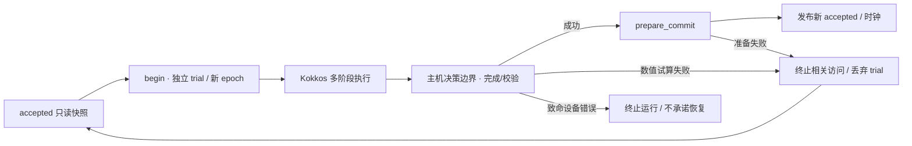

# Kokkos 单一路线：数据、执行与生命周期设计

修订时间：`2026-11-11T13:29:35+08:00`。**本文定义完整迁移目标及当前有限实现。** 权威入口是 [overview](overview.md)，源码现状见[迁移表](migration-roadmap.md#source-inventory)。本文声明面向 **C++20 / Kokkos 5.2.2**，版本和工具链依据见[构建政策](build-and-validation.md)。后文通用类型仍是可评审的接口草图。

当前已有 Serial CPU 基础构建与整数计算，以及内部 reference `State`/`Participant` 的 typed `x/q`、独立 trial、同步提交、恢复与重试。Reference Serial 窗口已验收最小 replay history、控制序列、诊断缓存和快照预算。旧快照及 packed 消费者在显式关闭后可保留到各自完成，应用须先于 Kokkos finalize 释放所有记录。设备异步交接与关闭和其他方法的完整历史恢复仍待验收。 [Reference 进程内恢复与预算](reference-resource-validation.md)

通用 `data_schema`、`ReadField/WriteField` 和整分配读写 lease 已实现同步 managed Serial 子集。当前签发器仅供内部使用，绑定保留原生 View。私有导入入口支持具备真实 owner 的一维 HostSpace 数组，本地 `TransportView` 按消费者保存 lease 并在交接前完成显式 pack。 [CPU 字段绑定与 lease](field-binding-validation.md) · [外部内存与本地传输](external-transport-validation.md)

## 1. 职责收敛

| 层 | 保留职责 | 明确不承担 |
|---|---|---|
| core | 强类型稳定 ID、局部索引宽度、real 标量、double 时间值、Status/Result、checked cast | 设备、allocator、队列、View、backend enum |
| data_schema | 字段物理含义、单位、参考系、measure、实体 association、语义 registry | 分配或持有方法主状态；选择设备 |
| data | descriptor 与原生 typed View 的校验绑定；外部 owner 保活；字段读写授权、版本快照 | 通用 allocation/copy/parallel API；另一份布局系统 |
| methods | 各自 topology、State/history、离散算子；直接使用 Kokkos policies/Views | 控制全局时钟或其他方法的主状态 |
| participant | 管理方法/引擎实例；签发权限；窗口、试算、提交、恢复、语义端口 | 通用硬件 runtime |
| simulation / coupling | 时间协调、试算决策、accepted 时钟、映射与守恒账本；后续多参与者一致提交 | 设备指针、具体 execution space、方法内部数组布局 |
| parallel / I/O | 明确 pack/unpack、halo/迁移协议、传输完成、逻辑 checkpoint | 再建 StateStore；将 Kokkos 对象序列化 |
| 外部 engine adapter | 引擎模型/状态所有权、单位与机械端口转换、恢复认证 | Nexora 通用 kernel provider 或第二条 native 硬件路线 |

`exec_api/exec_cpu` 已移除，旧拟议 `exec_cuda/exec_hip` 取消。core 数值容器的迁移和原生类型示例见 [core 数据结构](core-data-structures.md)。Kokkos 的 View、memory/execution spaces、layout、parallel dispatch、deep_copy、fence 直接用于合适的底层接口。Nexora 只增加以下领域语义：谁能写哪个版本、外部存储何时能释放、交换何时完成、哪个试算能提交。不会建立对 Kokkos API 的逐项 facade。

## 2. 字段语义和 typed View 绑定

`FieldDescriptor` 保留现有 name/id/domain/association/entity_set/dtype/components/tensor/units/reference_frame/pressure_convention/time_level/stage/measure/ownership 的物理含义及默认约定。将物理位置、stride、device_id 从 descriptor 移出：实际内存与布局由 View 类型及 `extent/stride` 提供；动态版本和有效期属于绑定快照。不得为 convenience 在 descriptor 和 View 各维护一份可独立修改的 layout。

以下是替换声明的关键部分；枚举沿用当前 `FieldDescriptor.hpp`，不是新物理约定。现有 `FieldRegistry` 只保存语义，动态 stamp 不在 registry 中原地改写。

```cpp
// Target data_schema: no Kokkos include.
struct FieldDescriptor {
    nexora::FieldId id;
    std::string name;
    nexora::DomainId domain_id;
    Association association{Association::cell};
    std::string entity_set;
    ScalarType scalar_type{real_scalar_type};
    std::size_t components{1};
    std::string tensor_interpretation, units, reference_frame;
    std::string pressure_convention, time_level, stage;
    FieldOwnership ownership{FieldOwnership::owned};
    FieldAccess access{FieldAccess::read}; // declared maximum, not a write grant
    MeasureSemantics measure{MeasureSemantics::point_value};
    nexora::Status validate() const;
};

struct FieldStamp {
    nexora::TopologyVersion topology;
    nexora::GeometryVersion geometry;
    nexora::LayoutVersion layout;
    nexora::StateVersion accepted_version;
    nexora::TrialEpoch trial;
    nexora::TimeStamp time;
    double valid_from{}, valid_until{};
    std::uint64_t storage_incarnation{}; // monotonic, never rewound
    bool accepted{};
};
```

完整目标声明均位于 `namespace nexora`（以上为了展示现有类型使用限定名）。header 按需包含 `<Kokkos_Core.hpp>`、`<memory>`、`<cstdint>`、`<string>`、`<type_traits>` 及 core headers。下面的 host 端薄绑定不提供索引运算符或执行方法；kernel 得到的仍是原生 View。

```cpp
namespace nexora {
namespace detail { struct FieldAuthority; struct FieldIssuer; }

class ReadLease {
public:
    ReadLease(ReadLease&&) noexcept;
    ReadLease& operator=(ReadLease&&) noexcept;
    ReadLease(const ReadLease&) = delete;
    ~ReadLease(); // releasing a user handle cannot retire submitted work
private:
    friend struct detail::FieldIssuer;
    explicit ReadLease(std::shared_ptr<detail::FieldAuthority>);
    std::shared_ptr<detail::FieldAuthority> authority_;
};
class WriteLease {
public:
    WriteLease(WriteLease&&) noexcept;
    WriteLease& operator=(WriteLease&&) noexcept;
    WriteLease(const WriteLease&) = delete;
    ~WriteLease();
private:
    friend struct detail::FieldIssuer;
    explicit WriteLease(std::shared_ptr<detail::FieldAuthority>);
    std::shared_ptr<detail::FieldAuthority> authority_;
};

template<class View> class ReadField {
    static_assert(Kokkos::is_view<View>::value);
public:
    using view_type = typename View::const_type;
    ReadField(ReadField&&) noexcept;
    ReadField& operator=(ReadField&&) noexcept;
    ReadField(const ReadField&) = delete;
    view_type view() const; // usable only within registered operation lifetime
    const FieldDescriptor& descriptor() const;
    const FieldStamp& stamp() const;
private:
    friend struct detail::FieldIssuer;
    ReadField(FieldDescriptor, FieldStamp, view_type, ReadLease);
    FieldDescriptor descriptor_;
    FieldStamp stamp_;
    view_type view_;
    ReadLease lease_;
};
template<class View> class WriteField {
    static_assert(Kokkos::is_view<View>::value);
    static_assert(!std::is_const_v<typename View::value_type>);
public:
    WriteField(WriteField&&) noexcept;
    WriteField& operator=(WriteField&&) noexcept;
    WriteField(const WriteField&) = delete;
    View view() const;
    const FieldStamp& stamp() const;
private:
    friend struct detail::FieldIssuer;
    WriteField(FieldDescriptor, FieldStamp, View, WriteLease);
    FieldDescriptor descriptor_;
    FieldStamp stamp_;
    View view_;
    WriteLease lease_;
};
} // namespace nexora
```

`FieldIssuer` 是 participant/data 内部授权入口，不是任意 caller 可创建的权限。签发前检查 dtype、association、units、components 与方法规定的各维含义、有效时间、所有版本、执行可达性和别名；算子知道分量轴/实体轴，不能假设每个 View 的 `extent(0)` 都是实体。对 runtime 外部数组同时检查对齐、元素生命周期、capacity、乘加溢出和 stride 重叠。空字段仍检查元数据。物理单位换算必须是显式耦合算子，绑定不偷偷换算。

当前 Serial 整组授权先构造不可改写的 typed 请求，再预留记录并按 storage incarnation 锁定 allocation。同一组内相同模式的别名共享记录，混合模式拒绝。Reference 用这一入口取得试算、快照和收发的完整授权。 [操作与验证](structure-execution-validation.md#reference-执行与授权)

- `const Kokkos::View<real*>` 并不表示元素只读；读取必须使用 `Kokkos::View<const real*, ...>` 或 `View::const_type`。[官方 View 类型规则](https://kokkos.org/kokkos-core-wiki/API/core/view/view.html)
- 同一个物理分配及其所有 subview 必须指向同一权限记录。P1 保守地以整分配仲裁，多读共存，overwrite/accumulate 独占。一个已验证的 stage 链作为一个授权域，由 window-work 一次合并全部别名并原子取得 accepted-read/trial-write 授权，链内后续 stage 按 execution instance 顺序复用该授权，不重复竞争租约，不因此引入 host wait。链外操作/外部消费者仍须独立申请，冲突在提交前拒绝。不同字段共享 allocation 也不能绕过此规则。
- accumulate 只授权该算子内部使用 Kokkos reduction/atomic，不允许两个未协调算子同时写。写权限属于 trial 或初始化期，accepted 快照只读。
- ReadField/WriteField 等 host wrapper、lease 和外部 shared_ptr owner 不能 capture 到 device lambda；native Kokkos View 可以按值捕获，标量和设备可调用的 args 同样可以。字段 record 可以撤销后续签发，已登记 stage 链保持旧版本存活至完成。
- 直接取出 writable View 可能被 C++ caller 误用；这是内部受信模块契约，不宣称 C++ 类型系统能撤销已复制的 handle。公共端口只返回 const 视图/快照；越界模块不得访问 State 或 issuer。

## 3. 稳定 ID、局部顺序与版本

沿用 `GlobalEntityId`、`DomainId`、`LocalIndex=uint32_t`、`Offset=uint64_t`。稳定身份由 `(DomainId, Association, entity_set, GlobalEntityId)` 唯一确定。局部 index 只对某一排列有效，不是持久身份。超过 LocalIndex/Offset 容量必须预检拒绝，不能截断。

当前 Serial 子集在 `data` 内部实现 `EntityOrder`、`Permutation` 和 `CsrAdjacency`。下面的声明描述面向各 memory space 的设计。现有实现使用 HostSpace const View，构造时取得独立快照，空实体顺序仍带命名空间和 layout 版本。命名空间内的 ID 在每个顺序中唯一，ID 分配与退役由状态所有者负责。

```cpp
namespace nexora {
template<class Space> struct EntityOrder {
    // Numeric payload encodes GlobalEntityId::value(); no host-only StrongValue
    // member functions are called in device kernels.
    Kokkos::View<const std::uint64_t*, Space> stable_ids;
    LayoutVersion order_version;
};
template<class Space> struct Permutation {
    Kokkos::View<const LocalIndex*, Space> new_to_old;
    Kokkos::View<const LocalIndex*, Space> old_to_new;
    LayoutVersion from, to;
};
template<class Space> struct CsrAdjacency {
    Kokkos::View<const Offset*, Space> offsets;
    Kokkos::View<const LocalIndex*, Space> indices;
    TopologyVersion topology;
    LayoutVersion order;
};
} // namespace nexora
```

当前双向排列记录源和目标顺序。它要求同命名空间、等基数和相同稳定 ID 集合。外部给出的两张表必须逐项对应同一稳定 ID 且互为逆。本地接收复用按 ID 构造双射的检查，在各自 stamp 通过校验后允许源和目标 layout 不同。CSR 同时绑定 topology 版本及独立的行列顺序。校验关联时同时检查命名空间、layout 和有序 ID。空图 offsets 为 `[0]`。CSR 保留行内顺序，消费者负责重复边和自环的解释。

当前私有 `StructureState` 是原子重排的首个消费者。它在只读 accepted bank 上构造并校验独立候选，再发布同一布局版本的实体顺序、字段、被动历史和 CSR。 [状态清单与验证](structure-execution-validation.md#结构状态与安全点)

重排必须覆盖所有同域主状态、历史、ID、ghost owner map；邻接/contact/face 引用需重映射或重建。先验证 permutation 是双射，再在无在途写的安全点发布新布局。stable ID 不随排序改变，已删除 ID 不复用于新实体。试算中生成的临时 ID 不外发为 accepted；生成器状态属于恢复清单，诊断 operation incarnation 始终递增，避免旧句柄重新有效。

| 版本 | 何时变化 | 失效内容 |
|---|---|---|
| TopologyVersion | 实体集合、连接、接触拓扑或边界分类改变 | 邻接、halo plan、映射、矩阵结构等 |
| GeometryVersion | 位置、网格几何、运动边界改变 | 法向/体积、搜索、几何映射等 |
| LayoutVersion | 重排、stride/rank/layout 或存储绑定改变 | 局部 index 句柄、打包索引和绑定 |
| StateVersion | 成功发布新 accepted state | 依赖数值状态的缓存 |
| TrialEpoch | window/attempt/iteration/stage 改变 | 试算缓存与授权，retry 必须新 attempt |
| storage_incarnation | 新分配或外部导入身份改变 | 裸地址/别名识别，永不因 rollback 回退 |

逻辑快照中的 topology/geometry 版本可随恢复回到 accepted 值；结合不会回退的 incarnation/attempt 防止 ABA。所有计数在溢出前报错。缓存必须列出所依赖的版本键，不能只比较指针地址。

<a id="method-state"></a>
## 4. 方法 State、kernel 输入与公共交换布局

共用 Kokkos 和字段契约，不共用一个“所有状态都是二维数组”的 StateStore。方法的 State 保存持久数据，Workspace 保存可重建缓存，typed kernel args 只暴露本算子所需的 const 输入与可写输出，TransportView 表达已授权的交换快照。

| 方法 | 拓扑/状态归属与典型 Kokkos 布局 | 离散算子与恢复要点 |
|---|---|---|
| SPH | 粒子 SoA（位置可用 `View<Real*[3], LayoutLeft, Space>` 或独立 x/y/z）和稳定粒子 ID。三维动态路径默认按格重排并直接遍历 [`cellBegin` 区间](migration-roadmap.md#sph-cell-begin) | 格索引供密度与压力/相互作用使用，积分后校验格归属。边界和归约遵循模型契约，恢复积分/自适应历史，按版本复用或重建索引 |
| FVM | 单元主变量与面通量分开；owner/neighbour、patch、cell-face CSR，面面积向量与体积独立 | face flux → cell gather/累积；内部面方向一致、每面逻辑通量唯一；压力/速度/通量一致性按具体方案保留 |
| FEM | DOF 向量、element connectivity、约束图；积分点可 rank 3/4（element, quadrature, component），稀疏块各自布局 | element apply/组装、边界约束、trace、材料积分；塑性等不可逆历史须 trial 分离，不能当缓存丢弃 |
| LBM | block / lattice / direction 多维 populations，ping-pong 时间层；stencil、halo 与掩码 | collision/streaming/forcing；保存 parity、populations、边界与固定步长量子，宏观量按需重建 |
| DEM | 粒子平动/旋转场；contact pair stable IDs、接触图；切向/滚动历史单独存储 | 搜索、接触力、积分；contact history、产生/消亡事件及 owner 迁移均影响恢复 |
| MBD | body/joint/constraint graph；q/v 长度可以不同，约束乘子、积分器/控制历史由 engine 拥有 | 动力学引擎执行 formulation；participant 负责机械端口、时间和恢复认证，见 §9 |

以下声明展示典型 SPH 与 FVM 类型边界。`SphKernelInput` 示意显式 CSR 对照路径的只读输入。三维动态密度的默认输入为按格排列的粒子字段、owned 目标映射和 `cellBegin`。具体维度、精度、公式及物理默认值由获准的算例/模型确定。

```cpp
namespace nexora {
template<class Real, class Space> struct SphState {
    Kokkos::View<Real*[3], Kokkos::LayoutLeft, Space> position, velocity;
    Kokkos::View<Real*, Space> density, mass;
    Kokkos::View<std::uint64_t*, Space> ids;
    // Actual integrator's persistent history is added explicitly, never Workspace.
};
template<class Real, class Space> struct SphKernelInput {
    Kokkos::View<const Real*[3], Kokkos::LayoutLeft, Space> position;
    Kokkos::View<const Real*, Space> mass;
    CsrAdjacency<Space> neighbors;
};
template<class Real, class Space> struct FvmTopology {
    Kokkos::View<const LocalIndex*, Space> owner, neighbour;
    Kokkos::View<const std::uint8_t*, Space> is_boundary;
    CsrAdjacency<Space> cell_faces;
    Kokkos::View<const std::int8_t*, Space> cell_face_sign;
    Kokkos::View<const Real*[3], Kokkos::LayoutRight, Space> area_vector;
    Kokkos::View<const Real*, Space> volume;
};
template<class Real, class Space> struct FvmState {
    Kokkos::View<Real*, Space> cell_value;
    Kokkos::View<Real*, Space> face_flux; // persistent only if scheme requires it
};
template<class Real, class Space> struct FvmFluxInput {
    Kokkos::View<const Real*, Space> cell_value;
    FvmTopology<Real, Space> topology;
};
} // namespace nexora
```

State 实际由 participant 私有持有；上面的 struct 是成员形状示意，不是公开绕过 lease 的 API。FVM 边界面通过 `is_boundary` 判断，不解引用无效 neighbour。CPU/GPU 可在 Kokkos 内选择 gather、team reduction、atomic accumulation 等策略；若改变数值求和次序，须按已有容差验证，不借性能调优放宽容差。

其余方法同样有自己的类型。下例仅选一个 FEM 同类单元块、一个三维 LBM block 族和一个 DEM 接触历史布局说明边界；不定义新的材料模型、stencil、接触定律或积分器。异构单元/可变积分点使用多个块或 CSR，不能为复用此示例强行 padding 成全局统一数组。

```cpp
namespace nexora {
template<class Real, class Space> struct FemState {
    Kokkos::View<Real*, Space> dofs;
    // One homogeneous block: element / quadrature point / material-state entry.
    Kokkos::View<Real***, Kokkos::LayoutRight, Space> material_history;
};
template<class Real, class Space> struct FemKernelInput {
    Kokkos::View<const Real*, Space> dofs;
    CsrAdjacency<Space> element_dofs;
    Kokkos::View<const Real***, Kokkos::LayoutRight, Space> accepted_history;
    // Constraint map, basis and geometry are operator-specific const Views.
};
template<class Real, class Space, int Q> struct LbmState {
    using Population =
        Kokkos::View<Real****[Q], Kokkos::LayoutRight, Space>;
    std::array<Population, 2> populations; // block / x / y / z / direction
    std::uint8_t active_layer{};
    Kokkos::View<std::uint8_t****, Space> boundary_mask;
};
template<class Real, class Space, int Q> struct LbmKernelInput {
    typename LbmState<Real, Space, Q>::Population::const_type populations;
    Kokkos::View<const std::uint8_t****, Space> boundary_mask;
    // Q and lattice-to-physical units are fixed by the approved model.
};
template<class Real, class Space> struct DemState {
    Kokkos::View<Real*[3], Kokkos::LayoutLeft, Space> position, velocity;
    Kokkos::View<Real*[4], Kokkos::LayoutLeft, Space> orientation;
    Kokkos::View<Real*[3], Kokkos::LayoutLeft, Space> angular_velocity;
    Kokkos::View<std::uint64_t*, Space> particle_ids;
    Kokkos::View<std::uint64_t*[2], Kokkos::LayoutRight, Space> contact_ids;
    // Entries and frame follow the chosen contact law, not a shared field layout.
    Kokkos::View<Real**, Kokkos::LayoutRight, Space> contact_history;
};
template<class Real, class Space> struct DemKernelInput {
    Kokkos::View<const Real*[3], Kokkos::LayoutLeft, Space> position, velocity;
    Kokkos::View<const std::uint64_t*[2], Kokkos::LayoutRight, Space> contact_ids;
    Kokkos::View<const Real**, Kokkos::LayoutRight, Space> accepted_history;
    // Contact adjacency / local-index maps are immutable for this launch.
};
} // namespace nexora
```

每种 kernel 的可写输出单独传入获授权的 trial Views；例如 FEM 返回新的材料历史、LBM 写目标时间层、DEM 更新接触历史，不通过 const 输入回写 accepted。LBM 的两个 population 层是方法内部时间层，不能误作窗口 accepted/trial 两份独立状态；窗口级恢复仍须保留完整 populations/parity/边界快照。DEM 四分量 orientation 的实际顺序/旋转约定由原模型固定，不能因为数组形状相同直接与外部 engine reinterpret_cast。

## 5. managed/unmanaged、数据位置和转换

默认状态使用 managed Kokkos View。分配、对齐、内存空间与布局由 Kokkos 提供；不新增 Buffer/AllocationRef/MemorySpace 替身。布局优先以原生 `LayoutLeft/Right/Stride` 表达。host 与 device 的当前数据版本显式管理；P1 不把 UVM/SharedSpace 当作透明一致性政策，也不隐式 `DualView::sync`。

```cpp
namespace nexora {
// Trusted adapter creates this host-only import contract.
// const T* => read-only; T* additionally needs a granted WriteLease.
template<class T, class Space> struct ExternalArray1D {
    using view_type =
        Kokkos::View<T*, Kokkos::LayoutStride, Space,
                     Kokkos::MemoryTraits<Kokkos::Unmanaged>>;
    view_type values;
    std::shared_ptr<const void> owner; // retains REAL allocation, not a dummy token
    std::uint64_t storage_incarnation;
    std::size_t accessible_bytes;      // validation bound, not an allocator API
};
} // namespace nexora
```

外部 adapter 在 producer 已完成或已建立明确 stream 依赖后导入；验证实际 space、device/context、dtype、extent/stride、容量、对齐、owner 和读写承诺。仅由指针无法证明设备身份，必须有可信 adapter/SDK 证据。owner 保活不代表外部系统不会 resize/free/write，协议必须禁止这些动作直至全部 consumer 完成。raw pointer 的 unmanaged View 无引用计数保活保证；拒绝只有裸指针而无可控 owner 的异步导入。[官方互操作边界](https://kokkos.org/kokkos-core-wiki/ProgrammingGuide/Interoperability.html)

批准后典型分配/拷贝（不是项目自建 API）：

```cpp
template<class Exec>
auto allocate_trial(const Exec& exec, std::size_t n) {
    using Space = typename Exec::memory_space;
    return Kokkos::View<real*, Space>(
        Kokkos::view_alloc(exec, Kokkos::WithoutInitializing, "trial.x"), n);
}
// All elements must be initialized/overwritten before read.
// A separately allocated destination is required for accepted/trial independence.
```

`WithoutInitializing` 只适用于已证明全量覆写的平凡数值元素；默认初始化和分配可能引入成本，必须测量，不宣称分配永远异步。[view_alloc](https://kokkos.org/kokkos-core-wiki/API/core/view/view_alloc.html)。
`create_mirror_view` 在空间可访问时可能别名原存储，所以不能用作恢复备份；需独立分配或 `create_mirror`，再显式复制。[mirror 语义](https://kokkos.org/kokkos-core-wiki/API/core/view/create_mirror.html)

转换计划分清两件事：位置复制与语义布局转换。例如 device SoA → host AoS：先在 device 的可访问空间 pack 到 `LayoutRight`，再复制同布局的连续 payload 到 host staging；也可先复制保持原布局的 host mirror，再由 host Kokkos 算子 pack。只有 execution space 能访问两边时才直接逐元素转换。不能对不可访问的两端跨空间、跨布局调用一次 deep_copy 并假设有效；禁止将不连续 subview 当连续字节传输。[deep_copy 条件与排序](https://kokkos.org/kokkos-core-wiki/API/core/view/deep_copy.html)

所有转换显式写入 execution plan，记录字节数、源/目标布局、精度、单位与 staging；不能隐式改变精度或物理量。公共交换格式选择 rank-2 `[entity, component]` 的 `LayoutRight`，只规范接口载荷；方法内部的 rank、索引、padding 和 SoA/AoSoA 不受此限制。

## 6. TransportView 与通信完成

当前 Serial 子集用私有 `TransportBuilder` 从数值字段和稳定 ID 的两个 read grants 构建每个消费者的 `TransportView`。快照持有 packed Views，默认保留两个源读 lease 到消费者完成。reference 发送端在 fence 后释放源读 lease，让源参与者可在旧快照存续时提交和开始下一窗口。调用方在最后一次使用后 `complete()` 或销毁记录。私有 `TransportReceiver` 使用目标写 lease 和目标稳定 ID 的读取 lease，先验证 `TransportView` 元数据与稳定 ID 双射，再按目标排列同步解包。下列声明概括完整设计，通信接收 scratch、跨 rank 交接和异步完成仍属于后续实现。见 [CPU 本地接收验证](local-receive-validation.md)。

```cpp
namespace nexora {
enum class TransportPurpose { halo, coupling, checkpoint, visualization };
template<class T, class Space> struct TransportView {
    FieldDescriptor descriptor;
    FieldStamp stamp;
    TransportPurpose purpose;
    Kokkos::View<const std::uint64_t*, Space> stable_ids;
    Kokkos::View<const T**, Kokkos::LayoutRight, Space> values;
    ReadLease snapshot_lease;
};
// A transport-owned flight record retains this snapshot and any packed/staged
// buffers. MPI_Request / stream handles live only in private implementations.
} // namespace nexora
```

TransportView 是进程内 typed 快照，不是 wire struct。发送方在数据准备完成后才交给通信；接收方独占持有 receive scratch，通信完成且校验成功后才 unpack 到获授权的 trial/ghost 区域。元数据包含 namespace、稳定 ID、时间、state/trial/拓扑/布局版本、purpose、dtype/单位，拒绝将 visualization 降采样数据作为数值输入。

| 完成条件 | 允许的后续行为 |
|---|---|
| producer 的相关 Kokkos 实例完成 | host-accessible View 或已完成 D2H copy 的 staging 可由 host 读取；fence 不使 device-only 空间变得 host-accessible；可向能访问实际空间的外部库交接 |
| MPI 非阻塞发送 request 完成 | MPI 不再读发送缓冲；不代表远端已应用数值状态 |
| MPI 接收 request 完成 | 接收缓冲可读；还需 ID/version/尺寸校验、unpack 完成才能用于 kernel |
| checkpoint writer 完成持久写并发布一致 manifest | 可释放其快照；单个写调用返回不等于全局 checkpoint commit |
| viewer/外部 SDK 确认 consumer complete | 释放对应 lease；timeout/取消请求本身不能证明停止访问 |

MPI 可选，初期明确 host staging；GPU-aware 需逐 MPI 实现/版本/device/transport 实测，且 GPU-aware 不意味着 stream-aware。优先 pack→相关实例 fence→MPI，再与无关 interior 工作重叠；request 完成后再入队 unpack。通信层有自己的 request/flight 管理，但不对 Kokkos kernel 建通用 Event 抽象。进程内多消费者各持读取租约，最后一个 consumer 完成前存储不能复用。

持久 checkpoint 写逻辑 schema、稳定 ID、拓扑、主状态/历史、时间、owner/partition 元数据及模型/工具链版本；不写 View 对象内存、指针、引用计数、lease、stream 或 MPI request。读取时重新分配 Kokkos Views，重建索引/缓存。首期仅采纳 [R0 同配置重启](checkpoint-restart.md#restart-levels)：相同 binary、rank/分区、execution/device 与数值配置；兼容检查、拒绝条件、发布协议和 CP-01–08 验收以该现行规范为准。R1/R2/R3 均延期、需另行设计和批准；字段可打包不授权跨 rank、设备或版本恢复。

## 7. accepted/trial、缓存和恢复

当前 reference 的同步窗口由参与者持有整分配 lease authority。算法读取 accepted 并写入独立 trial，接收仅在算法完成且尚未预提交时开放。预提交将 trial 的写授权切换为待发布的只读授权，提交后新快照才可见。旧快照共享其原有读 lease。见 [reference 窗口集成验证](reference-window-validation.md)。

Reference 同时维护会影响重放诊断的 history 和控制序列。候选 history 在 begin 显式复制，试算诊断按实际 history binding stamp 校验。accepted bank、旧快照和 packed 记录按共享票据限制在用记录和载荷字节。 [状态与计量清单](reference-resource-validation.md)

```cpp
namespace nexora {
template<class State, class History, class Control> struct StateBank {
    State fields;
    History history;
    Control control;  // integrator/adaptivity/RNG/contact state affecting replay
    FieldStamp stamp;
};
template<class Bank> class WindowState {
public:
    const Bank& accepted() const;
    Status begin(const TimeInterval&);  // reserves independent candidate storage
    Status prepare_commit();           // all fallible checks; no output
    Status commit();                   // publish prepared candidate
    Status restore();                  // complete accesses, discard trial
private:
    std::shared_ptr<const Bank> accepted_;
    std::shared_ptr<Bank> trial_;
    TrialEpoch next_epoch_;
};
} // namespace nexora
```

StateBank 不是全局存储容器：各方法自己定义 State/History/Control、拷贝和恢复策略。bank 句柄只用于保活；权限仍由字段 authority 控制。不能浅拷贝 managed View 后宣称 trial 与 accepted 独立。试算写集合必须独立分配；不可变拓扑可共享 const View，trial 改拓扑时另建副本。若算子完整 overwrite 某字段可省预复制，其余历史必须显式 deep_copy。外部 engine 若无法保存全部必要状态，拒绝 rollback capability。



- begin 失败不打开窗口、不改变 accepted。复制必要历史的工作先于依赖它的 kernel；同一实例保持排序即可。
- prepare_commit 完成数值诊断、必要通信、lease 检查、版本溢出和输出记录准备。commit 的正常路径是无失败的所有权发布；现有接口仍返回 Status，异常 commit 失败必须保留可恢复点，不能发布不可逆输出。
- restore 先禁止新 trial 使用、完成相关 kernel/传输访问，再撤销 trial 授权和缓存。恢复 accepted 数值、时间、积分历史、控制状态、随机状态及必要拓扑；诊断尝试次数允许增加。retry 使用新 attempt。
- 旧 accepted 的只读快照可以在新 accepted 发布后继续读取。双 bank 不等于可无条件轮换：旧 bank 仍有任何读者时不得成为下次 writable trial；显式 backpressure、等待相关消费者或在内存预算内另分配，不能靠 `View::use_count()` 猜权限。
- 缓存可重建但必须列清单与版本键；DEM 接触历史、FEM 材料历史、LBM parity、MBD 控制/约束 warm-start 若影响轨迹，都不是可随意丢弃的缓存。
- P1 保持现有同步 `ParticipantIF` 高层边界：`advance_trial` 在报告主机可用结果前 fence 相关工作。内部各 stage 不逐一同步。P2 多参与者一致提交在各参与者全部 prepare 成功后发布；跨 rank 失败决策需要通信协议，P1 单参与者测试不证明分布式恢复。

## 8. 类型化算子、执行实例、同步和错误

### 8.1 同一算子实例化

算子直接接受 `Exec` 和 native Views，不接收中性 queue。以下保留旧评审稿 reference 的公式，仅为基础生命周期夹具，不作为真实方法性能证据：

```cpp
template<class Exec>
struct RelaxationArgs {
    using Space = typename Exec::memory_space;
    Kokkos::View<const real*, Space> x, q;
    Kokkos::View<real*, Space> trial_x, trial_q;
    real lambda, dt;
};
template<class Exec>
void relaxation_step(const Exec& exec, RelaxationArgs<Exec> a) {
    using Policy = Kokkos::RangePolicy<Exec, Kokkos::IndexType<std::uint64_t>>;
    Kokkos::parallel_for("reference.relaxation", Policy(exec, 0, a.x.extent(0)),
        KOKKOS_LAMBDA(const std::uint64_t i) {
            const real d = a.dt * a.lambda * a.x(i);
            a.trial_x(i) = a.x(i) - d;
            a.trial_q(i) = a.q(i) + d;
        });
}
// The participant validates dimensions, aliases, permissions and numeric inputs
// and registers lifetimes BEFORE this call. Completion is not implied by return.
```

构建配置确定可用 `Kokkos::Serial`、`Kokkos::OpenMP`、`Kokkos::Cuda` 类型，方法的实例化单元只编译选中组合。CPU-only package 不包含 Cuda 实例化；CUDA package 可同时含经选择的 host space，但不承诺 CUDA/HIP 任意组合在同一个二进制切换。发布运行入口只在已构建、已验收的 method/precision/layout/space/device 组合中选择，并在 prepare 固定；未知或缺失组合直接拒绝，不 fallback。受控测试可直接实例化已构建、设备可用但尚未认证的组合以取得验收证据，报告仍标未认证，不授予产品支持。能力清单把 built、device available、validated 分开。

CPU 和 GPU 共用上述 source 与数学定义；SPH TeamPolicy、FVM gather/reduce 等可以专门调优。硬件分支若有需求应局限于 policy/布局/粒度的已测选择，不能复制整套 memory/runtime 或 native kernel 路线。

### 8.2 顺序与 fence 边界

| 依赖 | 目标行为 |
|---|---|
| 同一个 execution space 实例中的纯数据依赖 | 使用传入该实例的 policy 与 `deep_copy(exec,...)` 串接；不在每个 stage 进行主机等待 |
| 无依赖的独立实例 | 允许重叠；不声称任意实例都独占硬件队列或必然并行 |
| 不同实例间同一资源的读写/写写依赖（RAW/WAR/WAW） | Kokkos 通用基线是在前序实例 fence 后提交后序；仅必要跨实例边等待，按 §2 在同一授权链内排序或完成跨域租约交接 |
| 主机决定是否继续/提交/缩步 | 把诊断归约到可读取结果，完成相关 copy/fence 后检查，再决定；这是真实控制边界 |
| 外部 MPI/SDK 不理解 stream | producer fence 后调用；consumer completion 后才交回 Kokkos |
| 同一经认证外部 stream 互操作 | 私有 adapter 绑定同一 execution instance 或建立具体原生依赖；保留 runtime/stream owner |
| 关闭/最后资源释放 | 完成所有相关实例、transport 和外部消费者，再释放 Views/owners |

显式 execution-instance 的 deep_copy 可异步并与该实例排序，不自动等待其他实例；无 instance overload 可能造成广泛同步，因此仅用于确有意图的初始化/诊断边界。[deep_copy](https://kokkos.org/kokkos-core-wiki/API/core/view/deep_copy.html) 全局 `Kokkos::fence` 用于明确的全局收尾或测试，热路径优先 `exec.fence("reason")`。[fence](https://kokkos.org/kokkos-core-wiki/API/core/parallel-dispatch/fence.html)

取消旧稿“每条依赖都先主机等待并确认成功”的通用要求。设备上纯数据链可以先入队；如果下游只能在数值判据通过后安全运行，则该处必须插入诊断/主机决策边界，或使用经验证的设备内安全 guard。不能承诺异步硬件失败后已经入队的下游一定未执行。

### 8.3 有限的原生互操作

P1 唯一预定原生需求是**非默认外部 CUDA stream 的生命周期/排序验收夹具**；生产外部 SDK 接入需独立列需求。固定版本公开接口为 `Kokkos::Cuda(cudaStream_t)` 和 `cuda_stream()`；该构造不取得 stream 所有权，不使用 deprecated bool overload 或 Impl API。外部 stream 存活至全部异步操作完成且所有 Kokkos 实例副本销毁。跨 stream event 只用于被测 SDK/通信边界，不公开通用 ExecutionEvent。[固定 5.2.2 Cuda 声明](https://github.com/kokkos/kokkos/blob/8e15454876298832f013ebcaf08d53825b5bda40/core/src/Cuda/Kokkos_Cuda.hpp#L132)、[execution-space 概念](https://kokkos.org/kokkos-core-wiki/API/core/execution_spaces.html)

原生 CUDA/HIP 头与类型仅在 `src/interop/{cuda,hip}/` 和对应私有测试中。不得用此例外写 native allocator、并行算法库或新 backend。P6 HIP 添加 Kokkos 构建配置/实例化和 AMD 实机验收，不增加 `src/exec/hip`。

### 8.4 错误类别

| 类别 | 报告与动作 | 不作的承诺 |
|---|---|---|
| 提交前校验/可捕获分配失败 | host Status/Result；尚未入队则无副作用；预留 flight 记录失败即不提交 | 不把所有 Kokkos 失败都说成可捕获异常 |
| 可恢复数值试算失败 | kernel 写诊断值，主机决策边界读取；完成安全清理后丢 trial、保留 accepted，允许合法重试 | device lambda 内抛异常；无检查继续计算 |
| 致命设备/runtime 错误、abort | 停止新工作，禁止提交；进程或受隔离 worker 终止；只有 IO-001 已实现且新进程满足 R0 兼容条件，才可读取最后完整发布的持久 checkpoint | Kokkos 提供跨 backend 可恢复 event 状态、设备 reset 后原状态仍可信 |

`ParticipantIF` 保留 no-throw 操作约定：能捕获的 host 异常在边界转 Status；Kokkos abort、设备丢失或 runtime fail-stop 可能无法返回，由应用的终止策略处理，不能伪装成 `restore_window()` 成功。无需建立新的通用 error runtime。

## 9. MBD 与外部引擎边界

MBD participant 实现相同窗口接口，但其 engine contract 描述模型、formulation、运动/载荷端口和完整恢复能力，不选择 Nexora 通用硬件 provider。

```cpp
namespace nexora {
struct MbdModel;
struct MechanicalLoads;
struct MechanicalSnapshot;
class MbdRestorePoint;
struct MbdCapabilities { bool complete_rollback{}; };
struct MbdAdvanceReport {
    double reached_time{};
    bool physical_state_valid{};
};

class MbdEngineIF {
public:
    virtual ~MbdEngineIF() = default;
    virtual MbdCapabilities capabilities() const = 0;
    virtual Status prepare(const MbdModel&) = 0;
    virtual Result<std::shared_ptr<const MbdRestorePoint>> save() = 0;
    virtual Result<MbdAdvanceReport> advance(const TimeInterval&,
                                        const MechanicalLoads&) = 0;
    virtual Result<std::shared_ptr<const MechanicalSnapshot>> snapshot() = 0;
    virtual Status restore(const MbdRestorePoint&) = 0;
    virtual Status close() = 0;
};
} // namespace nexora
```

这些 host 契约不暴露 engine SDK 或 GPU 类型。共享值类型 `TimeInterval` 已在参考状态切片中从 `participant/TimeConstraint.hpp` 原样移至 `core/Time.hpp`，原头兼容包含，`requested_step/duration()` 语义不变；TimeConstraint 仍属于 participant。MbdAdvanceReport 仍是拟议类型，由 participant 将引擎完成情况转换为试算的 Status，engine API 无须依赖 participant。snapshot 的具体机械数据接口明确 units/frame、取矩点、姿态约定、wrench/impulse 和时间区间；FP64、重力、压力等已有约定继续保留。每个 PhysicalObjectId 的运动/惯性 owner 唯一，每个接触 pair 的 contact owner 唯一：DEM 积分自由颗粒，MBD 积分机构，流体边界只采样运动并返还载荷，避免重复重力、惯性与接触力。

Nexora 自有 MBD 数值数组与批量算子同样采用 Kokkos。经批准的完整外部引擎（Chrono/Newton 等候选）可以保有内部数据和运行时；只交换必要领域端口快照，必要时显式复制。它不能接管 SPH/FVM 的通用 kernel 执行。引擎替换涉及 formulation/精度/恢复/许可证的独立评审，不能因 API 适配成功自动获准。**Warp 仅允许作为经批准的完整外部引擎的内部依赖**；不得通过外部应用、服务、worker 或进程包装，重新建立 Nexora 通用算子 provider 或第二套计算基础设施。进程隔离不改变此职责边界。

## 10. 在途资源保活与关闭

每个具体 participant 的 window-work 记录持有实际 typed Views、lease、exec 实例和外部 owner；transport 的 flight 记录另持 packed/staged buffers 与自己的完成条件。它们是**领域操作记录**，没有公开的 allocate/submit/copy/event API，不构成新的通用队列。

提交前预留记录并转移全部保活权；一个已验证 stage 链持有一组授权，内部有序使用不重新申请租约。提交后的 owner handle、ReadField、user ticket 提前销毁只减少 caller 引用，不取消工作。只有已证明整条相关访问链结束才能归还写授权/释放 external owner；向链外消费者发布必须建立独立交接。不得依赖 device lambda 捕获 View 的临时 host 引用来延长整个异步操作寿命。

关闭顺序为：

1. 停止接受新的试算、输出和通信；撤销新绑定资格，保留所有在途记录。
2. 完成 producer/consumer Kokkos 实例；按协议完成 MPI requests、writer 与 SDK consumer，不能把一次 fence 当全部通信完成。
3. 释放 operation leases、staging、trial/history/accepted Views 和仅拥有数据分配的外部 owner；仍保留 stream/context 的 owner 及所需 engine/SDK。
4. 先销毁全部依赖该 stream 的 execution-space 实例副本，再销毁外部 stream/adapter 及其 owner；5.2.2 CUDA 实例的析构仍可能 fence，所以不能反序。若 stream 由 engine 拥有，engine 必须最后关闭；若 engine 自身引用 Kokkos 实例，也在 runtime 活着时完成销毁。最后退出 `Kokkos::ScopeGuard`。MPI 在所有 request 完成后 finalize，应用按实有依赖记录顺序。[固定实例析构实现](https://github.com/kokkos/kokkos/blob/8e15454876298832f013ebcaf08d53825b5bda40/core/src/Cuda/Kokkos_Cuda_Instance.cpp#L207)
5. 显式 `finalize/close` 返回可报告的 host 失败；析构不得静默假报成功或抛异常。部分初始化也执行同样的逆依赖清理。若设备状态未知而无法证明停止访问，保留受影响记录并终止隔离进程，不能主动释放可能还被访问的 owner。

正常收尾不依赖超时回收；无法终止的外部请求必须按该 adapter 的中止协议或进程隔离处理。记录生命周期测试计数与最大在途数量，防止无界保活及引用环。

## 11. 官方证据与实现核验边界

Context7 使用 `/kokkos/kokkos` 检索构建、View 和执行实例；返回的构建示例跟随 develop，View 查询未命中。因此固定版本要求按[官方 tag 源码与 release](build-and-validation.md)核对，具体 View/copy/fence/mirror/interop 规则以上文官方页面为依据。滚动文档出现 5.3 的未来说明时，不据此使用 5.2.2 不存在的 API。

Serial 基础切片和内部 reference 已在锁定 5.2.2 包上编译执行，实测范围见[CPU 记录](kokkos-cpu-slice-validation.md)和[参考生命周期记录](reference-lifecycle-validation.md)。这不验证本文未实现的通用声明、GPU 数值或性能。完整 P1 仍须编译对应声明与实例化、验证实际 stream API，并执行[验收矩阵](phase-1-design-review.md#acceptance)。
