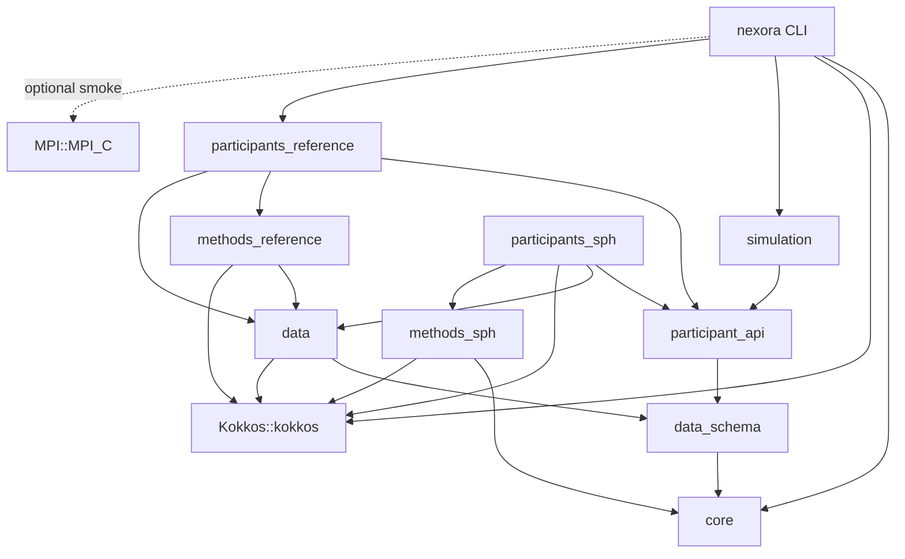
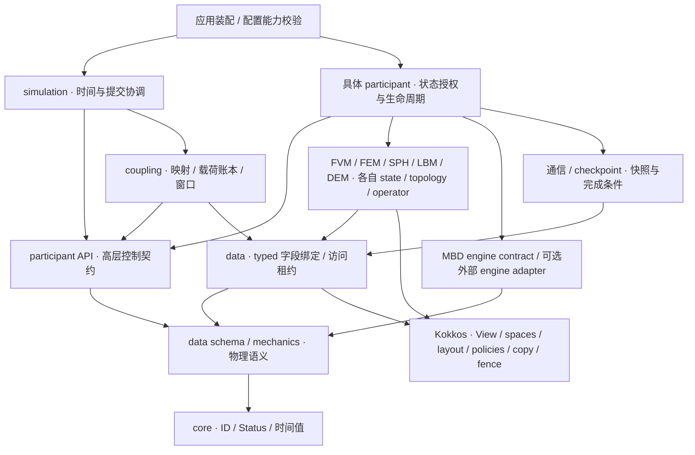
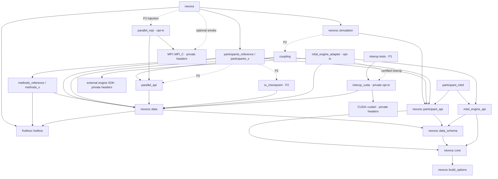

# Nexora 当前架构入口

修订时间 `2026-11-20T19:20:01+08:00`。**这是唯一有效的架构入口。Kokkos Serial CPU 已实现参考状态生命周期、P1-04 字段访问与本地传输、P1-07 SPH 代表性切片，以及三维 WCSPH 的密度、压力、Velocity Verlet、恒定重力与 Adami 固定壁。完整 Phase 1 仍开放。**

## 1. 决策与文档效力

Nexora 自有数值计算和存储统一使用 Kokkos，包括默认 CPU、可选 CUDA 及后续经实机验收的 HIP。Kokkos 是必需依赖，不存在绕过它的 native CPU/CUDA/HIP 通用实现、隐式 fallback、可选 Kokkos provider、通用 kernel DSL、编译器或自研 portability runtime。允许同一方法选择不同 Kokkos policy、布局和调优参数，数学公式、物理约定及容差仍须独立审批。

有效设计按本入口分工，发生矛盾时修正文档，不能用历史提案覆盖新决策：

| 文档 | 唯一负责的内容 |
|---|---|
| [ADR-003](../adr/ADR-003-kokkos-only-foundation.md) | 已确定的单一路线及替代关系；实现授权边界 |
| [Core 与数值数据结构](core-data-structures.md) | core 的值契约、Kokkos 原生数值接口及迁移边界 |
| [Kokkos 数据与执行设计](kokkos-design.md) | 关键 C++20 声明、字段权限、状态、同步、通信和关闭契约 |
| [Phase 1 评审与验收](phase-1-design-review.md) | 可执行任务、前置依赖、CPU/CUDA 与多方法代表性验收、实现审批事项 |
| [源码迁移与路线图](migration-roadmap.md) | 源码事实、新旧类型和 target 处置、归档 §27/§30 与 M/I 路线重映射 |
| [后续机械与集成任务](follow-on-task-plan.md) | 历史 MBD/INT 每项处置及候选前置；未立项项需另行设计和批准 |
| [Checkpoint 与重启](checkpoint-restart.md) | R0 的同配置范围、兼容检查/拒绝/验收；R1–R3 延期边界 |
| [构建与依赖政策](build-and-validation.md) | 版本锁定、工具链、离线供给、安装消费与配置能力 |
| [Serial CPU 基础设施验收](serial-foundation-acceptance.md) | 任务 1–7 的本地复跑、结构夹具计量、交付基线与能力边界 |

先前设计文档的文件清单与一致性检查见[文档审查记录](documentation-audit.md)，该记录不新增架构规范；实际实施与验证见 [CPU 基础切片](kokkos-cpu-slice-validation.md)、[参考状态生命周期](reference-lifecycle-validation.md)、[CPU 字段绑定](field-binding-validation.md)和[外部内存与本地传输](external-transport-validation.md)。

本次提交前的审阅、本地依赖重建及 float/double Debug/Release 复验见[字段迁移复查](field-migration-review.md)。

[ADR-001](../adr/ADR-001-module-boundaries.md)、[ADR-002](../adr/ADR-002-language-and-backend-baseline.md) 已被替代，只解释 bootstrap 源码。[归档 v1.2](../archive/CFDX_Multimethod_HPC_Architecture_Plan_v1.2_NVIDIA_Integration.md) 全篇为历史材料，其中的目录树、配置、代码、阶段和验收不是当前要求。历史中的物理问题可作为调研线索，须经现行计划重新采纳。Nexora 自有代码与文档采用 [BSD 3-Clause License](../../LICENSE)。复用第三方或 legacy 材料前，按 [ADR-014](../adr/ADR-014-license-and-provenance.md) 审查来源及授权。

## 2. 当前实现（源码事实）

首个切片要求本地 exact Kokkos 5.2.2 Serial-only、C++20 与 CMake 3.25.2+。`data → Kokkos::kokkos` 公开传递依赖；typed View 测试和只链接 `nexora::data` 的独立安装消费者执行 Kokkos 路径。CLI 报告 Kokkos 构建元数据。早期检查见 [CPU 切片验证](kokkos-cpu-slice-validation.md)。旧 `ArrayView`、`Vec`、`Tensor`、`FieldView`、`KernelView` 和 exec 层及其导出已移除；core 保留领域值契约，数值使用 Kokkos 原生类型。`nexora::real` 默认 `float`，可由构建选项 `NEXORA_ENABLE_DOUBLE_PRECISION=ON` 切换为 `double`，并由安装配置固定；现有 reference 数值字段、参数、算子和本地传输均随 real 精度选择，字段描述符默认 dtype 与之匹配；时间仍为 double。接口与迁移说明见 [core 数据结构](core-data-structures.md)，此前旧层切换的 Serial Debug/Release 测试和安装消费结果见[切换验证](core-data-structures-validation.md)；当前字段/算子的 float/double 数值证据见[数值迁移验证](real-numerics-validation.md)。

步骤 2 新增内部 `nexora_methods_reference` 和 `nexora_participants_reference`。方法持有稳定 ID、typed `x/q` Views、accepted 时间与版本；每次试算新分配独立数组，成功提交才发布，只读 managed 快照持续保活旧版本。参考参与者复用现有 `ParticipantIF` 和 `Simulation`，已验证主动恢复、数值失败、合法重试及重放。共享 `TimeInterval` 原样移至 `core/Time.hpp`，旧 participant 头仍兼容包含。内部 reference 保持内部构建，详细生命周期见[早期验证记录](reference-lifecycle-validation.md)。当前参与者用 lease 读取 accepted 并写入独立 trial。算子完成后可用本地 `TransportView` 发送或替换指定试算字段，接收失败禁止提交。发送快照持有独立打包缓冲，源读 lease 在打包完成后释放。预提交建立下一版只读授权，提交才发布新 accepted。旧快照持续持有其读 lease。见 [reference 窗口集成验证](reference-window-validation.md)。

`nexora::data_schema` 导出纯字段语义、registry 和 `FieldStamp`，`participant_api` 经由它依赖 core。`nexora::data` 提供 managed Kokkos View 的 typed 绑定与同步 Serial lease。私有签发器以整分配仲裁，检查字段形状与版本，允许多个读者或一个写者。可信适配器可导入持有真实 owner 的一维 HostSpace 外部数组；本地 `TransportView` 显式打包只读载荷，源 lease 可在打包完成后释放，也可保留至消费者完成。本地接收在写入前验证版本、字段形状和稳定 ID 集合，再按 ID 解包到持有写 lease 的 trial 或 ghost 区域。设备异步交接和通用实体重排仍是后续任务。见 [外部内存与本地传输](external-transport-validation.md)及 [CPU 本地接收验证](local-receive-validation.md)。

`data` 内部以只读 Kokkos Views 保存稳定实体顺序、双向排列与独立行列顺序的 CSR 邻接。本地接收复用实体 ID 双射检查。见 [实体与拓扑验证](entity-topology-validation.md)。

私有 reference participant 目标包含专用 `StructureState`，以候选 bank 一次发布实体顺序、主字段、被动历史和 CSR。Reference 试算、快照和本地收发用整组 allocation 授权，数值工作由已选的 Serial 实例执行。见 [状态重排与整组授权](structure-execution-validation.md)。

Reference 的同步窗口同时推进主状态、replay history 和控制序列，按试算 stamp 检查诊断缓存。旧快照与独立 packed 消费者保留各自的预算记录，最后一个持有者完成时回收额度。见 [进程内恢复与资源预算](reference-resource-validation.md)。

P1-07 的 Serial 验证夹具用既有 Simulation 窗口运行固定 CSR 的一维 M₄ 密度与 owned 归约。逐行输出与普通 double 归约共享一次遍历。夹具 participant 负责稳定 ID、字段授权、行列重排和结果发布，跨窗口读者持有完整快照。私有目标 `nexora_sph_fixed_csr_fixture` 仅供一维测试及显式构建的 `nexora_sph_benchmark` 使用。[夹具源码](../../validation/sph/fixed_csr/) · [SPH Serial 验证](../../validation/sph/serial.md)

给定三维粒子状态可直接建立或更新 `CellGrid`，以只读 `NeighborView3D` 调用密度、压力或连续性算子。格网和版本比较按实际分配前预留受控额度。四组静水初态直接运行密度和固定壁压力算子。[格索引](../../validation/sph/cell-begin-serial.md) · [重构验收](../../validation/sph/sph-3d-refactor-serial.md)

私有 `sph::WcsphParticipant3D` 拥有输入槽几何、owned 行表及显式初始化的四个流体字段，负责窗口授权、提交和恢复。`WcsphStep3D` 持有零至多组固定壁或规定轨迹壁、派生格网缓存和六个积分缓冲。统一固定平滑长度 h 由 `WcsphVerletParameters::smoothing_length` 给定，格宽及支持半径为 2h。两端连续性经稳定 ID 对齐后作梯形校正，压力用 Tait EOS 和 Adami 外推计算，Velocity Verlet 在两次半踢使用压力加速度和重力。参与者从候选终速求声学 CFL，与各运动壁在本地相位认证的采样上限取最小值，随几何、字段及轨迹相位提交。同步逐行及逐壁读取使用已提交几何和行表，驱逐格网后仍可读。回滚保留已提交的粒子值、行序、版本、时钟和步长约束。[重构验收](../../validation/sph/sph-3d-refactor-serial.md) · [固定壁历史对照](../../validation/sph/hydrostatic-continuity-repair.md#solver-cleanup-trajectory)

CLI 的 `validate`、`plan` 和 `run` 共用版本化 Reference case 预检。`run` 装配现有 `Simulation` 与内部 Reference participant，并发布可核对的 accepted 数值摘要。 [case 格式与验证](reference-case.md)

任何 `NEXORA_GPU_BACKEND` 值均被拒绝，旧 native CUDA 源文件休眠。OpenMP、CUDA/HIP 尚未实现。完整 SPH 求解器仍待验收，FVM/FEM/LBM/DEM/MBD 求解器、MPI halo 和持久 checkpoint 尚未实现。CI 先供应锁定的 Kokkos，再用本地安装验证 Serial。可选 MPI smoke 有独立配置。已运行的平台、配置和禁网记录见 [Serial CI 验证](serial-ci-validation.md)。

当前生产目标的直接依赖如下。

实际源文件与 target 的完整证据见[源码盘点](migration-roadmap.md#source-inventory)。`tools/check_dependencies.py` 检查当前边界，其通过不证明下述目标图全部实现。

## 3. 批准后模块图

箭头从使用者指向依赖。除上一节列明的实现外，新边和新模块仍是设计目标；后续模块按实际使用者引入，避免预建空框架。

`exec` 取消，不重命名成另一套 execution abstraction。Kokkos 初始化由应用拥有的 `Kokkos::ScopeGuard` 管理；具体参与者持有类型化 execution space 实例。外部 stream 的特殊桥接只存在于私有 interop 文件。`data` 的薄层只增加字段语义、授权和保活，不复制 View 索引、布局、allocation、parallel_for、copy 或 fence API。控制层既不模板化为某种 GPU，也不持有 CUDA/HIP/MPI 原生类型。

## 4. 批准后 CMake target 依赖图

图是直接依赖允许集合，具体 target 只链接实际用到的项。P1 导出 `nexora::core`、`nexora::data_schema`、`nexora::data`、`nexora::participant_api`、`nexora::simulation`；`build_options` 是导出链所需 compile policy，不是功能 API。方法、具体参与者、interop 和后续集成先为内部 `nexora_*` target，公开安装须另验消费与版本契约。图上无前缀的内部节点对应同名 `nexora_` target。

- `data_schema` 位于 `include/nexora/data/` 的元数据子集，`FieldDescriptor`/`FieldRegistry` 不再依赖执行或 memory-space 枚举。`data` 的 typed storage 头公开依赖 `Kokkos::kokkos`，这是有意的 API/ABI 变化。
- 模板化方法直接使用 Kokkos；相同 source 显式实例化已构建的 CPU/CUDA 类型，不设 `methods_x_cpu` / `methods_x_cuda` 两套实现库。内部实例化 object 单元可按编译器需要组织，不能成为第二实现路线。
- geometry/topology/numerics 按首次真实使用再提取共享 target，只依赖 `core/data` 和实际数值依赖；不得反向依赖 methods/participant/simulation。physics 保存物理模型与参数，不持有设备 runtime。
- P2 的 concrete participant 按用途链接 `parallel_api`、`io_checkpoint`；应用注入 `parallel_mpi`。外部 SDK 和 MPI 原生头保持私有；静态库的传递链接需求仍必须由安装配置解析，不能用 `PRIVATE` 掩盖真实依赖。
- 图中 CLI 的 optional smoke 边是私有诊断边 `nexora → MPI::MPI_C`；该探针保留，但不是 parallel_mpi 数值支持证据。旧 CUDA native 探针改用 Kokkos，CLI 不保留直接 CUDA runtime 链接；原生 stream 测试放在私有 interop target。
- Kokkos CUDA 构建自身的公开编译/链接要求可经 `Kokkos::kokkos` 传递。禁止的是 Nexora 公共契约暴露原生 `cudaStream_t`/`hipStream_t`/`MPI_Comm`，不是假装设备工具链没有依赖。
- 完整迁移时同时核对 target 边、header 所属子集、可选节点、源文件归属和安装导出；反例必须失败。当前已更新 schema 与 typed data 的 CMake 直接边、头边界检查和安装包测试。[Serial CI 验证](serial-ci-validation.md)涵盖本地 Kokkos 供应、依赖图及搬迁消费。

## 5. 交付与支持口径

单一基础设施不要求五种方法使用同一算法、rank 或布局。共同契约是物理语义、稳定 ID、版本、访问权、事务和可观测通信完成；具体离散结构见[方法数据边界](kokkos-design.md#method-state)。经批准的完整外部引擎可保有内部运行时，Warp 只可作为这种引擎的内部依赖；不得通过外部应用、服务或进程包装重建 Nexora 通用算子 provider 或第二套计算基础设施。

后续任务必须使用现行文件中的定义与精确任务 ID；归档链接只用于核对出处，不提供实施授权或补充未迁入的规范。P2 持久恢复仅采纳 [R0 同配置重启](checkpoint-restart.md#restart-levels)；尚未立项的 M/I 及高级能力需另行设计和批准。

Phase 1 直接建立 Kokkos 基础及 SPH/FVM 代表性结构切片；完整方法、分布式数值及持久恢复按后续阶段关闭。CPU/CUDA 实机数值、生命周期和端到端性能都通过后才可宣称完整 P1。HIP 必须另有 AMD 实机证据。构建成功、诊断通过和运行验收是三个不同状态。

首个 CUDA 构建按 [nvcc_wrapper/CXX 与安装消费契约](build-and-validation.md#cuda-build-contract)：锁定 Kokkos 的 CUDA+Serial、C++20、单一 GPU 架构，匹配的 wrapper/工具链用于 Nexora 和下游数值消费者；删除旧 `NEXORA_GPU_BACKEND`，从已验证的安装包推导构建组合。尚无 runner 配置或构建执行证据。

本次授权涵盖旧 core 数值容器及 exec 层的提前清理；其余未授权范围按 [Phase 1 的具体变更包](phase-1-design-review.md#approval)执行。Kokkos 单一路线本身不再列为待决项。
