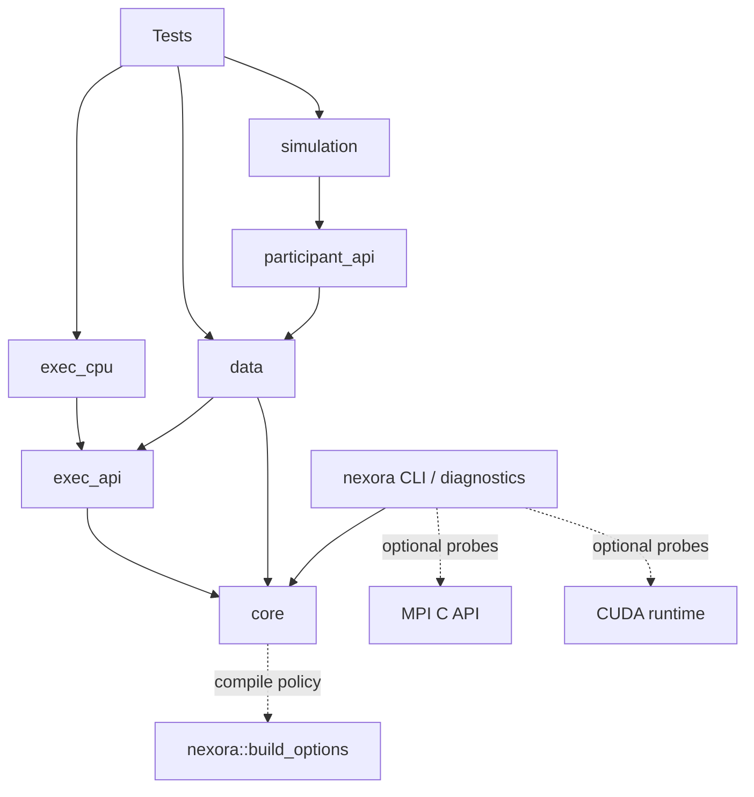

# Architecture and initialization baseline

Nexora uses several CMake library targets rather than one monolithic library. Dependencies point from a consumer to the contract or service it uses. Optional platform probes and command-line tools remain at the leaf of the graph.

## Bootstrap target graph

The links shown are the intended direct edges; transitive availability is not a reason to add a dependency. The dependency policy is checked against CMake's generated target graph and against Nexora header includes by `tools/check_dependencies.py`.

| Target | Allowed direct dependencies | Status |
|---|---|---|
| `nexora::core` | `nexora::build_options` | bootstrap foundation |
| `nexora::exec_api` | `nexora::core` | execution contract |
| `nexora::exec_cpu` | `nexora::exec_api` | CPU implementation |
| `nexora::data` | `nexora::core`, `nexora::exec_api` | data contracts |
| `nexora::participant_api` | `nexora::data` (plus core/execution contracts where required) | participant boundary |
| `nexora::simulation` | `nexora::participant_api` | orchestration boundary |
| `nexora` | `nexora::core`; optional `CUDA::cudart` and/or `MPI::MPI_C` for diagnostics | CLI and diagnostics |
| test targets | the specific library under test | test leaves |

At bootstrap, `nexora inspect-build` reports `cpu_execution`, `cuda_smoke`, and `mpi_smoke` as build capabilities. MPI and CUDA are CLI diagnostic probes, not general-purpose `parallel_mpi` or `exec_cuda` libraries. `smoke-mpi` uses the MPI C API; `smoke-cuda` exercises only the minimal device path. A successful probe does not imply that a simulation backend is implemented or certified. `nexora::build_options` is CMake compile-policy plumbing; downstream consumers should link functional library targets instead.

## Status and next baseline work

Initialization establishes module boundaries, build presets, metadata reporting, and CPU/MPI/CUDA smoke paths. For each solver slice, choose small representative cases, record inputs, compiler, hardware and reference outputs, and capture numerical and performance baselines. If an external component is proposed, document its provenance and reuse rights before importing it.

## Build support matrix

| Configuration | Configure/build | Runtime validation | Current claim |
|---|---|---|---|
| Linux, GCC, CPU | required | CPU CTest | primary CI baseline |
| Linux, Clang, CPU | required | CPU CTest | primary CI baseline |
| Windows, MSVC, CPU | required in CI | CPU CTest | CPU portability baseline |
| macOS, AppleClang, arm64 | CPU Debug/Release and optional MPI built locally | CPU CTest, relocated package, and two MPI ranks | bootstrap baseline |
| Linux, MPI C API | optional preset | exactly two ranks via `nexora smoke-mpi` | smoke path only |
| CUDA, explicit architecture | opt-in | `nexora smoke-cuda` on CUDA hardware | toolchain/device-specific; no macOS certification |

No other compiler, architecture, distributed scale, or numerical workload is implied to be supported by these checks.
