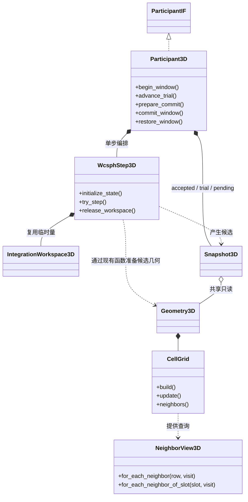
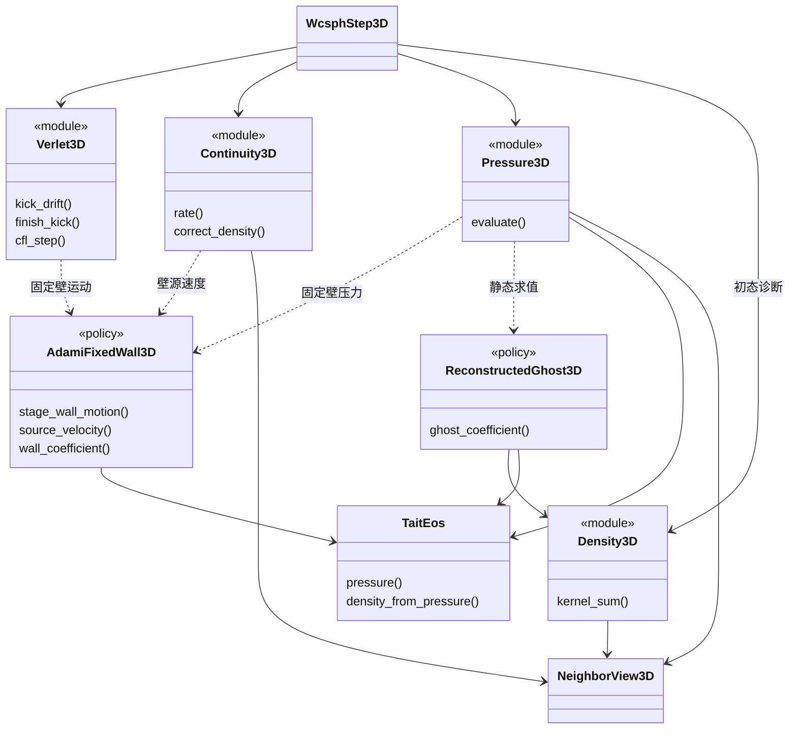

# 三维 WCSPH 求解器重构计划

状态为设计提案。基线是 `ce54294`，即一维固定 CSR 已迁至验证侧、三维外供终点窗口已移除的版本。目标是让修改壁面模型、邻域查询或窗口发布规则时，各自有明确的代码入口和独立的数值对照。当前执行范围为单进程 Kokkos Serial。设计遵循[架构入口](overview.md)、[Kokkos 数据与执行契约](kokkos-design.md)及[现行 SPH 路线](migration-roadmap.md#sph-cell-begin)。

## 1. 从三个具体改动划分职责

| 要做的改动 | 当前需要理解的代码 | 重构后的改动边界 |
|---|---|---|
| 调整固定壁的物理规则 | 参与者组合流体与壁源，压力算子用可空的重力指针选择 Adami，连续性单独把 ghost 速度取零，Verlet 另用布尔值固定壁位置。 | 输入装配负责标出壁源。一个固定壁策略统一说明壁的运动约束、连续性源速度和压力源系数。对称压力力核只消费已完成的系数。 |
| 调整邻域遍历或分格 | 密度、压力、连续性直接接收整个 `CellGrid`。其中普通 ghost 密度重建和 Adami 外推都需要以源粒子为中心查询。 | `CellGrid` 负责建格、复用和排列。数值算子只取得查询视图。可以单独用稳定 ID、格边界和独立全扫描验证查询。 |
| 调整时间步或状态发布 | `Participant3D::compute` 同时处理初态和步末，`integrate` 管理六个临时 View、数值步序及候选字段。快照还涉及旧读者和预算。 | `WcsphStep3D` 构造初态或试算候选。`Participant3D` 独占窗口状态机与发布权。算法失败与预提交失败都走既有恢复路径。 |

源码入口见[参与者](../../src/participants/sph/Participant3D.cpp)、[压力求值](../../src/methods/sph/Pressure3D.cpp)、[连续性与 Verlet](../../src/methods/sph/Verlet3D.cpp)和[格索引](../../src/methods/sph/neighbors/CellGrid.hpp)。

## 2. 目标类图

第一张图描述所有权和调用方向。实心菱形表示成员所有权，空心菱形表示共享只读几何，虚线箭头表示调用或产生结果。每份快照继续持有自己的字段读授权。图中的新类型都是 SPH 内部类型。

第二张图描述数值职责。标记为 `module` 的节点表示一组现有或拆分后的自由函数。标记为 `policy` 的节点表示具体值类型。实线对应数值操作的依赖，虚线对应选用的策略。纯流体、固定壁和普通 ghost 的适用入口见下表。

### 模式与具体接口

- **窗口用既有适配器，时间步用组合。** `Participant3D` 继续实现 `ParticipantIF`，持有执行实例、预算、时间窗、attempt、三份状态槽，向 `Simulation` 报告结果。`WcsphStep3D` 放在 `src/participants/sph/`，因为它需经 `prepare_geometry_3d` 预留预算，并在字段读写授权下构造候选。它持有一份算例配置与积分工作区，每次调用借用同一个执行实例和预算。数值自由函数仍在 `src/methods/sph/`，只接收执行实例、所需的参数和 typed Views。这样 `nexora_methods_sph` 继续只依赖 core 与 Kokkos。
- **边界用具体策略。** 主机端根据构造时的算例选择纯流体或 Adami 固定壁。在初始化及每次试算的外层用 tag/重载选择具体调用路径，粒子循环内执行可内联的策略操作。零重力是有效的固定壁工况，边界选择应独立于重力取值。普通 ghost 重构通过压力算子的静态入口选用，其类型仅提供源系数计算，无法作为积分策略传入。
- **邻域用只读查询视图。** `CellGrid::neighbors()` 返回按值传递的 `NeighborView3D`，只打包现有只读 View 句柄及必要的格参数。查询提供 owned 行到排序槽的映射、该阶段的粒子字段、`h`、支持半径和两种遍历入口。回调得到排序源槽与物理距离平方。索引的构造、资源准入、双向输入排列及版本仍属于 `CellGrid/Geometry3D` 路径。快照或候选几何在查询期间保活，查询对象仅在当前阶段使用。原有格网查询入口可转调同一份遍历实现。
- **EOS 用值对象，算子保留函数形式。** `TaitEos` 由已验证参数构成，供流体正算与壁源反算共享。既有压力算子负责输入/别名校验、工作区和对称力归约。`Continuity3D` 接管连续性右端及梯形校正。`Verlet3D` 保留运动学和声学 CFL。单步的调用顺序在 `WcsphStep3D` 中直接可读。上述接口均在现有两个私有 target 中完成。

| 输入与源角色 | 进入哪个入口 | 边界规则与输出 |
|---|---|---|
| 全 owned 流体，显式初始密度 | `initialize_state`、`try_step` | 全部源均为流体，直接计算流体压力、速度与密度。 |
| 全 owned 流体与显式固定壁集 | 同一积分入口，选用 `AdamiFixedWall3D` | 壁坐标固定、壁速度为零。对有非零力贡献的壁源，按邻近流体压力和重力水头外推，再反算壁密度。发布字段只包含流体行。 |
| 静态构型含普通 ghost | 方法层密度和压力入口，选用 `ReconstructedGhost3D` | 对所需 ghost 在完整本地支撑域重建核密度、求 Tait 压力，以其系数参与流体受力。普通 ghost 的数据来源、运动和通信均在此积分契约之外。 |
| 未给显式初始密度 | `initialize_state` 的诊断路径 | 可读取核求和初态快照。`begin_window` 拒绝推进。显式传入长度为零的密度仍能表示合法空流体。 |

**候选的交付接口。** 建议让 `initialize_state(exec, budget, initial, stamp)` 和 `try_step(exec, budget, accepted, trial_stamp, dt)` 各返回 `Result<Snapshot3D>`。这里的 `initial` 表示现有流体输入、速度以及可选的显式密度和壁源。步进器只在调用期间借用输入，候选复用既有的私有快照构造与字段签发代码。构造时记录“可推进”或“仅诊断”及壁源模式，初始化完成后释放调用方的输入句柄。窗口开启时仍由参与者检查可推进性。这样可以去掉当前 `compute` 依赖 `dt == 0`、空指针和成员状态来辨别数据来源的约定。

**资源寿命。** 查询视图随当前几何一起使用。策略仅接收当阶段所需的粒子字段、重力或 EOS 值。Adami 计算壁压时取得以壁槽为中心的查询和流体行映射，普通 ghost 重构取得以 ghost 槽为中心的查询。固定壁组合输入所用的临时内存仍在初始化期间经参与者预算准入。保持现有 field bank 的共享所有权，使预提交能准确发现外部 trial 读者，避免内部持有的额外副本触发多余的深拷贝。

**扩展示例。** 将来若立项支持运动壁，新策略需同时定义壁在漂移阶段的位置、两次连续性求和使用的壁速度及压力外推所需的运动量。按窗口推进的壁历史应进入候选快照及回滚测试。若立项第二种邻域索引，只需先证明它能提供两种中心查询、相同的粒子映射以及获准的数值顺序，再在方法边界引入第二实现。上述两项均为检验接口划分的例子，本轮实施候选只有固定壁与现有格索引。

## 3. 一个试算步的数据交接

令 `N` 为源槽总数（含固定壁），`Nf` 为 owned 流体行数。旧、新格的排序槽可不同。快照中密度、压力、压力加速度、速度按流体行保存。位置、质量、ID 与 ghost 标记按排序槽保存。

| 顺序 | 负责模块 | 输入 → 输出与约束 |
|---|---|---|
| 1 | `Participant3D` | 按 accepted 的 CFL、时间和版本校验调用方提供的步长，打开新的 attempt。只读借用当前 accepted。 |
| 2 | 步进器 → Verlet / 边界策略 | 第一次半踢使用旧压力加速度与重力。用经 `real` 舍入的半步速度漂移。在旧排序槽写候选位置与半步速度，同时处理固定壁。 |
| 3 | 步进器 → `prepare_geometry_3d` | 输入槽对应旧排序槽。根据格域、成员、归属及次序选择 reuse、remap 或 rebuild。每条路径都独立打包新位置。完成既有同步后，才允许复写漂移位置缓冲。邻居判断使用本阶段坐标。 |
| 4 | 步进器 → 连续性 | 用旧格和旧速度求 `Rₙ`。用新格和全步预测速度 `v* = vₙ + Δt(aₚ,ₙ + g)` 求 `R*`。新流体行对应的旧行取 `old_row[new.sorted_to_input[new.owned_slots[row]]]`。按现有 FMA 与窄化顺序计算 `ρ′ = ρₙ + Δt(Rₙ + R*)/2`，校验转为 `real` 后仍为正。 |
| 5 | 步进器 → 压力 / EOS / 边界策略 | 在新几何上用校正密度求流体 Tait 表压，填充所需源的 `p/ρ²`，再做对称压力力归约。只有 `0 < d² < (2h)²` 的相互作用需要源压力系数。负表压、近静态小扰动，以及 Adami 壁压先窄化、反算壁密度再窄化的顺序沿用基线。 |
| 6 | 步进器 → Verlet | 第二次半踢使用新压力加速度与同一重力。根据最终 owned 速度计算候选声学 CFL。归还包含几何、四个字段与 CFL 的完整试算候选。 |
| 7 | `Participant3D` / `Simulation` | 核验到达终点后预提交。无外部 trial 读者时释放原读授权后重绑。有读者时独立复制四字段，保留其旧 stamp 和几何。提交才发布 pending 并推进时钟。试算或预提交失败时恢复旧 accepted，调用方可重新给步长。 |

**存储与同步。** 六个积分 View 继续由私有 `IntegrationWorkspace3D` 持有。半步速度和阶段缓冲各为 `real[N,3]`，旧槽到旧流体行的映射为 `LocalIndex[N]`，两端密度率各为 `double[Nf]`，校正密度为 `real[Nf]`。候选最终字段独立于这些缓冲。查询视图、物理策略和 EOS 都不持有字段写授权或快照记录。

**预算与失败。** 工作区以现有票据计量。试算期间局部接管，成功再放回。输出字段或压力 scratch 预留失败时，释放已结束的阶段速度、行映射及两组速率，再重试该次预留。预提交需要为持有的 trial 复制字段而预算不足时，参与者可调用步进器回收整个缓存，再重试预留。保留原有 `Status`、失败阶段和恢复行为。每个 stage 复用参与者的 Kokkos 执行实例，沿用打包后复写和对外发布所需的同步点。跨窗口只读句柄仍计入预算，进程内恢复以 accepted 为依据。持久 checkpoint、MPI 通信以及设备执行各有独立验收范围。[工作区契约](../../validation/sph/wcsph-integration-workspace-serial.md) · [状态与预算](../../validation/sph/cell-begin-serial.md)

## 4. 迁移步骤与验收

以下步骤各自可编译、可回退。M1 与 M2 可从同一基线并行。修改压力调用点时先合入 M1，再由 M2 接入查询视图。M3 用两项完成后的统一入口。日常验证先跑受影响用例及 float Debug、double Release 两个配置。

| 阶段 | 修改范围与交付 | 完成判据 |
|---|---|---|
| M0 固定对照 | 从 `ce54294` 确定编译器、精度、Kokkos、构建选项与算例。归档同配置 6³ 的四份 CSV、关键步的分配/复制/fence 计数、预算下界。沿用已有独立 CSR/全扫描及力学参考。 | 基线可复跑。一维 7 项、三维 56 项的现有清单可追溯。报告区分常规 CTest、安装消费和轨迹。 |
| M1 提取 EOS 与边界 | 在 `src/methods/sph/` 提取 Tait 正反算、固定壁和静态 ghost 源处理。压力 scratch 字节计算与相应分支共用同一种模式。接通压力以及 Verlet 漂移、连续性源速度的调用方后，删除内部可空重力指针和壁布尔开关。 | 近参考态双侧、负表压与对称合力、只通过普通 ghost 改变流体受力、湿壁反算失败与缩步恢复、纯重力自由落体均通过。零 owned 行维持零压力 scratch。 |
| M2 分开格索引与查询 | 在 `src/methods/sph/neighbors/` 提取只读查询接口，现有排序、格偏移、版本与预算仍由原路径维护。密度、压力、连续性只使用需要的字段与查询。复用原有分格、截断及遍历代码。 | 对 owned 中心及源中心逐 ID 对照独立全扫描。校验格数、偏移、邻居 ID、重合异 ID、截断内外、输入置换、复用与重建、旧几何保活。若缺少直接的壁/ghost 中心查询断言，补一个构型。 |
| M3 分离连续性与单步编排 | 先从 `Verlet3D` 拆出连续性求和及从 `Participant3D` 拆出 ID 对齐的密度校正。再将 `compute/integrate` 的数值编排和工作区移入 `src/participants/sph/WcsphStep3D.*`。初始化与试算采用独立入口，共享字段构造逻辑。 | 用不同质量、不同密度的流体跨格检查 ID，校核两端密度率、轨迹、声学 CFL 和二阶密度误差。覆盖省略初始密度、显式空密度及仅有墙源。 |
| M4 验证事务及构建边界 | 参与者继续控制 stamp、预算、预提交、提交和恢复。更新两个私有目标的源清单、依赖检查器、安装包私有头检查和受影响文档。如测试名变化，同步 Serial 验证器的必跑清单。 | 持有与未持有 trial、外来/过期 stamp、非初始步回滚、小步重试、记录预算和最低字节预算均通过。关闭测试时独立构建三维目标，一维验证夹具仍只供回归和显式 benchmark 使用。 |

**最终对照与回退。** 完成 Debug/Release × float/double 四组 Serial 的 SPH 回归、全仓 CTest、依赖检查、Reference Decimal oracle 和搬迁安装消费。Decimal oracle 验证公共构建链。SPH 数学正确性由各 SPH 独立参考与轨迹验证。Release double 的 6³ 水箱对照基线的 `steps/frames/profiles/crossings` 四份 CSV，要求同配置逐字节一致。另核对同尺寸热步的六缓冲复用、受控峰值和最低可执行预算。跟踪额外分配、深拷贝、fence 以及配对计时。出现差异时先按稳定 ID 找到首个偏差的几何、密度率、壁压或速度，再单独回退引入差异的阶段。预算拒绝及试算失败采用真实算例触发。[Serial 清理基线](../../validation/sph/serial.md) · [6³ 轨迹对照](../../validation/sph/hydrostatic-continuity-repair.md#solver-cleanup-trajectory) · [项目验证流程](../../CONTRIBUTING.md)
