# 三维 WCSPH 求解器重构计划

## 现行单求解器契约

应用调用 `Simulation::initialize()`、`run(steps)`（或 `run(dt, count)`）和 `finalize()`。`run` 依次执行给定步长，首个失败的 `Status` 立即结束运行。每个成功步发布一次，随后时钟与已接受步数各更新一次。直接调用 `ParticipantIF::step(interval)` 与通过 `Simulation` 走相同的准入路径。[Simulation](../../include/nexora/simulation/Simulation.hpp) · [ParticipantIF](../../include/nexora/participant/ParticipantIF.hpp)

- **本步准入。** 声学 CFL 为 `C h / (c₀ + max |v|)`，空流体取 `C h / c₀`。初速导入和每步终速写入时同步归约存储精度下的最大速度平方。声学上限同各运动组的有效采样上限取最小值，随状态提交。`step` 用已提交上限对请求的正 `dt` 严格检查一次。可直接查询 `time_constraint()`。[步长校验](../../include/nexora/participant/TimeConstraint.hpp) · [声学归约](../../src/methods/sph/Verlet3D.cpp)
- **运动壁的位姿归属。** 所有运动壁通过 `PrescribedWallTrajectory3D::motion` 采样。调用方提供平移、转角、参考中心、固定轴及物理导数，SPH 据此变换整组参考粒子。欧拉算例由调用方用步初线速度和角速度推进候选位姿。只读几何可省略导数，流体连续性和 Adami 壁压分别使用对应时刻的壁速度和加速度。未来 MBD 可经同一入口提供运动，双向载荷耦合与联合恢复另行验收。[输入契约](../../src/methods/sph/PrescribedMovingWall3D.hpp) · [流程与验证](../../validation/sph/velocity-driven-wall-serial.md)
- **应用表达式装配。** 私有 `apps/prescribed_motion/PrescribedMotion` 持有运动表达式与调用方状态。`MotionConfig` 的四项表达式对应 x/y/z 平移和固定轴转角（`pose`），或其速率（`velocity`）；后者另提供初始位姿。Lepton 仅用于主机标量解析、求值和符号微分。表达式变量 `t` 是未取模的物理时间，初始化物理时刻由 `initial_time` 指定；物理时钟与 SPH 组内历时用同一请求时长独立推进。`trajectory(sample_step_limit)` 返回同一 `motion` 供初始化和端点采样；每次试算前调用方先 `prepare(dt)`，成功后 `commit()`，失败则 `discard()`。运动所有者须比所有借用轨迹活得更久。位姿函数需二阶可微，速率函数需一阶可微，符号微分不证明全域光滑；调用方按轨迹认证约束显式设置 `time_resolution`，默认零。此装配只有内部 C++ 入口，尚无 CLI/场景文件绑定或安装导出。[运动验证](../../validation/sph/velocity-driven-wall-serial.md)
- **运动壁采样。** 每组需给出覆盖其定义域的有限正常量 `sample_step_limit`，同时受剩余可表示历时约束。固定壁不引入采样上限。每次尝试经 `motion` 采样端点位姿与物理导数，壁槽速度供连续性使用，加速度供实际参与 Adami 外推的壁使用。采样应可重放，不能按回调次数累计推进外部状态。[时间域与轨迹采样](../../src/methods/sph/PrescribedMovingWall3D.cpp)
- **组内跨度与终点。** 步进器从已认证起点按请求时长计算各组的 `τ₁ = τ₀ + dt`。在取样前检查新端点的定义域、实际跨度 `δ = τ₁ − τ₀ > 0`、`δ <= 该组起点上限` 以及 `abs(δ − dt) <= time_resolution`。周期轨迹用起始相位加组内历时的 `double` 和对周期取模。旋转轴按组归一化。有限域的总历时取 `last_phase - initial_phase`，每步用总历时减去已用历时计算剩余量。到达右端时允许提交当前状态，下一步上限为零。[时间域与采样实现](../../src/methods/sph/PrescribedMovingWall3D.cpp)
- **物理阶段。** 使用已接受的速度、密度变化率、压力加速度与重力推进流体，更新位置和邻域，并按新行序写入速度、密度。格网在坐标转为整数前检查范围，速度归约检查平方和为有限值，密度写入检查有限正值。步末的速度、密度、壁运动学与几何处于同一时刻，用于求新的连续性右端、Tait 压力及 Adami 压力加速度。[数值步](../../src/participants/sph/WcsphStep3D.cpp)
- **提交与恢复。** 每次成功更新同时发布几何、行表、四个只读物理字段、连续性右端、上一步的速度、密度及相应导数、时间积分所需的行映射、轨迹相位与步长上限。历史共用原分配及其读权和额度，保留一个前序时间层。试算失败保留 SPH 原已接受状态；调用方保留已接受壁位姿及速率，丢弃候选运动，从同一起点按较小请求重建候选后在参与者入口重试。SPH 不恢复外部所有者的隐状态。`Simulation` 遇到失败后按既有契约进入 failed。释放工作区可驱逐格网，读回与续步仍使用已提交的行表和历史。当前支持同步单进程 Kokkos Serial；持久化检查点和分布式通信尚未实现。[参与者](../../src/participants/sph/WcsphParticipant3D.cpp) · [积分公式与验证](../../validation/sph/central-difference-serial.md)
- **几何与邻居验证。** 每步保持稳定 ID 和所有权。测试按 ID 核对粒子跨格时的新旧行、邻居和各时间层的密度变化率，并对照直接小步验证失败重试后的轨迹。[积分与邻居回归](../../tests/methods/sph/verlet_window_tests.cpp)

## 原 M0–M5 方案与验收背景（历史记录）

下面的第 1–4 节及附录 A 保留当时的设计、测量条件和验收步骤。其中的窗口、跨调用候选授权、失败后缩步重试、用户步长回调、终点必须有正余量、独立壁面采样、全粒子版本比较及步内观测回调等约定已由上文替代。

本设计提案最初提交于 `e8b01a1`。冻结的 6³ 轨迹和历史测试集取自 `ce54294`。M1/M2 的实施起点为 `d5bfb10` 加当前工作树中尚未提交的实现补丁，包含 [ParticipantIF](../../include/nexora/participant/ParticipantIF.hpp) 的 `Status` 窗口接口和数值窄化修订。可复算的补丁指纹和两个时期的测试清单见 [M0](#m0-固定对照)。本计划细化三维 WCSPH 重构，并为 IISPH 和显式 ISPH 保留独立参与者入口。现有单进程 Kokkos Serial 基线已验证流体与 Adami 固定壁。多壁组和指定轨迹运动壁是本次确认的设计，数值验收列于 M5。设计遵循[架构入口](overview.md)、[Kokkos 数据与执行契约](kokkos-design.md)及[现行 SPH 路线](migration-roadmap.md#sph-cell-begin)。

## 1. 从三个具体改动划分职责

| 要做的改动 | 当前需要理解的代码 | 重构后的改动边界 |
|---|---|---|
| 在同一水箱中使用固定侧壁与运动活塞 | 参与者组合流体与固定壁源，压力算子用可空的重力指针选择 Adami，连续性把壁源速度取零，Verlet 另用布尔值固定壁位置。 | 共享模块 `SphBoundary` 按壁粒子 ID 和所属组的轨迹相位给出位置、速度、加速度。步进器组装阶段几何，连续性读取壁速度，WCSPH 的 `AdamiWallPressure3D` 计算壁源系数，对称压力力核累加到流体行。 |
| 调整邻域遍历或分格 | `Geometry3D` 内含 `CellGrid`。密度、压力、连续性直接接收整个格网，普通 ghost 密度重建和 Adami 外推还需要以源粒子为中心查询。 | 参与者持有粒子几何，步进器缓存格网。格网从只读粒子字段建格或更新，三个数值模块通过当前阶段的查询视图遍历。 |
| 调整时间步或状态发布 | `Participant3D::compute` 同时处理初态和步末，`integrate` 管理六个临时 View、数值步序及候选字段。快照还涉及旧读者和预算。 | `WcsphStep3D` 完成初态计算或一个数值步。`WcsphParticipant3D` 负责窗口恢复、提交和结果读取。 |

源码入口见[参与者](../../src/participants/sph/Participant3D.cpp)、[压力求值](../../src/methods/sph/Pressure3D.cpp)、[连续性与 Verlet](../../src/methods/sph/Verlet3D.cpp)和[格索引](../../src/methods/sph/neighbors/CellGrid.hpp)。

**基线源码。** 现有 `Participant3D` 以 `accepted_ / trial_ / pending_` 三个 `Snapshot3D` 成员保存不同阶段的结果。`snapshot()`、`trial_stamp()` 和 `trial_snapshot()` 供三维测试和诊断使用。预提交遇到外部试算读者时复制四个字段，提交时再移动待发布对象。这些是本次计划移除的具体实现。[现有声明](../../src/participants/sph/Participant3D.hpp) · [现有发布与恢复](../../src/participants/sph/Participant3D.cpp)

基线的 `Participant3D` 同时提供有、无初始密度参数的构造入口。省略密度时，`compute` 核求和得到初态流体密度，`initialize` 可成功，随后 `begin_window` 拒绝推进。当前四组静水初态测试借此读取 `t=0` 的场值。目标设计将这些用例迁到方法层，并从参与者装配和步进器初始化入口移除省略密度的调用形式。[初始化分支](../../src/participants/sph/Participant3D.cpp) · [静水初态用例](../../tests/methods/sph/hydrostatic_initial_tests.cpp)

基线的 `ParticleFields3D` 定义在 `CellGrid.hpp` 中。`prepare_geometry_3d` 调用 `build/update` 并把格网和预算票据放入几何对象，`update_geometry_versions` 比较前后两份格网。实施时需要迁移这些调用点和直接读取 `geometry->grid` 的测试。[字段与格网](../../src/methods/sph/neighbors/CellGrid.hpp) · [几何装配](../../src/participants/sph/Geometry3D.cpp)

## 2. 目标类图

WCSPH、IISPH 和显式 ISPH 各自直接实现 `ParticipantIF`，各自定义压力离散、步长约束与窗口恢复内容。接入当前 `Simulation` 时须声明并实现回滚能力。图中 `WcsphParticipant3D` 对应基线的 `Participant3D`。`SphBoundary` 是三种算法可复用的壁运动学模块。`module` 表示数值自由函数组，`planned` 标出后续算法与新增运动壁类型。

```mermaid
classDiagram
    direction TB
    class Simulation {
        +finalize() Status
    }
    note for Simulation "回调结束后正常关闭<br/>参与者拒绝关闭时进入 failed，拒绝开窗，可再关闭清理"
    class ParticipantIF {
        <<interface>>
        +id()
        +capabilities()
        +ports()
        +time_constraint(accepted_time)
        +initialize(initial_time) Status
        +prepare()
        +begin_window(interval)
        +advance_trial(interval) Status
        +prepare_commit(interval) Status
        +commit_window(interval) Status
        +restore_window()
        +finalize() Status
    }
    class WcsphParticipant3D {
        +initialize(initial_time) Status
        +visit_committed_rows(visit) Status
        +read_committed_wall(id) Result~WallValue~
        +finalize() Status
        +resource_usage()
        +begin_window(interval)
        +advance_trial(interval) Status
        +prepare_commit(interval) Status
        +commit_window(interval) Status
        -bind_fields(candidate, trial_stamp, owned_rows, field_group)
        -maximum_step
        -committed_wall_phases_and_limits
        -reading
    }
    class IisphParticipant3D {
        <<planned>>
    }
    class ExplicitIsphParticipant3D {
        <<planned>>
    }
    class WcsphStep3D {
        +initialize_state(initial_time, fluid_fields, initial_velocity, initial_density, candidate) Status
        +try_step(interval, current, candidate, bind_fields) Status
        +release_workspace()
    }
    class IntegrationWorkspace3D {
        half_velocity_by_old_slot
        stage_by_source_slot
        old_row_by_source_slot
        old_rate_and_predicted_rate
        corrected_density
    }
    class Geometry3D {
        +fields() ParticleFields3D
        +owned_row_to_input
        +topology
        +geometry
        +layout
    }
    class ParticleFields3D {
        <<readOnly>>
        +position
        +mass
        +ids
        +ghost
    }
    class CellGrid {
        +build(exec, fields, max_cells, admit, smoothing_length)
        +update(exec, fields, max_cells, admit)
        +owned_slots()
        +sorted_to_input()
        +input_to_sorted()
        +neighbors() NeighborView3D
    }
    class NeighborView3D {
        +fields() ParticleFields3D
        +owned_slots()
        +smoothing_length()
        +support_radius()
        +for_each_neighbor(row, visit)
        +for_each_neighbor_of_slot(slot, visit)
    }
    class Verlet3D {
        <<module>>
        kick_drift(old_grid, v0_rows, a0_rows, gravity, dt, half0_slots, drift0_slots)
        finish_kick(new_grid, half0_slots, a1_rows, gravity, dt, v1_rows)
        cfl_step()
    }
    class Continuity3D {
        <<module>>
        rate(query, velocity_by_stage_slot, rate_by_owned_row)
        correct_density()
    }
    class Pressure3D {
        <<module>>
        evaluate(query, owned_rho, eos, owned_p, owned_a)
        evaluate(query, owned_rho, wall_a, gravity, eos, owned_p, owned_a)
        -ghost_source_coefficient(query, slot, eos)
    }
    class Density3D {
        <<module>>
        kernel_sum(query, owned_density)
        density_at_slot_3d(query, slot)
    }
    namespace SphBoundary {
        class SolidWallBoundary3D {
            <<abstract>>
            +particle_ids
            +reference_positions
            +mass_by_id
            +sample(particle_id, phase) WallKinematics3D
        }
        class FixedWall3D
        class PrescribedMovingWall3D {
            <<planned>>
            +trajectory
            +maximum_sample_step(phase) Result~double~
        }
        class WallKinematics3D {
            +position
            +velocity
            +acceleration
        }
    }
    class AdamiWallPressure3D {
        <<module>>
        wall_pressure(query, wall_slot, row_of_slot, owned_rho, owned_p, wall_a, gravity) double
        wall_coefficient(query, wall_slot, row_of_slot, owned_rho, owned_p, wall_a, gravity, eos)
    }
    class TaitEos {
        pressure()
        density_from_pressure()
    }

    Simulation --> ParticipantIF : 协调时间窗口
    ParticipantIF <|.. WcsphParticipant3D
    ParticipantIF <|.. IisphParticipant3D
    ParticipantIF <|.. ExplicitIsphParticipant3D
    WcsphParticipant3D *-- WcsphStep3D : 分阶段授权字段，接收候选场及各组相位和上限
    WcsphParticipant3D *-- Geometry3D : 随四字段发布几何与 owned 行表
    WcsphStep3D *-- IntegrationWorkspace3D : 积分临时量
    WcsphStep3D *-- CellGrid : 使用正反排列跨阶段对齐流体行与源槽
    WcsphStep3D "1" *-- "0..*" SolidWallBoundary3D : 按各组相位和 interval.duration() 采样
    SolidWallBoundary3D <|-- FixedWall3D
    SolidWallBoundary3D <|-- PrescribedMovingWall3D
    SolidWallBoundary3D ..> WallKinematics3D : 按 ID 和组内相位采样
    note for PrescribedMovingWall3D "给出本轨迹的时间分辨率<br/>从该相位认证一段有限正时长，或返回失败"
    WcsphStep3D ..> PrescribedMovingWall3D : 初态和候选终点取得组上限
    note for WcsphParticipant3D "begin_window 按已提交上限准入<br/>advance_trial 完成数值步并计算下一步上限<br/>prepare_commit 在原分配上重签四字段并备妥对象<br/>commit_window 发布整步状态<br/>已提交 stamp 和复合上限可独立于粒子行核验"
    IisphParticipant3D ..> SolidWallBoundary3D : 可复用壁运动学
    ExplicitIsphParticipant3D ..> SolidWallBoundary3D : 可复用壁运动学
    Geometry3D ..> ParticleFields3D : 提供只读字段
    WcsphStep3D ..> ParticleFields3D : 传递阶段输入
    CellGrid ..> ParticleFields3D : 按格与稳定 ID 打包，按已有槽序刷新
    CellGrid ..> NeighborView3D : 提供排序后的阶段字段
    note for WcsphStep3D "按组确定起始相位，组内历时归零，按 ID 采样壁<br/>在流体前缀后追加壁槽并建格<br/>按同一行表取三分量初速和密度，交参与者发布初态<br/>按未折返历时核验跨度与误差，再采样终点<br/>采样后须取得下一步正上限，才能交回候选"
    note for NeighborView3D "按 owned 行或任意源槽定位中心<br/>按格序、格内稳定 ID 依次回调邻居槽与物理 d²<br/>私有验收同步观察算子实际接收的查询"
    note for CellGrid "rebuild 按 cell 和稳定 ID 打包粒子字段<br/>reuse 沿用双向排列，remap 按 ID 更新排列<br/>两条复用路径均刷新位置和质量"
    NeighborView3D ..> ParticleFields3D : 同阶段只读排序字段

    WcsphParticipant3D ..> Verlet3D : 以映射后的初速及每步终速计算声学上限
    WcsphStep3D ..> Verlet3D : 终踢按新行映射到旧槽取半步速度一次
    WcsphStep3D ..> Continuity3D : 步进器将旧行速度和预测速度分别写至旧槽和新槽
    WcsphStep3D ..> Pressure3D
    WcsphStep3D ..> WallKinematics3D : 装配阶段壁位置
    Pressure3D ..> AdamiWallPressure3D : wall_coefficient 调用 wall_pressure 求壁压
    Pressure3D --> Density3D : 重构普通 ghost 源系数
    Pressure3D --> TaitEos
    AdamiWallPressure3D ..> WallKinematics3D : 读取同阶段壁加速度
    AdamiWallPressure3D ..> NeighborView3D : 以壁源槽查询流体
    AdamiWallPressure3D --> TaitEos : 由壁压反算密度
    Density3D --> NeighborView3D
    Continuity3D --> NeighborView3D
    Pressure3D --> NeighborView3D
```



### 模式与具体接口

- **参与者拥有数值字段和窗口发布权。** `WcsphParticipant3D` 拥有 `Geometry3D`，管理密度、表压、压力加速度、速度、步长上限、提交版本、执行实例及预算。`WcsphStep3D` 位于 `src/participants/sph/`，持有配置、零至多组实体壁、积分工作区和派生的 `CellGrid` 缓存。初始化期间借用输入，完成自有字段装配后释放调用方的句柄，壁组的稳定 ID、参考位置、质量、轨迹和各阶段缓冲按实际存续时间计入预算。步进器借用同一 Kokkos 执行实例。`try_step(interval, current, candidate, bind_fields)` 接收已提交字段的只读访问、与已提交状态独立的候选存储，以及参与者为本次 attempt 借出的私有签发入口。新格建好并确定候选 owned 行序与版本后，按首次写入顺序调用同一私有入口 `bind_fields(candidate, trial_stamp, owned_rows, field_group)`，依次预留并签发密度、表压与压力加速度、终速。各次使用同一 trial 身份和行序。积分临时量由工作区持有。步进器返回 `Status`。参与者的 `advance_trial` 返回 `Status`。成功表示已完成请求的整个步长。数值自由函数留在 `src/methods/sph/`，`nexora_methods_sph` 仅依赖 core 和 Kokkos。

- **实体壁按组给出运动学。** 每组壁粒子输入提供 `(id, reference_position, mass)`。`SolidWallBoundary3D` 按稳定 ID 保存参考位置与有限正质量。阶段采样只更新运动学，几何装配始终按同一 ID 取该粒子的输入质量。装配时检查每个壁 ID 只属于一个组，且与流体 ID 互异。`sample(particle_id, phase)` 以该组的轨迹相位给出粒子在同一物理坐标系的位置、速度和加速度。`FixedWall3D` 始终返回参考位置及两个零向量。`PrescribedMovingWall3D` 由给定的平移或转动轨迹求三项运动量。一个算例可同时装配固定侧壁和运动活塞，也可省略所有壁组。
- **运动壁的时间与步长（M5）。** 在 `initialize(initial_time)` 中将每组配置的起始相位与该初始时刻一次性关联。组内相对历时 `τ = 0` 对应各自的起始相位，此后轨迹直接用起始相位和组内历时求值。每步用与流体相同的 `dt = interval.duration()` 将已提交的 `τ₀` 推进至候选 `τ₁ = τ₀ + dt`。相对时间只在可分辨本次推进的范围内使用。以未折返的组内累计历时之差 `δ = τ₁ − τ₀` 为实际跨度。仅在求周期壁的位置、速度和加速度时，才按配置的起始相位将历时映射到周期内。跨度、误差及起点认证上限均用未折返的历时核验。要求两端在轨迹定义域内、`τ₁` 有限、`δ > 0`，且 `abs(δ − dt)` 在轨迹经验证的时间分辨率所允许的采样误差内。实际采样终点也必须落在从起点认证的区间内，即 `δ <= current.wall_limit[group]`。该值由步进器在形成已提交起点时向该组取得。按实际跨度核验此界限，以免在大相位上将区间右界一同向上舍入。这些条件在开窗成功后的试算中核验。任一失败即在调用终点采样前返回失败状态，协调器按既有窗口契约恢复。误差限取自该轨迹的时间分辨率。绝对时间用于窗口校验、字段时间戳和对外报告。
- 每个运动组的轨迹以 `maximum_sample_step(phase)` 给出从指定相位起安全解析整个步内运动的有限正上限，并说明依据。壁组由 `WcsphStep3D` 持有。在初态和每个候选终点，步进器向各运动组取该相位的有效上限，将按组标识对应的相位与上限随状态交给参与者。参与者以该状态的流体速度求声学 CFL，再与收到的组上限取最小值。只有提交后的 `maximum_step` 用于下一次开窗。该组用 `Result<double>` 交回认证结果，缺少有效上限时相应初始化或试算返回失败。每次成功发布的 `TimeConstraint.maximum_step` 均须有限且为正，包括计划中的最后一次提交。有限轨迹须在该提交相位之后仍有一段定义明确、可认证的正时间区间。在定义域右端可以求得壁位置、速度和加速度，若从该处已无正跨度，该步在求终点上限时失败并恢复。调用方随后要执行 `finalize` 也沿用这条发布契约。[公共步长契约](../../include/nexora/participant/TimeConstraint.hpp#L22-L27)
- 固定壁始终使用参考位置及零速度、零加速度。无运动组时只取声学上限。
- **运动学与壁压的接口。** `WcsphStep3D` 按阶段采样并按稳定 ID 装配壁的 Kokkos 字段。`Continuity3D` 读取对应端点的壁速度。WCSPH 的 `Pressure3D` 先对本阶段 owned 行完成 EOS，再把 `query, wall_slot, row_of_slot, owned_rho, owned_p, wall_a, gravity, eos` 交给 `AdamiWallPressure3D`。`Pressure3D` 仅在需要实体壁外推时由 `query.owned_slots()` 填出流体槽的反表 `row_of_slot`，外推只在排除 ghost 后查该表。两个 owned 场是同一行序的只读视图，表压可在压力算子的写授权内只读借用。基线的 `wall_pressure` 位于 `Pressure3D.cpp` 的匿名命名空间。M1 将同一生产函数迁入 Adami 模块，在私有方法头 `src/methods/sph/AdamiWallPressure3D.hpp` 声明它及 `wall_coefficient`。`wall_pressure` 接收阶段查询、壁槽、槽到流体行的反表、只读流体密度与表压、该壁加速度和重力，返回窄化前的 double 加权壁压。M1 的查询实参为只读 `CellGrid`，M2 改为 `NeighborView3D`。该函数累加 `W_wf [p_f + ρ_f (g − a_w)·(x_w − x_f)]`，再除以 `Σ_f W_wf`。`wall_coefficient` 调用上述生产函数，将壁压检查并窄化为 `real`，通过 `TaitEos` 反算并窄化壁密度，再以 double 形成 `p_w/ρ_w²`。只有与流体有非零力相互作用的壁槽才需要系数。被标记的壁槽求平均时包含相邻流体的全部非零核权重，异 ID 同位置的流体可贡献 `W(0)`。固定壁取 `a_w = 0` 即得到基线的重力水头，零重力也是合法工况。IISPH 和显式 ISPH 可共享壁组及采样结果，各自定义压力边界离散。[固定壁实现](../../src/methods/sph/Pressure3D.cpp) · [Adami 等的壁边界条件](https://portal.fis.tum.de/en/publications/a-generalized-wall-boundary-condition-for-smoothed-particle-hydro/) · [壁压离散公式](https://pysph.readthedocs.io/en/main/reference/equations.html#pysph.sph.wc.transport_velocity.SolidWallPressureBC)
- **给定构型中的普通 ghost。** 给定构型的普通 ghost 重构使用 `Pressure3D::evaluate` 无壁运动学参数的重载。带实体壁的积分或固定壁初态验证使用含同阶段壁槽加速度和重力的重载，其中所有非 owned 源均为已装配的实体壁。零重力、零壁加速度仍走实体壁外推。方法层对含普通 ghost 的构型求力时，调用方提供同一阶段的粒子字段及所需 ghost 的完整本地支撑域。`Pressure3D` 只标记与任一 owned 行满足 `0 < d² < (2h)²` 的普通 ghost。其模块内的普通函数 `ghost_source_coefficient` 以该 ghost 的排序源槽为中心调用 `Density3D` 的核密度求和，包含自身质量项及支撑域内的邻居。按基线检查密度的范围和正值。密度转为 `real` 后求 Tait 表压，再将压力转为 `real`，以 double 计算 `p/ρ²`。流体、普通 ghost 和 Adami 实体壁各自算出的源系数都交给同一个对称压力力核。[现有压力求值](../../src/methods/sph/Pressure3D.cpp) · [源槽密度求和](../../src/methods/sph/Density3D.cpp)
- **几何通过粒子字段提供输入。** 将现有 `ParticleFields3D` 原样移至私有头 `src/methods/sph/ParticleFields3D.hpp`。它包含位置、质量、稳定 ID 和 ghost 标记的只读 Kokkos HostSpace View。`Geometry3D::fields()` 按本版本建格的**输入槽**提供这些值。几何还拥有不可变的 `owned_row_to_input[Nf]`，由 `sorted_to_input[owned_slots[r]]` 生成。分配前按 `Nf * sizeof(LocalIndex)` 预留，票据随几何持有。每行映射到唯一 owned 输入槽，覆盖全部流体。该槽的 ID 就是同行四字段的 ID。参与者将几何、行表和四字段作为同一版本持有。版本比较按稳定 ID 对齐位置与归属，按输入次序、结果槽中的 ID 次序和 owned 行次序核对布局。纯输入置换按既有约定推进布局版本，格网缓存的一次分配或回收本身不触发几何版本变化。比较时由步进器传入两阶段的字段及完整只读排列（包括壁槽）。旧格已驱逐时，以旧几何的原输入次序重建格网，再核对行表和版本所需的全源次序。几何头与版本比较均通过字段及索引值工作。
- **步进器维护阶段索引。** 步进器把本阶段输入槽的只读粒子字段传给 `CellGrid::build/update`。建格或重建时，格网按 (cell, stable ID) 排列源槽，打包位置、质量、ID 和归属，并生成 `sorted_to_input`、`input_to_sorted` 与 owned 槽表。步进器借这些排列在旧、新阶段对齐速度与密度。`neighbors()` 借出 `NeighborView3D`。它的 `fields()` 按**本阶段排序源槽**给出只读 `position, mass, ids, ghost`，`owned_slots()[r]` 给出该行中心，`smoothing_length()` 和 `support_radius()` 给出统一的 `h` 和 `2h`。密度、压力和连续性用 `for_each_neighbor(row, visit)` 或 `for_each_neighbor_of_slot(slot, visit)`，后者接受任意流体、wall 或普通 ghost 槽。两种入口都按 z、y、x 格序递增遍历邻格，同格按稳定 ID 递增。每次回调给出邻居排序槽及物理平方距离 `d²`，从本阶段 `fields().ids` 可取对应 ID。沿用原格域、支撑域截断和自身槽排除规则。密度另加一次中心质量项，压力与连续性用两个位置计算有向分量。步进器另从 `CellGrid` 读取双向排列完成跨阶段对齐。
- **缓存的复用条件。** 在格域相同且每个 ID 的格归属、成员和 ownership 均匹配时，复用 `cell_begin` 和 owned 槽表。纯输入重排走 `remap`，按 ID 更新双向排列。输入顺序也相同时可复用排列。两条路径都保留已认证的格与 ID 槽序、共享 ID/归属和 owned 槽表，由格网按本阶段的 `sorted_to_input` 重新收集位置和质量，再按新坐标判距。更新失败时丢弃本次未完成的索引，先前的查询只对其原阶段有效。同格内也可能有粒子进入或离开支持域。跨格、粒子集合或 ownership 变化按现有规则重建，即使每格计数碰巧相同。质量单独变化时仍须刷新质量，不能只凭版本号或 View 地址判定字段有效。[格网刷新](../../src/methods/sph/neighbors/CellGrid.cpp#L101-L151) · [重建打包](../../src/methods/sph/neighbors/CellGrid.cpp#L255-L299)
- **EOS 用值对象，算子保留函数形式。** `TaitEos` 由已验证参数构成，供流体正算与壁源反算共享。既有压力算子负责输入/别名校验、工作区和对称力归约。`Continuity3D` 接管连续性右端及梯形校正。`Verlet3D` 保留运动学和声学 CFL。单步的调用顺序在 `WcsphStep3D` 中直接可读。上述接口均在现有两个私有 target 中完成。

| 输入与源角色 | 进入哪个入口 | 边界规则与输出 |
|---|---|---|
| 全 owned 流体，显式初速和密度 | 积分装配 → `initialize_state(initial_time, fluid_fields, initial_velocity, initial_density, candidate)` | 密度与初始速度均按流体输入行提供。按同一粒子映射计算初始压力、压力加速度和步长上限，供首次 `try_step` 使用。 |
| 全 owned 流体与一至多组实体壁 | 同一积分入口，装配固定壁组、指定轨迹壁组，或两者的组合 | 先按原输入次序写入 `Nf` 个全 owned 流体，再追加各壁组输入并将壁标为 ghost。密度、速度仅按流体前缀索引。壁粒子逐 ID 取输入质量，位置、速度、加速度从所属组按阶段取得。压力只为对流体有非零力贡献的壁源准备系数。固定壁有现行对照，运动壁及混合壁组按 M5 验收。 |
| 给定构型含普通 ghost，所需支撑域在本地完整 | 方法层 `Pressure3D::evaluate`，传入本阶段的 owned 密度和邻域查询 | 压力模块内部按需调用 `Density3D` 与 `TaitEos` 重构普通 ghost 源系数，输出 owned 压力和压力加速度。 |
| 空流体，可含实体壁组 | 同一积分入口，显式传入零长度密度和零行流体速度 | 沿用零流体声学 CFL 和零压力 scratch。无壁与仅固定壁的推进已有基线。仅运动壁时按轨迹相位更新壁位置并检查该组步长上限，此项列入 M5。 |
| 静水初态核求和验证（`t=0`） | 验证用例直接调用 `Density3D`、`Pressure3D` | 流体与固定壁共用同一阶段查询。先对 owned 流体行核求和，再将该密度传给选用 Adami 固定壁的压力算子。 |

**推进初始化。** 公共 `ParticipantIF::initialize(initial_time)` 返回 `Status`。具体参与者将流体几何字段、三分量速度 `initial_velocity[Nf,3]` 和密度 `initial_density[Nf]` 按同一流体输入行传给表中的私有步进器入口，后者写入 `candidate` 并返回 `Status`。初速各分量须有限，密度须有限且为正。空流体传入零行速度和零长度密度。

步进器先将各壁组的起始相位关联到 `initial_time`、组内历时置零，再按稳定 ID 采样壁。把采样所得壁槽接在原序流体之后建格。初态几何和行表使用独立于调用方的存储。参与者按建格所得行序为自有字段签发写权，步进器在相应写权内填充密度、速度、表压和压力加速度，各字段写完即结束写访问并转为同一初态版本的只读绑定。对每个 owned 行 `r`，以同一个 `i = sorted_to_input[owned_slots[r]]` 填入初速的三个分量和密度，并将 `i` 写入几何行表。`i` 属于流体前缀 `[0,Nf)`。用该行密度求 Tait 表压，在初态邻域中用同一时刻的壁加速度求壁源系数和流体压力加速度。步进器交回候选初态及各运动组起始相位与认证上限。参与者从候选 owned 速度求声学 CFL，与各组上限取小，全部成功后将几何、行表、四个只读字段和步长上限随各组相位与上限一并发布。初始化返回成功后，调用方即可复用输入缓冲。输入形状、数值或初态求值错误均在初始化期间返回。首次半踢使用已发布的压力加速度和重力。

**静水初态验证。** `SphHydrostaticInitial.ConventionalMassFourCases` 在测试中按原配置装配粒子、建格并取得查询，直接执行核密度求和与固定壁压力求值。沿用 `6³/h=1`、`12³/h=0.5`、`24³/h=0.25`、`24³/h=0.5` 四组基线及原容差。按稳定 ID 对照独立格点参考的邻居数、核矩与密度，核验 Tait 表压及质量加权的压力误差和净加速度残差 RMS。保留原逐粒子 CSV 的 ID、场值和行序。推进轨迹继续使用其显式初始密度。[静水初态基线](../../validation/sph/hydrostatic-initial-resolution.md) · [推进轨迹驱动](../../tests/methods/sph/hydrostatic_trajectory.cpp)

**结果读取。** 具体参与者的同步 `visit_committed_rows(visit) -> Status` 从已提交几何的行表逐行读取 ID、质量、位置及同行四字段，按值调用回调，遍历完成返回成功。缓存驱逐后也使用这张表。内部诊断 `read_committed_wall(id) -> Result<WallValue>` 使用项目的 `Result`。有效壁 ID 的成功值从**实际提交的几何输入槽**复制壁位置和质量，并包含同一提交的 accepted 版本、拓扑／几何／布局版本、物理时间与该组相位。仅壁工况也能观测这些值。解析轨迹或重新调用 `sample` 只生成测试期望。两种入口均要求已提交状态有效且窗口关闭，不借出 View、快照或授权。

**提交元数据。** 窗口已关闭且没有进行中的读访问时，仓内验收直接从参与者的已提交持有对象按值复制 `FieldStamp` 和 `maximum_step`。以 stamp 的 `accepted_version`、`topology`、`geometry`、`layout` 和 `time.physical_time` 对照版本及时钟，以同一提交的复合上限对照 `time_constraint`。这些标量随已提交版本保留，纯流体和粒子全空时也能取值，无须寻找壁 ID 或访问第零行。运动组的相位和上限按组标识从同一持有对象核对。[字段时间戳](../../include/nexora/data/FieldStamp.hpp) · [现有上限读取](../../src/participants/sph/Participant3D.cpp#L249-L254)

**实际阶段邻居。** 步进器在初态压力使用的 `q_init`、起点连续性使用的 `q0`、终点连续性及压力共用的 `q1` 处提供仓内同步观测。验收夹具在初始化或试算前，对本次真实步进器按作用域启用私有记录函数，直接检查即将传给算子的同一个只读 `NeighborView3D`。按所选中心记录中心稳定 ID（空邻居也记一行），用该查询的排序字段将每次回调转为 `(邻居稳定 ID, 物理 d²)`，保留原序。只把阶段、中心和数值副本交给测试保存。作用域结束即撤下记录函数，查询及其格网不被测试延寿。常规推进跳过观测遍历，普通逐行／壁值输出继续直接读取已提交数据。独立全扫描和按格序手列的序列仅提供期望。[旧快照的邻居入口](../../src/participants/sph/Participant3D.hpp#L35-L42) · [原轨迹邻居断言](../../tests/methods/sph/verlet_window_tests.cpp#L149-L157)

同步 Serial 调用共用一个作用域管理的 `reading` 标志。窗口打开或逐行回调重入时，逐行入口返回 `invalid_state`，壁入口返回状态码为 `invalid_state` 的失败结果。读取中尝试 `begin_window` 或直接调用参与者的 `finalize` 同样返回 `invalid_state`，保留外层读授权。正常与异常退出均由作用域析构释放读访问并复位标志。逐行入口将回调异常转为 `execution_failure`。轨迹驱动自行保存样本。正常关闭由原调用方在回调返回后执行。直接驱动参与者时，回调内拒绝 `finalize` 后，外层读完仍可继续推进。由 `Simulation` 独占驱动时，回调内强行调用 `Simulation::finalize()` 会得到参与者的 `invalid_state`，协调器按关闭失败的通用规则转为 `failed`。参与者保留外层读授权直至读完。此后协调器拒绝开窗，调用方可再次 `finalize()` 完成清理。[协调器关闭](../../src/simulation/Simulation.cpp#L138-L150) · [结果类型](../../include/nexora/core/Result.hpp) · [窗口契约](../../include/nexora/participant/ParticipantIF.hpp)

**窗口与恢复。** `begin_window` 成功前必须建立完整的进程内恢复点。建立失败时，已提交结果保持可用，窗口未打开。每个参与者同一时刻最多打开一个窗口。WCSPH 保留开窗前的已提交所有者，连同其行表恢复几何、流体字段、时间、版本、步长上限以及会影响重放的控制或历史。壁组的 ID、参考位置与预设轨迹在窗口内只读。每个运动组的已提交相位及该相位的采样上限也在恢复点中。失败或主动恢复时，先封闭该 attempt 的签发入口，完成相关执行与访问，再撤销候选字段授权，丢弃候选或待发布结果及其相位，使关联的格网和查询失效。后续步从已恢复的壁位置和组内相位出发，按 ID 采样速度与加速度。重试从恢复后的只读字段出发，仅在字段、排列、格归属与当前阶段可核对时复用，否则重新更新或建格。缓存已驱逐时，下一次真实试算用已提交几何的原输入次序重建起点格，完成后从该格取 `q0`。恢复后从恢复点对应的几何重建或核准复用起点格，再观察重试的 `q0`。候选 `q1` 一律取自该次漂移后的生产 `update` 路径。以这些查询核对邻居与回调原序，保持既有浮点累加顺序。恢复记录的表示由算法私有实现决定。只读输入与试算写集按 Kokkos 字段授权隔离，写入独立的获权输出，窗口结束前完成相关执行与访问。完整恢复点及独立写集按实际存续期计费。[ParticipantIF 窗口契约](../../include/nexora/participant/ParticipantIF.hpp) · [Simulation 的提交和恢复](../../src/simulation/Simulation.cpp)

`advance_trial` 先要求处于已开窗的 open 状态，且传入区间的起点、终点与原请求时长均与开窗记录相等。失配返回 `invalid_state`。匹配后完成候选数值步，在候选速度的 trial 只读授权下计算下一步声学 CFL，归并候选终点组上限，保存候选结果并返回 `Status`。四个候选字段保持 trial 身份，开窗前的所有者和恢复点继续有效。

`prepare_commit` 对匹配的成功试算完成所有可能失败的发布准备。先保活候选 Views 和票据，结束相关访问并释放所有 trial 授权，再对同一四份分配逐个创建下一 accepted 版本的 issuer 和只读 grant。待发布对象一并持有几何、行表、四字段、各版本、组相位和组上限、复合上限及窗口终点。四份绑定共享本次 accepted 版本、时间与领域版本，每份取得新注册的 `storage_incarnation`。注册、授权或对象分配失败时，按作用域销毁已建的部分绑定及对象，返回失败，窗口仍可恢复。合法 `commit_window` 只交换已备妥对象的拥有句柄并释放恢复点。[公共窗口契约](../../include/nexora/participant/ParticipantIF.hpp#L31-L43) · [当前字段换绑](../../src/participants/sph/Participant3D.cpp#L561-L609) · [授权注册](../../src/data/FieldAccess.cpp)

**邻域索引扩展。** 若引入第二种索引，须先用独立对照验证 owned 行与任意源槽两种中心查询、稳定 ID 映射和累加顺序。固定壁与运动壁共用本计划的 `CellGrid`。

**普通 ghost 的三粒子对照。** 保留 `SphWcsphOperators.SourceOutsideOwnedSupportChangesGhostPressureForceOnly`。owned 粒子 ID 10 只与普通 ghost ID 20 直接作用，远端粒子 ID 30 位于 ID 10 支撑域之外、ID 20 支撑域之内。只把 ID 30 的质量从 1 改为 8，按稳定 ID 分别与两次独立全粒子对参考比较。ID 10 的密度和表压须与改动前完全相等，压力加速度的 x 分量须因 ID 20 的源系数变化而改变。[三粒子压力回归](../../tests/methods/sph/pressure_3d_tests.cpp)

## 3. 一个试算步的数据交接

令 `N` 为含壁的源槽数，`Nf` 为 owned 流体行数。已提交和候选的密度、表压、压力加速度、速度各按本阶段的 owned 行保存。步末几何以**旧排序槽**作为建格输入次序。对同一流体 ID，旧行 `r₀` 对应旧槽 `s₀ = old.owned_slots[r₀]` 和新槽 `s₁ = new.input_to_sorted[s₀]`。从新行 `r₁` 反查，`s₁ = new.owned_slots[r₁]`，`s₀ = new.sorted_to_input[s₁]`。壁在两个格的槽号也可能不同。

| 顺序 | 负责模块 | 输入 → 输出与约束 |
|---|---|---|
| 1 | `WcsphParticipant3D` | `begin_window` 校验已提交起点、版本和有限正的 `dt = interval.duration()`。在通用时间校验后严格检查 `dt <= accepted.maximum_step`（声学 CFL 与各运动组上限的最小值）。读回调中返回 `invalid_state`。建立完整恢复点后才开窗。`advance_trial` 在本次 attempt 中交给步进器只读的 `current`、独立的 `candidate` 和私有的 `bind_fields`。 |
| 2 | 步进器 → 壁组 / Verlet | 从已提交的组相位和组上限开始，取得起点运动量及旧格查询。按流体的同一个 `dt` 推进各运动组相位，先核验实际采样跨度为正、时间误差在组内允许范围且跨度在起点认证上限内。通过后采样终点运动量，并在该终点相位向各运动组取得有限正的**下一步**上限，随候选相位保存。终点可采样但无法向后认证正跨度时，此次试算失败并恢复。半踢读取旧流体行的速度和压力加速度，窄化后存入 `v_half[s₀]`，再用它漂移至旧槽次序的步末位置。 |
| 3 | 步进器 → 格网 / 参与者 | 以漂移位置及按壁 ID 装配的位置、旧排序槽上的质量、ID 和归属更新格网。按下述存储规则取得候选输入次序的几何。预留新行表，物化 `owned_row_to_input`。比较两阶段排列与几何，确定三个领域版本及各组写授权共用的 trial stamp、基版、时间和 owned 行序。 |
| 4 | 步进器 → 连续性 | 步进器先把旧速度从 `r₀` 写到 `s₀`，记下 `old_row[s₀] = r₀`，按 ID 填入起点壁槽。旧查询读取这份源槽速度并将 `Rₙ` 写到旧行。该次读取完成后，步进器从旧行用全步 FMA 预测速度，检查并窄化为 `real`，直接写入 `s₁`，按 ID 填入终点壁槽。新查询读取新槽速度并将 `R*` 写到新行。两次 `rate` 都以本阶段中心和邻居的排序槽读速度。对每个新行，经 `r₀ = old_row[new.sorted_to_input[new.owned_slots[r₁]]]` 找回旧密度和旧密度率，按基线 FMA 顺序作梯形校正，将校正值窄化后写入独立的 corrected 缓冲。完成相关访问后才预留并签发候选密度，把 corrected 复制到该分配。 |
| 5 | 步进器 → 压力 / EOS / Adami 壁压 | 预留并签发表压及压力加速度，按本次压力求值预留 scratch。候选密度写完后结束其写访问，EOS 读取同一 trial stamp 的 `real` 密度，要求输入有限且大于零，再配合新查询求流体 Tait 表压，准备流体的 `p/ρ²`。对所需壁源，传入新查询、壁槽、流体排序槽到新 owned 行的 `row_of_slot`、本阶段只读密度和已求得的表压、同一壁 ID 的终点加速度、重力和 EOS，按 Adami 规则求系数。对称压力力核据此计算 owned 流体的压力加速度。只有 `0 < d² < (2h)²` 的相互作用需要源压力系数。负表压、近静态小扰动，以及 Adami 壁压先窄化、反算壁密度再窄化的顺序沿用基线。 |
| 6 | 步进器 → Verlet / 参与者 | 压力算子完成后释放其 scratch，再预留并签发终速。`finish_kick` 通过 `new.sorted_to_input[new.owned_slots[r₁]]` 从旧槽读取半步速度，用新行压力加速度和同一重力完成最终半踢。步进器交回四字段的 trial 读权、候选几何、行表以及各运动组的终点相位和上限。参与者以候选速度求声学 CFL，与收到的组上限取小，写入候选 `maximum_step` 并返回成功 `Status`。 |
| 7 | `WcsphParticipant3D::prepare_commit` | 匹配 advanced 状态及窗口，保活 Views 和票据，结束并释放 trial 访问。在原分配上建立下一 accepted 版本的四份只读绑定并组装私有待发布对象。全部成功才标为 precommitted。部分失败可恢复，成功预提交后也可主动恢复。 |
| 8 | `WcsphParticipant3D::commit_window` / `Simulation` | 匹配 precommitted 状态及窗口，以拥有句柄交换一次发布几何、行表、四字段、版本、各组相位与上限、复合上限和绝对终点。合法发布无新分配、换绑、复制或数值 kernel。随后协调器更新已接受的时钟和步数。错序调用返回 `invalid_state`。 |

格网完成本阶段粒子打包后，步进器使用双向排列完成两次速度装配与连续性密度的跨行对齐。`v_half` 在两次半踢之间始终保留旧槽次序，步进器将它原样借给最终半踢。逐分量的 FMA 和窄化顺序见附录 A.3。[旧端装配与预测](../../src/participants/sph/Participant3D.cpp#L425-L453) · [连续性读取源槽](../../src/methods/sph/Verlet3D.cpp#L56-L86) · [最终半踢取回旧槽](../../src/methods/sph/Verlet3D.cpp#L156-L178) · [几何版本与字段签发](../../src/participants/sph/Participant3D.cpp#L256-L283) · [格网 gather](../../src/methods/sph/neighbors/CellGrid.cpp#L255-L299) · [格网 refresh](../../src/methods/sph/neighbors/CellGrid.cpp#L136-L151)

**存储与准入（M3）。** 开窗只建立恢复点和私有候选记录。每组数值分配在首次使用前取得字节票据。已提交几何与四字段贯穿整个窗口。候选行表另占 `Nf * sizeof(LocalIndex)`，随候选几何跨预提交和发布持有。字段写授权按密度、表压与压力加速度、终速三批签发，每批检查分配独立、形状和行序。分批申请的总输出为 `8 * Nf * sizeof(real)`。

| 阶段 | 同时存活的主要分配及最后一次访问 |
|---|---|
| 漂移与更新格网 | 工作区先取得 half 和 stage，各为 `real[N,3]`。新格直接从 stage 的旧槽次序位置和旧排序的质量、ID、归属建格。若逐槽确认新排序与输入次序相同，几何与格网共同持有新格自有的只读打包字段和票据，打包完成后 stage 可写速度。初态也仅在同序且打包后的存储已独立于调用方时共持。异序时几何持有输入次序的独立位置和同序的不可变质量、ID、归属。可把漂移分配及票据移交给几何，再为速度 stage 预留新存储。按实际存活的输入字段、排序字段、旧新格、行表及比较 scratch 计费。 |
| 两端连续性与校正 | 取得旧槽反表 `LocalIndex[N]`、两端各一份 `double[Nf]` 密度率和 `real[Nf]` 校正缓冲。旧格查询在旧端求率和所需排列读取完毕后可释放。新端求率完成后 stage 可让出，校正完成后反表及两端率也可让出。候选密度只在复制校正结果时与校正缓冲重叠，复制完成即可回收校正缓冲。 |
| 压力、终踢与提交 | 压力阶段持有 half、新几何与行表、候选密度/表压/压力加速度，以及由源数和壁类型决定的压力 scratch。最终半踢才申请终速，压力 scratch 此时已释放。half 在终踢最后一次读完后可回收，CFL 只读候选速度。预提交重用这些分配，新增的是授权记录和待发布对象的宿主元数据。 |

宽裕预算下保留六个积分缓冲供热步复用。紧预算下，预留下一组前可驱逐已完成访问的缓存再重试。票据随最后一个持有者释放，仍由查询或几何持有的分配继续计费。壁组和阶段壁字段同样按最后一次 Kokkos 访问计费。

**格网与比较工作区的准入（M2）。** 基线 `try_reuse` 在识别输入置换时先分配 `sph.grid.to_input/from_input`，直到两表填完才调用 `admit(remap)`。改为每组分配前由方法层传分配用途与经溢出检查的字节数，取得 `Status/Result` 和不透明的存续票据。预算适配器由参与者侧提供。格网和查询仅保活所用分配与相应票据，方法 target 继续只依赖 core、Kokkos。[现有复用与建格路径](../../src/methods/sph/neighbors/CellGrid.cpp) · [现有准入适配](../../src/participants/sph/Geometry3D.cpp)

| 路径 | 分配、转移及释放时点 |
|---|---|
| `reuse` | 输入顺序和逐 ID 格归属、ownership 匹配时，共享旧格的 ID/ghost、`cell_begin`、owned 槽表和双向排列及其原票据，仅为本阶段排序位置、质量预留新额度。 |
| `remap` 探测 | 在第一张表分配前，为双向 `LocalIndex[N]` 一起取得临时票据。验证新输入到旧槽的双射、格归属与 ownership。匹配后为本阶段位置、质量取得额度，将同一对表和同一票据转为新排列，继续共享旧格其余索引。若任何准入被拒，结束本次更新。 |
| 回退 `rebuild` | 探测发现成员或格归属等不匹配，完成相关访问并先销毁两张临时表、释放临时票据，再进入独立的 rebuild 准入。直接重建也走同一入口。首次分配前覆盖新排序字段、索引、偏移与并存的 `N * sizeof(SortEntry)` 排序键。排序键最后一次读取完成后单独释放。重复 ID、异常及后续失败均按分配寿命释放本次资源。旧查询仍读旧数据。 |
| 版本比较 | 需要按 ID 排序比对时，先为 `old_by_id` 与 `new_by_id` 同时预留 `2 * N * sizeof(ParticleSlot)`，比较完成后释放，两表和排序键均按含对齐填充的实际元素大小计。槽或输入顺序可直接对齐的路径无此项开销。失败保留原三个版本。（历史方案） |

`controlled_bytes` 覆盖 Nexora 显式创建且同时存活的这些输出、scratch 和已提交行表。同一分配有多个持有者时共享原票据，只计一次。Kokkos 内部排序等实现工作区及分配器开销另列可观测值，进程内存峰值用独立指标报告。

**预算与失败。** 粒子字段、几何、壁组和阶段采样字段、恢复所需载荷和工作区使用现有资源预算。分配输出或压力 scratch 遇到预算不足，可释放已完成用途的阶段缓冲并重试该次预留。每个 stage 使用参与者的 Kokkos Serial 实例与可访问的 HostSpace Views。阶段查询借用的资源及其票据保活到该阶段 Kokkos 操作完成。几何的字段寿命独立于格网缓存，释放缓存只回收已无使用者的分配。

`Simulation` 在试算、预提交或提交返回失败状态时调用 `restore_window`。活动窗口也支持主动恢复。成功恢复关闭窗口并释放恢复记录，保留此前已提交的时钟和步数，允许从同一起点以合法步长重试。尝试次数按实际调用累计。恢复失败时报告错误，仿真进入失败状态。生命周期调用同步返回 `Status`。部分初始化或恢复失败后，参与者的 `finalize` 仍应能安全清理。持久 checkpoint、MPI 通信和设备执行各自单独验收。[工作区基线](../../validation/sph/wcsph-integration-workspace-serial.md) · [格表与预算基线](../../validation/sph/cell-begin-serial.md)

## 4. 迁移步骤与验收

M1 与 M2 均从 M0 登记的同一个实施提交并行开始。分别从该提交创建工作树，核对补丁摘要、文件内容和测试清单后再实施各自改动。共享压力调用点先合入 M1 的物理输入，再接 M2 的查询接口。M3 待两者完成后搬移步进职责。M0–M4 对照原固定壁，M5 单独验收多壁组和指定轨迹。每阶段用 float Debug、double Release 编译并执行受影响的 Serial 用例，新建、迁移或改名的必跑用例当阶段以完整 CTest 名写入 `tools/validate_serial.py` 的 `verify_precision` 名单，核对发现并执行的名称。源清单、私有头许可、拒绝反例和安装私有头清单随首次改动一起落地。[依赖守卫与自测](../../tools/check_dependencies.py) · [Serial 验证器](../../tools/validate_serial.py) · [搬迁安装检查](../../tests/package/VerifyInstall.cmake)

### M0 固定对照

| M0 对照 | 源码状态和用途 | 一维 fixed CSR / 三维 SPH |
|---|---|---|
| 历史数值对照 | `ce54294`，冻结 Release double 固定壁 6³ 的四份 CSV，保留原独立 CSR、全扫描及力学参考 | 历史 Serial 四种精度/构建组合各 7 / 56 项 |
| M1/M2 实施起点 | `bbc301cad481ce6e85706f139398027dbf823e10`，包含试算接口迁移和 SPH 数值校验 | 当前 CTest 发现 Debug float 7 / 59 项，Release double 7 / 58 项。两者相差一项 float 专用的窄化边界测试 |

在仓库根目录运行下面的命令，可复核实施起点相对原基线的补丁。路径覆盖本轮窗口接口、数值实现、固定 CSR 夹具、测试及 Serial 验证器的全部已跟踪改动，计划文档可以独立修订。此实现补丁的 SHA-256 为 `12838aaebeac7c2200ee1e28ee16eeea7232125ba950c9734233371a0270424f`。

```sh
git diff --no-ext-diff --no-textconv --binary --full-index --no-renames --no-color \
  d5bfb101cc78be09738d4b4aa43efdd727259b9c bbc301cad481ce6e85706f139398027dbf823e10 \
  -- include src tests tools validation/sph/fixed_csr \
  | shasum -a 256
```

在历史对照和实际实施起点分别记录编译器、精度、Kokkos、选项和输入。保留历史四份 CSV、关键步的分配/复制/fence 和预算下界，供后续同配置比较。用各构建目录的 `ctest --show-only=json-v1` 分别按完整名前缀 `nexora_sph_fixed_csr_tests.` 和 `nexora_sph_tests.` 归档发现清单。标出快照或无密度入口的调用者、四组静水初态及判据。安装消费者和轨迹驱动另记。[历史 Serial 记录](../../validation/sph/serial.md) · [6³ 轨迹复验](../../validation/sph/hydrostatic-continuity-repair.md#solver-cleanup-trajectory)

### M1 提取 EOS 与固定壁采样

- 在现有方法 target 提取 `TaitEos`、`AdamiWallPressure3D` 与 `SphBoundary`。在现有固定壁装配、`Participant3D::compute/integrate`、连续性与 Verlet 调用点接通 `FixedWall3D`。各调用点从原壁输入按 ID 取得质量及参考位置，取样得到位置和零速度、零加速度，分别供几何、连续性及壁压使用。将压力入口的可空重力和 Verlet 的固定壁布尔开关替换为实际阶段输入。M1 借用当前只读格网，M2 再统一为 `NeighborView3D`。普通 ghost 继续按任意源槽重构密度，三类源共享对称力核。按实际数组预留压力 scratch。
- 在已有 `tests/methods/sph/adami_wall_tests.cpp` 中新增并登记 `nexora_sph_tests.SphAdamiWall.WallPressureAndForcesMatchIndependentReference`。固定几何、壁槽、壁加速度与重力，仅改变一个邻近流体的显式密度。两份输入分别调用私有头声明的生产 `wall_pressure` 和 `wall_coefficient`，核对窄化前的中间壁压与用于受力的壁源系数。再经同一输入的正常固定壁参与者 → `Pressure3D::evaluate` 路径读取流体 Tait 表压和压力加速度。各项期望从输入独立全扫描求得，按基线精度次序求系数。安排一个非重合流体使壁被标记，再用另一颗与壁重合的异 ID 流体验证 `W(0)` 贡献。保留原有固定壁受力与恢复用例、普通 ghost 三粒子对照、近参考密度两侧、负表压与合力、湿壁反算失败及缩步、纯重力自由落体和零 owned 行的零压力 scratch。[现有独立力学对照](../../tests/methods/sph/adami_wall_tests.cpp#L78-L152)
- 将 Adami 生产实现列入现有 `nexora_methods_sph`。上述测试直接包含 `<methods/sph/AdamiWallPressure3D.hpp>`，继续编入 `nexora_sph_tests`，将新增用例全名写入 `verify_precision`。在 `check_internal_include` 的 SPH 通用放行前识别该私有头，允许生产压力/Adami 实现使用。测试侧的直接包含许可仅授予 `tests/methods/sph/adami_wall_tests.cpp`。在 `policy_self_test` 核对这条文件到头的正例，拒绝无关格网测试及其 oracle、CLI、公共头、安装消费者和一维夹具直接包含该头，保留方法引用参与者头的拒绝反例。按实际解析的内部头核对规范路径与相对包含写法。将 `AdamiWallPressure3D.hpp` 以及新 EOS/壁私有头加入 `VerifyInstall.cmake` 的排除清单，沿用目录过滤，并按文件名检查搬迁后的安装树。实现与声明留在现有私有目标中。[方法目标](../../src/methods/sph/CMakeLists.txt) · [测试源清单](../../tests/methods/sph/CMakeLists.txt) · [依赖守卫](../../tools/check_dependencies.py) · [安装检查](../../tests/package/VerifyInstall.cmake)

### M2 提取查询视图并修正格网准入

- 拆出 `ParticleFields3D.hpp` 和只读查询，密度、压力和连续性迁到同阶段查询，步进器所用双向排列仍由格网提供。让几何版本比较接收字段及布局次序，原几何装配在 M3 迁移缓存前继续传入这些值。保留现有 owned 邻居集合与独立全扫描 CSR 的对照。`explicit_csr` 跳过 ghost 中心，按固定半径 2 枚举并排序邻居 ID，`compare` 也排序实测 ID。两种查询入口的回调原序另按下一项验收。单粒子含非单位质量和 `h` 时，邻居回调为空、核密度为 `m/(πh³)`。取支撑域内两颗不等质量、正表压的粒子，令其沿连线相向运动。逐 ID 对照解析密度率与压力加速度。将位置和速度同时镜像，密度与密度率保持，背离邻居的压力加速度沿镜像轴反号。另在原位置保持质心速度，仅反转相对速度，核对两粒子各自的密度率从相向压缩时的正值变为相离膨胀时等幅的负值。覆盖支撑边缘双向判定、重合异 ID、同格越过支撑边界、仅质量变化、输入置换、等格计数的跨格交换和 ownership 变化。按 ID 分开核对版本与实际格表路由。[格网与几何用例](../../tests/methods/sph/cell_grid_tests.cpp) · [压力对照](../../tests/methods/sph/pressure_3d_tests.cpp)
- 在 [cell_grid_tests.cpp](../../tests/methods/sph/cell_grid_tests.cpp) 新增 `nexora_sph_tests.SphCellGrid.NeighborViewPreservesCallbackOrder`，实施 M2 时将全名加入 `verify_precision`。取 `h = 1/2`、`y = z = 0`，中心 ID 50 的 `x = 1`，左邻 ID 90 的 `x = 3/4`，右邻 ID 10 的 `x = 11/8`。格宽为 1，左邻在格 0，右邻在格 1。手列原序期望为 `[(90, 1/16), (10, 9/64)]`。流体中心分别从 owned 行和排序源槽查询。另设实体壁、普通 ghost 两个中心工况，分别从该源槽查询，两者在格网中均标为 ghost。每次回调立即追加 `(fields().ids[邻居槽], d²)`，直接与常量序列逐对比较。在流体输入及对应字段置换后复验，实体壁仍在流体前缀之后。交换两次回调必须使原序断言失败。期望独立于生产枚举器，实测序列保持回调次序。[现有集合对照](../../tests/methods/sph/cell_grid_oracle.hpp#L76-L104)
- 按第 3 节的分配时点更新 `try_reuse`、rebuild 与版本比较。用现有 Kokkos Tools 分配／释放回调记录 label、地址、字节和顺序，与每次准入的用途、额度和实际同时存活峰值对照。旧格建好并释放排序键后，用独立的真实预算票据把可用余额压到 `2 * N * sizeof(LocalIndex) − 1`。置换相同粒子触发 remap，须在**两张表均零次分配**时拒绝，旧查询逐行 ID、邻居、密度及可用余额保持。释放占额票据，以同一旧格和同一输入足额重试，成功 remap 只出现一对新表，随后的直接 reuse 共享同一对，旧新查询共用部分只计一次，最后一个持有者释放后回收。[分配观测范例](../../tests/data/serial_irregular_measurement.cpp)
- 保持外包围格与 owned 数不变，置换输入并令一个换序 ID 跨格，确保进入 remap 探测再回退。按事件核对探测两表已释放才分配 rebuild keys，再与 CSR 比较。分别在 rebuild（含 keys）的额度及真正需按 ID 比较的两表额度不足时拒绝，相关 scratch 的分配次数为零。验证成功时输出与 scratch 的重叠峰值，拒绝后候选票据及额度全数归还、旧查询可用，足额同起点运行匹配直接建格。
- 增补新字段／查询头的私有边界及安装排除，守卫拒绝方法层引用 `participants/ResourceBudget.hpp`，拒绝版本比较重新依赖 `CellGrid`。保留方法目标只链接 core 和 Kokkos 的目标图反例。

### M3 分离单步、几何所有权与同步读取

- 将 `compute/integrate`、原有固定壁采样调用、阶段 ID 装配及六个工作缓冲搬入 `src/participants/sph/WcsphStep3D.*`。将连续性求和与按 ID 校正并入 `Continuity3D`。参与者改名为 `WcsphParticipant3D`，拥有按输入槽存储的几何及其带预算的 owned 行表。格网缓存与关联票据迁入步进器。`release_workspace()` 可在相关访问结束后连同派生格网释放。接通第 3 节的建格后签发、同步读取、独立候选与发布／恢复，替换三态快照及其调用者。删除无密度推进构造，纯流体、固定壁均用显式输入。检验速度或参数错误的用例提供合法密度，以命中原检查。四组静水初态改为直接调用方法。
- 用质量、密度和速度各异的流体与排序槽穿插的固定壁，使一步跨格并改变 owned 行序。用独立全扫描核对两阶段流体／壁速度、邻居、密度率、半踢、漂移、密度校正、终踢、声学 CFL、轨迹和二阶密度误差。候选四字段与新几何同行同版。拓扑保持，几何和布局按实际变化推进。提交后复用漂移缓冲并实际驱逐缓存，确认独占缓存分配已释放。读取期间无重新建格。按独立的格与 ID 排序给出的**逐行顺序**核对 ID、位置、质量及四字段，同时检查行表留在受控额度内。恢复后的行序也用相同办法检查。
- 在现有 `tests/methods/sph/verlet_window_tests.cpp` 内用具名的私有测试访问器读取参与者持有的标量，并在真实步进器的上述查询调用点安装同步记录。该访问器限于此测试源，依赖检查只为它确需的参与者／步进器私有头增加该文件的正例，其他窗口测试及安装消费者沿用拒绝规则。`nexora_sph_tests.SphVerletWindow.CommittedMetadataWithNoWallOrRows` 分别取纯流体和全空输入，在初始化及提交后核对 stamp、复合上限与仿真时钟。全空用例还断言逐行回调零次。`nexora_sph_tests.SphVerletWindow.ObservesStageNeighborsAfterEvictionAndRestore` 先核对初态查询、一次跨格步的两端查询及发布值，驱逐缓存后用行表读值并确认未建格。再从同一提交态实际开窗试算，记录由生产重建取得的起点和更新取得的终点，主动恢复，核对提交元数据与粒子值，然后重放该步。检查重放实际重建或核准复用的起点邻居、终点邻居与直接运行匹配，各阶段的中心、逐对 ID 和物理距离另外对照独立期望。记录函数及其测试端数据不占用数值工作区，容量与热步基准关闭观测。两个拟新增用例登记到 `verify_precision`。[现有窗口测试目标](../../tests/methods/sph/CMakeLists.txt)
- 迁移 [轨迹输出](../../tests/methods/sph/hydrostatic_trajectory.cpp#L121-L135) 到逐行入口。将窗口轨迹及 [力学对照](../../tests/methods/sph/wcsph_oracle.hpp#L86-L95) 中从旧快照取邻居的部分改读同一阶段录下的值。方法层直接测试仍使用该方法实际接收的查询。
- 复跑校正密度非正后的 EOS 失败与缩步重试、漂移位置越界后的恢复，以及同一速度场含有限行和 NaN 行时的 CFL 求值失败。float 另覆盖漂移值略高于最大有限值、直接转换会舍入回该值的情形。[连续性与 CFL 回归](../../tests/methods/sph/continuity_tests.cpp) · [漂移与恢复回归](../../tests/methods/sph/verlet_window_tests.cpp)
- 令流体输入次序与建格后的行序不同，每个 ID 给定可辨认的正密度与三分量初速。将流体字段、初速和密度同步置换，分别从这两份输入初始化。逐 ID 核对密度、各速度分量、表压与压力加速度，再用输入流体速度独立算首步 CFL 对照发布值。全局 CFL 对行置换不敏感，速度映射由逐 ID 断言验证。初始化成功后复用调用方的位置、速度和显式密度缓冲，再核对已提交初态及首步结果。直接驱动参与者时，分别改动开窗区间的起点、终点或原请求时长，确认试算返回 `invalid_state`，随后使用原区间可正常试算。复跑现有初速/CFL 与按 ID 的跨格回归。初始化拒绝字段长度不符、无效初速及非正或非有限密度。空流体与仅固定壁用零行三分量速度和零长度密度推进。仅固定壁时逐 ID 读实际提交的壁位置、质量、时间和三个几何相关版本，对照参考位置和原版本规则。直接运行四组静水对照并保留 CSV 行序。多组质量置换在 M5 组合运行。[初速、CFL 与空流体基线](../../tests/methods/sph/verlet_window_tests.cpp) · [按 ID 的跨格回归](../../tests/methods/sph/continuity_tests.cpp)
- 同步两个私有目标及测试的实际源清单。将 `check_internal_include` 和 `policy_self_test` 的 `Participant3D.hpp` 许可与拒绝反例改到 `participants/sph/WcsphParticipant3D.hpp`。检查所有旧 include（含轨迹及未编入当前 CTest 的源）。`hydrostatic_initial_tests.cpp` 保留直接包含 `methods/sph/Density3D.hpp` 的许可，并**精确增加该文件 → `methods/sph/Pressure3D.hpp`** 的正例。撤销其参与者头许可并测试拒绝，保留所需 oracle 和现有合法压力调用者。连续性测试按实际直接引用切换私有头许可。无关窗口测试、CLI、安装消费者直接引入新方法头须被拒。
- 几何脱离缓存后，同时守卫 `Geometry3D` 及版本比较（含本地相对 include）不再引用格网。预算头许可随实际持票的参与者侧文件迁移。安装排除覆盖新参与者、步进器和连续性头。`verify_precision` 同步替换旧的保留快照、trial 读者和复制拒绝等必跑项，加入其真实窗口替代用例，核对发现列表。[参与者目标](../../src/participants/sph/CMakeLists.txt) · [三维测试清单](../../tests/methods/sph/CMakeLists.txt)

**M3 双粒子同格容量。** 固定原回归的两粒子输入、同一格、无壁、显式密度、`dt = 0.125`、记录额度 32。用 `A` 表示原实现初始化后报告的 `controlled_bytes`。以下字节均按 Nexora 原有受控数值存储口径，`R = sizeof(real)`、`I = sizeof(LocalIndex) = 4`、`D = sizeof(double) = 8`。[原预算回归](../../tests/methods/sph/verlet_window_tests.cpp#L526-L602) · [几何计费](../../src/participants/sph/Geometry3D.cpp) · [压力工作区](../../src/methods/sph/Pressure3D.cpp#L88-L91)

- 原初态每粒子占几何 4R、四字段 8R、ID 与归属 9 B、双向排列和 owned 槽表 3I，另有两个格偏移。故 `A = 2(12R + 9 + 3I) + 2I`，float/double 分别为 146/242 B。原拒绝线 `A + 6R` 为 170/290 B。原成功线 `L = A + 2(16R + D)` 为 **290/514 B**。当前工作树已在 macOS arm64、Apple Clang 21、Kokkos Serial 的 Debug float / Release double 上读回上述两个 A 值，并复跑原拒绝与成功用例（复核于 `2026-11-24T10:45:38+08:00`）。重构验收沿用两条原绝对限额，另记新初态开销和实测最低成功预算。
- 本例输入与排序逐槽一致，初态经 rebuild 建格，此后的同格步走 reuse。两阶段几何均可共持各自格网自有的打包字段。旧、新两张独立行表都计入。下表给出按第 3 节及时驱逐临时量时，**在旧 A 之上每粒子**的设计上界，同时保留完整恢复点。每粒子两张行表合计 2I，候选几何为 4R，half 为 3R。新初态常驻行表相对 A 增加 `Nf × I = 8 B`。本用例在窗口内保活已认证的起点格及其票据，主动恢复只丢弃候选格，原步重放仍共用起点几何的打包字段。显式驱逐后另行重建的用例按实际重叠计费。候选字段与宿主授权的分配身份分别跟踪，同一份数值分配只计一次。

| 阶段 | 每粒子同时存活的增量 | 全例上界 `A + 2 × 增量`（float / double） |
|---|---|---|
| 建格后至梯形校正 | 2I + 4R + 3R，加 stage 3R、反表 I、两端率 2D、corrected R | 290 / 474 B |
| 复制校正密度 | 2I + 4R + 3R，加 corrected R、候选密度 R | 234 / 402 B |
| 压力求值 | 2I + 4R + 3R，加密度/表压/压力加速度 5R、全 owned 压力系数 D | 274 / 466 B |
| 最终半踢 | 2I + 4R + 3R，加候选四字段 8R | 282 / 498 B |

- 初始化另记建格排序键和字段寿命。先在打包阶段计两份 `SortEntry`，排序键释放后才需行表和初态数值字段。本例在当前 64 位 ABI 下每项排序键为 24 B，建格峰的推导为 `2(4R + 9 + 3I) + 2I + 48`。初始化其余阶段保守上界为 `A + 2I + 2D`，可在原拒绝线内完成初始化。表中数字是设计推导。异序、跨格、壁字段或额外索引的实际重叠须按第 3 节另计。
- 保留原回归及其限额作对照。M3 同数据在原拒绝线完成初始化，连续两次试算因额度不足返回 `resource_exhausted`，原状态与时钟可恢复。在原成功线完成试算、主动恢复和连续三次提交，逐 ID 与独立 Verlet 轨迹核对。旧接口退役前用 trial 快照核对候选端点，迁移后通过同起点独立提交重放核对该端点。以预留/释放事件记录初始化、首步和热步的高水位及被驱逐的缓冲，结束后检查票据归零。用相同精度、输入、记录额度和调用序列测最低预算，同时报告该额度和比它少 1 B 时各自的结果。如实施后仍超过 L，逐项列出额外分配、字节与重叠阶段，对照共享和驱逐条件，将容量差额列为 M3 未通过项。[工作区基线](../../validation/sph/wcsph-integration-workspace-serial.md)

### M4 验证真实窗口与整体构建边界

- 用带流体和固定壁的真实 WCSPH 核对两种读取结果。窗口关闭时，`visit_committed_rows` 应依序交付各行副本并返回成功 `Status`。对有效壁 ID 调用 `read_committed_wall`，检查 `result.ok()`，再核对 `result.value()` 中的实际壁值和提交元数据。经 `Simulation` 开窗失败后仍可读。窗口打开时逐行入口应返回 `invalid_state` 且零次调用回调，壁入口的 `result.ok()` 为假且 `result.status().code()` 为 `invalid_state`。
- 在逐行回调中经 `Simulation::begin_window` 尝试开窗，再嵌套调用两种读取入口，核对上述错误码及壁结果的失败状态，外层仍按原序读完并返回成功。另令回调抛异常，逐行入口返回 `execution_failure`。分别在正常及异常退出后通过原调用方开窗、恢复、读取，最后从回调外正常关闭，验证 `reading` 已复位。
- 在 `tests/methods/sph/verlet_window_tests.cpp` 分别登记两个拟新增的真实 WCSPH 用例，均用至少两行流体，仅在第一行回调尝试关闭。① `nexora_sph_tests.SphVerletWindow.DirectFinalizeRejectedDuringCommittedRowVisit` 全程直接驱动参与者。回调内 `participant.finalize()` 返回 `invalid_state`，外层读完整个原序且返回成功，随后提交一个合法步并从回调外关闭。② `nexora_sph_tests.SphVerletWindow.SimulationFinalizeFailsDuringCommittedRowVisit` 全程由协调器驱动生命周期。回调内 `sim.finalize()` 返回 `invalid_state`，协调器立即为 `failed`，外层仍读完整个原序并返回成功。此后 `sim.begin_window` 被拒，时钟与已接受步数保持，回调外第二次 `sim.finalize()` 清理成功并转为 `finalized`。两项列入 `verify_precision`，保留通用关闭失败回归 `nexora_simulation_tests.SimulationTest.FailedRestoreAndFinalization`。[协调器实现](../../src/simulation/Simulation.cpp#L138-L150) · [既有关闭失败与重试回归](../../tests/simulation/simulation_tests.cpp#L271-L277)
- 用真实预算拒绝一次试算。在同配置测出初始化峰值与一次旧新阶段并存的更高必需峰值，选能完成初始化、经允许的缓存释放／重试仍不足以完成对应预留的额度。记录确切拒绝的预留和已完成的工作，验证 `resource_exhausted` 与候选额度回收。另在跨格后签发写权，再以真实数值失败或主动恢复验证撤权。在开窗前与恢复关闭后分别按行及壁 ID 读取实际粒子值，通过已提交持有对象核对行表、版本、物理时间及复合上限，再对照独立 CFL 和协调器的时钟、步数。尝试次数按实际调用增长。长驻可复用工作区单列，驱逐后比较等条件的预算。在下一合法试算从真实起点格取 `q0`、漂移更新后取 `q1`，按中心逐对核对回调原序及物理距离，并比较后续发布轨迹。
- **数值试算失败。** Serial double 单个静止流体、无壁、零表压，起点时间与位置为 0，`h = c₀ = 1`、CFL 系数 0.5、`gₓ = 2^1018`。足额预算下取 `dt = 2^-505`，漂移至 128，终速 `2^513` 可表示，其平方在声学归约中溢出，`advance_trial` 返回 `numerical_failure`。确认未进入预提交、未签发下一 accepted 授权。恢复后候选授权及独占额度收回，开窗前字段、行表、版本、上限和时钟一致。原步重放应同样失败。改取 `dt = 2^-508`，位移 2、终速 `2^510`、上限 `2^-511`，应与同起点直接小步相同。[CFL 实现](../../src/methods/sph/Verlet3D.cpp#L181-L213)
- **预提交准备失败。** 让真实参与者先成功走完整个数值步，记录该候选的分配身份。在隔离的 Serial 测试进程中，仅在预提交期间对宿主分配触发一次 `bad_alloc`。按正常调用观察到的分配点逐个复跑，覆盖前一字段已重签、后续 grant 或待发布对象创建失败的路径。故障由测试端控制，触发后立即解除，让清理和恢复正常执行。通过 `Simulation::commit_window` 验证预提交返回 `resource_exhausted`，待发布状态未对外可见，协调器恢复并关闭窗口。核对部分授权及候选票据已释放，旧字段、行表、版本、上限、时钟和步数与开窗前相同，同起点正常重试与直接运行一致。受控数值字节与宿主授权分配分别记录。[现行同存储重签](../../src/participants/sph/Participant3D.cpp#L561-L609) · [数据授权实现](../../src/data/FieldAccess.cpp)

- **预提交后的两个出口**均走真实参与者。从一份非初始提交状态，全程直接驱动参与者，成功开窗、advance 并调用匹配的 `prepare_commit`（`Simulation::commit_window` 会连续调用两个提交方法）。此时拒读，直接 `restore_window` 后从行表读回已提交字段及行序，从持有对象核对版本及上限，从 `resource_usage` 核对额度。原步重放和合法缩步各与同起点直接运行比较。另经真实 `Simulation` 正常发布同一算例。核验四字段在预提交取得下一 accepted 的新授权，底层 Kokkos 分配记录与试算时相同。主动恢复释放待发布对象及其四个新授权。合法发布只有拥有句柄转移，零新绑定、零字段分配／复制，行表分配身份连贯，时钟和步数恰推进一次。可在私有持有对象的测试中对照所有权与 stamp，并用分配事件验证。现有 Simulation 替身继续覆盖通用参与者预提交／提交失败的协调行为。旧“保留 trial 读者才复制四字段”的预算分支随读取入口删除。
- 整体复验阶段源清单、依赖守卫正反例与实际目标图，运行搬迁安装消费者 `nexora_install_consumer`，检查新旧私有头、库和导出目标均未泄漏。`BUILD_TESTING=OFF` 独立构建三维私有目标，一维 fixed CSR 夹具仍仅用于回归及显式 benchmark。核对 Serial 必跑清单与实际执行结果，包括直接调用算子的四组静水初态和普通 ghost 三粒子对照。

### M5 实现并验收指定轨迹运动壁

在已有壁组契约上实现 `PrescribedMovingWall3D`，同步其私有头守卫、反例和 Serial 必跑项。从非零时刻及不同组初相位出发，用解析平移和转动检查位置、速度、加速度（含切向及向心分量）。拒绝 ID 冲突、无效采样和缺少安全上限的运动组。固定侧壁与变速活塞使用不同的逐 ID 质量，令活塞跨格且两端壁速不同。分别置换流体输入及对应初始字段、壁组次序及组内粒子次序，由壁值和逐行入口按 ID 核对已提交壁质量、位置、初始流体密度与速度。从真实步进器的 `q0` 和 `q1` 记录两端邻居及距离原序。两端密度率、壁压和流体压力加速度与独立全扫描比较。将轨迹设为恒定参考位置时应复现固定壁结果。

仅运动壁、零 owned 行时，令两壁的相对格序在一步内改变。初态、一次提交、后一窗口主动恢复及合法重试后，均用 `read_committed_wall(id)` 取出**实际提交**的坐标、质量、相位、时间及 accepted／拓扑／几何／布局版本。与解析轨迹和独立排序的期望逐项对照。原成员及归属保持拓扑，移动推进几何版本，顺序变化推进布局版本，恢复读回开窗前值，重试与同起点直接运行一致。同时核对零流体行、零压力 scratch、原零流体声学 CFL 与组上限的最小值。

**M5 的时间与步长验收**

- 用两组上限不同的运动壁，让每组轨迹上限和流体声学上限分别成为最小值。在步进器及参与者的私有状态测试中，按组标识对照初态、候选终点和恢复点的相位与上限。在真实窗口中，用 `time_constraint` 核验初始化及提交后的最小值。另取声学上限及其他组均大于 1、本组起点允许 1、终点只允许 0.25 的轨迹。经验证的轨迹分辨率允许本步实际跨度 0.5，故 `dt = 0.5` 可从起点提交。在该终点用下一步的上限 0.25 做严格准入。在其余条件合法时，具体参与者直接开窗接受等于上限的 `dt`，拒绝 `nextafter(maximum_step, +∞)`，并通过 `Simulation` 核对拒绝后时钟与已提交状态。无壁和仅固定壁复跑原声学上限及轨迹。
- 以相同的初始组相位分别从绝对时间 `0` 和 `2^52` 运行。取可准入的 `dt = 0.75`、零加速度、壁与流体同速为 `1`，两次的流体和壁均移动 `0.75`，相对距离、两端采样和按 ID 的场值一致。后一运行提交后的绝对时钟为 `2^52 + 1`。
- **组内时间分辨率的独立反例（拟新增）**。在 `tests/methods/sph/verlet_window_tests.cpp` 登记 `nexora_sph_tests.SphVerletWindow.MovingWallRelativeTimeResolutionRejectsInBoundRoundedSpan` 并列入 M5 的 Serial 必跑项。用 binary64 组内时间，令 `T = 2^52`。零流体、一组位置恒定的规定轨迹壁，`h = 1`、CFL 系数 `1/2`、`c₀ = 2^-54`，零流体声学上限为 `2^53`。轨迹在所需认证区间内有定义，至少覆盖组相位 `[0, 2T]`，恒位置允许如下安全上限。绝对初时取 `−T`，组起始相位与相对历时均为零，初始组上限取 `T`。先正常提交 `dt = T`，使绝对时钟到 0、组内历时到 `τ₀ = T`。该相位返回各行所列上限。各工况独立从此起点开窗，各自仅违反表中一项。绝对终点均能前进。

| 组内反例 | 请求 dt | 起点组上限 | 允许的绝对时间误差 | binary64 实际跨度 δ | 唯一拒绝条件 |
|---|---:|---:|---:|---:|---|
| 相位停滞 | 0.25 | 2 | 0.25 | 0 | 相位未前移 |
| 超起点认证上限 | 1.75 | 1.75 | 0.25 | 2 | 实际跨度超过 1.75 |
| 界内但超出分辨率 | 1.75 | 2 | 0.125 | 2 | 误差 0.25 超过 0.125 |

三次 `begin_window` 都应成功。`T` 处向上的 binary64 间距为 1，第三例的 `τ₁ = T + 2`，实际跨度恰等于上限。试算在终点运动学采样及预提交前返回失败，记录轨迹调用以核对未取失败步的终点样本。协调器恢复后按壁 ID 对照实际位置、质量，从已提交持有对象核对物理时间 0、组相位 `T`、组上限、复合上限及各版本，再核对协调器的绝对时钟仍为 0、已接受步数仍为 1。第三例再从同一起点取 `dt = 1`，此时 `δ = 1`、误差为零，应成功提交至绝对时间 1、组相位 `T + 1`，与独立同起点直接走该步一致。此容差仅用作算例轨迹已验证的时间分辨率。

- 从已提交的非初始相位出发，在壁跨格后触发真实失败或主动恢复。逐组核对恢复的起点相位、起点认证上限以及复合上限，确认候选终点的上限随本次试算丢弃。按 ID 核对几何、版本与流体字段。原步长重放和合法缩步分别与从相同相位直接运行对照。

#### 往返活塞的单周期验收

在 `tests/methods/sph/verlet_window_tests.cpp` 规划 `nexora_sph_tests.SphVerletWindow.RoundTripPistonResolvesTransientContact`，加入 `verify_precision`。采用三维 M4 核，一颗流体与一颗规定轨迹壁仅沿 x 方向运动。非周期空间、无固定壁和其他源，`max_cells = 64`，预算足额。时间、组初相位和组内历时从 0 开始。

| 夹具输入 | 固定值 |
|---|---|
| 流体 ID 11 | 质量 1，初始位置与速度均为零向量，显式初始密度 2 |
| 运动壁 ID 29 | 质量 8192，参考位置 `(−2−1/512, 0, 0)`，始终沿 x 平移 |
| 流体参数 | `h = 1`，支撑半径 2，Tait 参数 `ρ_ref = 1, c₀ = 7/8, γ = 1`，CFL 系数 1，重力为零 |
| 壁轨迹 | 振幅 `A = 1/128`，周期 `T = 1`，`u = τ/T − floor(τ/T)`。壁位置为参考位置加 `(s(u),0,0)`，其中 `s(u) = 256 A [u(1−u)]⁴`。壁速和加速度取位移对物理时间的一、二阶导数。轨迹周期延拓。核对最后一个准入步从 `τ₀ = 31/32` 到 `τ₁ = 1`，`δ = +1/32`、误差为零，终点运动学在 `u = 0` 求值，该步正常提交并认证下一步。 |

**开窗与采样。** 每个相位的壁组上限固定为 `1/32`。解析最大壁速为 `16 A (6/7)³ / √7 ≈ 0.02975231`。在一个准入步内壁的总行程小于 `1/1024`，初始粒壁间距超过支撑半径 `1/512`。本例的起始声学上限为 `8/7`。请求整周期 `dt = 1`，仅壁组上限使 `begin_window` 拒绝，时钟、已接受步数和试算次数不变。再以 `dt = 1/32` 连续提交 32 步，在 `t = 0, 1/2, 1` 核对实际阶段查询。以 ID 11 为中心的邻居 ID 序列依次为 `[]`、`[29]`、`[]`。中点还核对回调的物理 `d²` 与该阶段两位置的平方距离。两端壁位移、速度和加速度均为零，流体终速体现步内作用。每个端点同时核对已提交的复合上限为 `1/32`。

**独立细步参考。** 令 `r = x_f − x_w`。本例全过程 `r > 1`，直接使用 M4 外段 `w = max(2−r,0)³/(4π)`、`G = 3 max(2−r,0)²/(4π)`。单壁源的连续性给出 `ρ = 2 + 8192 w`，初始时 `w = 0`。当 `r < 2` 时，从单邻居 Adami 公式独立计算 `p = c₀²(ρ−1)`、`p_w = p + ρ a_w r`、`ρ_w = 1 + p_w/c₀²`。用经典四阶 RK 和 binary64 从 `(x_f,v_x) = (0,0)` 积分 `x_f′ = v_x`、`v_x′ = 8192 G (p/ρ² + p_w/ρ_w²)`，`r ≥ 2` 时加速度取零。每个 RK 子阶段用其自身的时间和流体位置求壁运动及右端，两横向速度始终为零。独立参考步长固定为 `1/8192`，直接计算这一对粒子。用 `1/4096` 复算，表中两时刻的密度和速度差均小于 `4e−14`。

| 时刻 | 参考间距 r | ID 11 的参考密度 | ID 11 的参考速度 (x, y, z) |
|---:|---:|---:|---|
| 1/2 | 1.994283047164 | 2.000121807465783 | (0.000611834268412, 0, 0) |
| 1 | 2.002527610449 | 2.000000000000000 | (0.001113282602584, 0, 0) |

**通过判据。** 从已提交行按 ID 读取两时刻的流体值。在 Serial float 和 double 中，密度绝对误差均须 ≤ `3e−6`，三分量速度逐分量绝对误差均须 ≤ `2e−6`。另以 `1/64`、`1/128` 重跑同一周期，记录两时刻的最大绝对误差，检查 double 下逐次减小。按 A.3 时序独立核算，double 三个步长的最大密度误差依次约为 `1.44e−6, 3.60e−7, 8.94e−8`，最大速度误差约为 `1.14e−6, 2.79e−7, 7.23e−8`。对漏掉壁作用的负对照，`ρ = 2, v = 0` 将使中点密度误差达到 `1.22e−4`、期末速度误差达到 `1.11e−3`。完整往返后流体密度回到初值，因此保留中点断言。这些阈值仅用于此夹具。

在现有格网、连续性和压力算子上另作分阶段核算。单壁连续性对相对速度线性，分别求流体速度与壁速度对同一中心的贡献后相减。单壁 Adami 外推取等效水头加速度 `g−a_w`。以 `1/32` 核算得到的最大密度／速度误差为 float 的 `1.41e−6 / 1.16e−6` 和 double 的 `1.44e−6 / 1.14e−6`。M5 实施时须再通过真实运动壁窗口运行上表验收。[连续性基线](../../src/methods/sph/Verlet3D.cpp#L56-L86) · [壁压基线](../../src/methods/sph/Pressure3D.cpp#L38-L59)

#### 有限轨迹终点的发布条件

在同一窗口测试源规划 `nexora_sph_tests.SphVerletWindow.MovingWallFiniteDomainRequiresPositivePostCommitSpan` 并加入 `verify_precision`。零流体，规定直线轨迹壁 ID 70、质量 1，壁位置为 `((1+τ)/4, 0, 0)`，速度 `(1/4,0,0)`，加速度和重力均为零。绝对初时、组初相位及历时均为 0。`h = 1, ρ_ref = 1, c₀ = 1/4, γ = 7`，CFL 系数 `1/2`，零流体声学上限为 2。轨迹同时约束每步壁行程 ≤ `h/4`。在给定相位计算 `remaining = 域右端 − τ`。余量为正时认证 `min(1, remaining)`，否则返回认证失败。两份输入只改变定义域右端，都从起点认证组上限和复合上限 1。

| 轨迹定义域 | 同一步的实际路径 | 应观测的结果 |
|---|---|---|
| 闭区间 `[0,1]` | `begin_window(1)` 成功，实际跨度为 1，时间误差为零。壁在 `τ=1` 成功采样到 `x=1/2`，随后查询该相位的下一步上限失败。 | `advance_trial` 失败，未进入预提交。协调器恢复到 `prepared`。提交的壁位置仍为 `x=1/4`、质量为 1，时钟、组相位与已接受步数仍为 0，版本、组上限及复合上限保持，试算次数增加一次。 |
| 闭区间 `[0,3/2]` | 相同请求、跨度和终点运动学。由 `τ=1` 向后可认证正时长 `1/2`，预提交及发布成功。 | 时钟和组相位为 1，已接受步数为 1。按 ID 读取实际壁位置 `x=1/2` 及质量 1，核对已提交组上限及 `time_constraint` 返回的复合上限均为 `1/2`。随后从窗口外 `finalize()` 成功。 |

短域用例记录真实轨迹的终点采样与上限查询次序。它与前述在采样前拒绝的三个组内时间反例分别验收。两条路径均使用现有 `Status`、`TimeConstraint` 和窗口恢复语义。[公共步长校验](../../include/nexora/participant/TimeConstraint.hpp#L22-L27) · [试算失败恢复与成功发布](../../src/simulation/Simulation.cpp#L83-L118)

#### 最终对照与回退

完成 Debug/Release × float/double 四组 Serial 的 SPH 回归、全仓 CTest、依赖检查、Reference Decimal oracle 和搬迁安装消费。Decimal oracle 验证公共构建链。SPH 数学正确性由各 SPH 独立参考与轨迹验证。Release double 的 6³ 水箱使用与 M0 相同的工具链、输入与输出顺序。`frames.csv`、`profiles.csv`、`crossings.csv` 逐字节一致。`steps.csv` 保留原表头与列序，两边仅剔除 `controlled_bytes` 后逐字节比较，其余列含时间、步长、CFL 和数值诊断。逐步资源字节数单列对照，对资源差异逐步归因，在相同采样点重测热步六缓冲复用、受控峰值、最低可执行预算、分配、深拷贝、fence 和配对计时。以真实几何、预算或数值失败验证恢复。出现数值差异时按稳定 ID 定位首个偏差的几何、密度率、壁压或速度，再回退相应阶段。[轨迹驱动](../../tests/methods/sph/hydrostatic_trajectory.cpp) · [Serial 清理基线](../../validation/sph/serial.md) · [6³ 轨迹对照](../../validation/sph/hydrostatic-continuity-repair.md#solver-cleanup-trajectory) · [项目验证流程](../../CONTRIBUTING.md)

## 附录 A　架构审阅与验收对照

正文定义目标契约，M0–M5 定义实施顺序与完成判据。下表给出能复查这些决定的当前源码或测试。运动壁与新发布路径须经各自阶段验收。[主类图](#2-目标类图) · [单步数据交接](#3-一个试算步的数据交接) · [迁移与验收](#4-迁移步骤与验收)

### A.1 从基线定位到验收

| 阶段 | 基线中决定设计的行为 | 查验位置 |
|---|---|---|
| M1 | 当前压力按 owned 行做 EOS，匿名函数 `wall_pressure` 用反表取同阶段的密度、表压。M1 将它声明在 Adami 私有头，生产系数路径与命名壁压测试调用同一实现。固定壁质量来自粒子输入。 | [基线壁压求和](../../src/methods/sph/Pressure3D.cpp#L38-L59) · [生产系数路径](../../src/methods/sph/Pressure3D.cpp#L181-L197) · [流体前缀及壁输入](../../src/participants/sph/Participant3D.cpp#L154-L169) |
| M2 | 格网 rebuild 按 (cell, stable ID) 打包字段并建立两种排列。reuse/remap 依本次映射刷新位置和质量。当前 remap 在路由回调前分配。按 ID 比较还有两张临时表。 | [查询与排列](../../src/methods/sph/neighbors/CellGrid.hpp) · [remap](../../src/methods/sph/neighbors/CellGrid.cpp#L103-L138) |
| M3 | 连续性读阶段源槽，最终半踢从旧槽取值。现有逐行结果从几何内的格网取 ID。新行表须在驱逐格网后仍与字段同行。 | [速度装配](../../src/participants/sph/Participant3D.cpp#L425-L453) · [半步速度读取](../../src/methods/sph/Verlet3D.cpp#L156-L178) · [当前快照](../../src/participants/sph/Participant3D.hpp) |
| M4 | 试算阶段从候选速度取得 CFL。预提交在同一分配上重签 accepted 读权，基线遇到外部 trial 读者时才改走复制。协调器依次调用预提交与发布。 | [当前发布分支](../../src/participants/sph/Participant3D.cpp#L572-L607) · [签发与授权](../../src/data/FieldAccess.cpp) · [提交顺序](../../src/simulation/Simulation.cpp#L102-L118) |
| M5 | 轨迹与流体用相同的请求时长。从 `2^52` 请求 `0.75` 时绝对终点舍入为 `2^52 + 1`。单周期活塞选定 `A = 1/128, T = 1`，两端壁运动学相同，中点进入流体支撑域。有限域的最后一步在采样后认证下一步正上限。 | [往返活塞夹具](#往返活塞的单周期验收) · [有限域成对验收](#有限轨迹终点的发布条件) · [时长定义](../../include/nexora/core/Time.hpp#L5-L14) · [舍入用例](../../tests/simulation/simulation_tests.cpp#L359-L366) · [参与者严格上限](../../src/participants/sph/Participant3D.cpp#L523-L535) |

### A.2 局部 UML

几何提供输入槽字段，`CellGrid` 将其打包为本阶段的排序字段并提供双向排列。`WcsphStep3D` 用这些排列把两端速度写到各自的源槽，为新行找回旧密度和旧密度率。半步速度仍按旧槽交给 `finish_kick`，由它从新行反查旧槽一次。壁压模块的 `wall_coefficient` 在流体 EOS 后调用私有头声明的 `wall_pressure`，两者使用同阶段的槽到行反表、密度和表压。

```mermaid
classDiagram
    direction LR
    class WcsphParticipant3D {
        +initialize(initial_time) Status
        +visit_committed_rows(visit) Status
        +read_committed_wall(id) Result~WallValue~
        +finalize() Status
        +begin_window(interval)
        +advance_trial(interval) Status
        +prepare_commit(interval) Status
        +commit_window(interval) Status
        -bind_fields(candidate, trial_stamp, owned_rows, field_group)
    }
    class Geometry3D {
        +fields() ParticleFields3D
        +owned_row_to_input
    }
    class NeighborView3D {
        +fields() ParticleFields3D
        +owned_slots()
        +smoothing_length()
        +support_radius()
        +for_each_neighbor(row, visit)
        +for_each_neighbor_of_slot(slot, visit)
    }
    class Pressure3D {
        evaluate(query, owned_rho, eos, owned_p, owned_a)
        evaluate(query, owned_rho, wall_a, gravity, eos, owned_p, owned_a)
    }
    class WcsphStep3D {
        +initialize_state(initial_time, fluid_fields, initial_velocity, initial_density, candidate) Status
        +try_step(interval, current, candidate, bind_fields) Status
    }
    class CellGrid {
        +build(exec, fields, max_cells, admit, smoothing_length)
        +update(exec, fields, max_cells, admit)
        +owned_slots()
        +sorted_to_input()
        +input_to_sorted()
        +neighbors() NeighborView3D
    }
    class Continuity3D {
        rate(query, velocity_by_stage_slot, rate_by_owned_row)
    }
    class Verlet3D {
        finish_kick(new_grid, half0_slots, a1_rows, gravity, dt, v1_rows)
        cfl_step()
    }
    class AdamiWallPressure3D {
        <<module>>
        wall_pressure(query, wall_slot, row_of_slot, owned_rho, owned_p, wall_a, gravity) double
        wall_coefficient(query, wall_slot, row_of_slot, owned_rho, owned_p, wall_a, gravity, eos)
    }
    class SolidWallBoundary3D {
        <<abstract>>
        +sample(particle_id, phase) WallKinematics3D
    }
    class PrescribedMovingWall3D {
        +maximum_sample_step(phase) Result~double~
    }
    SolidWallBoundary3D <|-- PrescribedMovingWall3D
    WcsphStep3D "1" *-- "0..*" SolidWallBoundary3D : 持有壁组并采样
    note for PrescribedMovingWall3D "给出本轨迹的时间分辨率<br/>从该相位认证一段有限正时长，或返回失败"
    WcsphStep3D ..> PrescribedMovingWall3D : 在初态和候选终点取组上限
    WcsphParticipant3D *-- WcsphStep3D : 按阶段签发候选字段，接收各组相位及上限
    note for WcsphParticipant3D "advance_trial 合并候选 CFL 和终点组上限<br/>prepare_commit 同存储重签四字段并备妥对象<br/>预提交后可恢复，commit_window 只发布<br/>按值核对已提交 stamp 和复合上限<br/>读取中拒绝 finalize，外层继续读完"
    WcsphParticipant3D *-- Geometry3D : 拥有同行四字段对应的输入槽表
    WcsphStep3D *-- CellGrid : 用正反排列对齐两端速度与密度行
    CellGrid ..> NeighborView3D : 提供排序后的阶段字段
    note for WcsphStep3D "按组确定起始相位，组内历时归零，按 ID 采样壁<br/>在流体前缀后追加壁槽并建格<br/>按同一行表取三分量初速和密度，交参与者发布初态<br/>按未折返历时核验跨度与误差，再采样终点<br/>采样后须取得下一步正上限，才能交回候选"
    note for NeighborView3D "按 owned 行或任意源槽定位中心<br/>按格序、格内稳定 ID 依次回调邻居槽与物理 d²<br/>私有验收同步观察算子实际接收的查询"
    note for CellGrid "rebuild 按 cell 和稳定 ID 打包粒子字段<br/>reuse 沿用双向排列，remap 按 ID 更新排列<br/>两条复用路径均刷新位置和质量"
    WcsphStep3D ..> Continuity3D : 在两端分别装配排序源槽速度
    WcsphParticipant3D ..> Verlet3D : 以映射后的初速及每步终速计算声学上限
    WcsphStep3D ..> Verlet3D : 原样传入旧槽半步速度供终踢取回
    WcsphStep3D ..> Pressure3D : 传入密度与对应阶段的壁加速度
    Pressure3D ..> AdamiWallPressure3D : wall_coefficient 调用同一生产 wall_pressure
    AdamiWallPressure3D ..> NeighborView3D : 以壁槽查询流体
```



### A.3 单步伪代码

`stage` 和 `half` 是工作区内两个不同的 `real[N,3]` 缓冲。`current` 是已提交的只读状态。试算时，`candidate` 属于本次 attempt，步进器通过参与者的 `bind_fields` 借用其数值字段。下文速度运算逐分量执行，`to_real` 表示转换为字段精度。半步速度和全步预测速度在窄化前检查范围。写入漂移位置、校正密度和终速时，超过 float 存储范围的值记为同号无穷，避免舍入回最大有限值。建格在索引转换前拒绝无效位置，EOS 使用窄化后的密度，CFL 归约遇到非有限终速时返回失败。下文的阶段查询按 owned 行或任意源槽取中心，依格序和格内 ID 递增回调邻居槽及物理 `d²`。连续性直接按回调次序累加。

```text
WcsphStep3D.initialize_state(initial_time, fluid_fields, initial_velocity, initial_density, candidate) -> Status:
    三分量初速和密度与 fluid_fields 的 Nf 个全 owned 输入行对应，沿用初始化形状和数值契约
    将各壁组配置的起始相位关联到 initial_time，将组内历时置零
    按稳定 ID 在起始相位采样各壁，固定壁取参考位置、零速度与零加速度
    保留 fluid_fields 的原序前缀，在其后追加各壁的 ID、输入质量及采样位置，标记壁槽为 ghost
    用装配后的输入建格，建立自有几何及行表。按该行序借用参与者签发的密度、速度写权，对于每个 owned 行 r:
        i = grid.sorted_to_input[grid.owned_slots[r]]
        candidate.geometry.owned_row_to_input[r] = i
        candidate.v[r,:] = initial_velocity[i,:]
        candidate.rho[r] = initial_density[i]
    结束密度和速度写访问，转为初态只读绑定
    q_init = grid.neighbors()       # 历史方案在初态压力前记录查询
    借用参与者签发的表压和压力加速度写权，以密度只读绑定、q_init 和同一时刻的壁加速度直接填入这两项输出
    结束两项写访问，转为同一初态版本的只读绑定
    对每个运动组 g 调用 g.maximum_sample_step(phase0[g])。若无可认证的有限正时长则返回失败，否则将相位及 limit0[g] 写入 candidate
    返回 Status

WcsphParticipant3D.initialize(initial_time) -> Status:
    调用 stepper.initialize_state(initial_time, fluid_fields, initial_velocity, initial_density, candidate)，失败则返回其 Status
    从 candidate.v 的只读绑定求流体声学 CFL（零行沿用零流体公式），求值失败则返回其 Status，否则与每个 limit0[g] 取小
    全部成功后一起发布自有几何、行表、四个只读字段、各组相位和上限、maximum_step 及初始时间。返回后调用方可复用输入缓冲

visit_committed_rows(visit) -> Status:
    已提交状态不可读、窗口打开或 reading 已置位时，返回 invalid_state
    进入 reading 作用域，正常与异常退出均释放读访问并复位 reading
    依已提交行表逐行按值调用 visit，读完返回成功，回调抛异常则返回 execution_failure

read_committed_wall(id) -> Result<WallValue>:
    同一读取准入失败时，返回携带 invalid_state 的失败结果
    在 reading 作用域内按有效壁 ID 从已提交几何复制壁值及同一版本的提交元数据，按值返回成功结果，退出时释放读取

仓内验收读取已提交元数据（窗口关闭且未在读取中）:
    从已提交持有对象按值复制 stamp、maximum_step。有运动组时按组取相位及上限。零行时同样可读

finalize() 在逐行回调内被调用:
    参与者返回 invalid_state，外层继续读完并释放 reading
    直接驱动时可随后推进。若由 Simulation.finalize 转发，协调器进入 failed，拒绝开窗，读完后可再次 finalize 清理

begin_window(interval):
    若同步读取仍在执行，返回 invalid_state。否则 participant 校验时间及版本，严格要求 0 < interval.duration() <= current.maximum_step
    建立恢复点和私有候选记录，保存原 interval 后开窗。候选数值字段在首次写入前分批预留

try_step(interval, current, candidate, bind_fields):
    dt = interval.duration()
    对每个运动组 g，从已提交的未折返累计历时 τ₀ 计算 τ₁ = τ₀ + dt，令 δ = τ₁ − τ₀，核验定义域、有限正跨度、abs(δ − dt) <= 该组允许的时间误差及 δ <= current.wall_limit[g]
    任一失败当即返回 Status，协调器恢复窗口。通过后才采样终点
    w0, w1 = 按壁 ID 以各组起始相位在 τ₀、τ₁ 采样。仅在周期壁运动学求值时映射到周期内，固定壁使用参考位置和两个零向量
    对每个运动组 g，在已采样的终点相位调用 g.maximum_sample_step(phase1[g])
    若从该相位无法认证向后的一段有限正时长，返回失败 Status，沿窗口失败路径恢复
    全部成功后，将各 phase1[g] 和本组所得的 next_limit[g] 记入候选
    old = 按 current.geometry 及起点壁位置核准复用起点格，缓存驱逐时按原输入序重建，恢复后用恢复点的几何
    预留或复用 half 和 stage，两者均按旧排序槽写入
    Verlet.kick_drift 对每个旧流体行 r0:
        s0 = old.owned_slots[r0]
        half[s0] = to_real(fma(0.5 * dt, current.a_pressure[r0] + gravity, double(current.v[r0])))
        stage[s0] = to_real(fma(dt, double(half[s0]), double(old.position[s0])))
    将 w1.position 按 ID 填入 stage 的旧壁槽
    new = old.update(exec, (stage 的位置, old 的质量/ID/归属), max_cells, admit)  # 新格输入槽 = 旧格排序槽
    CellGrid 重建时按 (cell, stable ID) 打包输入并写正反排列。reuse 沿用两种排列，remap 按 ID 更新两种排列
    reuse/remap 均按 new.sorted_to_input 从本步输入刷新排序位置与质量，沿用已核对的 ID、归属及格索引
    确定 candidate.geometry 的输入槽字段。新排序与输入逐槽一致时，共持新格自有打包字段及票据
    异序时保留独立漂移位置并按输入次序持有不可变质量/ID/归属，为后续速度 stage 另行预留
    预留候选行表，生成 candidate.geometry.owned_row_to_input[r1] = new.sorted_to_input[new.owned_slots[r1]]
    对照已提交几何、两阶段排列取得 topology、geometry、layout，确定新 owned 行序
    stamp = 包含已提交基版、本次 trial 身份、窗口终点和三个候选版本
    预留或复用 old_row，供旧速度装配及之后的校正读取

    坐标打包及相关访问完成后，取得可写的速度 stage，对每个旧行 r0:
        s0 = old.owned_slots[r0]
        old_row[s0] = r0
        stage[s0] = current.v[r0]
    按 ID 将 w0.velocity 填入旧壁槽
    预留或复用 R0
    q0 = old.neighbors()            # 历史方案在起点记录邻居 ID 和距离
    Continuity.rate(q0, stage, R0)                 # 按旧槽读，按旧行写
    此次读取完成后，步进器对每个旧行 r0:
        s1 = new.input_to_sorted[old.owned_slots[r0]]
        stage[s1] = to_real(fma(dt, current.a_pressure[r0] + gravity, double(current.v[r0])))
    按 ID 将 w1.velocity 填入新壁槽
    预留或复用 R1
    q1 = new.neighbors()            # 观察本次漂移 update 后的实际终点查询，原序按值保存
    Continuity.rate(q1, stage, R1)                 # 按新槽读，按新行写
    预留或复用 corrected
    Continuity.correct_density 对每个新流体行 r1:
        r0 = old_row[new.sorted_to_input[new.owned_slots[r1]]]
        rho = fma(0.5 * dt, R0[r0] + R1[r1], double(current.rho[r0]))
        corrected[r1] = to_real(rho)
    stage 的速度读取、old_row 和两端率的校正读取全部完成，紧预算时先释放这些缓冲
    out.rho = bind_fields(candidate, stamp, 新 owned 行序, 密度)
    复制 corrected 至 out.rho，完成后可释放 corrected
    rho_read = 完成 out.rho 写访问并转为同一 trial stamp 的只读绑定
    out.p, out.a_pressure = bind_fields(candidate, stamp, 新 owned 行序, 表压及压力加速度)
    为本次压力求值预留 scratch
    Pressure.evaluate(q1, rho_read, 新槽上的 w1.acceleration, gravity, eos, out.p, out.a_pressure):
        完成新 owned 行的 EOS，全 owned 无壁时 scratch 只有 double[N] 压力系数
        实体壁外推才构造 row_of_slot，再为所需壁槽 j 计算
        wall_coefficient(query, j, row_of_slot, rho_read, readonly(out.p), w1.acceleration[j], gravity, eos)  # query = q1
            raw_p = wall_pressure(query, j, row_of_slot, rho_read, readonly(out.p), w1.acceleration[j], gravity)
            沿用基线范围及正密度检查。p_w = to_real(raw_p)，rho_w = to_real(eos.density_from_pressure(p_w))
            返回 double(p_w) / (double(rho_w) * double(rho_w))
        按同一阶段的排序位置、质量及各源系数累加 owned 压力加速度
    p_read, a_read = 完成 out.p 和 out.a_pressure 写访问并转为同版本只读绑定
    压力 scratch 访问完成并释放
    out.v = bind_fields(candidate, stamp, 新 owned 行序, 终速)
    Verlet.finish_kick 对每个新流体行 r1:
        s0 = new.sorted_to_input[new.owned_slots[r1]]            # 由最终半踢取回一次
        out.v[r1] = to_real(fma(0.5 * dt, a_read[r1] + gravity, double(half[s0])))
    v_read = 完成 out.v 写访问并转为同版本只读绑定
    完成终踢后 half 可回收。交回候选几何、行表、四字段的 trial 读权及逐组 (phase1, next_limit)
    返回 Status

advance_trial(interval):
    若状态不是 open 或 !matches(interval)，返回 invalid_state。matches 逐项比较已记录的 begin、end 和 duration()（原请求时长）
    调用 try_step(interval, current, candidate, bind_fields)，失败则返回相应 Status
    acoustic_step = cfl_step(candidate 的 trial 只读速度)，失败则返回相应 Status
    candidate.maximum_step = acoustic_step，再与每个 candidate.next_limit[g] 取小
    保留完整 trial 候选并标记 advanced，返回成功 Status

prepare_commit(interval):
    匹配 advanced 状态及 interval，保活候选 Views、票据及完整恢复点
    完成相关访问，释放全部 trial 授权，在同一分配上分别签发下一 accepted 版本的四份只读绑定
    用新绑定和候选元数据组装私有待发布对象，全部成功才标记 precommitted
    任何准备失败均清理部分绑定与对象，返回相应 Status，保留可恢复的窗口

commit_window(interval):
    匹配 precommitted 状态及 interval 后，交换已备妥对象的拥有句柄
    几何、行表、四字段、版本、各组相位与组上限、maximum_step 和绝对终点一起可见，释放恢复点

restore_window:
    禁止该 attempt 再获权，完成相关访问，撤销试算授权、候选与待发布结果及关联查询
    使用开窗前的完整恢复点。双粒子容量对照留用已认证的起点格，重试复用其打包分配
    重试从已提交字段、版本、复合上限及每组的相位和认证上限开始
```

上述写转读只在对应写操作完成后进行，先释放互斥写权，再以同一候选分配、行序和 trial stamp 建立读权。压力算子内部可在自己的授权域中使用刚求出的表压。下一 accepted 版本的四份只读绑定由 `prepare_commit` 在原分配上建立，外部只在合法提交后得以读取。`Simulation` 对步长作通用检查，具体参与者在开窗时执行严格上限检查。开窗后的失败触发恢复，对外时钟只在提交成功后推进到 `interval.end`。[开窗与回滚](../../src/simulation/Simulation.cpp#L56-L100) · [提交顺序](../../src/simulation/Simulation.cpp#L102-L118)
