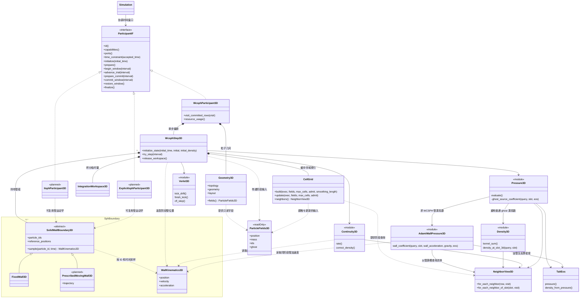
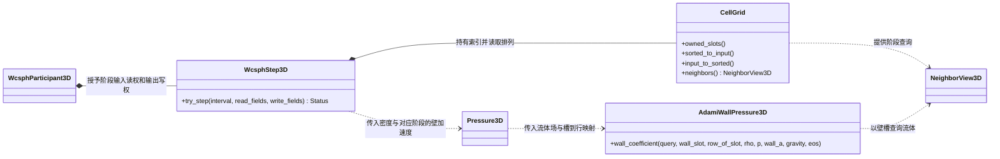

# 三维 WCSPH 求解器重构计划

状态为设计提案，最初提交为 `e8b01a1`，对应源码基线为 `ce54294`。本计划细化三维 WCSPH 重构，并为 IISPH 和显式 ISPH 保留独立参与者入口。现有单进程 Kokkos Serial 基线已验证流体与 Adami 固定壁。多壁组和指定轨迹运动壁是本次确认的设计，数值验收列于 M5。设计遵循[架构入口](overview.md)、[Kokkos 数据与执行契约](kokkos-design.md)及[现行 SPH 路线](migration-roadmap.md#sph-cell-begin)。

## 1. 从三个具体改动划分职责

| 要做的改动 | 当前需要理解的代码 | 重构后的改动边界 |
|---|---|---|
| 在同一水箱中使用固定侧壁与运动活塞 | 参与者组合流体与固定壁源，压力算子用可空的重力指针选择 Adami，连续性把壁源速度取零，Verlet 另用布尔值固定壁位置。 | 共享模块 `SphBoundary` 按壁粒子 ID 和时间给出位置、速度、加速度。步进器组装阶段几何，连续性读取壁速度，WCSPH 的 `AdamiWallPressure3D` 计算壁源系数，对称压力力核累加到流体行。 |
| 调整邻域遍历或分格 | `Geometry3D` 内含 `CellGrid`。密度、压力、连续性直接接收整个格网，普通 ghost 密度重建和 Adami 外推还需要以源粒子为中心查询。 | 参与者持有粒子几何，步进器缓存格网。格网从只读粒子字段建格或更新，三个数值模块通过当前阶段的查询视图遍历。 |
| 调整时间步或状态发布 | `Participant3D::compute` 同时处理初态和步末，`integrate` 管理六个临时 View、数值步序及候选字段。快照还涉及旧读者和预算。 | `WcsphStep3D` 完成初态计算或一个数值步。`WcsphParticipant3D` 负责窗口恢复、提交和结果读取。 |

源码入口见[参与者](../../src/participants/sph/Participant3D.cpp)、[压力求值](../../src/methods/sph/Pressure3D.cpp)、[连续性与 Verlet](../../src/methods/sph/Verlet3D.cpp)和[格索引](../../src/methods/sph/neighbors/CellGrid.hpp)。

**基线源码。** 现有 `Participant3D` 以 `accepted_ / trial_ / pending_` 三个 `Snapshot3D` 成员保存不同阶段的结果。`snapshot()`、`trial_stamp()` 和 `trial_snapshot()` 供三维测试和诊断使用。预提交遇到外部试算读者时复制四个字段，提交时再移动待发布对象。这些是本次计划移除的具体实现。[现有声明](../../src/participants/sph/Participant3D.hpp) · [现有发布与恢复](../../src/participants/sph/Participant3D.cpp)

基线的 `Participant3D` 同时提供有、无初始密度参数的构造入口。省略密度时，`compute` 核求和得到初态流体密度，`initialize` 可成功，随后 `begin_window` 拒绝推进。当前四组静水初态测试借此读取 `t=0` 的场值。目标设计将这些用例迁到方法层，并从参与者装配和步进器初始化入口移除省略密度的调用形式。[初始化分支](../../src/participants/sph/Participant3D.cpp) · [静水初态用例](../../tests/methods/sph/hydrostatic_initial_tests.cpp)

基线的 `ParticleFields3D` 定义在 `CellGrid.hpp` 中。`prepare_geometry_3d` 调用 `build/update` 并把格网和预算票据放入几何对象，`update_geometry_versions` 比较前后两份格网。实施时需要迁移这些调用点和直接读取 `geometry->grid` 的测试。[字段与格网](../../src/methods/sph/neighbors/CellGrid.hpp) · [几何装配](../../src/participants/sph/Geometry3D.cpp) · [版本比较](../../src/participants/sph/GeometryVersions3D.hpp)

## 2. 目标类图

WCSPH、IISPH 和显式 ISPH 各自直接实现 `ParticipantIF`，各自定义压力离散、步长约束与窗口恢复内容。接入当前 `Simulation` 时须声明并实现回滚能力。图中 `WcsphParticipant3D` 对应基线的 `Participant3D`。`SphBoundary` 是三种算法可复用的壁运动学模块。`module` 表示数值自由函数组，`planned` 标出后续算法与新增运动壁类型。



### 模式与具体接口

- **参与者拥有数值字段和窗口发布权。** `WcsphParticipant3D` 拥有 `Geometry3D`，管理密度、表压、压力加速度、速度、步长上限、提交版本、执行实例及预算。`WcsphStep3D` 位于 `src/participants/sph/`，持有配置、零至多组实体壁、积分工作区和派生的 `CellGrid` 缓存。初始化期间借用输入，完成自有字段装配后释放调用方的句柄，壁组的稳定 ID、参考位置、轨迹和各阶段缓冲按实际存续时间计入预算。它借用同一 Kokkos 执行实例、已授权的输入和输出进行初态计算或步进，以 `Status` 报告成功或失败。参与者在 `advance_trial` 中生成 `TrialReport`。数值自由函数留在 `src/methods/sph/`，`nexora_methods_sph` 仅依赖 core 和 Kokkos。

- **实体壁按组给出运动学。** 每个 `SolidWallBoundary3D` 用稳定粒子 ID 关联一组参考位置。装配时检查每个壁 ID 只属于一个组，且与流体 ID 互异。`sample(particle_id, time)` 给出该粒子在同一物理坐标系的位置、速度和加速度。`FixedWall3D` 始终返回参考位置及两个零向量。`PrescribedMovingWall3D` 由给定的平移或转动轨迹求三项运动量。一个算例可同时装配固定侧壁和运动活塞，也可省略所有壁组。
- **运动学与壁压的接口。** `WcsphStep3D` 按阶段采样并按稳定 ID 装配壁的 Kokkos 字段。`Continuity3D` 读取对应端点的壁速度。WCSPH 的 `Pressure3D` 调用 `AdamiWallPressure3D`，以壁源槽查询同阶段流体。它以核权重平均 `p_f + ρ_f (g − a_w)·(x_w − x_f)` 得到壁压，再通过 `TaitEos` 反算壁密度并形成 `p_w/ρ_w²`。固定壁取 `a_w = 0` 即得到基线的重力水头，零重力也是合法工况。IISPH 和显式 ISPH 可共享壁组及采样结果，各自定义压力边界离散。[固定壁实现](../../src/methods/sph/Pressure3D.cpp) · [Adami 等的壁边界条件](https://portal.fis.tum.de/en/publications/a-generalized-wall-boundary-condition-for-smoothed-particle-hydro/) · [壁压离散公式](https://pysph.readthedocs.io/en/main/reference/equations.html#pysph.sph.wc.transport_velocity.SolidWallPressureBC)
- **给定构型中的普通 ghost。** 方法层对含普通 ghost 的构型求力时，调用方提供同一阶段的粒子字段及所需 ghost 的完整本地支撑域。`Pressure3D` 只标记与任一 owned 行满足 `0 < d² < (2h)²` 的普通 ghost。其模块内的普通函数 `ghost_source_coefficient` 以该 ghost 的排序源槽为中心调用 `Density3D` 的核密度求和，包含自身质量项及支撑域内的邻居。按基线检查密度的范围和正值。密度转为 `real` 后求 Tait 表压，再将压力转为 `real`，以 double 计算 `p/ρ²`。流体、普通 ghost 和 Adami 实体壁各自算出的源系数都交给同一个对称压力力核。[现有压力求值](../../src/methods/sph/Pressure3D.cpp) · [源槽密度求和](../../src/methods/sph/Density3D.cpp)
- **几何通过粒子字段提供输入。** 将现有 `ParticleFields3D` 原样移至私有头 `src/methods/sph/ParticleFields3D.hpp`。它包含位置、质量、稳定 ID 和 ghost 标记的只读 Kokkos HostSpace View。`Geometry3D::fields()` 提供这些句柄，几何负责字段所有权及拓扑、几何、布局版本。版本比较按稳定 ID 对齐位置与归属，按输入次序、结果槽中的 ID 次序和 owned 行次序核对布局。纯输入置换按既有约定推进布局版本，格网缓存的一次分配或回收本身不触发几何版本变化。几何和格网的头文件分别引用字段契约，二者之间只传 `ParticleFields3D`。
- **步进器维护阶段索引。** 步进器将阶段字段传给现有 `CellGrid::build/update`，成功后才采用返回的格网。`neighbors()` 是拟新增的只读入口，将同一阶段的排序字段、owned 行到排序槽的映射、格偏移、格域和 `h` 绑定为 `NeighborView3D`。密度、压力和连续性只借用该视图及各自的物理输入，按 owned 行或任意源槽遍历，回调取得排序源槽与物理距离平方。参与者读取已提交结果所需的行序由已提交字段的稳定 ID 对应关系确定，回收格网缓存后仍可读取。
- **缓存的复用条件。** 在格域相同且每个 ID 的格归属、成员和 ownership 均匹配时，复用 `cell_begin` 和 owned 槽表。纯输入重排走 `remap`，按 ID 更新双向排列。输入顺序也相同时可复用排列。两条路径都装入本阶段的位置和质量，再按新坐标判距。更新失败时丢弃本次未完成的索引，先前的查询只对其原阶段有效。同格内也可能有粒子进入或离开支持域。跨格、粒子集合或 ownership 变化按现有规则重建，即使每格计数碰巧相同。质量单独变化时仍须刷新质量，不能只凭版本号或 View 地址判定字段有效。
- **EOS 用值对象，算子保留函数形式。** `TaitEos` 由已验证参数构成，供流体正算与壁源反算共享。既有压力算子负责输入/别名校验、工作区和对称力归约。`Continuity3D` 接管连续性右端及梯形校正。`Verlet3D` 保留运动学和声学 CFL。单步的调用顺序在 `WcsphStep3D` 中直接可读。上述接口均在现有两个私有 target 中完成。

| 输入与源角色 | 进入哪个入口 | 边界规则与输出 |
|---|---|---|
| 全 owned 流体，显式初始密度 | 积分装配 → `initialize_state(initial_time, initial, initial_density)` | 密度与初始速度均按流体输入行提供。按同一粒子映射计算初始压力、压力加速度和步长上限，供首次 `try_step` 使用。 |
| 全 owned 流体与一至多组实体壁 | 同一积分入口，装配固定壁组、指定轨迹壁组，或两者的组合 | 密度只覆盖流体输入行。壁的质量与 ID 随粒子保持，位置、速度、加速度从所属组按阶段取得。压力只为对流体有非零力贡献的壁源准备系数。固定壁有现行对照，运动壁及混合壁组按 M5 验收。 |
| 给定构型含普通 ghost，所需支撑域在本地完整 | 方法层 `Pressure3D::evaluate`，传入本阶段的 owned 密度和邻域查询 | 压力模块内部按需调用 `Density3D` 与 `TaitEos` 重构普通 ghost 源系数，输出 owned 压力和压力加速度。 |
| 空流体，可含实体壁组 | 同一积分入口，显式传入零长度密度和零行流体速度 | 沿用零流体声学 CFL 和零压力 scratch。无壁与仅固定壁的推进已有基线。仅运动壁时按窗口端点更新壁位置，此项列入 M5。 |
| 静水初态核求和验证（`t=0`） | 验证用例直接调用 `Density3D`、`Pressure3D` | 流体与固定壁共用同一阶段查询。先对 owned 流体行核求和，再将该密度传给选用 Adami 固定壁的压力算子。 |

**推进初始化。** 装配 `WcsphParticipant3D` 必须提供初始流体密度。参与者在 `initialize(initial_time)` 中将起始时间与密度显式交给步进器。步进器在该时间采样所有壁，用采样位置和初始流体位置建格。设 `Nf` 为流体输入行数，密度长度须为 `Nf`，每项有限且为正。建格后按 `sorted_to_input[owned_slots[row]]` 从输入行取同一粒子的密度与速度。用给定密度求 Tait 表压，在初态邻域内用同一时刻的壁加速度求壁源系数和流体压力加速度。初始声学 CFL 由流体速度、声速、`h` 和 CFL 系数按原公式计算。首次半踢读取该压力加速度并加上重力。长度错误、密度非法或初态求值失败均在初始化期间报告，成功后才发布初态。

**静水初态验证。** `SphHydrostaticInitial.ConventionalMassFourCases` 在测试中按原配置装配粒子、建格并取得查询，直接执行核密度求和与固定壁压力求值。沿用 `6³/h=1`、`12³/h=0.5`、`24³/h=0.25`、`24³/h=0.5` 四组基线及原容差。按稳定 ID 对照独立格点参考的邻居数、核矩与密度，核验 Tait 表压及质量加权的压力误差和净加速度残差 RMS。保留原逐粒子 CSV 的 ID、场值和行序。推进轨迹继续使用其显式初始密度。[静水初态基线](../../validation/sph/hydrostatic-initial-resolution.md) · [推进轨迹驱动](../../tests/methods/sph/hydrostatic_trajectory.cpp)

**结果读取。** 建议为 WCSPH 提供同步的 `visit_committed_rows(visit)`。在初始化成功、窗口已关闭且结果有效时，调用者可以按原有行序读取稳定 ID、质量、位置、密度、表压、压力加速度和速度的值。开放窗口中的读取返回 `invalid_state`。访问期间保持几何与字段的读授权并排斥开窗写入，回调按值取得单行数据。轨迹驱动自行保存所需样本，邻域测试通过 `NeighborView3D` 对照独立全扫描。

**窗口与恢复。** `begin_window` 成功前必须建立完整的进程内恢复点。建立失败时，已提交结果保持可用，窗口未打开。每个参与者同一时刻最多打开一个窗口。WCSPH 按稳定 ID 恢复几何、流体字段、时间、版本、步长上限以及会影响重放的控制或历史。壁组的 ID、参考位置与预设轨迹在窗口内只读。从恢复后的时间和几何按 ID 重新采样，丢弃失败阶段的壁运动量，并使关联的格网和查询失效。失败或主动恢复时先结束相关查询与访问，撤销与失败阶段关联的缓存有效性。重试从恢复后的只读字段出发，仅在字段、排列、格归属与当前阶段可核对时复用，否则重新更新或建格。按稳定 ID 核对重建后的邻居与遍历顺序，保持既有浮点累加顺序。恢复记录的表示由算法私有实现决定。只读输入与试算写集按 Kokkos 字段授权隔离，写入独立的获权输出，窗口结束前完成相关执行与访问。完整恢复点及独立写集的预算和寿命按实际占用计量。[ParticipantIF 窗口契约](../../include/nexora/participant/ParticipantIF.hpp) · [Simulation 的提交和恢复](../../src/simulation/Simulation.cpp)

**邻域索引扩展。** 若引入第二种索引，须先用独立对照验证 owned 行与任意源槽两种中心查询、稳定 ID 映射和累加顺序。固定壁与运动壁共用本计划的 `CellGrid`。

**普通 ghost 的三粒子对照。** 保留 `SphWcsphOperators.SourceOutsideOwnedSupportChangesGhostPressureForceOnly`。owned 粒子 ID 10 只与普通 ghost ID 20 直接作用，远端粒子 ID 30 位于 ID 10 支撑域之外、ID 20 支撑域之内。只把 ID 30 的质量从 1 改为 8，按稳定 ID 分别与两次独立全粒子对参考比较。ID 10 的密度和表压须与改动前完全相等，压力加速度的 x 分量须因 ID 20 的源系数变化而改变。[三粒子压力回归](../../tests/methods/sph/pressure_3d_tests.cpp)

## 3. 一个试算步的数据交接

令 `N` 为源槽总数（含所有壁组），`Nf` 为 owned 流体行数。旧、新格的排序槽可不同。密度、压力、压力加速度、速度按流体行保存。几何用 `ParticleFields3D` 提供输入顺序下的位置、质量、ID 与 ghost 标记。查询按该阶段的格排序槽读取这些字段。输入槽、排序槽和 owned 行之间按稳定 ID 及本阶段的双向排列对齐。壁组归属和采样的速度、加速度由同一 ID 关联到阶段源槽。

| 顺序 | 负责模块 | 输入 → 输出与约束 |
|---|---|---|
| 1 | `WcsphParticipant3D` | 按已提交时间、版本和严格的声学 CFL 上限校验步长，建立恢复点后开启本次 attempt。步进使用 `interval.duration()`。 |
| 2 | 步进器 → 壁组 / Verlet | 在 `interval.begin` 取得或核验各壁粒子的采样，以壁位置和已提交流体位置取得旧阶段索引，保活旧查询与映射。Verlet 只对 owned 流体用旧压力加速度与重力完成半踢，用经 `real` 舍入的半步速度漂移。在 `interval.end` 采样各壁粒子取得其步末位置、速度及加速度。 |
| 3 | 步进器 → `CellGrid::update` | 在旧排序槽中将漂移后的流体位置和终点采样的壁位置与同 ID 的质量、ID、标记合为新的 `ParticleFields3D`，更新格网。按格归属与输入顺序复用偏移、重映射或重建。阶段字段打包及同步成功后才取得新查询并复用漂移缓冲。按 ID 将终点壁运动量对齐到新槽，旧查询与起点壁速度保活至旧端密度率求和完成。 |
| 4 | 步进器 → 连续性 | 旧查询配旧流体速度及起点壁速度求 `Rₙ`。新查询配按新排序槽对齐的全步预测速度 `v* = vₙ + Δt(aₚ,ₙ + g)` 和终点壁速度求 `R*`。借助跨阶段排列 `old_row[new.sorted_to_input[new.owned_slots[row]]]` 找回同一 ID 的旧流体行。按现有 FMA 与窄化顺序计算 `ρ′ = ρₙ + Δt(Rₙ + R*)/2`，校验转为 `real` 后仍为正。 |
| 5 | 步进器 → 压力 / EOS / Adami 壁压 | 用同一新阶段查询和校正密度求流体 Tait 表压，准备流体的 `p/ρ²`。对所需壁源，用终点邻域、流体场及同一壁 ID 的终点加速度按 Adami 规则求系数。对称压力力核据此计算 owned 流体的压力加速度。只有 `0 < d² < (2h)²` 的相互作用需要源压力系数。负表压、近静态小扰动，以及 Adami 壁压先窄化、反算壁密度再窄化的顺序沿用基线。 |
| 6 | 步进器 → Verlet | 第二次半踢使用新压力加速度与同一重力。根据最终 owned 速度计算候选声学 CFL。将步末几何字段与四个流体字段按稳定 ID 和既有输出行序对应，同步并检查字段与 CFL。参与者向 `Simulation` 报告有效物理状态和精确的窗口终点。 |
| 7 | `WcsphParticipant3D` / `Simulation` | `prepare_commit` 完成所有可能失败的发布准备，保持结果私有。`commit_window` 成功时发布本步结果并释放恢复点，随后 `Simulation` 推进时钟和已接受步数。提交失败时恢复点仍可用，且尚无不可逆输出。 |

**存储与同步。** 六个积分 View 继续由私有 `IntegrationWorkspace3D` 持有。半步速度和阶段缓冲各为 `real[N,3]`，旧槽到旧流体行的映射为 `LocalIndex[N]`，两端密度率各为 `double[Nf]`，校正密度为 `real[Nf]`。步末字段独立于可回收缓冲。壁组参考数据由步进器持有。阶段壁字段按需分配，按各自最后一次 Kokkos 访问保活和计费。各算子只借用本阶段查询、所需壁字段和 EOS。

**预算与失败。** 粒子字段、几何、壁组和阶段采样字段、恢复所需载荷和工作区使用现有资源预算。分配输出或压力 scratch 遇到预算不足，可释放已完成用途的阶段缓冲并重试该次预留。每个 stage 使用参与者的 Kokkos Serial 实例与可访问的 HostSpace Views。格网保存的排序字段、偏移、owned 槽表及双向排列按实际分配计费，共用的分配只计一次。阶段查询借用的资源及其票据保活到该阶段 Kokkos 操作完成。几何的字段寿命独立于格网缓存，释放缓存只回收已无使用者的分配。

`Simulation` 在试算失败、终点不符、物理状态无效、预提交或提交失败时调用 `restore_window`。活动窗口也支持主动恢复。成功恢复关闭窗口并释放恢复记录，保留此前已提交的时钟和步数，允许从同一起点以合法步长重试。尝试次数按实际调用累计。恢复失败时报告错误，仿真进入失败状态。生命周期调用同步返回 `Status/Result`。部分初始化或恢复失败后，参与者的 `finalize` 仍应能安全清理。持久 checkpoint、MPI 通信和设备执行各自单独验收。[工作区基线](../../validation/sph/wcsph-integration-workspace-serial.md) · [格表与预算基线](../../validation/sph/cell-begin-serial.md)

## 4. 迁移步骤与验收

以下步骤各自可编译、可回退。M1 与 M2 可从同一基线并行。修改压力调用点时先合入 M1，再由 M2 接入查询视图。M3 用两项完成后的统一入口。M0–M4 先对照原有固定壁行为，M5 在统一接口上实现并单独验收指定轨迹。日常验证先跑受影响用例及 float Debug、double Release 两个配置。

| 阶段 | 修改范围与交付 | 完成判据 |
|---|---|---|
| M0 固定对照 | 从 `ce54294` 确定编译器、精度、Kokkos、构建选项与算例。归档同配置 6³ 的四份 CSV、关键步的分配/复制/fence 计数、预算下界。沿用已有独立 CSR/全扫描及力学参考。 | 基线可复跑。记录原有一维 7 项、三维 56 项用例及其精确名称，标记依赖三维快照 API 或无密度构造入口的调用者，记录四组静水 `t=0` 对照及其原判据。报告区分常规 CTest、安装消费和轨迹。 |
| M1 提取 EOS 与边界 | 在 `src/methods/sph/` 提取 Tait 正反算及 WCSPH 专属的 `AdamiWallPressure3D`。在同一私有方法目标中建立共享模块 `SphBoundary` 的壁组与采样值契约，先用 `FixedWall3D` 适配现有固定壁输入，核对参考位置与零速度、零加速度。普通 ghost 的源系数留在 `Pressure3D` 的普通函数中，复用源槽核密度求和与对称压力力核。按实际所需数组计算压力 scratch 字节数。接通按 ID 采样的壁位置、连续性源速度和 Adami 壁压后，删除内部可空重力指针和壁布尔开关。 | 保留上述三粒子独立对照。核验近参考态双侧、负表压与对称合力、湿壁反算失败与缩步恢复、纯重力自由落体和零 owned 行时的零压力 scratch。 |
| M2 提取字段契约和查询视图 | 移出独立的 `ParticleFields3D.hpp`，让格网直接读取该契约。添加 `neighbors()`，迁移密度、压力、连续性及两类中心查询的调用者。把几何版本比较改为基于粒子字段和布局次序，复用现有分格、截断与遍历实现。 | 按稳定 ID 对照独立全扫描和显式 CSR。覆盖同格移动越过支持边界、仅质量变化、输入置换与双向映射、粒子跨格互换且格计数不变、ghost 归属变化、重合异 ID、截断内外，以及 wall/ghost 槽为中心的查询。分开核验几何版本和格表路由。 |
| M3 分离连续性与单步编排 | 从 `Verlet3D` 拆出连续性求和，从现有 `Participant3D` 拆出 ID 对齐的密度校正。将 `compute/integrate` 的数值编排和工作区移入 `src/participants/sph/WcsphStep3D.*`。参与者改名为 `WcsphParticipant3D` 并持有算法几何。在初态和步进两端接入分组采样，装配新旧几何，对齐壁速度与加速度。将 `CellGrid` 缓存及对应资源票据从几何装配迁入步进器。几何通过字段契约供数，测试从几何字段和步进查询分别取证。移除三态快照及其读取入口，接通同步逐行读取、独立写集和窗口恢复，同时迁移三维测试与轨迹驱动，测试改名时同步更新 Serial 验证器的必跑清单。删除纯流体及固定壁的无密度构造重载，推进初始化要求显式输入密度。将四组静水初态用例迁到方法层。 | 用不同质量、不同密度的流体跨格并重排，按 ID 独立核对漂移前后两阶段的映射、邻居、两端密度率、轨迹、声学 CFL 和二阶密度误差。核验输入置换后的初始密度、压力、压力加速度和首步 CFL。长度不符或非正、非有限密度须在初始化时拒绝。空流体与仅固定壁均以显式零长度密度成功推进。 |
| M4 验证窗口契约及构建边界 | 按 `ParticipantIF` 的开窗、预提交、发布、恢复顺序验证外部可见行为。将保留旧快照、试算 stamp 和由读者触发复制的三维专属断言迁移为窗口验收。替换旧的“无密度初始化成功、开窗拒绝”用例，为检验速度或参数错误的用例提供合法密度。更新依赖检查器与安装消费检查，验证新字段头保持私有、几何与版本代码独立于格网类型。同步两个私有目标的源清单、Serial 验证器必跑清单及相关文档。 | 覆盖开窗失败仍可读、窗口中拒绝读取、主动恢复、部分计算后失败、步末数值仅在提交成功后可读、非初始步恢复后按 ID 比对全部字段与 CFL、原步长重放和合法小步重试。用现有 Simulation 契约测试覆盖预提交及提交失败后的恢复和时钟不前移。在新格已算出后触发真实步进失败或主动恢复，再以恢复字段重建或验证缓存。按 ID 比较邻居、数值和后续轨迹与从相同起点直接运行的结果。直接调用算子的四组静水初态和普通 ghost 三粒子求力用例分别通过各自的独立对照。实测旧新阶段临时共存时的预算准入与回收。关闭测试时可独立构建三维目标，一维固定 CSR 夹具继续服务回归和显式 benchmark。 |
| M5 实现并验收指定轨迹运动壁 | 在 `SphBoundary` 实现 `PrescribedMovingWall3D`。从非零时刻启动，分别用解析平移和转动核对粒子位置、速度和加速度，转动覆盖切向与向心分量。检验仅运动壁与空流体的推进、壁 ID 冲突及无效采样的失败路径。 | 在固定侧壁与变速活塞共存的算例中让活塞跨格，两端壁速不同。按 ID 对照独立全扫描的邻居、两端密度率、壁压和流体压力加速度，覆盖输入置换和新排序。将轨迹设为恒定参考位置并核验其壁压与固定壁一致。跨格后触发真实失败或主动恢复，同步长重放及合法缩步分别与从同一起点直接运行对照。 |

**最终对照与回退。** 完成 Debug/Release × float/double 四组 Serial 的 SPH 回归、全仓 CTest、依赖检查、Reference Decimal oracle 和搬迁安装消费。Decimal oracle 验证公共构建链。SPH 数学正确性由各 SPH 独立参考与轨迹验证。Release double 的 6³ 水箱使用与 M0 相同的工具链、输入与输出顺序。`frames.csv`、`profiles.csv`、`crossings.csv` 逐字节一致。`steps.csv` 保留原表头与列序，两边仅剔除 `controlled_bytes` 后逐字节比较，其余列含时间、步长、CFL 和数值诊断。逐步资源字节数单列对照，对资源差异逐步归因，在相同采样点重测热步六缓冲复用、受控峰值、最低可执行预算、分配、深拷贝、fence 和配对计时。以真实几何、预算或数值失败验证恢复。出现数值差异时按稳定 ID 定位首个偏差的几何、密度率、壁压或速度，再回退相应阶段。[轨迹驱动](../../tests/methods/sph/hydrostatic_trajectory.cpp) · [Serial 清理基线](../../validation/sph/serial.md) · [6³ 轨迹对照](../../validation/sph/hydrostatic-continuity-repair.md#solver-cleanup-trajectory) · [项目验证流程](../../CONTRIBUTING.md)

## 附录 A　架构审阅与验收对照

审阅对象为本文件第 1–4 节的设计提案。现有 Kokkos Serial 数值基线覆盖流体和 Adami 固定壁。多壁组与规定轨迹运动壁已纳入设计，数值实现和验收安排在 M5。下列接口修订与新增用例是本次审阅建议，实施状态以各阶段的实测结果为准。[完整目标类图](#2-目标类图) · [单步数据交接](#3-一个试算步的数据交接) · [迁移与验收](#4-迁移步骤与验收)

### A.1 当前计划的对应关系

| 阶段 | 已有架构决定与验收 | 审阅结论 |
|---|---|---|
| M0 | 以 `ce54294` 为源码基线，固定同配置轨迹、数值对照、资源采样及旧接口调用者。 | 同配置轨迹与 M4 之后的最终对照已有对应。 |
| M1 | `SphBoundary` 提供壁运动学。WCSPH 的 `Pressure3D` 经 `AdamiWallPressure3D` 计算壁源系数，普通 ghost 走独立的源槽密度重构。 | 应把壁压所需的流体场及槽到行映射写入接口。 |
| M2 | `Geometry3D` 提供只读粒子字段，步进器维护 `CellGrid`。`NeighborView3D` 支持以 owned 行和任意源槽为中心查询。 | 跨阶段数据流还需在图中标出步进器读取的排列。 |
| M3 | `WcsphStep3D` 编排连续性、Verlet 和压力。参与者持有已提交字段。初始化显式接收流体密度，四组静水初态对照迁到方法层。 | 应写明多壁组质量来源、初始流体行序，以及 `try_step` 借用的输入和输出。 |
| M4 | `WcsphParticipant3D` 提交后提供同步逐行读取，以独立写集和完整恢复点支持失败重试。 | 已覆盖开窗期间拒绝读取。还应验收读取回调执行期间尝试开窗的行为。 |
| M5 | 每个算例可配置零到多组壁。`FixedWall3D` 与 `PrescribedMovingWall3D` 可共存，按稳定 ID 对齐位置、速度、加速度。 | 已安排混合壁组、平移、转动、跨格和重试。还需规定轨迹的时间基准、可解析步长及两者的验收。 |

WCSPH、IISPH 和显式 ISPH 各自实现 `ParticipantIF`，可以共享壁运动学。IISPH 和显式 ISPH 的压力离散、步长与数值验收归入各自的后续设计。

### A.2 审阅发现及对应修改

1. **M1 的壁压函数需要流体场。** 第 2 节的 `wall_coefficient(query, slot, wall_acceleration, gravity, eos)` 缺少 `ρ_f`、`p_f` 及从流体邻居槽查找其 owned 行的映射。同一几何可配两份显式密度，因而同一壁槽可以得到不同壁压。建议由 `Pressure3D` 先完成本阶段流体 EOS，再把对应的只读场和映射传给壁压函数。验收时固定几何与壁加速度，只改变邻近流体密度，独立计算两次预期壁压并核对。[现有壁压求和](../../src/methods/sph/Pressure3D.cpp#L38-L59)

2. **M1/M3 的多壁组装配需要确定质量来源与密度下标。** 正文要求壁质量随 ID 保持，壁组接口仅列出了 ID 和参考位置。基线从壁输入取质量，先按原输入序装入全部 `Nf` 个流体粒子，再追加壁，故 `sorted_to_input[owned_slots[row]]` 可直接索引长度为 `Nf` 的密度和速度。建议沿用这一装配约定，壁粒子质量从各组的粒子输入按稳定 ID 写入几何。验收采用不同质量的两个壁组，置换流体输入及壁组次序，按 ID 核对初始密度、质量和壁对流体的作用。[固定壁输入](../../src/participants/sph/Participant3D.hpp#L51-L55) · [基线装配](../../src/participants/sph/Participant3D.cpp#L154-L169)

3. **M2/M3 的排列和步末坐标需要明确寿命。** 第 3 节在校正密度时使用 `owned_slots`、`sorted_to_input` 和旧槽到流体行的映射。建议在 `CellGrid` 上标出双向排列与 owned 槽入口，由步进器完成跨阶段对齐。步末几何须在漂移缓冲改作速度缓冲前取得独立有效的坐标。验收时让粒子跨格并重排，复用缓冲、回收格网，再按稳定 ID 核对已提交的坐标和输出行序。[现有格网排列](../../src/methods/sph/neighbors/CellGrid.hpp#L41-L55) · [几何所有权对照](../../tests/methods/sph/cell_grid_tests.cpp#L467-L492)

4. **M3/M4 的读写交接需要进入签名。** 图中的 `try_step(interval)` 没有表达参与者如何交付已提交字段的读权及本窗口输出的写权。建议补为 `try_step(interval, read_fields, write_fields) -> Status`，由参与者负责发布。验收时从 `visit_committed_rows` 的回调尝试开窗，应得到 `invalid_state` 并能按序读完所有行。回调退出后应能正常开窗。[窗口与发布契约](../../include/nexora/participant/ParticipantIF.hpp#L34-L48)

5. **M5 的壁与流体需要同一积分时长。** 第 3 节以 `interval.duration()` 推进流体，同时用绝对端点采样运动壁。已有 `Simulation` 用例从 `2^52` 起步，合法请求步长为 `0.75`，浮点终点比起点大 `1.0`。据此推算，在无加速度、同速为 `1` 的共同平移中，按绝对端点采样的壁移动 `1.0`，流体移动 `0.75`。建议在初始化时确定轨迹参考时刻和起始相位，随后直接在相对时标上求值，以同一个 `duration()` 推进。已提交相对历时属于运动壁的恢复数据，对外报告仍使用 `interval.end`。验收应核对共同平移的相对距离、失败重放和合法缩步。[积分时长定义](../../include/nexora/core/Time.hpp#L5-L14) · [已有舍入用例](../../tests/simulation/simulation_tests.cpp#L368-L375)

6. **M5 的步长准入需要覆盖步内壁运动。** 现有声学 CFL 取决于 owned 流体速度。举例取窗口归一化时间 `u ∈ [0,1]`，活塞位移 `s(u) = 256 A [u(1−u)]⁴`。两端的位移、速度、加速度均为零，中点位移却为 `A`。若活塞在中途进入流体支撑域，单步的两端采样会漏掉这次相互作用。建议由规定轨迹或算例给出有依据的最大采样步长，参与者将其与原声学上限取小值。M5 用步内往返活塞和细步参考检验准入及结果，固定壁继续沿用原声学上限。[现有声学步长计算](../../src/methods/sph/Verlet3D.cpp#L197-L225)

### A.3 建议修订的局部 UML

下图展开第 2 节中需要补充的接口。`row_of_slot` 将本阶段的流体排序槽映射到 `rho` 和 `p` 的行。两个场只在已完成本阶段流体 EOS 后交给壁压函数。



### A.4 建议的单步伪代码

下例将现有七步流程与 A.2 的建议放在一起。`current` 是只读的已提交数据，`out` 是独立的试算写集。`τ` 表示相对轨迹历时。固定壁使用参考位置与零速度、零加速度。流体速度和密度的预测、窄化及修正使用正文规定的算子和顺序。

```text
initialize(initial_time):
    按输入流体行装配初始密度和速度，再按稳定 ID 追加各组壁粒子及质量
    令相对历时 τ = 0 对应 initial_time 的轨迹相位，在 τ = 0 采样壁并建立几何
    计算初始流体压力、压力加速度和声学上限，取与适用轨迹上限的较小值
    成功后发布初态、maximum_step 和相对历时 τ = 0

try_step(interval, current, out):
    dt = interval.duration()
    τ0 = current.wall_elapsed_time
    τ1 = τ0 + dt
    w0, w1 = 分别在相对历时 τ0、τ1 采样各组壁，按稳定 ID 关联三项运动量
    grid0 = 取得已提交几何对应的格网(current.geometry, w0.position)
    q0 = grid0.neighbors()
    v_half, x_fluid = Verlet.kick_drift(q0, current.v, current.a_pressure, gravity, dt)
    out.geometry = 按旧槽装配独立的步末几何(x_fluid, w1.position, 原质量、ID 与归属标记)
    grid1 = grid0.update(exec, out.geometry.fields(), max_cells, admit)
    q1 = grid1.neighbors()
    R0 = Continuity.rate(q0, current.v, 起点槽上的 w0.velocity)
    v_pred = 按稳定 ID 映射到新槽(current.v + dt * (current.a_pressure + gravity))
    R1 = Continuity.rate(q1, v_pred, 终点槽上的 w1.velocity)
    out.rho = Continuity.correct_density(按新流体行对齐的 current.rho 和 R0, R1, dt)
    out.p, out.a_pressure = Pressure.evaluate(q1, out.rho, 终点槽上的 w1.acceleration, gravity, eos)
    out.v = Verlet.finish_kick(按新行对齐的 v_half, out.a_pressure, gravity, dt)
    out.maximum_step = min(声学上限(out.v), 适用的轨迹步长上限(τ1))
    out.wall_elapsed_time = τ1
    完成执行并核对步末字段、行序和步长上限，返回 Status
```

初始化和步末采用同一步长准入约定。`Simulation` 在开窗前校验已提交的 `maximum_step`。开窗后任一阶段失败，参与者返回失败状态，`Simulation` 调用 `restore_window()`，从上次提交的几何、流体字段与轨迹相位重试。成功时由 `prepare_commit()` 准备发布，再由 `commit_window()` 一并发布写集与新相位，随后推进外部时钟。[开窗与回滚](../../src/simulation/Simulation.cpp#L56-L108) · [提交顺序](../../src/simulation/Simulation.cpp#L111-L127)
