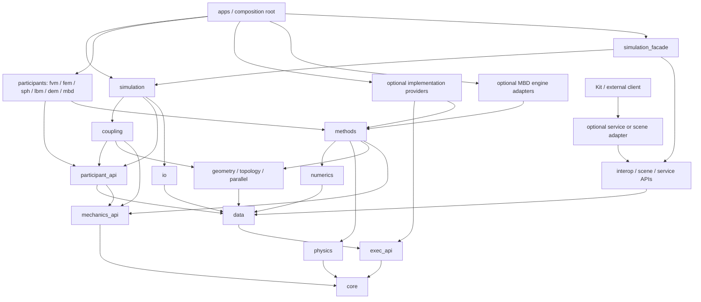

# 多方法 CFD / 多物理场 HPC 平台架构与仓库设计计划（含 MBD、Warp、Newton 与 Omniverse 集成）

> **工作代号：CFDX · 版本：1.2（外部集成整合版）· 日期：2026-11-03**  
> 面向 FVM、FEM、SPH、LBM、DEM 五种数值方法与 MBD 多体动力学子系统，以及流固、流粒、刚柔、接触、传热、多区域和多时间尺度耦合。  
> 设计基线：C++17、CUDA 优先、CPU 参考实现、可选 MPI C API、现代 CMake、离线可复现构建。  
> 新增集成：NVIDIA Warp 算子、Newton Physics 动力学引擎、OpenUSD/Omniverse 场景与交互、C ABI/Python/RPC/IPC 对外接口；均按可选 profile 与能力认证接入。

## 文档定位

这是一份**目标架构、接口契约、仓库规划与实施路线**。文中的外部求解器适配建议适用于将来选定且具备复用许可的组件。`CFDX` 是本文使用的工作代号。

全文的目录、类名、配置键和命令均为**建议定义的项目规范**。除明确给出的独立示例外，接口片段用于设计评审，不能当成已经具备依赖、实现和测试的可运行求解器。外部项目的已核实机制通过 `[Rxx]` 引用；其余内容是本平台的设计建议，不表示相关项目已经采用完全相同的架构。

**核心结论：建设“共享基础设施 + 独立方法内核 + 类型化耦合协议”的模块化单仓库平台，而不是一个万能求解器、一种万能网格，或一个先行自研的通用 DSL 编译器。**

---

## v1.2 版本修订说明

本版以 v1.1 完整 MBD 计划为基线，同步更新主架构、数据/执行契约、仓库、构建、检查点和路线，新增 **第 37–46 章及附录 E**。旧版文件保留，本文件为独立可读的完整整合版，不要求读者手动拼接补丁。

**三者的角色不混同：Warp 是可选算子 provider，Newton Physics 是候选动力学引擎，Omniverse/OpenUSD 是外部场景与应用集成。** 数值方法与 MBD 的十五种配对保持不变。核心求解器不依赖 Kit；Python compute-host 与原生 core-hpc 是不同部署 profile。

**阅读路径：**第 37 章（总体边界）→ 第 38–40 章（数据、Warp、Newton）→ 第 41–43 章（场景、Omniverse、通信）→ 第 44–46 章（文件结构、配置、任务）。本次新增参考资料从 R30 开始；第三方功能与本文拟设计接口明确区分。

## v1.1 历史修订说明

v1.1 在 v1.0 原计划上**整合** MBD，不以独立附录替代主架构更新。原有第 1–30 章的编号和链接保留：在 DEM 后插入 **第 13A 章**，在原主体末尾增加 **第 31–36 章**，新增 **附录 D**。顶层分层、场与端口、15 种组合、仓库、CMake、检查点、验收和里程碑均同步修订。

MBD 是处理刚体/机构运动、关节、约束及扩展刚柔动力学的求解子系统，**不是与 FVM 等同义的空间离散方法**。因此“六类子系统”指五种数值方法加 MBD；15 种两两组合是架构规划，不代表全部已实现，也不要求为每一组合重写一套耦合管理器。

**MBD 阅读入口：**第 13A 章（MBD 内核与所有权）→ 第 31–32 章（耦合和时间）→ 第 34–36 章（文件结构、配置、任务）。原 v1.0 文件保留，本文可独立阅读。

## 目录

- [1. 范围、约束与优先级](#sec-01)
- [2. 总体架构与依赖方向](#sec-02)
- [3. 领域划分与对象模型](#sec-03)
- [4. L0：基础类型、数值策略与错误模型](#sec-04)
- [5. L1：执行、内存与异步运行时](#sec-05)
- [6. L2：数据、场与状态所有权](#sec-06)
- [7. L3：几何、拓扑与自适应](#sec-07)
- [8. L4：物理模型、边界条件与公共数值服务](#sec-08)
- [9. L5：FVM 子系统](#sec-09)
- [10. L5：FEM 子系统](#sec-10)
- [11. L5：SPH 子系统](#sec-11)
- [12. L5：LBM 子系统](#sec-12)
- [13. L5：DEM 子系统](#sec-13)
- [13A. L5：MBD 多体动力学子系统](#sec-13a)
- [14. 参与者接口与生命周期](#sec-14)
- [15. 耦合类型、方法组合与支持边界](#sec-15)
- [16. 空间映射、守恒、功与载荷账本](#sec-16)
- [17. 时间协调、子步进与强耦合回滚](#sec-17)
- [18. 分布式、多 GPU 与通信计算重叠](#sec-18)
- [19. 多 DSL / Backend 适配与算子实现注册](#sec-19)
- [20. 算例描述、Python 与运行入口](#sec-20)
- [21. 仓库总体文件结构](#sec-21)
- [22. 各模块内部文件结构](#sec-22)
- [23. CMake Target、依赖与构建规范](#sec-23)
- [24. I/O、检查点与可复现性](#sec-24)
- [25. 测试、验证与性能验收](#sec-25)
- [26. 可选接入外部 CUDA/SPH/DEM 求解器](#sec-26)
- [27. 分阶段开发计划与交付门槛](#sec-27)
- [28. 扩展开发工作流与变更治理](#sec-28)
- [29. 风险、待决项与架构决策记录](#sec-29)
- [30. 第一批可直接拆解的开发任务](#sec-30)
- [31. MBD 与五种数值方法的耦合详细设计](#sec-31)
- [32. MBD 时间协调、强耦合与事务恢复](#sec-32)
- [33. MBD 的 HPC、DSL、Backend 与分布式设计](#sec-33)
- [34. MBD 仓库增量、依赖与 CMake 设计](#sec-34)
- [35. MBD 模型 DSL、耦合配置与能力校验](#sec-35)
- [36. MBD 验证、分阶段交付与可拆解任务](#sec-36)
- [37. NVIDIA 生态与外部集成的总体设计](#sec-37)
- [38. 对外数据契约、所有权与版本](#sec-38)
- [39. NVIDIA Warp 计算与数组互操作设计](#sec-39)
- [40. Newton Physics 引擎与多物理场参与者接口](#sec-40)
- [41. OpenUSD 场景、模型与科学数据交换](#sec-41)
- [42. Omniverse 实时应用、渲染与控制接口](#sec-42)
- [43. 通信协议、吞吐、同步与失败恢复](#sec-43)
- [44. 外部集成的仓库结构、Target 与部署边界](#sec-44)
- [45. 外部集成配置、接口协议与典型运行闭环](#sec-45)
- [46. 集成专项验证、交付阶段与开发任务](#sec-46)
- [附录 A：关键接口骨架](#appendix-a)
- [附录 B：完整时间窗口执行示例](#appendix-b)
- [附录 C：架构评审检查表](#appendix-c)
- [附录 D：MBD 中性接口声明与设计评审清单](#appendix-d)
- [附录 E：外部接口声明、生命周期与集成评审清单](#appendix-e)
- [参考资料与证据边界](#references)

---

<a id="sec-01"></a>
## 1. 范围、约束与优先级

### 1.1 平台的准确定位

平台以 CFD 为中心，但 DEM 属于颗粒/接触动力学，FEM 还承担结构、热和约束问题，MBD 负责刚体、机构、关节和机械约束动力学。因此，顶层不宜命名为 `UniversalFluidSolver`，而应采用 `Simulation + Participants + Couplings`。

一个算例可以只有一个 FVM 流体参与者，也可以组合 SPH 流体、DEM 颗粒、FEM 结构和 MBD 机构。MBD 通过原生参考引擎或外部引擎适配实现，在平台内同样是一级参与者。**物理模型、离散/动力学 formulation、求解策略、实现引擎及执行设备分别配置。**

| 维度 | 示例 | 不应混淆的内容 |
|---|---|---|
| 物理问题 | 不可压流、传热、弹性、颗粒接触 | 不能由 `cuda` 或 `sph` 推断全部物理假设 |
| 离散方法 | FVM、FEM、SPH、LBM、DEM | FEM 不是一种材料模型，DEM 不是流体离散 |
| 求解策略 | 显式积分、投影法、Newton、约束 DAE、分区强耦合 | 同一方法可有多种时间推进方式 |
| 动力学 formulation / 引擎 | MBD 冗余/约化坐标、SMC/NSC；原生参考、Chrono 或 Newton adapter | 引擎不是 CUDA/HIP backend；具体 solver 的 formulation 单独认证 |
| 实现与设备 | native CUDA、CPU、HIP、Kokkos provider | DSL/provider 与硬件 backend 不构成任意组合 |

### 1.2 建议采用的基线

| 项目 | 本计划的决定 | 原因或边界 |
|---|---|---|
| 核心语言 | C++17 | 对齐现有工程；不要求 C++20 concepts、coroutines、`std::span` |
| 接口命名 | 抽象接口采用 `IF` 后缀 | 例如 `ParticipantIF`、`LinearOperatorIF` |
| 首要设备 | NVIDIA CUDA | 保留现有高性能实现，不为抽象而重写成熟 kernel |
| 参考设备 | CPU serial，随后 OpenMP | 数值验证、调试、无 GPU CI；不是要求 CPU 与 GPU 实现完全相同 |
| 后续设备 | HIP；SYCL 按实际硬件需求推进 | 只有通过真实设备测试的功能才能标为支持 |
| 多进程 | MPI 可选，仅使用 C API | 串行构建不需要 MPI；业务层不直接使用 `MPI_*` |
| 多 GPU | 初期每个 MPI rank 一个 GPU | 后续再增加单进程多 GPU，不同时展开两套调度复杂度 |
| 仓库 | 模块化 monorepo | 数值契约、耦合协议、测试可原子变更 |
| 发布 | 默认 core-hpc 原生程序；可选 Python compute-host 与独立 viewer | 原生 profile 无 Python/Kit 强依赖；可选 profile 的运行时/预热与制品另行锁定 |
| 外部依赖 | 固定版本、哈希、构建选项和来源 | 内网/离线可重建，默认不从网络隐式下载 |
| 平台 | Linux 为完整 HPC 验收平台；Windows 为核心/CPU/CUDA 支持平台 | Windows 的 MPI、外部库组合逐项认证，不宣称与 Linux 全量等价 |

对于旧 C++14 模块，优先通过边界适配接入，不把现代化改造与数值迁移绑定在同一个提交。核心示例保持 C++17，不因可选 provider 的新版本需求而无条件提升全仓库标准。

### 1.3 功能优先级

| 分类 | 初始交付 | 后续扩展 |
|---|---|---|
| SPH | 既有 WCSPH 基线、邻域、边界、简单传热 | IISPH/DFSPH、APR、多相、SDF/半解析边界 |
| DEM | 球形颗粒、历史相关接触、基本转动与摩擦 | 非球形、多面体、黏结、磁相互作用 |
| FVM | 标量扩散/输运 → 层流不可压流 | 可压缩、多相、湍流、ALE、AMR |
| FEM | 热传导与线弹性 → 混合 Stokes/Navier–Stokes | 高阶、非线性结构、DG、复杂接触 |
| LBM | 单相等温、单层规则块、基本边界 | MRT/central-moment、热、多相、分层网格 |
| MBD | 自由刚体/基础关节、载荷端口、CPU 引擎适配与参考验证 | 闭环机构、刚柔/ROM；可选 Newton GPU 引擎按具体 solver 认证 |
| 耦合 | 现有 SPH–DEM；优先增加 SPH–MBD、DEM–MBD；随后 FVM–DEM、流体–FEM 热耦合 | 强三方耦合、FVM/LBM–MBD、FEM–MBD、多方法流体域与表征转换 |

**不承诺第一版同时完成六类子系统的生产级求解器。** 五种数值方法和 MBD 都必须在架构上有明确落点，但按验证闭环逐步交付；没有实现的能力应在配置校验阶段直接拒绝。

### 1.4 外部集成优先级

先增加中性导出与受限 OpenUSD 文件交换，再分别验证一个 Warp 算子和一个 Newton 机械模型；在线 Kit 客户端与远程控制在数据/控制契约稳定后接入。CUDA IPC、Fabric、独立渲染/流媒体库只在具体需求和性能证据下推进，见 I0–I7。外部接口不改变原物理验证门槛。

### 1.5 明确不做的事情

不在第一阶段自研通用编译器、不要求所有方法共享同一个残差形式、不强制所有数据为 CSR、不一次支持全部 DSL、不以“所有对象都继承一个基类”换取表面统一，也不将 GUI、远程作业系统和 AI Agent 放入数值内核。

---

<a id="sec-02"></a>
## 2. 总体架构与依赖方向

### 2.1 逻辑分层

```text
L8  用户入口与应用装配
    CLI / Case Schema / Python API / 外部 Kit 客户端 / 可选远程服务
    Integration Boundary: interop_api / scene_api / service_api（叶子装配）
                          │
L7  仿真编排
    Simulation / CaseBuilder / TimeCoordinator / OutputSchedule
                          │
L6  耦合与参与者适配
    CouplingGraph / Mapping / Loads / WindowTransaction
    Fvm / Fem / Sph / Lbm / Dem / MbdParticipant
                          │
L5  数值方法与动力学子系统（平级，不能互相 include 实现）
    FVM       FEM       SPH       LBM       DEM       MBD
                          │
L4  公共物理与数值服务
    Constitutive / Material / Algebra / Krylov / Time / Diagnostics
    Mechanics: frame / pose / wrench / ownership（不含具体 MBD 求解器）
                          │
L3  几何、拓扑、空间查询与分布式规划
    Geometry / Mesh / FE space / Particle set / Block hierarchy
    Partition / HaloPlan / MigrationPlan / Contact graph
                          │
L2  场与数据契约
    FieldRegistry / Buffer / View / State / Snapshot / Version
                          │
L1  执行与通信机制
    ExecContext / Event / Allocator / CPU / CUDA / HIP / Transport
                          │
L0  基础设施
    IDs / Units / Vec-Tensor / Status / Logging API / Build info
```

这是一张**职责图**，不是要求每个模块只能访问紧邻的一层。真实依赖以 CMake targets 和头文件规则为准；例如 `physics` 可以只依赖 `core`，不必依赖整个 `L1–L3`。

### 2.2 横向能力必须与数值方法解耦

`io`、`diagnostics`、`profiling`、`checkpoint`、`parallel` 是横向服务。它们使用明确的数据/任务接口，而不是通过一个包含全部求解器指针的 `GlobalContext` 获取状态。



**箭头表示编译依赖，方向为使用者指向被依赖者。** `coupling` 不依赖 `SphSolver`、`FvmSolver` 等具体类型；具体方法的输入/输出由 `participants/*` 导出。`methods` 的公共算子契约不依赖实现 provider；可选 provider 依赖这些契约，在应用装配时注册。

### 2.3 必须落地的依赖规则

| 模块 | 允许依赖 | 禁止依赖 |
|---|---|---|
| `core` | 标准库、最小基础工具 | CUDA/MPI/HDF5/方法模块 |
| `exec_api` | `core` | 任意数值方法、耦合逻辑 |
| `data` | `core`、`exec_api` | 具体 CUDA runtime 类型、求解器 |
| `geometry` / `topology` | `core`、`data` | FVM/SPH 算法、`Simulation` |
| `numerics` | `core`、`data`、执行契约 | 具体 `FvmSolver` 或 `SphSolver` |
| `physics` | 数学与参数类型 | 网格索引、MPI、GPU launch |
| `mechanics_api` | core 的 ID、数学、状态类型 | MBD solver、Chrono、CUDA/MPI 类型 |
| `mechanics` | mechanics_api、data、执行契约 | 具体 MBD 引擎与其他方法内部状态 |
| `methods/x` | 基础服务和自己的实现 | `methods/y` 的内部头文件、耦合管理器 |
| `participant_api` | 数据、时间、异步与轻量 mechanics_api | 具体方法/引擎头文件 |
| `participants/x` | `participant_api`、`methods/x` | 其他方法的内部状态 |
| `coupling` | `participant_api`、映射/通信服务 | 具体求解器所有权、方法内部数组 |
| `simulation` | 参与者接口、耦合、I/O | 粒子级/面级 device kernel |
| `interop_api` / `scene_api` / `service_api` | 中性数据/时间/命令契约 | Python/Warp/Newton/Kit/gRPC 私有类型 |
| `simulation_facade` | simulation、上述接口 | 被 simulation 反向依赖 |
| 外部 adapters/integrations | 对应公开契约、私有第三方依赖 | 改写方法内部数组或另开同一物体的推进循环 |
| `apps` | 需要装配的全部模块 | 不应新增数值算法 |

CI 同时检查 target 依赖和 `#include` 边界。只有文档分层、没有编译约束的仓库，最终仍容易变成循环依赖。

---

<a id="sec-03"></a>
## 3. 领域划分与对象模型

### 3.1 建议的顶层组合关系

```text
Simulation
 ├─ RuntimeServices                  # 执行、通信、日志等基础服务
 ├─ CaseDefinition                   # 校验后的不可变配置
 ├─ Participant[]                    # 各自拥有物理状态和积分器
 │   ├─ Domain                       # 几何区域与离散实体
 │   ├─ State                        # 主变量、历史变量、模型内部状态
 │   ├─ MethodSolver                 # 该方法自己的求解流程
 │   └─ Port[]                       # 对外交换契约，不暴露整个 Solver
 ├─ CouplingGraph                    # 哪些端口以什么数学方式交换
 │   └─ CouplingEdge[]
 ├─ TimeCoordinator                  # 宏步、子步、失败处理
 ├─ DiagnosticSuite
 ├─ OutputManager
 └─ AcceptedSnapshotPublisher         # 可选导出：不持有第二套主状态

External SimulationFacade             # 叶子适配，不属于任意方法的内部依赖
 ├─ controlled command queue
 └─ immutable snapshot subscriptions
```

`Simulation` 负责组织，不逐项管理每个场。`Participant` 负责状态所有权，不拥有全局 CUDA 单例。`CouplingEdge` 拥有映射和交换历史，不拥有流体或结构的主状态。

### 3.2 四种核心实体需要区分

| 对象 | 生命周期与职责 | 关键约束 |
|---|---|---|
| `Domain` | 描述一个离散区域及其拓扑/几何 | 一个算例可有多个同方法 domain |
| `State` | 持有已接受状态、试算状态、历史 | 所有会影响未来结果的量都属于可恢复状态 |
| `Operator` | 对输入产生输出或更新指定状态 | 必须声明读写集、前置条件、数值语义 |
| `Participant` | 将方法求解器暴露为可时间推进的对象 | 同时声明可交换量、可回滚性和时间能力 |

不把 `Mesh` 当作 `Domain` 的必需成员。SPH 的空间离散是粒子集合，DEM 还包含持久接触历史，LBM 是带离散速度方向的块场，FEM 的自由度也不等同于网格顶点；MBD 使用刚体/关节/约束图、广义坐标与广义速度，不要求构造体网格。

### 3.3 工厂只在装配时使用

配置解析后，工厂将字符串转换为确定类型与不可变参数。热路径不得执行类似 `if (model_name == "...")` 的字符串判断，也不逐粒子查询全局注册表。

建议的绑定过程：

```text
Case YAML
 → schema validation
 → semantic validation
 → participant / material / operator factories
 → capability resolution
 → concrete execution plan
 → timestep loop without repeated capability lookup
```

运行时多态允许出现在参与者、求解器和批量算子层；单个粒子、积分点和格点内部使用静态多态或直接函数。

---

<a id="sec-04"></a>
## 4. L0：基础类型、数值策略与错误模型

### 4.1 基础类型

建议提供 `Vec<T,N>`、`Tensor<T,M,N>`、`Quaternion<T>`、`Aabb<T>`、`ArrayView<T>`、强类型 ID 和 checked integer conversion。已有 FixedVector/Tensor 优先作为迁移候选，不同时再引入另一套同职责数学容器。

| 类型 | 建议约定 |
|---|---|
| `GlobalEntityId` | 64 位、跨排序稳定；在集合内唯一；跨集合引用使用 `(DomainId, GlobalEntityId)` |
| `LocalIndex` | 默认 32 位；构建时检查容量，不允许静默截断 |
| `Offset` | 默认 64 位，容纳邻域总条目、稀疏矩阵非零元等 |
| `FieldId`、`DomainId` | 强类型句柄，不与任意整数混用 |
| `PhysicalObjectId` | 同一物理对象跨方法代理的身份；用于运动/惯性所有权校验 |
| `BodyId`、`JointId`、`FrameId` | 由 mechanics_api 声明的强类型机械句柄，不能与粒子 local index 混用 |
| `TrialEpoch` | window/attempt/iteration/stage 身份；与已提交 StateVersion 分离 |
| `TopologyVersion` | 拓扑或实体集合变化时递增 |
| `LayoutVersion` | 排序、重分配、stride/layout 变化时递增 |
| `GeometryVersion` | 坐标/几何变化时递增，不等同于拓扑变化 |
| `StateVersion` | 一次已提交物理状态版本 |
| `TimeStamp` | 物理时间、窗口号、子步号、阶段标识 |

跨 MPI 传输整数 ID 使用匹配的整型 datatype 或显式字节序列化，不把大整数转换成 `double` 再传输。

### 4.2 精度不是一个全局 `typedef Real`

配置分别描述 `storage_precision`、`compute_precision`、`reduction_precision`、`geometry_precision`。第一版只开放经过验证的有限组合，例如纯 FP64，以及存储/局部计算 FP32、全局统计 FP64。混合精度线性求解必须有残差监控与回退策略。

`fast_math`、FMA 策略、denormal 行为和规约顺序属于执行计划的一部分。不能为了通过跨 backend 测试临时放宽全部容差，也不能默认要求不同 GPU、不同 MPI 分区逐位相同。

### 4.3 量纲与参考系

对外配置和耦合接口默认使用 SI；方法内部允许无量纲化或格子单位。每个字段声明量纲、数值解释和参考系，例如：

```text
pressure          : Pa, absolute or gauge, reference pressure specified
kinematic_pressure: m^2/s^2, requires reference density for conversion
traction          : N/m^2, normal and sign convention specified
nodal_force       : N, already integrated over support
heat_flux         : W/m^2, outward normal convention
heat_rate         : W, support-integrated
velocity          : m/s, inertial / rotating / mesh-relative
angular_velocity  : rad/s, relative-to frame and expressed-in frame
torque            : N*m, about a specified point, expressed-in frame
linear_impulse    : N*s, integrated over a declared interval
angular_impulse   : N*m*s, fixed-origin or explicitly time-varying reference convention
```

量纲在配置和端口连接时检查；不要求每个 GPU 算术操作携带动态单位对象。

### 4.4 错误处理

Host 边界使用统一 `Status/Result<T>` 或异常转换层，device 内不抛异常。GPU 错误标志应记录最早的实体 ID、operator ID 与错误类别，随后在明确检查点读回。

区分输入错误、能力不支持、数值失败、资源耗尽、通信失败和文件错误。数值失败可以触发回滚/缩步；CUDA illegal access 等执行环境失败不能假装通过缩小时间步恢复。

---

<a id="sec-05"></a>
## 5. L1：执行、内存与异步运行时

### 5.1 抽象单位

| 对象 | 职责 |
|---|---|
| `DeviceInfo` | 设备身份、显存容量、原子/精度/子组能力等 |
| `ExecContext` | 指定设备和执行队列；不是全局默认 stream |
| `Buffer` | 内存所有权、容量、memory space、分配器 |
| `Event` | 设备/CPU 执行完成依赖 |
| `CompletionToken` | 将设备事件、host task、通信完成统一为可等待的完成对象 |
| `MemoryPool` | 工作区复用、峰值预算、延迟释放 |
| `NativeInterop` | 显式查询原生 stream/context，仅 provider/adapter 可用 |
| `KernelProviderIF` | 为某个算子签名提供具体实现与能力说明 |

Kokkos 将执行空间、执行模式、执行策略、内存空间、布局和内存属性分开，是本设计拆分执行与存储维度的参考，而不是要求平台所有模块都依赖 Kokkos。[R01]

### 5.2 不采用万能 `virtual launch(void*)`

粒子邻域、有限体积面通量、FEM element apply 和 LBM stencil 的性能结构不同。基础层提供有限的 `for_each/reduce/scan/sort/copy` 能力，但高性能方法算子允许独立 provider。

建议提供两条实现路径：

```text
简单规则算子：shared C++ math + backend policy
复杂热点算子：method operator contract + native/provider specialization
```

运行时在 `prepare()` 中选定实现；之后调用已绑定的函数或粗粒度虚接口。不要在每个邻居贡献内部做 backend 分发。

### 5.3 内存与 View 的契约

`Buffer` 拥有内存，`View` 不拥有。View 必须携带 shape/stride、memory space、device identity 和布局版本，或者由上层对这些属性给出可验证保证。Host 不能因为获得一个 `T*` 就解引用 device memory。

分配可以同步，但 copy 和 kernel 默认显式异步。释放要么等待所有消费者完成，要么交给依赖事件驱动的延迟回收队列。`Buffer` 析构不能无声地把全设备同步变成每步常态。

对外部库借用的数组使用 `BorrowedBuffer + LifetimeToken`。借用方不能 resize、free 或擅自修改 layout；拥有者不能在消费者完成前释放或重新排序。

### 5.4 依赖驱动，而不是默认流隐式排序

```text
positions.ready
     │
     ├─ neighbor_build ── neighbor.ready ── interaction
     │
     └─ boundary_update ─ boundary.ready ─────┘
```

每个任务声明读/写/累加访问，必要时精确到字段切片。对存在别名的两个 View，调度器必须识别底层 allocation/range；第一版可保守地将整个字段视为冲突，不能错误地认定无依赖。

CUDA 的 stream/event 可以表达这些依赖，但异步 API 并不保证物理上的并发执行；吞吐和重叠仍受设备资源约束。[R17]

### 5.5 任务图分阶段实现

第一阶段使用可读的顺序 stage list 加显式 event；第二阶段引入可观测的 DAG；第三阶段才为稳定区域选择性捕获 CUDA Graph。图捕获必须在内存地址、拓扑、shape 和控制流条件变化时失效并重建。

不得在第一阶段为所有数值操作开发通用分布式任务调度器。已有执行链能通过明确事件表达时，先保留它。

### 5.6 Backend 专属优化放在哪里

warp/wavefront shuffle、共享内存 tile、持久 kernel、异步拷贝、SIMD/NUMA、特定排序库和融合 kernel 放在实现层。上层声明算法语义，backend 选择物理映射。`block_size=128` 只能是某 provider 的调优参数，不是整个 CFD 平台的通用执行定义。

### 5.7 外部运行时的双向完成契约

Warp/Newton 同进程接入复用 `ExecContext/BufferLease/CompletionToken`；既要等待生产完成，也要记录外部消费者完成后才可回收。DLPack 不是跨进程协议，外部 runtime 初始化和默认流不能代替显式同步。原生 Warp AOT 与 Python runtime 两条路径分开认证，详见第 38–39 章。

---

<a id="sec-06"></a>
## 6. L2：数据、场与状态所有权

### 6.1 三种视图必须分开

| 视图 | 面向对象 | 包含内容 |
|---|---|---|
| `State` / `FieldRegistry` | 求解流程、I/O、诊断 | 场元数据、所有权、时间层、历史和版本 |
| `KernelView` | CPU/GPU 热路径 | 紧凑指针、stride、长度、少量常量；不含字符串和 owning STL 容器 |
| `TransportView` | MPI、外部耦合、持久化 | 需要交换的字段切片、实体 ID、打包布局和时间标签 |

三者可以引用同一份存储，但不能由一个巨型对象同时承担所有职责。

### 6.2 FieldDescriptor

一个场至少声明以下属性：

```text
FieldId / semantic name
DomainId / association / entity set
scalar type / component count / tensor interpretation
units / reference frame / pressure convention
time level / stage / validity interval
storage layout / strides / memory space / device
ownership: owned, ghost, replicated, external
versions: topology, geometry, layout, state
access: read, overwrite, accumulate
measure semantics: point value, density, integrated load, flux integral
```

`association` 必须支持 cell、face、node、FE dof、quadrature point、particle、contact、lattice population、boundary sample，以及 rigid body、joint、generalized position/velocity、constraint 与 modal coordinate。不能将所有场压成“点上的向量”。

### 6.3 稳定 ID 与局部索引

粒子空间排序只改变局部顺序，不改变稳定 ID。排序时所有与粒子关联的场必须按同一个 permutation 更新；DEM 接触历史使用稳定 pair key，不能绑定两个短期 local index。

FVM cell ID、FEM element/DOF ID、LBM block ID 也分别维护。全局 DOF 编号与几何节点 ID 不相等；非一致网格、p-adaptivity 与约束消元会改变这种关系。

### 6.4 状态分类决定检查点内容

| 类别 | 例子 | 回滚策略 |
|---|---|---|
| Primary state | 速度、密度、温度、位移、分布函数 | 必须恢复 |
| History state | DEM 切向弹簧、塑性变量、BDF 历史、湍流输运变量、MBD 积分器/接触历史 | 必须恢复 |
| Control state | 时间积分阶段、子步时钟、RNG、粒子生成计数、控制器状态、关节/事件模式 | 必须恢复 |
| Derived cache | 梯度、邻域、矩阵预条件器、映射搜索树 | 可保存或按版本重建，但不能复用失效对象 |
| External side effect | 已写文件、日志统计、外部命令 | 试算期间延迟提交或标记 attempt，不能当作已接受结果 |

**省掉一份历史数组可能导致强耦合每次重算得到不同问题，而不是单纯降低精度。**

### 6.5 版本化失效机制

每个缓存声明自己的 key。例如：

```text
NeighborCacheKey  = (positions_version, support_radius_version, topology_version)
MatrixPatternKey  = (topology_version, dof_map_version, constraint_version)
MappingCacheKey  = (source_geometry, target_geometry, topology, mapping_options)
KernelBindingKey = (provider, dtype, layout, topology_kind, algorithm_variant)
```

试算缓存还必须记录 `TrialEpoch` 或试算几何版本：同一个已接受 `StateVersion` 下，不同耦合迭代可能产生不同刚体轨迹，不能复用上一次试算的边界位置。详细规则见第 32 章。

位置每步变化不一定要求重建邻域；skin 判据可以证明缓存仍有效。这个证明由邻域模块负责，不能简单依赖“上次只移动了一点”。

### 6.6 数据布局策略

SPH/DEM 优先保留既有 SoA；LBM 可使用方向优先的块场；FEM 可以使用 element/quadrature 专用布局；FVM 可将面通量与单元量分开。CPU provider 可选择 AoSoA/SIMD-friendly 变体。

布局切换是显式、有成本的任务。自动选择 provider 必须计入转换、通信和 scratch memory，不能只按一个 kernel 的耗时选择实现。

### 6.7 导出不是转移主状态所有权

外部接口导出不可变 snapshot 或受 lease 约束的视图，明确 `purpose=numerical/visualization/checkpoint`、单位、frame、时间/TrialEpoch、association 和稳定 ID。采样/降精度的展示数据不得回灌为精确耦合输入；JSON 中的 64 位 ID 不经 JavaScript number 截断。详见第 38 章。

---

<a id="sec-07"></a>
## 7. L3：几何、拓扑与自适应

### 7.1 分离三层对象

```text
Geometry          : 真实形状、SDF、曲面、法向、坐标变换
DiscreteTopology  : cell-face / element-dof / particle-neighbor / block-stencil
SpatialIndex      : BVH / cell linked list / hash / spatial partition
```

几何负责“在哪里”，拓扑负责“和谁相邻、什么自由度关联”，空间查询负责“如何快速找到候选”。这三者可独立更新。

### 7.2 不同方法的专属拓扑

| 方法 | 核心拓扑 | 不应被错误统一的对象 |
|---|---|---|
| FVM | cell–face–vertex、owner/neighbour、patch | face flux 不等同于 node value |
| FEM | element connectivity、FE space、DOF map、constraints | 高阶 DOF 不等同于 mesh vertex |
| SPH | particle set、cell-linked list / neighbor CSR | 动态邻域不是永久 mesh connectivity |
| LBM | structured block、discrete velocity stencil、halo | lattice population 包含速度方向维度 |
| DEM | particle shapes、contact candidates、persistent contact graph | 几何近邻不一定发生接触；接触状态不是普通粒子场 |
| MBD | body–joint–constraint graph、contact islands、q/v layout | 关节拓扑不等于几何邻接；q 与 v 的维数可能不同 |

FVM 的 cell volume、face area vector、cell/face centre 是离散守恒运算的基本几何量。[R18] 块结构场则需要分别表达块集合与分布映射，AMReX 的相关组织方式可作为参考，但本平台不会将其强制用于非结构 FVM 或 FEM。[R10]

### 7.3 公共几何服务

提供三角面、解析形状、AABB/BVH、距离与最近点、SDF 查询、法向和局部坐标变换。不同方法通过自己的 boundary adapter 使用这些服务。

同一壁面可同时产生 FVM patch、SPH 壁面样本、DEM 接触几何和 FEM 耦合曲面；MBD 的 BodyAttachment 为这些几何代理提供运动，不创建第二份动力学实体。它们共享源几何与变换，但保持独立的离散权重、索引和误差控制。

### 7.4 自适应不是一种统一算法

FVM 的网格加密/粗化、FEM 的 h/p 自适应、SPH 的分裂/合并、LBM 的分层网格、DEM 的粒子插入/删除分别实现。平台只统一以下生命周期：

```text
propose adaptation
 → reach an accepted synchronization boundary
 → transfer primary/history state with method-specific rules
 → rebuild ownership and topology
 → invalidate dependent maps / matrices / captured graphs
 → verify conservation and constraints
 → publish new versions
```

第一版强耦合窗口内冻结实体集合与分区；MBD 的模型/关节拓扑变更也放在已接受边界执行。普通接触建立/失效与运动边界掩码变化仍可发生，但必须支持完整回滚。必须在窗口内自适应时，参与者必须额外实现跨拓扑回滚。不能只备份数组值而丢失实体生成/删除信息。


### 7.5 场景几何与计算拓扑的边界

OpenUSD 导入先产生中性几何、机构和材料描述，再由方法前处理生成 mesh/particles/blocks。渲染三角网格不自动成为 FVM 体网格或高阶 FEM 空间；USD PrimPath 也不替代稳定物理 ID。详见第 41 章。

---

<a id="sec-08"></a>
## 8. L4：物理模型、边界条件与公共数值服务

### 8.1 物理模型与离散模型分离

可共享的是物理参数与局部关系，例如 Newtonian 黏性、状态方程、热导率、比热、弹性本构、颗粒接触定律中的材料参数。不能直接共享的是所有离散通量、稳定化和边界实现。

```text
physics/materials/        # 物性、温度/压力依赖参数
physics/constitutive/     # 连续介质局部本构关系
physics/eos/              # 状态方程及适用范围
physics/interaction/      # 相间交换闭式模型定义
methods/<method>/...      # 将物理关系放入该方法的离散计算
```

例如 Newtonian 应力的局部计算可以共享，但 FVM 面黏性通量、FEM 弱形式积分、SPH 黏性离散和 LBM relaxation parameter 的设置不应实现成同一个 `ViscosityOperator`。湍流模型也应区分局部代数关系与额外输运方程，不因名称相同就宣称数值等价。

### 8.2 边界条件采用“物理意图 + 方法实现”

| 物理意图 | FVM | FEM | SPH | LBM |
|---|---|---|---|---|
| 无滑移壁面 | patch value/flux 与压力一致性 | essential constraint / Nitsche 等 | ghost、边界粒子、半解析 | bounce-back / interpolated boundary |
| 给定压力 | face/patch 压力与通量处理 | natural/traction 或适当弱施加 | 开边界/缓冲层专门算法 | 分布函数重构 |
| 绝热 | 法向导热通量为零 | 自然边界项为零 | 边界导热通量处理 | 热分布函数边界 |
| 热耦合 | 接收热流或温度边界 | 接收热流载荷或温度约束 | 边界散射/守恒换热 | 热模型适配 |

配置层可以使用统一物理词汇；`BoundaryCompiler` 根据方法验证可用实现，并生成方法专属参数。没有实现时必须拒绝，不能将所有 `wall` 都退化为“速度置零”。

### 8.3 线性代数层

建议保留如下接口：

```text
DistributedVector
LinearOperatorIF::apply(x, y, context)
LinearOperatorIF::properties()        # symmetry, SPD claim, nullspace, layout
PreconditionerIF::apply(r, z, context)
LinearSolverIF::solve(A, b, x, options)
NonlinearOperatorIF::residual(x, r)
NonlinearOperatorIF::jacobian_action(x, v, jv)   # optional
```

`LinearOperatorIF` 可以包装 CSR/BSR、矩阵无关 element apply 或外部库对象。不能以“没有 CSR 指针”为理由禁止 matrix-free。PETSc 的 Mat 抽象支持没有显式稀疏表示的算子，MFEM 则区分 full、element、partial 与 matrix-free 等装配路径。[R03][R04]

第一版自研范围控制在向量操作、简单 CSR、CG/GMRES 的参考路径与测试工具。生产级 AMG、复杂 block preconditioner 和强鲁棒非线性求解优先通过适配器复用成熟库，不同时复制一个完整 PETSc。

### 8.4 求解器选择必须满足数学条件

CG 只用于已确认满足相应正定对称条件的离散系统；一般不可压速度–压力耦合系统与 MBD 的约束鞍点系统不直接当作 SPD；NSC/摩擦互补问题也不是把同一个矩阵交给 CG 即可求解。压力纯 Neumann 问题必须显式指定零空间/参考压力，并检验右端兼容性。

混合系统以 block 描述变量与耦合：

\[
\begin{bmatrix} A & B^T \\ B & -C \end{bmatrix}
\begin{bmatrix}u\\p\end{bmatrix}
=
\begin{bmatrix}f\\g\end{bmatrix}.
\]

预条件器接口应能表达 Schur complement，而不是只接受一个无语义的稀疏矩阵。PETSc 的 field-split 提供了按变量组和 Schur 策略组织预条件器的现成参考。[R05]

### 8.5 公共时间服务只管理契约

提供 `TimeInterval`、`DtConstraint`、`StepStatus`、`IntegrationHistory` 和基础显式/RK/BDF 工具，但不让平台强制所有方法调用同一个 `rhs()`。

FVM 可能需要压力校正循环，FEM 可能解 DAE，SPH 可能双准则子步，LBM 需要完整 collide/stream 步，DEM 需要接触历史更新，MBD 需要 q/v 运动学、约束求解及姿态一致积分。这些流程由各方法负责；平台协调“推进到什么时间、能否回滚、结果是否接受”。

### 8.6 可复用诊断

公共诊断接受物理积分量与测度，而不是仅对字段求普通平均值。质量使用体积/粒子质量权重，FEM 误差按积分规则，LBM 先完成格子到物理单位转换，DEM 动能同时包含平动和转动。

---

<a id="sec-09"></a>
## 9. L5：FVM 子系统

### 9.1 职责与数据

FVM 负责基于控制体与面通量的离散。至少维护：`CellGeometry`、`FaceGeometry`、`OwnerNeighbour`、`PatchSet`、cell fields、face fluxes、梯度/限制器缓存和线性系统结构。

推荐 `FvmState` 将 cell-centred 主变量与 face flux 分开保存。对于不可压流，仅保存速度、压力后在任意时刻重建面通量，可能无法精确恢复压力校正迭代状态；需要按具体积分器决定哪些 face flux 属于持久状态。

### 9.2 模块划分

| 模块 | 职责 |
|---|---|
| `mesh` | 多面体几何、owner/neighbour、patch、网格质量 |
| `reconstruction` | 梯度、插值、限制器、非正交修正 |
| `flux` | 对流、黏性、扩散、可选 Riemann flux |
| `assembly` | 标量/向量方程、矩阵与右端装配 |
| `pressure_velocity` | 压力修正、面通量一致性、边界兼容 |
| `boundary` | 方法专属 patch 条件 |
| `solvers` | 标量输运、不可压流、后续可压缩流 |
| `kernels` | face-centric / cell-centric 的具体执行实现 |

### 9.3 守恒离散契约

定义 \(F_f\) 为已按指定法向积分的面通量，\(s_{cf}\in\{-1,+1\}\) 为 cell–face 方向关系，则：

\[
\frac{d(V_c U_c)}{dt} + \sum_{f\in\partial c}s_{cf}F_f=V_c S_c.
\]

内部面只存在一个逻辑通量，两侧以相反符号使用。并行分区面要么由约定 owner 计算并交换，要么使用经过一致性验证的对称计算路径，不能把两个略有不同的通量当作守恒通量。

移动网格必须区分流体绝对速度、网格速度和相对质量通量，并满足所选离散的几何守恒律；不能只更新 cell centre 而不更新时间体积关系。

### 9.4 首期求解流水线

```text
scalar diffusion verification
 → scalar advection-diffusion
 → incompressible laminar flow
      update material properties
      fill halo / boundary values
      compute gradients and reconstruction
      assemble / apply momentum predictor
      build pressure-correction system
      solve with nullspace/reference handling
      correct velocity and face flux
      iterate according to the selected algorithm
      validate continuity and accepted-step diagnostics
```

同位网格需要明确的压力–速度耦合与抑制棋盘格方案；这不是 backend 优化选项。选择具体压力校正算法时，同时固定离散、边界、收敛判据和回归算例，避免将多个方法的步骤任意拼接。

### 9.5 性能实现

face-centric 计算利于每个面只算一次，但向两个 cell 累加会产生冲突；cell-centric 计算便于独占输出，却可能重复面工作。将这两种策略作为同一算子的不同实现候选，通过守恒测试与端到端基准选择。

矩阵 pattern 在拓扑不变时复用，系数和预条件器按策略更新。不要每步重建所有 sparse metadata，也不要在强非线性情况下无限复用失效预条件器。

### 9.6 耦合端口与验收

输出速度、压力、温度、应力/牵引、面质量流率等；输入体积力、热源、孔隙率、边界速度/位移、边界热流。每个源项说明是按总体积还是流体体积归一化。

基础验收包括制造解扩散/输运收敛阶、Poiseuille 流、质量通量平衡、非正交网格测试、纯 Neumann 压力零空间测试，以及分区变化后的守恒一致性。

### 9.7 与 MBD 的连接

FVM 不拥有被 MBD 积分的刚体状态；通过移动边界端口接收运动、通过独立载荷端口输出应力合力/合矩。ALE、overset、immersed 路线的几何与守恒要求在第 31.3 节展开，不因为存在 `wall_velocity` 就自动具备 FVM–MBD 能力。

---

<a id="sec-10"></a>
## 10. L5：FEM 子系统

### 10.1 职责与数据

FEM 必须明确区分几何 mesh、有限元空间、自由度布局、积分点状态和线性/非线性算子。`FemState` 不能仅持有 `node_displacement`，因为高阶、混合与不连续空间的未知量并不全部位于网格节点。

| 模块 | 职责 |
|---|---|
| `space` | basis、element family、order、DOF map、mixed space |
| `quadrature` | 积分规则与几何 Jacobian |
| `constraints` | essential BC、hanging node、周期、线性约束 |
| `forms` | mass、diffusion、elasticity、convection、mixed pressure |
| `assembly` | full / element / partial / matrix-free |
| `constitutive` | 积分点状态更新与切线适配 |
| `solvers` | heat、elasticity、Stokes/Navier–Stokes |
| `trace` | 边界 trace、牵引/热流积分、耦合载荷投影 |

### 10.2 最小演进路线

先用 Poisson/热传导建立 mesh–space–quadrature–operator–solver 的闭环，再做线弹性，随后增加混合 Stokes 和不可压 Navier–Stokes。**只完成结构 FEM 并不代表平台已具备 FEM CFD。**

流体 FEM 需要明确 inf-sup 稳定的空间配对，或明确定义等阶稳定化方案；还要处理压力零空间、对流稳定性和边界一致性。这些选择应形成独立 ADR 和验证报告。

### 10.3 组装与 matrix-free 并存

不规定所有 FEM 算子都必须产出全局 CSR。可保留如下分解思想：

\[
A=P^T G^T B^T D B G P,
\]

其中各映射的精确定义由该 FE 空间固定：\(P\) 处理全局/局部与约束，\(G\) 进行 element restriction，\(B\) 表示基函数/导数评价，\(D\) 包含积分点上的几何与物理系数。该式是架构上的算子分解表达，不声称适用于所有非线性/混合项的同一简单实现。

MFEM 的多装配级别说明了保持统一 apply 接口、允许不同存储策略的可行性。具体 element、integrator、backend 支持范围仍须逐项确认。[R03]

### 10.4 并行执行

element gather → quadrature evaluation → local action → global scatter。CPU 可使用着色或线程局部缓冲；GPU 可使用原子累加、分组规约或专属 matrix-free 内核。

约束与 Dirichlet 处理必须与算子/预条件器一致，不能只在最终向量上覆盖边界值。分布式 true DOF、共享 DOF、ghost element 和约束映射必须分别管理。

### 10.5 耦合与验收

结构输出位移、速度、温度；接受牵引、节点力、热流。将面牵引转为节点力必须经过 trace basis 与面积积分，不是将每个采样点牵引直接当节点力。

验收包括常应变 patch test、刚体运动零应变、线弹性能量平衡、热传导制造解、mixed Stokes 收敛、约束消元一致性，以及 assembled 与 matrix-free `apply()` 对照。

### 10.6 与 MBD 的连接

先区分 FEM 流体与 FEM 结构；前者走流体–刚体接口，后者再选择全阶分区刚柔、离线 ROM 导出或联合约束求解。每份结构惯性只由一个在线状态表示，详见第 31.6 节。

---

<a id="sec-11"></a>
## 11. L5：SPH 子系统

### 11.1 保留成熟内核，重构接口边界

SPH 是现有工程迁移的第一优先级。先封装 `ParticleState`、`NeighborService`、边界与 stage 接口，保持已有 CUDA 算子不变；不要同时更换密度算法、核函数、积分器和 backend 抽象。

| 模块 | 职责 |
|---|---|
| `state` | 流体主变量、时间层、模型历史 |
| `neighbors` | hash/cell linked list、CSR、skin、variable support |
| `kernels` | 核函数及导数的纯数学实现 |
| `operators` | density、pressure、viscosity、surface tension、conduction |
| `corrections` | KGC、密度扩散、PST 等独立且可审计修正 |
| `boundary` | 粒子边界、SDF、半解析、入口/出口 |
| `solvers` | WCSPH、IISPH、DFSPH 等不同流程 |
| `adaptivity` | 分裂/合并、粒子重采样与状态转移 |

### 11.2 不把不同 SPH 算法压成一个参数开关

WCSPH 的压力由 EOS 得到，投影型方案则包含迭代压力求解。它们可共享字段、邻域和若干离散核，但 `advance()` 流水线应分别定义。

密度求和与连续性积分也应是明确的算法变体。单纯让配置同时开启多个“密度修正”布尔开关，容易产生未经验证的组合。

### 11.3 邻域契约

邻域视图声明：支持半径定义、是否包含自身、是否包含 ghost/boundary、邻居是否排序、列表对称性、有效位置版本和构建策略。

变光滑长度必须按实际相互作用支持定义 halo 和搜索半径。不能只按接收粒子的 \(h_i\) 构建邻域，然后假定所有对称作用项都完整。

### 11.4 守恒与修正的边界

以某个选定的标准对称压力离散为例：

\[
\mathbf F_{ij}=-m_i m_j
\left(\frac{p_i}{\rho_i^2}+\frac{p_j}{\rho_j^2}\right)
\nabla_i W_{ij}.
\]

当对应核梯度、成对参数和邻域处理满足反对称关系时，可检查 \(\mathbf F_{ij}+\mathbf F_{ji}=0\)。但任意单边梯度修正、截断、边界处理或邻域不对称都可能改变这一性质。**不能仅因函数名含 `conservative` 就免除离散证明与测试。**

PST、密度扩散、压力限制等应声明其对质量、动量、能量和自由表面的影响。SPHinXsys 的多分辨率与流固耦合理论可作为具体 SPH 方案评估的参考，而不是本平台所有 SPH 变体的统一保证。[R19]

### 11.5 推荐流水线

```text
accepted state
 → update prescribed/moving boundaries
 → migrate particles if scheduled
 → validate/rebuild neighbors
 → exchange the required halo fields
 → density / EOS or pressure iteration
 → pressure + viscosity + body/coupling forces
 → heat transfer if enabled
 → integrate trial state
 → apply declared corrections
 → evaluate timestep and physical diagnostics
 → commit only when the coupling window accepts
```

邻域重建、密度计算与声学子步的实际频率由求解器定义，不要求每个小步执行全部操作。

### 11.6 特别适合现有工程的扩展点

将现有 FixedVector/Tensor 接入 `core/math`；TValueFunction 类配置逻辑放入 host 参数层；设备执行使用预编译的常量/表格视图。风场耦合经专属场采样端口接入，AMR 风场的砖块结构不能直接等同于 SPH 粒子自适应。

SDF/半解析边界适配器应单独验证法向、体积缺失修正与边界通量；避免为了抽象共享而隐藏其特有积分权重。

### 11.7 与 MBD 的连接

SPH 边界粒子、BCE 或 SDF 代理附着到 BodyId，只接收 MBD 运动，不独立推进刚体。反力/力矩由经验证的流固离散贡献规约而来；不能用后处理积分假装修复原离散的非守恒。详见第 31.2 节。

---

<a id="sec-12"></a>
## 12. L5：LBM 子系统

### 12.1 第一类状态是分布函数，不是速度压力

`LbmState` 保存 \(f_q\)、格点标记、边界链接、forcing 参数、必要的热/相场分布及 streaming parity。宏观密度/速度可以是缓存，但不能靠它们无损恢复全部分布函数。

| 模块 | 职责 |
|---|---|
| `lattice` | D2Q9/D3Q19/D3Q27 等 stencil 定义 |
| `collision` | BGK、后续 MRT/central-moment 等 |
| `streaming` | pull/push、双缓冲、后续 in-place |
| `forcing` | 与 collision 一致的体力与宏观量修正 |
| `boundary` | bounce-back、移动壁面、入口/出口重构 |
| `blocks` | 分块存储、halo、稀疏/分层扩展 |
| `units` | 格子单位与物理单位转换 |
| `codegen` | 可选 stencil/collision AOT 生成 |

### 12.2 单位转换必须单独建模

对标准等温 BGK、常用格子定义且 \(\tau_{lu}\) 为无量纲 relaxation time，可写：

\[
\nu_{phys}=c_{s,lu}^{2}(\tau_{lu}-1/2)
\frac{\Delta x_{phys}^{2}}{\Delta t_{phys}}.
\]

这不是全部 LBM 模型的统一公式；MRT、多相、非 Newtonian 等必须由模型给出对应关系。`UnitConverter` 同时管理长度、时间、密度、压力偏置、速度和力密度转换，不能仅提供一个 `scale_velocity()`。

对于采用相应半步体力修正的模型，宏观动量读取还需包含该修正。具体 forcing 与 equilibrium shift 必须成对选择；lbmpy 的文档明确区分不同 forcing 方案及宏观量修正。[R20]

### 12.3 时间步与耦合约束

LBM 原生步长在给定格子物理标度下通常不是可任意改变的普通显式 `dt`。参与者应返回 `FixedQuantum` 或受限制的时间能力。

耦合宏窗口必须与其合法步长兼容；遇到需要缩小宏步的强耦合失败时，不能简单把 LBM 最后一步裁成半步。允许的策略是重新选择兼容窗口，或使用经过单独验证的重标度/子步方案；无此能力则拒绝。

### 12.4 Halo 与 streaming

交换对象是特定方向、特定阶段的分布函数，不一定是全部 \(f_q\)，更不是仅交换 \(\rho,\mathbf u\)。数据打包与 pull/push、边界处理次序绑定。

首期采用容易验证的双缓冲模式。引入 in-place streaming 时，将奇偶步 parity 和逻辑读写解释纳入 checkpoint 与 transport contract。

### 12.5 DSL/codegen 的合适入口

LBM 的 collision/stencil 是优先评估代码生成的模块。可选生成器输出 kernel、packing 和边界代码，最终仍通过方法算子接口接入。waLBerla 展示了用生成工具生成 LBM sweep、通信打包和边界处理的路径，说明 codegen 不应只生成一个孤立的 collision kernel。[R09]

### 12.6 验收

包括质量漂移、Poiseuille/Taylor–Green 类基准、forcing 宏观量一致性、移动壁面动量交换、分块与单块结果对照、双缓冲恢复和单位转换往返测试。多相和复杂热 LBM 不属于单相内核通过测试后的自动支持项。

### 12.7 与 MBD 的连接

LBM 输出载荷前完成格子单位、运动边界时序和合矩位置的转换；被移动物体覆盖/释放的格点状态纳入恢复。LBM 固定 tick 不受 MBD 连续步长能力覆盖，详见第 31.4 节。

---

<a id="sec-13"></a>
## 13. L5：DEM 子系统

### 13.1 三类状态

`DemParticleState` 存位置、速度、质量、惯量、姿态与角速度；`ContactHistoryState` 存切向位移、黏结/损伤等；`ContactWorkspace` 存候选对、几何中间量和临时力。

后两者不能合并为一个每步清空的 contact buffer。历史相关模型的恢复、迁移和删除规则必须明确定义。

### 13.2 模块划分

| 模块 | 职责 |
|---|---|
| `shapes` | sphere、clump、后续 convex/polyhedron |
| `broadphase` | 空间候选接触查询 |
| `narrowphase` | 接触点、法向、穿透量和接触特征 |
| `contacts` | 持久 key、历史更新、接触建立/失效 |
| `laws` | normal、tangential、rolling、cohesion、bond |
| `integration` | 平动/转动积分、姿态更新 |
| `boundary` | 壁面与运动几何 |
| `communication` | 接触 owner、反向力通信、历史迁移计划 |

### 13.3 接触唯一性

基础 key 为两个稳定实体 ID 的规范化组合；复杂形状还需要 feature/contact-point 标识，周期边界可能还需要 image 标识。明确接触由哪个 rank 计算，避免相邻 rank 双重累加。

切向历史更新还要考虑法向变化时的局部参考系变换。粒子排序之后接触历史不能失配；粒子迁移时其相关接触历史也要按唯一所有权规则转移。

### 13.4 推荐流水线

```text
update geometry / particle migration
 → broadphase candidates
 → narrowphase contacts
 → match persistent contact histories
 → evaluate normal / tangential / rolling laws
 → accumulate forces and torques
 → reverse-sum ghost contributions when required
 → integrate translation and rotation
 → verify overlaps, energy terms and time-step restrictions
```

流体作用力与接触力使用独立来源标记，最后由统一装配阶段相加，避免流体 adapter 直接覆盖 `force[]`。

### 13.5 并行策略

允许半邻域 pair-once + scatter、完整邻域 local-gather 或分组规约等不同实现。但切向历史相关接触不能在两个 rank 上各自随意更新成两份独立历史。

LAMMPS 区分 owned/ghost、forward communication 与 reverse accumulation，适合作为粒子交换机制设计的参考。[R08] 本平台的 DEM 接触历史与跨方法载荷仍需额外协议，不由基础 ghost 交换自动解决。

### 13.6 验收

单碰撞恢复系数、切向滑动、斜面静/动摩擦、滚动、颗粒堆积、角动量检查、接触历史排序/迁移/回滚测试。耗散系统应验证能量预算而非强制总机械能守恒；输入功、重力势能、接触储能和耗散要分开统计。

### 13.7 与 MBD 的边界

DEM 保持颗粒运动与颗粒接触历史；机构刚体的运动由 MBD 唯一拥有。同一接触对明确指定由 DEM、MBD 或联合接触块中的哪一个负责求解，禁止两侧独立施加相同接触力。初期采用已有 DEM compliant/SMC 路径，统一 NSC 约束接触作为单独高级能力，详见第 31.5 节。

---

<a id="sec-13a"></a>
## 13A. L5：MBD 多体动力学子系统

> **v1.1 新增。** 为保留 v1.0 第 14–30 章的引用与锚点，本章使用 13A 编号。MBD 的五条跨方法耦合见第 31 章，时间与回滚见第 32 章，HPC/DSL 见第 33 章，文件与构建见第 34 章，配置见第 35 章，验收与任务见第 36 章。

### 13A.1 定位：独立动力学子系统，而非 DEM 的附属刚体积分器

MBD（Multibody Dynamics）负责刚体、关节、驱动、约束、接触和可选柔性部件组成的机械系统。它不是与 FVM/FEM 同类的空间离散方法；在本平台中将它作为**与五种数值方法平级的求解子系统**，通过同一参与者协议参与多物理场仿真。

独立的 `MbdParticipant` 可以用于机械系统单独仿真，也可以接受流体应力、颗粒接触力或柔性结构接口载荷。它不能被简化为“对每个 rigid particle 更新位置”：闭环机构、约束反力、广义速度、驱动功和接触冲量具有独立的状态与求解过程。Chrono 的 system/links/integrator 组织和 Drake 的 multibody state/ports 为这些职责划分提供了参考。[R22][R24]

**首期范围：**固定体、预设运动体、自由刚体、转动/移动/球铰、基本弹簧阻尼、力/力矩驱动、刚体运动与载荷端口。复杂闭环、非光滑接触、柔性多体、规模化 GPU 约束求解分别设门槛，不与首个 SPH–MBD 案例捆绑交付。

### 13A.2 运动、惯性与接触必须分别指定 owner

| 对象/功能 | 默认 owner | 其他模块允许做什么 | 禁止行为 |
|---|---|---|---|
| DEM 自由颗粒的质量、姿态、速度 | DEM | MBD/流体读取运动、提供载荷 | 再创建一份有相同质量且独立推进的 MBD body |
| 机械机构刚体的质量、惯量、运动 | MBD | DEM/流体生成只读几何代理 | DEM 再积分同一个机构刚体 |
| SPH 刚体边界样本 | SPH boundary adapter | 随 MBD 位姿更新、参与流体边界离散 | 把边界样本的数值权重再计入机构物理质量 |
| FEM 全阶结构的节点、材料、惯性 | FEM | MBD 通过受约束接口与它连接 | 用刚体载体再次加入同一块材料的全部惯量 |
| 导入 MBD 的柔性降阶部件 | MBD/唯一柔性系统 owner | FEM 离线生成模态或仅重构后处理 | FEM 全阶系统与 ROM 同时积分同一材料 |
| 某一实体对的接触定律与历史 | `ContactOwnershipPolicy` 指定的唯一模块 | 其他模块提供几何/运动或消费反力 | DEM 与 MBD 各算一次同一接触 |
| 预设运动/固定支撑 | 明确的运动源或 MBD 约束 | 接收反力用于统计 | 由反力又独立改变已经被规定的运动 |

这里“单一 owner”针对**每个物理状态和每个物理贡献**，不是要求全部计算必须放在一个进程。一份受控镜像可以存在于 GPU、多 rank 或外部程序中，但镜像不拥有独立积分权。

定义 `PhysicalObjectId` 将多个离散代理关联到同一物体；它不替代 `BodyId`、`ParticleId`、`SurfaceSampleId`。配置编译时建立 `MotionAuthorityMap`、`InertiaOwnershipMap` 和 `ContactOwnershipPolicy`，发现冲突即拒绝运行。

### 13A.3 Model、State、Workspace 三分

```text
MbdModel                                      # prepare 后原则上不变
 ├─ BodyCatalog: mass, COM, inertia, body frame, motion mode
 ├─ JointGraph: joints, loops, limits, parent/child frames
 ├─ ConstraintDefinitions: holonomic / velocity-level constraints
 ├─ ForceElements: gravity, spring, damper, bushing, actuators
 ├─ GeometryAttachments: collision / wetted / visual geometry
 └─ CoordinateLayout: q/v/constraint/mode offsets and stable IDs

MbdState                                      # checkpoint 必须覆盖
 ├─ generalized positions q / generalized velocities v
 ├─ accepted and trial time / integrator history
 ├─ constraint multipliers and reaction history as required
 ├─ active contacts, friction histories and warm-start state
 ├─ actuator/controller states, scheduled events, limit modes
 └─ optional modal coordinates, rates and material states

MbdWorkspace                                  # 可按有效性规则重建
 ├─ body poses, point velocities, Jacobian work arrays
 ├─ mass operator, factorization and constraint ordering
 ├─ candidate contacts and contact islands
 └─ stage loads, linear/nonlinear residuals and device scratch
```

`q` 与 `v` 不要求等长。例如自由刚体采用三维平移加单位四元数表示位置时有 7 个位置参数，而平动/角速度有 6 个分量；**四元数四个分量不是四个独立转动自由度，`qdot` 也不等于 `v`**。[R24]

`BodyPoseCache` 可以是广义坐标的导出缓存，也可以直接引用绝对坐标模型的主状态；必须在实现中选择一种，不能在每步双向覆盖两份“主状态”。

### 13A.4 坐标系与空间量规范

建议固定以下跨模块约定，并由外部 adapter 转换：

| 量 | 平台约定 |
|---|---|
| `WorldFrame W` | 惯性参考系；旋转参考系模型必须显式转换 |
| `BodyFrame B` | 用户/几何定义的刚体参考系，不强制原点等于质心 |
| `CenterOfMass C` | 质量中心，位置相对 B 固定 |
| `JointFrame J` | 固连于父/子体的关节安装坐标系 |
| `R_WB` / `T_WB` | 将 B 表示的向量/点变换到 W |
| 四元数 | 单位四元数，存储次序 `w,x,y,z`，定义与 `R_WB` 一致 |
| 空间速度 | `[omega, linear_velocity_at_reference_point]`，全部表达于同一坐标系 |
| 空间载荷 | `[torque_about_reference_point, force]`，力矩顺序在前 |
| 端口默认表达 | 世界坐标；刚体质心为默认参考点，非默认必须显式标记 |
| 单位 | m、s、kg、rad；N、N·m、N·s、N·m·s 分开标记 |

空间向量除了表达坐标系，还必须携带作用/取矩参考点；速度还要说明相对哪个参考系测量。这与 Drake 的空间量定义一致。[R25]

纯旋转数学放在 `core/math`，空间量语义放在 `mechanics_api`，大批量几何变换由 `mechanics` 实现。`FrameId` 不能只是一个没有版本与变换路径的字符串。

对惯量要求：质量为正、惯量有限且对称、对可接受的三维物体满足相应物理可实现性检查。固定体通过 `motion_mode: fixed` 表示，不用“无穷大质量”污染数值运算。惯量需记录关于哪个点、在哪个坐标系、是否已使用平行轴变换。

### 13A.5 方程与约束接口

本平台采用如下通用记号作为接口设计依据：

\[
\dot q=N(q)v,
\qquad
M(q)\dot v+h(q,v,t)
=Q_{app}+G(q,t)^T\lambda+Q_{contact}.
\]

其中 `h` 是所选约定下的惯性偏置项；重力默认属于 `Q_app`，不能又被计入 `h`。`Q_app` 包括驱动、已定义的力元和外部耦合载荷。Drake 同样显式区分广义位置、广义速度、运动学映射与广义力。[R24]

对完整约束 \(\Phi(q,t)=0\)：

\[
G=\Phi_qN,\qquad Gv+\Phi_t=0,\qquad G\dot v=\gamma.
\]

`gamma` 由速度约束求全时间导数并加入所选、显式声明的稳定化项获得。非完整约束以独立的速度级关系建模，不能伪装成不存在的 `Phi(q)`。

在连续、双边约束的参考实现中，可以求解：

\[
\begin{bmatrix}M&G^T\\G&0\end{bmatrix}
\begin{bmatrix}\dot v\\-\lambda\end{bmatrix}
=
\begin{bmatrix}Q_{app}+Q_{contact}-h\\\gamma\end{bmatrix}.
\]

这里特意使用未知量 `-lambda`，保持块矩阵对称与前述反力正号约定一致。实际离散隐式系统还含刚度、阻尼、步长系数和线性化项，不能直接把该连续方程矩阵当成所有积分器的求解矩阵。

**工程约束：**完整 KKT 系统一般不是 SPD，不能直接套用 CG；约束冗余可能造成奇异，需做模型诊断、秩/冗余处理和明确的正则化策略。`M^-1` 表示求解/算子作用，不要求显式计算逆矩阵。

### 13A.6 坐标表示采用“一个默认方案 + 可替换实现”

| 路线 | 首期定位 | 适合内容 | 不应承诺 |
|---|---|---|---|
| 绝对/冗余坐标 + 约束 | 生产候选默认，优先复用成熟 engine | 闭环、接触、任意刚体装配、耦合挂接 | 约束无限刚且任意大步长仍准确 |
| 最小/关节坐标 + 递归动力学 | 后续按机构需求引入 | 树形机构、批量机构、控制/逆动力学 | 树算法天然处理任意闭环和全局接触 |
| 原生自由刚体/受限机构参考实现 | 首期独立测试与无外部库 CI | 解析测试、端口协议、简单耦合 | 与成熟 MBD 引擎具有完整功能对等 |
| 柔性降阶坐标 | 后续专项 | 小变形叠加大刚体运动、模态部件 | 自动适用于任意大变形、塑性和接触 |

`CoordinateLayout` 负责表示差异，外部耦合默认读取刚体运动，不读取某引擎私有广义坐标顺序。不能让 SPH/FVM 通过“q 的第几个数”识别旋转角。

### 13A.7 关节、约束、驱动与控制

基础关节按 `fixed/revolute/prismatic/spherical` 顺序交付，再按需求增加 universal、planar、screw、distance、gear/rack。每项定义父/子体、安装 frame、允许运动、约束残差、Jacobian/作用算子、反力符号和恢复状态。

理想齿轮比约束与真实齿面接触是不同模型。**同一齿轮啮合不得默认既施加理想比约束，又由接触模型重复限制同一自由度。** 轴承、间隙、齿面弹性和润滑属于各自的物理模型，不由 `joint: gear` 自动包含。

预设角度/速度属于运动驱动；给定力矩属于动力学驱动。两者不能对同一自由度无条件同时作为独立强制条件。控制器可以根据状态生成力矩，但其采样时钟、积分/滤波状态、限幅与 anti-windup 状态必须进入 checkpoint。

关节摩擦、驱动功、支撑反力单独输出。涉及 ground 或预设运动源时，机械子系统动量不必封闭；守恒诊断必须计入外部支撑冲量和驱动输入功。

### 13A.8 SMC 与 NSC 接触分成不同算法族

| 项目 | SMC / 柔顺罚式接触 | NSC / 非光滑接触 |
|---|---|---|
| 主要未知量/输出 | 接触变形、历史与力 | 时间步内接触冲量或约束乘子 |
| 关键数据 | 穿透、切向历史、法向变化、刚度/阻尼 | gap、接触 Jacobian、摩擦锥、active set、warm start |
| 时间限制 | 需要解析所选接触刚度的时间尺度 | 仍受准确性、事件分辨率与迭代收敛限制 |
| 与 DEM 的关系 | 易与已有 Hertz/Mindlin 类路径对接 | 需要跨系统有效质量与约束的联合处理 |
| 不能混淆 | “接触可压缩”不等于整个物体是 FEM 柔体 | “非光滑接触”不等于任意结果都可解释为瞬时力 |

Chrono 明确将 NSC 定义为非光滑/互补型接触，将 SMC 定义为罚式接触。[R22] 这些是**接触求解模型**，不是按真实材料简单分成“刚体/柔体”。

单边无摩擦的示意条件为 gap \(g\ge0\)、法向反力 \(\lambda_n\ge0\)、\(g\lambda_n=0\)。时间离散 NSC 必须进一步指定 gap/速度级约束、恢复系数、稳定化和冲量定义，不能拿这三个连续条件代替完整算法。

摩擦锥采用多面体近似还是原始库仑锥，会影响问题属于哪一类互补/锥优化形式。**不是所有含摩擦接触都能直接称为 LCP。** `ContactProblemDescriptor` 需声明 formulation、摩擦模型、未知量单位和终止残差；PGS、投影梯度、ADMM 等仅作为按 formulation 认证的候选，不用同一参数表包装全部求解器。

### 13A.9 时间积分与初始化

初始化先检查质量/惯量、关节 frame、闭环可装配性，再处理位置与速度约束一致性；初态投影必须报告修改量，不静默大幅改变用户初态。

光滑机械系统可评估隐式 Euler、Newmark/HHT/generalized-alpha 等路径；非光滑接触使用已验证的相容时间步进算法。每个 engine manifest 必须列出**关节 × 接触 formulation × 积分器**的真实组合，不把某一个积分器视为全组合通用。

旋转更新在 SO(3)/单位四元数上保持几何一致性；归一化是数值保护，不是替代正确角速度运动学。姿态插值与角速度必须来自一致的轨迹描述。对关节约束漂移，分别报告位置/速度残差与稳定化工作量，不仅检查 `norm(quaternion)==1`。

### 13A.10 对外端口

| 端口 | 方向 | 最小语义 |
|---|---|---|
| `RigidMotionPort` | 输出 | BodyId、T_WB、质心、线/角速度、采样时间/轨迹及参考系 |
| `RigidSurfacePort` | 输出 | 几何 attachment、body-local 点、可湿润/可接触区域与运动绑定 |
| `WrenchPort` | 输入 | 力、关于指定点的力矩、坐标系、时间节点/区间、来源 |
| `WrenchImpulsePort` | 输入/输出 | 线/角冲量与参考点轨迹；不得冒充瞬时载荷 |
| `JointStatePort` | 输出 | 关节坐标/速率、反力、驱动状态与功 |
| `ActuationPort` | 输入 | 规定运动或广义驱动力及采样语义 |
| `ConstraintBlockPort` | 高级可选 | 约束残差、Jacobian action、有效质量响应，用于联合机械求解 |
| `FlexibleTracePort` | 高级可选 | 结构/模态接口的运动与功共轭载荷 |

`WrenchPort` 和 `WrenchImpulsePort` 必须是不同语义类型。`BodyId` 需要模型实例/命名空间，不使用外部库地址或临时数组下标。

### 13A.11 执行流水线

```text
validate / assemble model and consistent initial state
 → bind one dynamics engine and concrete capabilities
 → begin trial from a complete checkpoint
 → sample input waveform and controller at declared stage times
 → update body kinematics and geometry attachments
 → build / refresh contacts owned by this solver
 → assemble external loads, force elements, joints and contacts
 → solve dynamics + constraints using the selected formulation
 → update pose, velocity, integrator/contact/controller history
 → collect reactions, work and constraint diagnostics
 → publish trial ports with readiness tokens
 → commit only after the coordinator accepts the window
```

只读边界采样、力矩规约、接触候选等批量计算可以使用 GPU；小规模机构约束系统首期允许留在 CPU。MBD 不必与流体参与者拥有相同执行设备，详见第 33 章。

### 13A.12 引擎策略与可替换边界

**推荐：原生受限参考引擎 + 一个生产候选引擎适配器，而非同时自研两套完整 MBD。** 默认优先评估 `adapters/chrono`，但公共 API 不包含 `chrono::ChBody`、`ChSystem` 或其他供应商类型。

`MbdEngineIF` 提供 model preparation、trial advancement、运动查询、载荷提交、诊断和完整恢复。`MbdParticipant` 负责将这些能力接入平台协议。引擎是否能忠实恢复积分器、接触与控制状态，必须经过测试；有对象序列化 API 不等于已具备强耦合回滚。

Chrono 的 FSI 资料展示了流体与多体之间交换运动、力和力矩的接口分工。[R23] 本平台借鉴该分工，并由自身的时间协调协议调度参与者。

---

<a id="sec-14"></a>
## 14. 参与者接口与生命周期

### 14.1 最小可耦合参与者

每个参与者至少提供初始化、准备、时间约束、试算推进、端口读取/载荷输入、状态提交和终止。回滚作为显式能力，强耦合配置要求该能力存在。

```text
Created
 → Configured
 → Prepared
 → WindowOpen
 → TrialAdvanced
      ├─ accepted → Committed → next WindowOpen
      └─ rejected → Restored → another TrialAdvanced
 → Finalized
```

`advance_trial()` 不自行提交全局时间、不写正式输出、不永久消耗随机粒子生成序列。`commit_window()` 才推进已接受状态版本。

### 14.2 能力声明

| 能力 | 用途 |
|---|---|
| `Rollback` | 强分区耦合、失败缩步 |
| `Subcycling` | 宏窗口内多步推进 |
| `FixedQuantum` | LBM 或其他受限步长方法 |
| `DenseOutput` | 在子步中间采样；没有时不得假装精确插值 |
| `LoadQuadrature` | 接受时间分段载荷或冲量/热量 |
| `MovingInterface` | 位移/速度驱动几何更新 |
| `TopologyChange` | 粒子生成、重网格、自适应 |
| `Residual/JacobianAction` | 后续单体耦合求解 |
| `RestartRepartition` | 重启时改变 rank 数 |
| `RigidMotion/WrenchQuadrature` | 刚体运动波形和力/力矩时间积分输入；按引擎组合认证 |
| `ConstraintBlockAction` | 高级联合机械约束求解；黑盒 advance 不自动具备此能力 |

能力是参与者 + 算法 + provider 的组合属性，而不是仅由类名判断。例如同一个 `LbmParticipant` 的两种 streaming 实现可能具有不同回滚实现状态。

### 14.3 端口不能仅由字段名称匹配

`CouplingPort` 声明 support geometry、实体/采样位置、物理量、测度、法向、参考系、时间阶段、更新频率和分布 ownership。

“都有 velocity 字段”并不代表可直接连接。相对壁面速度与惯性系速度、体平均速度与相内平均速度、格子速度与 SI 速度都需要显式转换。

### 14.4 单体求解不是默认参与者能力

普通 black-box `advance()` 支持分区耦合，但不自动支持 monolithic Newton。单体耦合要求联合残差、交叉 Jacobian 或 Jacobian action、变量块布局和预条件器接口。

因此单体耦合设计为后续 `ResidualParticipantIF` 扩展，不要求 LBM/DEM 第一阶段实现一个没有数学含义的假残差接口。


### 14.5 外部引擎、远程参与者与时钟

Newton adapter 通过已有 MBD 引擎/参与者契约接入；远端 solver 则由 `RemoteParticipantProxy` 保持相同 trial/restore/commit 语义。Omniverse viewer 不是时间参与者，不因刷新帧就调用 advance。只有显式配置的外部主控能请求步进，CFDX 和外部主控不能同时拥有独立推进循环，详见第 37、40、43 章。

---

<a id="sec-15"></a>
## 15. 耦合类型、方法组合与支持边界

### 15.1 首先按物理耦合分类

| 耦合类型 | 交换内容 | 关键要求 |
|---|---|---|
| Surface FSI | 位移/速度 ↔ 牵引/力 | 法向、功共轭、运动几何、added-mass 稳定性评估 |
| Conjugate heat transfer | 温度 ↔ 热流/热功率 | 接触热阻、通量符号、时间积分热量 |
| Unresolved fluid–particle | 空隙率、相平均速度 ↔ 曳力/相间动量源 | 体平均方程、闭式模型适用范围、压力项归属 |
| Resolved fluid–particle | 运动表面 ↔ 流体应力/动量交换 | 表面分辨率、润滑/接触修正、不可穿透性 |
| Multi-domain fluid | 压力、速度、通量、特征量 | 两侧模型一致性、质量通量与接口稳定性 |
| Representation conversion | 粒子 ↔ 控制体/其他表征 | 质量、动量、能量及实体生命周期 |
| Contact / immersed structure | 接触力、约束、几何 | 接触历史、反力、结构响应 |
| Rigid/Multibody mechanics | pose/twist/acceleration ↔ wrench/impulse；关节与刚柔接口 | 唯一推进权、惯性/接触 owner、参考点与功共轭 |

**Resolved 与 unresolved 是不同物理建模路径。** 不能默认把表面压力积分、经验曳力和浮力全部叠加，否则可能重复计算同一流固作用。

### 15.2 六类求解子系统的十五种两两组合

以下覆盖 FVM、FEM、SPH、LBM、DEM 与 MBD 的 15 种不同子系统配对。MBD 是动力学子系统，不是第六种流体空间离散；以下是目标能力规划，不是全部已可用的支持表。

| 组合 | 有意义的首要场景 | 建议交换接口 | 优先级/风险 |
|---|---|---|---|
| FVM–FEM | 流固耦合、共轭传热 | surface velocity/displacement ↔ traction；T ↔ heat rate | 高；先 CHT 后强 FSI |
| FVM–SPH | 局部自由表面与欧拉远场、嵌套流体域 | overlap/interface state + conservative flux | 研究级起步；质量跨域很难 |
| FVM–LBM | 不同流体区域/尺度的混合方法 | 宏观量 + 非平衡重构/通量约束 | 后续；不允许只复制速度 |
| FVM–DEM | 未解析颗粒输运、流化、沉降 | sampling/deposition + porosity + force ledger | 高；先稀相小基准 |
| FEM–SPH | 结构–自由表面 FSI、热耦合 | trace motion ↔ loads；T ↔ heat rate | 高；回滚与几何更新必要 |
| FEM–LBM | 弹性结构与格子流体 | boundary/immersed motion ↔ momentum transfer | 中；forcing/边界一致性 |
| FEM–DEM | 颗粒冲击结构、颗粒–柔体接触、传热 | contact geometry ↔ force/heat rate | 中；contact history 与受力位置 |
| SPH–LBM | 自由表面局部区与规则流体区 | 宏观/非平衡边界转换 + flux matching | 低；先证明模型兼容性 |
| SPH–DEM | 颗粒自由表面流、悬浮/沉降 | resolved boundary 或 unresolved exchange | 最高；沿用现有可信路径 |
| LBM–DEM | 颗粒解析流、悬浮、多孔流 | momentum exchange 或 unresolved force | 中；区分两种分辨率建模 |
| FVM–MBD | 网格流体与刚体/机构 | rigid motion ↔ stress resultant / wrench waveform | 高；明确 ALE/overset/immersed 路线，见 31.3 |
| FEM–MBD | 流体 FEM–机构或结构 FEM–刚柔机构 | fluid trace ↔ wrench；或 attachment/ROM/constraint ports | 分角色认证；惯性不重复，见 31.6 |
| SPH–MBD | 自由表面与浮体、转子、机构 | attached boundary motion ↔ body-wise force/torque | 最高；先对接既有 SPH 路径，见 31.2 |
| LBM–MBD | 格子流体中的运动刚体/机构 | moving links ↔ physical-unit momentum/wrench | 中；单位、tick、覆盖格点恢复，见 31.4 |
| DEM–MBD | 颗粒与机械机构/转子/挡板 | contact geometry/motion ↔ force/torque or joint contact blocks | 最高；唯一 contact owner，见 31.5 |

同方法多区域耦合、原生/外部 MBD 引擎和其他外部求解器均使用相应端口协议。SPH–DEM–MBD、FVM–DEM–MBD、流体–FEM–MBD 不只是三条边的机械拼接，必须有统一推进权与载荷路径账本，见第 31.7 节。

### 15.3 CouplingEdge 的组成

```text
CouplingEdge
 ├─ SourcePort / TargetPort
 ├─ PhysicalExchangeLaw              # 相间作用、接触、热阻等
 ├─ SupportLocator                   # 面交叠、点定位、邻域、BVH
 ├─ SpatialTransfer                  # 一致插值/守恒载荷/投影
 ├─ TemporalTransfer                 # 时间采样、保持、积分、子步
 ├─ LoadLedger                      # 来源、反力/反矩、线/角冲量、热量
 ├─ ConvergenceMeasure               # 强耦合时使用
 └─ Diagnostics                     # 守恒、覆盖率、越界与失效
```

不推荐为十五种组合各写一套完全独立的大型 manager。共用映射与时间机制，物理交换 law 与具体端口适配仍独立。

### 15.4 外部求解器接入

已有成熟独立外部程序优先采用进程外参与者/外部 coupling adapter；可作为库嵌入的 MBD 引擎则可走私有同进程 `MbdEngineIF` adapter，不强制进程外。preCICE 适合作为可选的外部耦合通道；原生同进程 GPU–GPU 路径则仍可由本平台执行，以避免不必要的数据往返。

外部通信传输、空间映射和物理闭式关系是三个不同概念。采用外部耦合库不意味着它替你定义了 unresolved drag 模型或 SPH 开边界算法。


### 15.5 流体–流体跨方法接口的特殊要求

FVM–SPH、FVM–LBM、SPH–LBM 不能仅通过两个速度场互插值完成。连接前必须审核可压缩性、状态方程、压力零点、密度含义、黏性/应力定义及界面时序。WCSPH 的人工声速与不可压算法的压力约束不是同一种物理闭式关系。

接口适配器需要决定传入哪些物理信息、由本侧重构哪些未知量，避免同时任意指定压力和全部速度而过度约束边界。LBM 一侧还要按具体模型重构 populations 的平衡与必要非平衡信息，不能从宏观速度复制就假定应力已匹配。

重叠域必须定义有效计算区域、覆盖权重和源项归属，避免同一份质量或动量被两个方法重复计入。对只交换边界通量的方案，监控两侧时间积分质量/动量流率；对确有物质跨表征转移的方案，使用第 16.7 节的独立转换事务。

这些耦合应从一维/准一维稳态与瞬态界面测试开始，逐步验证反射、质量漂移、应力连续性和分辨率敏感性，不直接以复杂工业流场作为首个正确性证据。

---

<a id="sec-16"></a>
## 16. 空间映射、守恒、功与载荷账本

### 16.1 三类量使用不同传递契约

| 量的性质 | 例子 | 主要检查 |
|---|---|---|
| Intensive / point-like | 温度、速度、压力 | 常量再现、必要时线性再现、边界覆盖 |
| Extensive / integrated | 节点力、热功率、质量、冲量 | 全局和与符号、受力位置、时间积分 |
| Density / flux density | 牵引、体积力密度、热流密度 | 必须带面积/体积/积分权重，不能直接按普通和守恒 |

preCICE 的 consistent/conservative 区分正对应“插值状态”和“保持总量”的不同需求；对密度型量的积分守恒还要引入几何测度。[R06]

### 16.2 速度–力的功共轭映射

设 A、B 为同一物理接口上的两种离散，\(H\) 将 A 的速度插值到 B：

\[
\mathbf u_B=H\mathbf u_A.
\]

若 \(\mathbf F_A,\mathbf F_B\) 是分别作用在两个子系统上的、已经积分的功共轭载荷，可定义反力传递：

\[
\mathbf F_A=-H^T\mathbf F_B.
\]

于是，在同一评价时刻和相同速度约束下：

\[
\mathbf u_A^T\mathbf F_A+\mathbf u_B^T\mathbf F_B=0.
\]

这是本设计选择转置载荷传递的直接代数依据。它证明该条件下接口功率配对一致，**不自动证明不同时间积分器组合后的总能量守恒，也不消除分区迭代误差**。

若交换的是 traction，而不是 integrated force，需要先通过面积/积分权重获得载荷。对于合适的对角测度矩阵 \(W_A,W_B\)，关系可表示为：

\[
\mathbf t_A=-W_A^{-1}H^TW_B\mathbf t_B.
\]

FEM 的一般情况可能需要 mass matrix/trace projection，而不是简单对角除法。

### 16.3 总力守恒不等于总力矩守恒

\(H\mathbf 1=\mathbf 1\) 有助于保证转置载荷传递的总力关系；力矩/刚体转动一致性还需要坐标/刚体运动的再现条件以及一致的作用位置。

映射测试必须分别计算：

\[
\sum \mathbf F,\qquad
\sum (\mathbf x-\mathbf x_0)\times\mathbf F,\qquad
\sum \mathbf u\cdot\mathbf F.
\]

不能用“插值权重和为 1”一句话宣称质量、动量、角动量和能量全部守恒。

### 16.4 颗粒到网格的体积反力散射

令 \(W_{cp}\) 为颗粒 p 向网格 cell c 的分配权重，满足 \(\sum_c W_{cp}=1\)。若 \(\mathbf F_p\) 为流体对颗粒的总作用力，则在总体积归一化约定下：

\[
\mathbf S_c=-\frac{1}{V_c}\sum_p W_{cp}\mathbf F_p,
\qquad
\sum_cV_c\mathbf S_c+\sum_p\mathbf F_p=0.
\]

如采用流体体积分母，则必须同步修改方程定义与积分诊断，不能暗中将 \(V_c\) 换成 \(\epsilon_cV_c\)。若要保持力矩，还需检查权重的一阶矩再现，或引入相应偶力/修正。

边界截断导致权重和不等于 1 时，应采用经验证的补偿、重归一化或守恒映射，不能默默丢弃落在域外的贡献。重归一化可能影响线性精度、正性和边界行为，需要测试。

### 16.5 未解析耦合的压力与浮力归属

FVM–DEM/SPH–DEM unresolved 路径必须在一个 `ExchangeConvention` 中声明：流体压力是 intrinsic 还是 mixture 约定、动量源按哪种体积归一化、颗粒是否显式接受压力梯度力、黏性应力贡献如何计算，以及重力与浮力是否已包含在其他项中。

一个 coupling contribution 只允许有一个物理来源 owner。例如，若粒子已通过解析表面应力得到静水压力合力，就不能再无条件添加独立的静水浮力项。

### 16.6 LoadLedger：避免重复、漏算和时间不匹配

每笔交换记录：

```text
ContributionId = (edge_id, window_id, attempt_id, iteration_id, substep_id,
                  source_entity_id, target_entity_id, physical_term, quadrature_id)
source participant / target participant
source entity / target support / application point
quantity kind: force, torque, wrench, impulse, angular_impulse, heat_rate, heat, mass_transfer
physical unit / expressed-in frame / motion reference frame / sign convention
application point / moment reference point / reference-point time convention
valid time interval / quadrature rule
paired reaction ID
completion token / commit state
```

对内力检查成对反作用，对外力标记 `external`。重试窗口创建新的 attempt，旧 trial ledger 作废；同一 contribution 不允许被两个装配阶段重复消费。重复强耦合迭代具有独立 `iteration_id`；多 rank 同一实体的 owned/ghost 贡献按唯一 owner 过滤，不能靠不同 rank 编号伪装成不同物理载荷。

### 16.7 质量跨表征转换属于独立高级能力

FVM–SPH 的粒子生成/吸收不只是 `interpolate(u)`。每次转换必须成对记录质量、动量、能量、相体积分数和实体创建/删除，并处理局部密度、压力与自由表面稳定性。

第一版将“只交换边界/源项”和“物质真的跨表征转移”分成不同 coupling mode。后者没有验证前，不允许通过一个布尔开关开启。

### 16.8 MBD 的合力、合矩与广义力

刚体端口输出的 wrench 同时携带受力 body、取矩点、表达坐标系和时刻；通过刚体点速度 Jacobian 的转置形成载荷，以便核对功共轭。关于运动质心的力矩不能在时间积分后仅用末端力臂换到固定原点；相关公式、反例和验收见第 31.1、32.2 节。

---

<a id="sec-17"></a>
## 17. 时间协调、子步进与强耦合回滚

### 17.1 三个时间尺度

```text
Global accepted time       : 对用户可见的已提交时间
Coupling window [tn, tn+1] : 参与者交换并检验一致性的区间
Participant substep        : 某方法内部积分与阶段
```

参与者返回允许的步长上限、固定步长量子、最小合法步长和对输出/耦合端点的限制。统一的 `dt = min(all_dt)` 只适用于所有参与者都允许任意裁步的情况。

对于固定量子的参与者，协调器寻找兼容窗口端点；不存在合法公共窗口时显式报错，不靠浮点误差累计“差不多对齐”。时间比较使用窗口索引/计数与容差策略，避免无限小尾步。

### 17.2 单向与显式双向耦合

单向耦合没有反作用时，需在算例中明确说明其物理近似。显式双向耦合允许一次交换完成窗口，但稳定性不是由“双向”二字保证。

当载荷依赖滞后状态时，记录该时序和阶数。不能将先流体后颗粒与同时冻结两侧状态的算法当作完全相同方案。

### 17.3 子步中的反力使用积分量

若 DEM 在一个流体窗口内有多个子步：

\[
\mathbf J_p=\sum_k w_k\mathbf F_{p,k}\Delta t_k,
\]

其中权重与子步载荷评价规则由积分器定义。流体接收同一笔冲量的反作用；若需要平均力，使用 \(-\mathbf J_p/\Delta T\)，而不是最后一个 DEM 子步的瞬时力。

这样可以建立窗口内的动量账本，但若流体/颗粒速度在不同时间评价，能量仍可能存在分裂误差，应独立监控接口功与耗散。

### 17.4 强分区耦合

```text
save complete accepted checkpoint at tn
predict interface data / waveform
for coupling iteration k:
    restore each participant to the same tn checkpoint
    clear trial ledger, keep iteration acceleration history
    advance participants over the whole window using current interface data
    obtain trial outputs and integrated exchange quantities
    form scaled interface residuals
    collectively decide convergence
    if converged:
        commit all participants, ledger and output together
        finish window
    else:
        update interface iterate using relaxation/acceleration
on iteration failure:
    restore all participants
    choose a smaller legal window, or stop with diagnostic
```

**保留的是耦合迭代器的加速历史，恢复的是参与者的物理历史。** 两者不能混在同一 checkpoint 里被每次一起清空。

隐式耦合要求完整恢复求解器状态，使相同输入能够产生一致的重算结果；preCICE 的官方接入流程明确提出这一要求。[R07]

### 17.5 收敛判据

对位移、速度、载荷、温度等使用独立的物理尺度：

\[
\eta_i=\frac{\|r_i\|}{a_i+r_i^{tol}\,\|x_i\|},
\qquad \max_i\eta_i\le1.
\]

这里 \(a_i\) 是该量的绝对容差，\(r_i^{tol}\) 是相对容差，范数带必要的面积/体积权重。不能将米、牛顿和开尔文直接拼进一个未缩放欧氏范数。

耦合残差之外，还要检查每个参与者的内部求解残差、守恒残差和非法状态。接口收敛不能掩盖流体压力方程没有解好的事实。

### 17.6 回滚完整性

SPH 恢复积分历史、粒子生成序列和必要边界状态；DEM 恢复切向接触/黏结历史；LBM 恢复全部分布函数和 parity；FEM 恢复材料内部变量、积分器阶段与约束状态；FVM 恢复主变量、历史层和算法需要的通量；MBD 恢复 q/v、积分器阶段、关节/接触模式、力元历史、控制器状态以及影响重算的 warm-start 信息。

候选邻域、预条件器、映射等可按版本重建。必须在恢复前处理尚未完成的 GPU/MPI/I/O 读写，避免旧 trial 的异步工作污染恢复后的数组。

### 17.7 失败是全局一致的决定

一个 rank 失败时，其他 rank 不能直接进入下一个 collective 或提交窗口。参与者通信域和耦合通信域分别进行状态归约，形成一致的 continue/retry/abort 决策。

数值错误在预先约定的 collective 安全点传播；不能让失败 rank 提前退出正在进行的集体算法，而其他 rank 继续等待。未完成请求按协议排空或安全结束；通信环境已失效时不再假设可以通过一次普通 Allreduce 恢复。

不承诺普通 MPI 任务能够从 rank 进程崩溃中恢复；默认策略是记录已提交检查点并失败退出，故障容错 MPI 属于另一个专项。

---

<a id="sec-18"></a>
## 18. 分布式、多 GPU 与通信计算重叠

### 18.1 三层拆分

```text
Partition / Ownership     : 哪个 rank 拥有哪些实体
CommunicationPlan         : 交换哪些字段、方向、阶段和目标
Transport                 : serial / MPI host staging / device-aware MPI / optional NCCL
```

方法定义需要什么数据，parallel 层生成/执行计划，transport 处理通信机制。`SphSolver` 不直接调用 `MPI_Isend`，`MpiTransport` 也不知道 SPH 核函数。

### 18.2 方法特有的交换计划

| 方法 | Forward 交换 | Reverse / 其他交换 |
|---|---|---|
| FVM | cell state、梯度、必要面数据 | 共享面通量或装配累加，按所选策略 |
| FEM | shared/ghost DOF 值 | element scatter 后 true-DOF 汇总 |
| SPH | 位置、质量、密度、速度等算子需要字段 | pair-scatter 方案的力/热流反向累加 |
| LBM | 特定方向和时刻的 populations | 与 streaming/boundary 阶段绑定 |
| DEM | 形状/位置/速度/转动信息 | 力/力矩反向汇总，接触历史和粒子迁移 |
| MBD | owner 发布刚体 pose/twist/运动波形至只读代理 | owned 载荷向机械 owner 规约；单一积分与必要接触/历史事务 |

MBD 初期使用单个机构 owner rank，而不是让每个流体 rank 独立推进同一机构。机构 owner 与流体网格/粒子 owner 是不同概念，详见第 33.4 节。

Halo、ownership migration 和 coupling transfer 是三种不同操作。粒子迁移改变 owner，普通 halo refresh 不改变 owner。

### 18.3 每 rank 一 GPU 的绑定

使用节点内 local rank 和作业系统暴露的设备可见性进行绑定。不能普遍采用 `world_rank % gpu_count`：多节点、受限设备可见性与不均匀 GPU 配置会使该假设失效。

若每个进程只看见一张 GPU，应选可见设备 0；若看见多张，则由 local rank/显式映射配置选择。对 oversubscription、设备 UUID 冲突和无设备情况给出明确错误。

### 18.4 GPU-aware 不等于 stream-aware

Open MPI 的 CUDA-aware 能力允许直接传递 device buffer，但其可用 API 与实际传输路径受构建、版本和 transport 影响。[R11]

因此本平台采用如下保守正确性协议：

```text
GPU pack
 → explicit producer completion
 → MPI send/recv
 → MPI completion
 → make received memory visible to consumer under verified runtime contract
 → GPU unpack / boundary computation
```

不能在某个 stream 的 pack 尚未完成时，仅因 MPI 支持 device pointer 就发起读取该 buffer。若实现提供经过验证的 stream 集成，可以增加专属路径，但它不是默认 MPI 保证。

### 18.5 重叠执行的安全路径

```text
start receive requests
launch pack on transfer/compute stream
launch independent interior computation
after pack ready: start sends
progress communication
after receives complete: launch unpack and boundary computation
join required events before consumers
```

非阻塞 MPI 不保证一定有独立异步进展；需要显式 progress 测试，或在 MPI 线程能力和实现允许时使用进展线程。`MPI_THREAD_MULTIPLE` 不作为默认必需条件：优先保证所有 MPI 调用由约定线程发起，额外线程方案单独认证。

### 18.6 Host staging 是正式后备路径

`Device → pinned host → MPI → pinned host → Device` 应有测试、统计和容量管理，不是临时调试代码。记录 staging bytes 和耗时，避免支持能力不足时悄悄造成大量数据往返。

`gpu_aware: auto` 需要能力检查和小型实际通信测试；`required` 模式失败则直接终止，不能静默回退。

### 18.7 NCCL 的定位

NCCL 为可选的 GPU 集合通信/特定通信热点实现，不替代所有分布式拓扑、MPI 控制面和任意求解器的通信协议。默认关闭，外部依赖按独立 target 引入，不将二进制提交到主仓库。

### 18.8 多参与者 communicator

`world` 负责启动与全局管理；每个 participant 有自己的 communicator；跨参与者交换使用专门的 coupling communicator/通道。各参与者的内部迭代次数可以不同，因此不能把所有内部残差 `Allreduce` 直接放在 `MPI_COMM_WORLD` 上。

首期优先采用相同 rank 集合承载多参与者，降低调度复杂度；参与者分离 rank 集合属于后续能力，但接口从一开始不写死 world communicator。

### 18.9 外部 gateway 与内部 MPI 不是同一通信层

MPI 继续承担分区、halo 和耦合规约；对外 RPC 由受控 gateway 排队，在既有安全点应用。RPC 工作线程不得直接进入不匹配的 collective，也不改变默认 MPI 线程等级。CUDA IPC 仅是经认证的本机数据路径，不能替代跨节点 MPI 或远程协议，详见第 43 章。

---

<a id="sec-19"></a>
## 19. 多 DSL / Backend 适配与算子实现注册

### 19.1 必须区分七种角色

| 角色 | 作用 | 本平台放置位置 |
|---|---|---|
| 配置 DSL | 描述区域、物理、算法与参数 | `schemas/`、`frontends/` |
| 方程/弱形式/stencil DSL | 表达有限类别的数学计算 | 可选 `codegen/`，不承诺统一解析所有方法 |
| Kernel provider | 实现具体算子 | `providers/` 或方法内部 `kernels/` |
| Device / execution backend | 内存、队列、事件、设备执行 | `src/exec/` |
| Dynamics engine | MBD formulation、约束/接触与积分实现 | `methods/mbd` 引擎接口；Chrono/Newton adapters |
| Scene / scientific exchange | 几何、资产、字段元数据与显示快照 | `scene_api`、`adapters/openusd`、Omniverse client |
| External service / transport | 控制、数据订阅、同机/远程传输 | `service_api`、`integrations`；不替代内部 MPI |

Kokkos、Taichi、Triton 不应与 CUDA/HIP 简单并列为同一层的“硬件 backend”。例如 Kokkos provider 可以在经认证的设备路径上执行；Taichi provider 自带编译/运行时要求；Triton 作为专门 kernel provider 评估，不默认承担完整邻域/接触求解器。[R01][R14][R15]

### 19.2 三条实际接入路径

**路径 A：原生 C++/CUDA/HIP。** 共享纯数学函数、参数和逻辑 View；复杂 kernel 使用 backend 专属实现。这是生产主线。

**路径 B：可移植 C++ provider。** 以一个完整算子纵切面验证 Kokkos 等框架，包含存储、事件、通信、测试和性能；不同时实现多套等价的 portability wrapper。

**路径 C：独立 DSL/provider。** 用明确的数组/阶段接口接入 Warp、Taichi、Triton 或 stencil codegen。支持粒度可以是某个批量算子，也可以是完整参与者；不要逐粒子跨 Python/C++ 边界。

### 19.3 Provider 的选择键

```text
OperatorSignature
 ├─ operator semantic ID + algorithm revision
 ├─ domain/topology kind
 ├─ data dtype / layout / alignment
 ├─ required capabilities
 ├─ numerical mode / determinism policy
 ├─ device family / compiler artifact compatibility
 └─ shape or bounded shape class where required
```

为新设备选择 provider 时还要估算 layout conversion、device transfer、compile/JIT 和 scratch costs。默认禁止无声明的 host fallback；允许 fallback 时在 plan 和日志中明确显示。

### 19.4 能力表，而非笛卡尔积支持表

| 实现路径 | 初始目标 | 未验证前不能宣称 |
|---|---|---|
| native CPU | 参考算子、核心测试、基础求解 | 所有复杂 CUDA 功能已有等价实现 |
| native CUDA | 现有 SPH/DEM、逐步增加其他方法 | CUDA 一通过就代表 HIP/SYCL 通过 |
| native HIP | 经筛选的共享算法 + 专属实现 | NVIDIA 特有指令/库自动可迁移 |
| Kokkos provider | 一个代表性阶段的 portability 实验 | 所有版本与 C++17/既有工具链兼容 |
| LBM codegen | collision/stream/packing 的受控 AOT | codegen 自动解决全部边界与单位转换 |
| Taichi provider | 原型或特定批量算子 | 任意外部内存、布局、流都能零拷贝 |
| Triton provider | 适合其执行模型的局部热点 | 任意非规则 SPH/DEM 算子都有性能优势 |
| Warp Python provider | 同进程 typed batch 算子 + 明确 stream/lease | 自动零拷贝、自动可微、无 Python 运行环境 |
| Warp native AOT provider | 锁定版本的已生成 CUDA kernel 原生加载 | 任意 Warp/Newton 程序都可去除 Python |
| Newton MBD adapter | 一个已认证 solver 与机械子集 | 所有 solver 精度/接触/回滚等价 |
| OpenUSD / Kit adapter | 场景交换、只读显示、随后受控交互 | 已有精确 CFD roundtrip 或完整 checkpoint |
| MLIR | 后续存在明确复用价值时评估 | 多 backend 必须先有自研 compiler |
| native MBD reference | 受限自由刚体/基础约束参考与验证 | 已有全部生产级关节、复杂接触和刚柔能力 |
| Chrono MBD adapter | 经版本锁定、状态恢复认证的机械引擎 | 自动全 GPU、所有接触/积分器组合或外部流体均可回滚 |

外部库语言标准与编译器需求按具体锁定版本检查。[R02] 如果某版本要求更高 C++ 标准，可使用私有 target + 稳定 C ABI/隔离进程，或者选用兼容版本；不能把不兼容模板头文件暴露给 C++17 公共 API。

### 19.5 零拷贝的必要条件

同一真实设备/兼容 context、兼容 dtype/layout/stride/alignment、双方理解 memory kind、正确所有权、明确 producer/consumer 同步，以及明确可写性，缺一不可。

DLPack 描述 dense strided array 的交换，并包含设备、生命周期和 stream 协调要求；它不是跨任意设备、任意稀疏场的万能共享内存协议。[R16] Taichi 文档也区分复制到内部 field 与按 ndarray 参数传递，并对后者的连续性提出限制；具体使用时按锁定版本复核。[R14]

互操作测试必须包含非默认 stream、非连续切片、错误设备、提前释放、只读缓冲和并发消费者。

### 19.6 Manifest 与生成产物

每个可选 provider 附带 `capabilities.yaml`，声明算子列表、精度、布局、设备、同步契约、checkpoint 影响和支持版本。生成产物记录：

```text
source model hash + generator version + dependency lock hash
compiler version + flags + target architecture
algorithm revision + dtype/layout specialization
validation suite ID + artifact checksum
```

默认 `core-hpc` 正式运行加载已有原生产物。可选 `python-compute-host` 明确携带 Python/Warp/Newton 依赖，并按固定 profile 允许经过授权的预热/编译或加载已缓存特化；预热缓存不等于 Python-free AOT。原生 Warp 部署单独认证，详见第 39、44 章。所有模式禁止算例配置任意执行 Python 或加载未知共享库。

### 19.7 何时才引入 IR

先采用 `StageDescriptor` 表达读写集、依赖、算法 ID 与实现选择；它是调度元数据，不是可求导的通用方程 IR。

只有存在两个以上真实前端需要共享同一批数学优化/降级规则，且重复成本已可量化时，再评估 domain IR/MLIR。MLIR 提供 conversion target、rewrite 与 type conversion 等机制，但不会自动给出 CFD 的守恒与边界语义。[R13]

---

<a id="sec-20"></a>
## 20. 算例描述、Python 与运行入口

### 20.1 配置与外部集成分层

`case.yaml` 描述物理与算法；`execution.yaml` 描述设备、精度、provider 与引擎；可选 `integration.yaml` 描述外部接口、场景与通信；构建/兼容 manifest 描述发行物真正具备的能力。解析后输出不可变的 `resolved_case.json` 和 `execution_plan.json`。旧案例未配置 integration 时保持纯 headless 行为；新增示例见第 45 章。

YAML 只作为输入语法，内部先转为受 schema 约束的 JSON-like typed model。解析时禁止任意 tag/object construction；路径必须受项目策略限制，未知键默认报错。

网格、材料和边界文件的相对路径以 case 文件所在目录为基准；输出路径以 CLI 明确记录的运行根目录为基准。解析后保存绝对/规范化路径与输入哈希，避免切换工作目录后读取另一份数据。

### 20.2 FVM–DEM 算例规范示例

以下是**目标 schema 示例**，不是声称已有命令能运行。`stokes_dilute_v1` 代表需要实现并验证的受限闭式方案；只有在其稀相、低颗粒 Reynolds 数及空间分辨率适用条件满足时才允许使用。

```yaml
schema_version: 1
case:
  name: dilute_settling_fvm_dem
  units: SI
  dimension: 3
  gravity: [0.0, 0.0, -9.81]

participants:
  - id: carrier
    method: fvm
    physics: incompressible_volume_averaged
    mesh: meshes/carrier.mesh.h5
    material:
      density: 1000.0
      dynamic_viscosity: 0.01
    algorithm:
      family: pressure_correction
      variant: verified_baseline_v1
      pressure_reference: {cell_global_id: 0, value: 0.0}
    boundaries: boundaries/carrier.yaml
    initial_state: initial/carrier.h5

  - id: grains
    method: dem
    shape: sphere
    particles: initial/grains.h5
    material:
      density: 2500.0
    contact:
      model: hertz_mindlin_history
      parameters: materials/contact.yaml
    integration:
      scheme: velocity_verlet
      adaptive_limit: contact_stability

couplings:
  - id: fluid_particle_exchange
    type: unresolved_fluid_particle
    participants: [carrier, grains]
    convention: volume_averaged_total_volume_v1
    law:
      model: stokes_dilute_v1
      applicability: fail_if_outside_validated_range
      pressure_gradient_force: enabled
      separate_archimedes_term: disabled
    transfer:
      sampling: linear_reproducing
      deposition: conservative_dual
      boundary_policy: reject_uncovered_support
    time:
      scheme: partitioned_explicit
      dem_subcycling: true
      reaction_quantity: integrated_impulse
    diagnostics:
      momentum_balance: true
      torque_balance: true
      interface_work: true

time:
  start: 0.0
  end: 0.05
  maximum_window: 1.0e-4
  failure_policy: rollback_and_reduce_legal_window

output:
  path: results/dilute_settling_fvm_dem
  accepted_steps_only: true
  field_interval: 0.001
  checkpoint_interval: 0.01
  format: hdf5_per_rank
```

示例中的压力梯度力与关闭独立 Archimedes 项，意在要求物理项归属明确；最终离散必须与所选体平均方程一起验证。它不是所有 CFD–DEM 方案的统一方程约定。

### 20.3 执行配置示例

```yaml
schema_version: 1
execution:
  backend: cuda
  kernel_provider: native
  device_mapping: local_rank
  precision:
    storage: fp64
    compute: fp64
    reduction: fp64
  numerical_mode: strict
  communication:
    transport: mpi
    device_buffers: auto
    fallback: pinned_host_staging
  capability_policy: fail_on_missing_operator
  hidden_host_fallback: forbidden
  profiling:
    stages: true
    transfers: true
```

在 CPU-only 可执行文件上读取该配置，应明确报告缺少 CUDA 能力，而不是自动改成 CPU 后宣称运行成功。

### 20.4 建议 CLI

```bash
cfdx inspect-build
cfdx validate cases/examples/dilute_settling/case.yaml --execution cases/examples/dilute_settling/execution.cuda.yaml
cfdx plan cases/examples/dilute_settling/case.yaml --execution cases/examples/dilute_settling/execution.cuda.yaml
cfdx run cases/examples/dilute_settling/case.yaml --execution cases/examples/dilute_settling/execution.cuda.yaml
cfdx restart results/dilute_settling_fvm_dem/checkpoints/latest/manifest.json
cfdx compare results/reference results/candidate --spec validation/tolerances.yaml
```

`validate` 不分配大规模设备状态；`plan` 解析具体 provider、复制、同步、通信和内存预算；`run` 才创建真实状态。

### 20.5 Python 的范围

Python 用于算例构造、批量实验、后处理、可选优化与研究 DSL。C++ 侧执行时间循环与热路径，不能每个粒子/网格面调用 Python callback。

Python View 默认只读，写入必须在安全的仿真暂停点取得 lease。持有 NumPy/DLPack 引用期间，底层状态不得被无通知地 resize/reorder。

可选 Agent 仅生成可审计配置、调用校验与受控运行入口，不拥有跳过 schema、绕过能力检查或修改内核代码后直接投产的权限。


### 20.6 MBD 配置扩展与兼容

MBD 模型、耦合关系和 CPU/GPU/MPI 放置分离描述，完整示例见第 35 章。原 v1.0 的简单算例保持其 schema 语义；新增的 `schema_version: 2` 示意需要明确迁移器和语义校验，不能通过改版本号就宣称原程序能运行。示例中标明待选的已验证离散策略时，validator 必须拒绝占位配置。

---

<a id="sec-21"></a>
## 21. 仓库总体文件结构

### 21.1 采用单仓库、多个库 target

主仓库只保存源码、schema、文档、小型测试数据和基准定义。大型 mesh、结果、依赖包、编译缓存、设备二进制和性能原始记录存于受控制品库/对象存储，通过 manifest + checksum 引用。

以下为**完整目标目录概览**；MBD 细项见第 34 章，外部接口新增文件见第 44 章。标记为可选/后续的模块先保留文档与能力声明，不要求一开始创建数百个空类。

```text
cfdx/
├── CMakeLists.txt
├── CMakePresets.json
├── CMakeUserPresets.json.example
├── README.md
├── CONTRIBUTING.md
├── AGENTS.md
├── CODEOWNERS
├── LICENSE
├── CHANGELOG.md
├── .clang-format
├── .clang-tidy
├── .editorconfig
├── .gitignore
├── .gitlab-ci.yml
│
├── cmake/
│   ├── CfdxOptions.cmake
│   ├── CfdxTargets.cmake
│   ├── CfdxDependencies.cmake
│   ├── CfdxCompilerWarnings.cmake
│   ├── CfdxSanitizers.cmake
│   ├── CfdxMPI.cmake
│   ├── CfdxChrono.cmake               # 仅启用 Chrono 引擎时解析依赖
│   ├── CfdxExternalProfiles.cmake      # 可选 USD/RPC/原生 Warp 的依赖解析
│   ├── CfdxPackaging.cmake
│   ├── CfdxConfig.cmake.in
│   ├── FindNCCL.cmake
│   └── toolchains/
│       ├── linux-gcc.cmake
│       ├── linux-clang.cmake
│       ├── windows-msvc.cmake
│       └── site-example.cmake
│
├── include/cfdx/                     # 安装给使用者的公共头文件
│   ├── capi/                         # 可选、版本化本地 C ABI
│   ├── core/
│   ├── exec/
│   ├── data/
│   ├── geometry/
│   ├── topology/
│   ├── parallel/
│   ├── physics/
│   ├── numerics/
│   ├── mechanics/                    # frame / motion / wrench 与批量工具
│   ├── participant/
│   ├── methods/
│   │   ├── fvm/
│   │   ├── fem/
│   │   ├── sph/
│   │   ├── lbm/
│   │   ├── dem/
│   │   └── mbd/
│   ├── interop/                      # 对外中性数据与生命周期契约
│   ├── scene/                        # 场景/显示快照，不拥有物理推进
│   ├── service/                      # API 与上层 facade 分离
│   ├── coupling/
│   ├── simulation/
│   └── io/
│
├── src/                             # 实现与不安装的内部头文件
│   ├── core/
│   ├── exec/
│   │   ├── api/
│   │   ├── cpu/
│   │   ├── cuda/
│   │   └── hip/                     # 后续按真实硬件验证
│   ├── data/
│   ├── geometry/
│   ├── topology/
│   ├── parallel/
│   │   ├── api/
│   │   ├── serial/
│   │   ├── mpi/
│   │   ├── nccl/                    # 可选，默认关闭
│   │   ├── partition/
│   │   ├── halo/
│   │   ├── migration/
│   │   └── mechanics/                # body motion 广播与 owned wrench 规约
│   ├── physics/
│   ├── numerics/
│   ├── mechanics/                    # frame / motion / wrench 与批量工具
│   ├── methods/
│   │   ├── fvm/
│   │   ├── fem/
│   │   ├── sph/
│   │   ├── lbm/
│   │   ├── dem/
│   │   └── mbd/
│   ├── participant_api/
│   ├── participants/
│   │   ├── fvm/
│   │   ├── fem/
│   │   ├── sph/
│   │   ├── lbm/
│   │   ├── dem/
│   │   └── mbd/
│   ├── interop/                      # 对外中性数据与生命周期契约
│   ├── scene/                        # 场景/显示快照，不拥有物理推进
│   ├── service/                      # API 与上层 facade 分离
│   ├── coupling/
│   ├── simulation/
│   └── io/
│
├── providers/                       # 可选计算实现，不拥有全平台状态
│   ├── README.md
│   ├── kokkos/
│   │   ├── CMakeLists.txt
│   │   ├── capabilities.yaml
│   │   └── src/
│   ├── taichi/                      # 独立运行时/版本边界
│   ├── triton/
│   ├── warp/                         # Python kernels + 可选 native AOT
│   └── lbm_codegen/                 # 接入生成产物的 C++/runtime 包装
│
├── codegen/                         # 开发/构建侧，不进入普通运行依赖
│   ├── README.md
│   ├── requirements.lock
│   ├── schemas/
│   ├── lbm/
│   │   ├── collision_models.py
│   │   ├── emit_kernels.py
│   │   └── emit_manifest.py
│   └── tests/
│
├── adapters/                        # 外部库或遗留系统边界
│   ├── petsc/
│   ├── mfem/                        # 可选 FE operator/participant 路径
│   ├── precice/
│   ├── chrono/                      # 可选私有 MBD 引擎，非硬件 backend
│   ├── warp_runtime/                 # Python/stream/array bridge
│   ├── newton/                       # MBD engine，含可选 worker proxy
│   ├── openusd/                      # 场景导入/导出
│   └── external_sph/                 # 可选外部 SPH 求解器适配
│
├── integrations/                    # 外部应用和传输，默认可选
│   ├── grpc/
│   ├── shared_memory/
│   ├── cuda_ipc/
│   └── omniverse/                    # kit / fabric / isaac / 可选独立库
├── protocols/cfdx/v1/               # wire schema，不序列化裸指针
├── profiles/                        # core-hpc / python-compute-host / viewer
│
├── apps/
│   ├── cfdx/                        # validate / plan / run / restart
│   ├── cfdx_serve/                   # 可选 RPC server 叶子应用
│   ├── cfdx_usd_convert/             # 不依赖 Kit 的离线工具
│   ├── inspect_build/
│   └── mesh_convert/
│
├── bindings/
│   └── python/
├── python/
│   └── cfdx/
│       ├── __init__.py
│       ├── case_builder.py
│       ├── result_reader.py
│       ├── experiments.py
│       └── cli.py
│
├── schemas/
│   ├── case.schema.json
│   ├── execution.schema.json
│   ├── provider.schema.json
│   ├── checkpoint.schema.json
│   ├── benchmark.schema.json
│   ├── mbd_model.schema.json
│   ├── mechanical_coupling.schema.json
│   ├── contact_ownership.schema.json
│   ├── mbd_capabilities.schema.json
│   ├── integration.schema.json
│   ├── scene_binding.schema.json
│   ├── exchange_envelope.schema.json
│   ├── external_capability.schema.json
│   └── versions/
│
├── cases/
│   ├── verification/
│   │   ├── fvm/
│   │   ├── fem/
│   │   ├── sph/
│   │   ├── lbm/
│   │   ├── dem/
│   │   ├── mbd/
│   │   ├── coupling/
│   │   └── integration/
│   ├── examples/
│   ├── industrial_sanitized/         # 无保密数据的小型工程回归
│   └── data_manifest.json
│
├── tests/
│   ├── unit/
│   ├── contracts/
│   ├── integration/
│   ├── distributed/
│   ├── restart/
│   ├── backend_conformance/
│   ├── architecture/
│   └── fixtures/
│
├── validation/
│   ├── specifications/
│   ├── tolerances/
│   ├── reference_manifest.json
│   ├── reports/                     # 小型汇总，非大体积运行数据
│   └── scripts/
├── benchmarks/
│   ├── micro/
│   ├── method_stages/
│   ├── coupling/
│   ├── end_to_end/
│   ├── scaling/
│   └── baselines/
│
├── docs/
│   ├── architecture/
│   ├── adr/
│   ├── numerical_methods/
│   ├── coupling_contracts/
│   ├── integration/
│   ├── developer/
│   ├── user/
│   ├── performance/
│   └── migration/
│
├── tools/
│   ├── check_dependencies.py
│   ├── check_public_headers.py
│   ├── check_case_schema.py
│   ├── inspect_plan.py
│   ├── compare_results.py
│   ├── collect_build_info.py
│   └── verify_artifacts.py
├── ci/
│   ├── jobs/
│   ├── matrices/
│   └── scripts/
├── containers/
│   ├── dev/
│   └── runtime/
├── packaging/
│   ├── runtime_manifest.schema.json
│   └── cmake/
└── third_party/
    ├── README.md
    ├── deps.lock.json
    ├── licenses/
    └── patches/                     # 经审批的最小补丁，不放完整二进制
```

### 21.2 不进入版本控制的路径

```text
build*/
install*/
results/
.cache/
generated/                           # 构建目录内的生成代码与设备产物
local-data/
CMakeUserPresets.json
```

生成源码是否随 release source tarball 发布由发布策略决定；主开发分支不默认提交海量生成文件。任何生成文件都必须可追溯到模型、生成器和锁定依赖。

---

<a id="sec-22"></a>
## 22. 各模块内部文件结构

### 22.1 公共头与实现的对应原则

公共 API 放在 `include/cfdx/<module>`；实现、内部辅助头和 device 专属代码放在 `src/<module>`。以 `FieldRegistry` 为例：

```text
include/cfdx/data/FieldRegistry.hpp
src/data/FieldRegistry.cpp
src/data/detail/FieldStorage.hpp
```

模板定义只在确有实例化需求时进入公共头；可控组合用显式实例化减少编译时间。CUDA runtime、MPI、PETSc 等第三方类型不出现在通用公共接口中；仅专属 adapter 的私有/明确 native interop 头可见。

### 22.2 core、exec 与 data

```text
include/cfdx/core/
├── ArrayView.hpp
├── Id.hpp
├── Version.hpp
├── Units.hpp
├── Status.hpp
├── Result.hpp
├── PrecisionPolicy.hpp
├── math/Vec.hpp
├── math/Tensor.hpp
└── math/Quaternion.hpp

include/cfdx/exec/
├── ExecContext.hpp
├── DeviceInfo.hpp
├── MemorySpace.hpp
├── Buffer.hpp
├── Event.hpp
├── CompletionToken.hpp
├── KernelProviderIF.hpp
└── StageDescriptor.hpp

src/exec/
├── CMakeLists.txt
├── api/CompletionToken.cpp
├── api/CapabilityResolver.cpp
├── cpu/CpuExecutor.cpp
├── cpu/CpuMemoryResource.cpp
├── cuda/CudaExecutor.cu
├── cuda/CudaMemoryResource.cpp
├── cuda/CudaEvent.cpp
├── cuda/CudaInterop.hpp
└── hip/                              # 独立实现文件按阶段增加

include/cfdx/data/
├── FieldDescriptor.hpp
├── FieldRegistry.hpp
├── FieldView.hpp
├── KernelView.hpp
├── TransportView.hpp
├── StateStore.hpp
├── Snapshot.hpp
└── BufferLease.hpp

src/data/
├── FieldRegistry.cpp
├── StateStore.cpp
├── Snapshot.cpp
├── BufferLease.cpp
└── detail/                           # 类型擦除存储等内部实现
```

`Event` 不强迫 MPI request 假装成 CUDA event；`CompletionToken` 在 host 调度层组合这些完成条件。device 内不使用该多态对象。

### 22.3 geometry、topology 与 parallel

```text
src/geometry/
├── CMakeLists.txt
├── mesh/SurfaceMesh.cpp
├── primitives/AnalyticShapes.cpp
├── transforms/RigidTransform.cpp
├── sdf/SignedDistanceField.cpp
└── search/
    ├── Bvh.cpp
    └── PointLocator.cpp

src/topology/
├── CMakeLists.txt
├── unstructured/CellFaceTopology.cpp
├── finite_element/ElementConnectivity.cpp
├── particles/ParticleSet.cpp
├── structured/BlockHierarchy.cpp
└── interfaces/InterfaceSupport.cpp

src/parallel/
├── CMakeLists.txt
├── api/CommunicatorIF.cpp
├── api/CommunicationPlan.cpp
├── serial/SerialTransport.cpp
├── mpi/MpiEnvironment.cpp
├── mpi/MpiTransport.cpp
├── mpi/MpiDeviceCapability.cpp
├── mpi/HostStagingTransfer.cpp
├── partition/OwnershipMap.cpp
├── partition/PartitionerIF.cpp
├── halo/HaloPlan.cpp
├── halo/ReverseSumPlan.cpp
└── migration/MigrationTransaction.cpp
```

`ElementConnectivity` 属于拓扑，`FESpace/DofMap` 属于 FEM 方法。公共 topology 不能为了方便而引入 FEM basis 实现。

### 22.4 numerics 与 physics

```text
src/numerics/
├── CMakeLists.txt
├── algebra/DistributedVector.cpp
├── algebra/CsrMatrix.cpp
├── algebra/OperatorProperties.cpp
├── krylov/ConjugateGradient.cpp
├── krylov/Gmres.cpp
├── preconditioners/Jacobi.cpp
├── nonlinear/NewtonDriver.cpp
├── time/TimeConstraint.cpp
├── time/ExplicitRungeKutta.cpp
└── diagnostics/ConservationBudget.cpp

src/physics/
├── CMakeLists.txt
├── materials/MaterialRegistry.cpp
├── materials/PropertyTable.cpp
├── eos/                              # 常量/表格/局部数学实现
├── constitutive/
│   ├── Newtonian.hpp
│   ├── LinearElastic.hpp
│   └── FourierConduction.hpp
└── interaction/
    ├── InteractionConvention.cpp
    └── DragModelParameters.cpp
```

`InteractionConvention` 只描述物理定义与参数，具体 cell/particle 映射、离散源项与 kernel 不放进 `physics`。

### 22.5 FVM 细化目录

```text
src/methods/fvm/
├── CMakeLists.txt
├── state/FvmState.cpp
├── mesh/FvmGeometryCache.cpp
├── mesh/PatchSet.cpp
├── reconstruction/LeastSquaresGradient.cpp
├── reconstruction/Limiter.cpp
├── flux/ConvectiveFlux.cpp
├── flux/DiffusiveFlux.cpp
├── assembly/EquationAssembler.cpp
├── assembly/MatrixPattern.cpp
├── pressure_velocity/PressureCorrection.cpp
├── pressure_velocity/FluxCorrection.cpp
├── boundary/PatchConditionFactory.cpp
├── solvers/ScalarTransportSolver.cpp
├── solvers/IncompressibleSolver.cpp
└── kernels/
    ├── shared/FluxMath.hpp
    ├── cpu/FaceFlux.cpp
    ├── cpu/CellResidual.cpp
    ├── cuda/FaceFlux.cu
    └── cuda/CellResidual.cu

include/cfdx/methods/fvm/
├── FvmSolver.hpp
├── FvmStateView.hpp
├── FvmOptions.hpp
├── FvmOperatorSet.hpp
└── OperatorSignatures.hpp
```

### 22.6 FEM 细化目录

```text
src/methods/fem/
├── CMakeLists.txt
├── state/FemState.cpp
├── space/FESpace.cpp
├── space/DofMap.cpp
├── space/MixedSpace.cpp
├── quadrature/QuadratureRule.cpp
├── constraints/ConstraintOperator.cpp
├── forms/MassForm.cpp
├── forms/DiffusionForm.cpp
├── forms/ElasticityForm.cpp
├── forms/MixedFluidForm.cpp
├── assembly/FullAssembly.cpp
├── assembly/PartialAssembly.cpp
├── assembly/MatrixFreeOperator.cpp
├── constitutive/MaterialState.cpp
├── trace/TraceOperator.cpp
├── trace/BoundaryLoadAssembler.cpp
├── solvers/HeatSolver.cpp
├── solvers/ElasticitySolver.cpp
├── solvers/StokesSolver.cpp
└── kernels/
    ├── shared/BasisEvaluation.hpp
    ├── cpu/ElementApply.cpp
    └── cuda/ElementApply.cu
```

### 22.7 SPH 细化目录

```text
src/methods/sph/
├── CMakeLists.txt
├── state/SphState.cpp
├── neighbors/NeighborPolicy.cpp
├── neighbors/NeighborCache.cpp
├── operators/DensityOperator.cpp
├── operators/PressureOperator.cpp
├── operators/ViscosityOperator.cpp
├── operators/HeatConductionOperator.cpp
├── corrections/GradientCorrection.cpp
├── corrections/ParticleShifting.cpp
├── boundary/ParticleBoundary.cpp
├── boundary/SdfBoundary.cpp
├── boundary/SemiAnalyticalBoundary.cpp
├── boundary/InletOutlet.cpp
├── solvers/WcsphSolver.cpp
├── solvers/IisphSolver.cpp            # 后续，不必初期创建空类
├── solvers/DfsphSolver.cpp            # 后续
├── adaptivity/ParticleRefinement.cpp  # 后续
└── kernels/
    ├── shared/KernelFunctions.hpp
    ├── shared/PairInteractions.hpp
    ├── cpu/Density.cpp
    ├── cpu/PressureForce.cpp
    ├── cuda/Density.cu
    ├── cuda/PressureForce.cu
    └── cuda/FusedInteraction.cu
```

空间 hash/sort/scan 中真正方法无关的机制可复用，但 SPH 的支持半径、邻域有效性和边界策略仍留在该模块。

### 22.8 LBM 细化目录

```text
src/methods/lbm/
├── CMakeLists.txt
├── state/LbmState.cpp
├── lattice/LatticeDescriptor.cpp
├── collision/CollisionParameters.cpp
├── forcing/ForceConvention.cpp
├── streaming/StreamingPlan.cpp
├── blocks/PopulationField.cpp
├── blocks/PopulationHaloPlan.cpp
├── boundary/BoundaryLinks.cpp
├── boundary/BoundaryReconstruction.cpp
├── units/LatticeUnitConverter.cpp
├── solvers/IsothermalSolver.cpp
└── kernels/
    ├── shared/D2Q9.hpp
    ├── shared/D3Q19.hpp
    ├── cpu/CollideStream.cpp
    └── cuda/CollideStream.cu
```

生成型 LBM kernel 位于 build tree，由 `providers/lbm_codegen` 包装；不要与手写版本使用相同符号后依赖链接顺序碰运气。

### 22.9 DEM 细化目录

```text
src/methods/dem/
├── CMakeLists.txt
├── state/DemState.cpp
├── shapes/Sphere.cpp
├── shapes/Clump.cpp
├── broadphase/ContactCandidates.cpp
├── narrowphase/SphereSphere.cpp
├── narrowphase/SphereWall.cpp
├── contacts/ContactKey.cpp
├── contacts/ContactHistory.cpp
├── contacts/ContactOwnership.cpp
├── laws/NormalContact.hpp
├── laws/TangentialHistory.hpp
├── laws/RollingResistance.hpp
├── integration/TranslationIntegrator.cpp
├── integration/RotationIntegrator.cpp
├── communication/ContactHistoryMigration.cpp
├── solvers/DemSolver.cpp
└── kernels/
    ├── cpu/ContactForces.cpp
    └── cuda/ContactForces.cu
```

### 22.10 participant、coupling 与 simulation

```text
include/cfdx/participant/
├── ParticipantIF.hpp
├── ParticipantCapabilities.hpp
├── CouplingPort.hpp
├── AdvanceRequest.hpp
├── TrialResult.hpp
└── CheckpointToken.hpp

src/participants/
├── sph/SphParticipant.cpp
├── dem/DemParticipant.cpp
├── fvm/FvmParticipant.cpp
├── fem/FemParticipant.cpp
├── lbm/LbmParticipant.cpp
└── mbd/MbdParticipant.cpp

src/coupling/
├── CMakeLists.txt
├── graph/CouplingGraph.cpp
├── ports/PortCompatibility.cpp
├── mapping/MappingOperatorIF.cpp
├── mapping/ConsistentInterpolation.cpp
├── mapping/DualLoadTransfer.cpp
├── mapping/ConservativeDeposit.cpp
├── mapping/OverlapProjection.cpp      # 后续高级能力
├── temporal/TemporalSampler.cpp
├── temporal/ImpulseAccumulator.cpp
├── loads/LoadLedger.cpp
├── laws/UnresolvedFluidParticle.cpp
├── laws/ResolvedFluidBoundary.cpp
├── laws/ConjugateHeatTransfer.cpp
├── laws/SurfaceFsi.cpp
├── schemes/ExplicitPartitioned.cpp
├── schemes/ImplicitPartitioned.cpp
├── acceleration/AitkenRelaxation.cpp
├── acceleration/QuasiNewton.cpp       # 后续，需专门测试
└── diagnostics/InterfaceBalance.cpp

src/simulation/
├── CMakeLists.txt
├── CaseDefinition.cpp
├── CaseValidator.cpp
├── Simulation.cpp
├── TimeCoordinator.cpp
├── WindowTransaction.cpp
├── ExecutionPlan.cpp
├── OutputSchedule.cpp
└── FailurePolicy.cpp
```

`CaseBuilder` 的通用逻辑可在 `simulation`，但具体 solver/provider 的注册入口在 `apps/cfdx/CompositionRoot.cpp`。这样 `simulation` target 不需链接所有六类子系统才能做一个纯端口/时间调度测试。

### 22.11 每个新模块的最小交付集

一个新模块至少交付公共接口、实现、CMake target、能力声明、单元/契约测试、最小数值案例和性能基准。仅提交一个空目录和 `TODO` 不算架构能力完成。

### 22.12 MBD 与机械耦合的详细增量

`include/cfdx/mechanics`、`src/mechanics`、`methods/mbd`、`participants/mbd`、`adapters/chrono` 的详细文件树统一放在第 34 章，同时覆盖其他方法的 boundary/trace 改动、`coupling/mechanics`、`parallel/mechanics`、schema、测试和 ADR。不要把这些接口放入 DEM 模块后让 FVM/FEM 通过 DEM 间接依赖 MBD。

---

<a id="sec-23"></a>
## 23. CMake Target、依赖与构建规范

### 23.1 推荐 target 划分

| Target alias | 主要职责 | 直接依赖示例 |
|---|---|---|
| `cfdx::core` | 基础类型、数学、状态错误 | 无设备/通信依赖 |
| `cfdx::exec_api` | 执行和内存契约 | core |
| `cfdx::exec_cpu` | CPU 实现 | exec_api |
| `cfdx::exec_cuda` | CUDA 实现 | exec_api、CUDA runtime |
| `cfdx::data` | field/state/view | core、exec_api |
| `cfdx::geometry` | 几何与查询 | core、data |
| `cfdx::topology` | 基础离散集合 | data、geometry |
| `cfdx::parallel_api` | transport/plan 接口 | core、exec_api、data |
| `cfdx::parallel_mpi` | MPI 机制实现 | parallel_api、MPI C |
| `cfdx::numerics` | algebra/time/contracts | data、parallel_api |
| `cfdx::physics` | 局部物理关系 | core |
| `cfdx::mechanics_api` | 轻量空间运动/载荷/所有权契约 | core |
| `cfdx::mechanics` | 共享机械转换与批量算子契约 | mechanics_api、data、exec_api |
| `cfdx::mechanics_cuda` | 刚体边界变换与合力/矩规约 | mechanics contract、exec_cuda |
| `cfdx::method_sph` 等 | 方法流程与公共算子签名 | numerics、physics、topology、parallel_api |
| `cfdx::kernels_sph_cuda` 等 | 方法专属设备实现 | method contract、exec_cuda |
| `cfdx::participant_api` | 可推进对象/端口契约 | data、exec_api、时间类型、mechanics_api |
| `cfdx::participant_sph` 等 | 具体方法适配 | participant_api、method_sph |
| `cfdx::coupling` | 交换、映射与耦合迭代 | participant_api、geometry、parallel_api |
| `cfdx::io` | 序列化/检查点契约 | data、topology |
| `cfdx::simulation` | 编排、时间、事务 | participant_api、coupling、io |
| `cfdx::method_mbd` | 模型、引擎契约、动力学流程 | mechanics_api、numerics、topology、parallel_api |
| `cfdx::mbd_native_reference` | 受限原生机械参考实现 | method_mbd |
| `cfdx::participant_mbd` | MBD 生命周期与端口适配 | participant_api、method_mbd |
| `cfdx::adapter_chrono` | 可选私有机械引擎 | method_mbd；Chrono 为私有依赖 |
| `cfdx::adapter_petsc` | 外部线性代数适配 | numerics、PETSc |
| `cfdx::provider_kokkos` | 可选算子实现 | 相关 method contract、Kokkos |
| `cfdx::interop` / `scene` | 导出、生命周期与场景快照 | 中性数据/执行契约 |
| `cfdx::simulation_facade` | 受控命令与已接受状态发布 | service_api、simulation；叶子层 |
| 外部集成 targets / Python 包 | Warp/Newton/OpenUSD/RPC/Kit | 见第 44 章；不使核心强依赖外部运行时 |

方法 target 使用注入的 typed operator set，不反向链接所有 provider。应用 target 负责链接所需实现并显式注册，防止静态链接器丢弃纯静态初始化的注册对象。

### 23.2 第一版 backend 构建策略

每个构建树包含 CPU，另可选择一种 GPU runtime：`NONE / CUDA / HIP`。同一个 native 可执行文件同时装入 CUDA+HIP+SYCL 多工具链暂不作为初期目标。运行时只能选择该构建已经包含的 backend。

这与“平台支持多个 backend”并不矛盾：不同构建配置可生成不同已认证发行物，减少编译器、运行时和 ABI 冲突。

### 23.3 根 CMake 骨架

```cmake
cmake_minimum_required(VERSION 3.24)
project(CFDX VERSION 0.1.0 LANGUAGES C CXX)

include(CTest)
list(APPEND CMAKE_MODULE_PATH "${CMAKE_CURRENT_SOURCE_DIR}/cmake")

set(CFDX_GPU_BACKEND "NONE" CACHE STRING "NONE, CUDA, or HIP")
set_property(CACHE CFDX_GPU_BACKEND PROPERTY STRINGS NONE CUDA HIP)
option(CFDX_ENABLE_MPI "Enable MPI C API transport" OFF)
option(CFDX_ENABLE_NCCL "Enable optional NCCL provider" OFF)
option(CFDX_ENABLE_HDF5 "Enable HDF5 I/O" OFF)
option(CFDX_ENABLE_PYTHON "Build Python bindings" OFF)
option(CFDX_ENABLE_KOKKOS "Build optional Kokkos provider" OFF)
option(CFDX_ENABLE_MBD "Build the MBD participant" OFF)
# 引擎选择与柔性能力开关见第 34.6 节；按依赖计划添加模块。

add_library(cfdx_build_options INTERFACE)
target_compile_features(cfdx_build_options INTERFACE cxx_std_17)

if(CFDX_GPU_BACKEND STREQUAL "CUDA")
    # Preset/toolchain 必须明确设置目标架构，不能依赖开发机隐式探测。
    if(NOT DEFINED CMAKE_CUDA_ARCHITECTURES)
        message(FATAL_ERROR "Set CMAKE_CUDA_ARCHITECTURES explicitly")
    endif()
    enable_language(CUDA)
    find_package(CUDAToolkit REQUIRED)
elseif(CFDX_GPU_BACKEND STREQUAL "HIP")
    enable_language(HIP)
elseif(NOT CFDX_GPU_BACKEND STREQUAL "NONE")
    message(FATAL_ERROR "Unknown CFDX_GPU_BACKEND=${CFDX_GPU_BACKEND}")
endif()

if(CFDX_ENABLE_MPI)
    include(CfdxMPI)
endif()

add_subdirectory(src/core)
add_subdirectory(src/exec)
add_subdirectory(src/data)
# 其余模块按启用清单和依赖顺序加入；不是无条件引入所有第三方库。
```

该片段是根工程规范示意，完整工程还需要各子目录和依赖检查。每个 CUDA/HIP kernel target 分别设置对应的语言标准、目标架构和编译选项；不要假定 `cxx_std_17` 自动覆盖 CUDA/HIP 编译模式。

### 23.4 MPI C API 的准确处理

CMake 官方文档区分 `C`、`CXX`、`MPICXX`：`CXX` 是从 C++ 使用的 MPI C API，旧 MPI-2 C++ bindings 对应 `MPICXX`。本项目选择 `MPI::MPI_C` 是为了遵循既有工程约束与明确依赖，不是因为 `MPI::MPI_CXX` 这个 target 名称本身等同于旧 bindings。[R12]

```cmake
# cmake/CfdxMPI.cmake
set(MPI_CXX_SKIP_MPICXX TRUE)
find_package(MPI REQUIRED COMPONENTS C)

include(CMakePushCheckState)
include(CheckCXXSourceCompiles)
cmake_push_check_state(RESET)
set(CMAKE_REQUIRED_LIBRARIES MPI::MPI_C)
set(CMAKE_REQUIRED_DEFINITIONS
    -DOMPI_SKIP_MPICXX=1
    -DMPICH_SKIP_MPICXX=1)
check_cxx_source_compiles("
#include <mpi.h>
int main(int argc, char** argv) {
    int provided = 0;
    MPI_Init_thread(&argc, &argv, MPI_THREAD_FUNNELED, &provided);
    MPI_Finalize();
    return 0;
}" CFDX_MPI_C_API_FROM_CXX_WORKS)
cmake_pop_check_state()

if(NOT CFDX_MPI_C_API_FROM_CXX_WORKS)
    message(FATAL_ERROR
        "MPI C API cannot be compiled/linked from the selected C++ toolchain")
endif()
```

在 transport target 中：

```cmake
add_library(cfdx_parallel_mpi
    MpiEnvironment.cpp
    MpiTransport.cpp
    HostStagingTransfer.cpp)
add_library(cfdx::parallel_mpi ALIAS cfdx_parallel_mpi)

target_link_libraries(cfdx_parallel_mpi
    PUBLIC cfdx::parallel_api
    PRIVATE MPI::MPI_C)
target_compile_definitions(cfdx_parallel_mpi PRIVATE
    OMPI_SKIP_MPICXX=1
    MPICH_SKIP_MPICXX=1)
```

只有 MPI 实现适配文件包含 `mpi.h`。上层使用 communicator handle；编译链接测试之外还需要实际运行的 MPI smoke test 与线程能力检查。MPI 关闭时不执行 `find_package(MPI)`。

### 23.5 CMake 使用规则

采用 target-scoped include、compile definitions、compile options 和 link dependencies；禁止全局 `include_directories()`/`link_directories()` 扩散。设备头不能被所有普通 C++ 源文件间接包含。

`CMakePresets.json` 保存团队可复现配置，个人路径放未提交的 UserPresets。安装导出 `cfdx::` targets，并仅为实际启用模块声明依赖。

Linux 的 `-static-libstdc++/-static-libgcc` 可在发布 preset 中针对最终程序启用，但不能当作跨任意 glibc/MPI/driver 环境兼容的保证。动态插件与外部 C++ 库的 ABI/运行库组合需专门测试，避免全局强制静态 C++ runtime。

### 23.6 依赖取舍

| 需求 | 默认策略 | 可选扩展 |
|---|---|---|
| 设备数学 | 既有 Vec/Tensor 与精简共享数学核 | host Eigen 等限定在相应模块 |
| JSON/YAML | frontends/schema 层固定选型 | 不进入 device kernel |
| 测试/基准 | Google Test / Google Benchmark，按构建开关 | 不在运行发行物中携带开发依赖 |
| HDF5 | 输出模块可选；保持既有 HighFive 适配边界 | parallel HDF5 后续认证 |
| 分布式 | MPI C API 可选 | NCCL 等热点实现 |
| 复杂稀疏求解 | PETSc adapter 为优先评估路径 | 通过其配置使用 AMG；需要时再独立接入其他库 |
| FEM 外部能力 | 原生最小实现或 MFEM adapter，按产品目标选择 | 不同时要求重写全部 FE 能力 |
| 外部耦合 | preCICE adapter | 原生同进程路径继续保留 |
| MBD 机械引擎 | 受限原生参考 + 可选锁定版本 Chrono adapter | 生产范围逐项认证，不默认重写完整引擎 |
| LBM 生成 | 可选 AOT codegen | 不成为全平台构建必需依赖 |
| 通用 IR | 不引入 | 有明确需求后另立项目 |

每项外部依赖还要进行许可证、再分发与商业集成审查；文档中列为候选不代表可以未经审核复制其源码或二进制。

### 23.7 离线依赖与运行发行物

`third_party/deps.lock.json` 记录实际版本、来源、真实 SHA256、补丁、构建选项与 ABI 信息，不填虚构哈希。第三方构建脚本可以独立仓库管理，输出统一前缀供 `CMAKE_PREFIX_PATH` 查找。

默认禁用隐式联网的 FetchContent/包安装；允许联网更新的步骤在开发环境显式执行，并产生新的 lock file。

开发容器包括编译器、CUDA toolkit、调试与测试工具；原生运行容器只包括程序、必要运行库和算例入口。远程运行平台继续只负责已构建发行物 + case 的执行与结果回收，不承接源代码编译、CMake 或 IDE 工作流。可选 Python compute-host 与 Kit client 使用第 44 章独立 profile；不能沿用“全部发行物无 Python”这一仅适用于 core-hpc 的保证。


<a id="sec-24"></a>
## 24. I/O、检查点与可复现性

### 24.1 可视化输出与恢复文件分开

可视化文件强调易读和体积，可以只包含位置、速度、压力、温度等；checkpoint 必须包含足以继续相同算法的完整状态。不能把一帧 VTK 文件直接当作所有方法通用的 restart。

建议初期采用每 rank 独立 HDF5 文件 + manifest，随后根据文件系统与规模引入 parallel HDF5。并行 HDF5 的创建、元数据等操作有明确 collective 调用要求，不能由任意一个后台线程或少数 rank 随意调用。[R21]

### 24.2 文件内容规范

```text
checkpoint/
├── manifest.json
├── resolved_case.json
├── build_manifest.json
├── rank_000000.h5
├── rank_000001.h5
└── checksums.json
```

```text
HDF5 logical groups
/meta/schema_version
/meta/accepted_time
/meta/window_id
/domains/<id>/geometry
/domains/<id>/topology
/domains/<id>/global_ids
/participants/<id>/primary_state
/participants/<id>/history_state
/participants/<id>/integrator_state
/participants/<id>/model_internal_state
/participants/<id>/random_state
/participants/<mbd_id>/model_and_coordinate_layout
/participants/<mbd_id>/joint_contact_controller_state
/participants/<mbd_id>/engine_state_manifest
/mechanics/motion_inertia_contact_ownership
/coupling/<edge>/accepted_history
```

MBD 的外部引擎序列化只有在覆盖积分器、接触、控制和事件状态并通过 replay 后才算有效 checkpoint；只存刚体 pose/velocity 不够。引擎版本与坐标/取矩约定进入 manifest。

不保存原始 device pointer、MPI request、stream handle 或 C++ 对象内存镜像。保存逻辑数据与可重建元数据，按字段记录类型、单位和版本。

### 24.3 一致提交

每个 rank 先写临时文件，关闭并确认完成后进行全局成功判定；最终发布包含完整文件列表与校验和的 manifest。读者只接受完整 manifest 指向的 checkpoint，不将半写目录当成有效重启点。

同一文件系统上的原子 rename 可以用于最后发布步骤；跨文件系统/对象存储必须使用相应的提交协议。这个流程提供一致恢复点，不等于通用的分布式数据库事务或对所有硬件故障的绝对容错保证。

### 24.4 异步输出的内存所有权

```text
accepted state
 → immutable snapshot / leased slice
 → GPU-to-host copy completes
 → bounded host output queue
 → writer performs I/O
 → release snapshot resources
```

必须有队列上限与背压。输出速度低于计算速度时选择减速或按允许策略丢弃可视化帧，**不能丢弃必需的 checkpoint，也不能无限增加 pinned memory**。

HDF5 并行性、线程安全和 MPI 线程级别按实际构建验证。首期建议由一个受控 writer 执行串行 HDF5 写入，而不是假设“异步 API + 任意线程 + parallel HDF5”天然兼容。

### 24.5 重启能力分级

| 级别 | 保证范围 | 所需内容 |
|---|---|---|
| R0 | 相同 binary、相同 rank 数恢复 | 完整逻辑状态与时间层 |
| R1 | 相同方法版本、不同 rank 数恢复 | 稳定 ID、分区无关拓扑、历史重分布 |
| R2 | 不同 backend 恢复 | 可转换布局/精度、重建缓存、数值一致性测试 |
| R3 | schema/算法版本迁移 | 明确的迁移器与验证，不保证自动支持 |

首期交付 R0，R1/R2 作为独立验收。跨 backend 重启不承诺逐位一致。

### 24.6 运行清单

记录源码 commit、dirty 状态、依赖 lock 哈希、编译器与 flags、GPU 型号/驱动、MPI 实现、provider 版本、kernel artifact hash、数学模式、初始数据哈希、随机种子、实际命令、case/schema 版本和分区参数。

性能报告需要同时记录求解器收敛容差和迭代次数；通过更松的容差获得更短耗时不能当作等价性能优化。

### 24.7 外部集成的恢复边界

检查点继续保存物理逻辑状态，不保存 USD/Fabric 的瞬态显示镜像、socket、DLPack capsule、GPU 地址或 IPC handle。Newton 恢复范围由具体 solver 认证；远程命令账本与 applied version 单独持久化，重启后更新 session/connection generation、撤销旧控制租约并重新协商导出。不能在新 run 中重放旧会话的 pending advance。

---

<a id="sec-25"></a>
## 25. 测试、验证与性能验收

### 25.1 测试分层

| 层级 | 检查内容 | 运行位置 |
|---|---|---|
| Unit | 数学、ID、单位、索引、材料局部关系 | 每次提交，CPU |
| Contract | Buffer 生命周期、端口、版本、provider 能力 | 每次提交 + GPU runner |
| Numerical operator | 通量、梯度、element apply、pair force、collision | 小数据 CPU/GPU |
| Verification | 制造解、收敛阶、守恒与经典解析解 | 合并前/定期 |
| Integration | 完整单方法与耦合流水线 | 合并前筛选集 |
| Distributed | 1/2/4 ranks、halo、迁移、reverse sum、空分区 | 专用 MPI runner |
| Restart | 恢复、回滚、rank 变化、不同布局 | 按已声明恢复级别 |
| Performance | stage 与端到端、显存、强弱扩展 | 固定硬件、隔离环境 |
| Architecture | target/include 规则、可选依赖隔离 | 每次提交 |

### 25.2 每种方法的最低数值验证集

| 方法 | 最低验证闭环 | 关键指标 |
|---|---|---|
| FVM | 标量扩散制造解、输运、Poiseuille、封闭域质量预算 | L1/L2/L∞ 误差、收敛阶、面通量残差 |
| FEM | Poisson、patch test、梁/弹性、热、mixed Stokes | DOF 误差、能量、刚体模态、约束一致性 |
| SPH | 静水、均匀/剪切流、密度演化、简单自由表面、导热 | 密度误差、动量、边界穿透、时间收敛 |
| LBM | Poiseuille、衰减涡、forcing、移动壁面 | 物理黏度、质量漂移、速度误差、单位一致性 |
| DEM | 二体碰撞、斜面、切向历史、简单堆积 | 恢复系数、摩擦、重叠、动量与耗散预算 |
| MBD | 自由刚体、受扭转动、摆/基础关节、约束初始化、驱动/接触单例 | q/v 一致、约束残差、姿态范数、动量/功/反力与重算 |

解析/制造解适用的案例优先于仅凭图像“看起来对”。复杂工程案例采用已定义的统计量、积分量和实验/文献数据，不要求所有瞬时湍动细节逐点一致。

### 25.3 耦合必须有独立小测试

```text
mapping_constant_reproduction
mapping_linear_reproduction
force_reaction_balance
moment_balance_about_multiple_origins
interface_power_pairing
heat_rate_balance
subcycling_integrated_impulse_balance
uncovered_support_rejection
pressure_unit_and_gauge_conversion
duplicate_load_rejection
rollback_replay_equivalence
moving_interface_map_invalidation
unique_motion_and_inertia_owner
contact_owner_exclusivity
rigid_motion_wrench_duality
angular_impulse_fixed_origin_balance
mechanical_controller_rollback
```

刚体转动映射测试尤其重要：总力正确但力矩错误，会在长时间计算中产生明显非物理旋转。

### 25.4 并行与生命周期的负向测试

覆盖零实体 rank、halo 大于子域尺度、跨周期边界、排序后字段遗漏、粒子迁移后 contact history 丢失、device buffer 提前释放、非默认 stream、MPI disabled build、GPU capability 不足、checkpoint 中途失败与错误字段单位。

这些测试应预期得到明确报错，而不是仅验证合法算例能运行。

### 25.5 确定性分级

| 等级 | 含义 |
|---|---|
| D0 | 物理/统计容差内等价，不保证重复执行逐位一致 |
| D1 | 相同 binary、设备、分区下可重复，使用受控排序/规约 |
| D2 | 跨线程数或分区更强的可重复性，需要额外算法与代价 |

默认按算子/案例声明等级，不承诺全平台天然 D2。确定性模式必须覆盖排序 tie-break、原子累加顺序、RNG 与接触唯一性，而不只是关闭 fast-math。

### 25.6 容差设计

将离散误差、迭代误差、浮点误差和模型误差分别标识。以参考尺度定义绝对与相对容差；零附近主要用绝对容差，收敛阶测试使用多个空间/时间分辨率。

CPU/GPU 差异测试保持相同物理模型、积分器、参数、初态和停止条件。不同 SPH 压力模型、不同 LBM collision 或不同 FVM limiter 不能按“换 backend”测试处理。

### 25.7 性能指标

| 模块 | 建议指标 |
|---|---|
| SPH | particle-step/s、有效 pair interaction/s、平均邻域、重建耗时 |
| DEM | candidate/contact 数、contact evaluation/s、history lookup 与迁移 |
| MBD | body/joint/constraint/contact 数、assembly/solve/积分时间、残差与引擎步数 |
| FVM | cell/face update rate、装配时间、线性求解总时间与迭代数 |
| FEM | DOF/s、operator apply time、预条件 setup/apply、内存 |
| LBM | lattice updates/s、有效带宽、halo 占比、边界占比 |
| Coupling | mapping build/apply、交换字节、迭代次数、窗口耗时 |
| Runtime | launch 数、分配次数、复制字节、同步等待、scratch 峰值 |
| Distributed | 最慢 rank 耗时、负载不均衡、通信重叠效率 |

不能将 LBM MLUPS、SPH pair/s 与 FVM cell/s 放在一起当作方法优劣排名。

### 25.8 性能门槛是建议政策，不是已测结果

迁移前先冻结 baseline。建议将稳定微基准约 5% 以上、端到端约 10% 以上的退化设为人工审查触发值，而不是未经统计便自动判错。实际阈值应按硬件噪声和样本方差调整。

报告 warm-up、同步位置、样本次数、median/分位数、最慢 rank、显存峰值。计时要覆盖异步完成，而非只测 kernel enqueue。优化必须在相同误差/收敛要求下比较。

### 25.9 显存预算

\[
M_{peak}\approx M_{primary}+M_{history}+M_{checkpoint}
+M_{halo}+M_{mapping}+M_{solver\ workspace}+M_{output\ staging}.
\]

该式用于分类预算，不假定各项总在同一时刻达到峰值；实际执行计划要分析生命周期与可复用区间。强耦合的完整 checkpoint 可能是主要成本，应在增加新场/历史时同步更新容量测试。

### 25.10 外部接口专项验收

原数值/恢复/性能测试保持不变，另加入 Warp 生命周期、Newton 参考系与隐藏状态、USD roundtrip、RPC 幂等、SHM/IPC 失效与 viewer 背压测试，详见第 46 章。图像能显示、接口能连接、数组地址相同分别只是局部证据，不构成正确性或零开销证明。

---

<a id="sec-26"></a>
## 26. 可选接入外部 CUDA/SPH/DEM 求解器

### 26.1 迁移单元

迁移的最小单位不是“整个 Solver 类”，而是：

> **一组明确状态 + 一个计算阶段 + 输入/输出契约 + 正确性测试 + 性能基线。**

首先选择一个能覆盖读取、写入、规约或邻域访问的真实阶段，例如 density update；通过后再迁移 pressure force、neighbor build 和 coupling load accumulation。

### 26.2 遗留系统适配策略

选定并确认复用许可后，可在 `adapters/external_sph` 将外部 SPH 求解器包装为参与者。外部求解器拥有原始数组，平台通过只读或受限写入的 borrowed views 访问，由此维持主状态的唯一所有权。

若现有接口不能导出 stream/event，则在适配边界使用显式同步保证正确，并将其列为可观察的迁移成本；不能为了宣称零开销，假定遗留库与新运行时共用默认流。

### 26.3 建议映射

| 既有能力 | 目标位置 | 迁移注意 |
|---|---|---|
| FixedVector/Tensor | `core/math` | 保留已验证的 host/device 行为与 layout |
| TValueFunction/表格/表达式 | 配置/物性层 + 设备参数视图 | host parser 不进入 GPU 热路径 |
| 粒子 SoA | `data` 的外部/拥有型 storage 适配 | 单一 owner，排序时同步所有字段 |
| hash/scan/sort | 执行基础原语 + SPH/DEM 空间策略 | 不把 SPH 支持半径规则误放进通用 backend |
| KGC/PST/密度修正 | `methods/sph/corrections` | 保留单独开关、算法 revision 和测试 |
| SDF/半解析边界 | geometry + SPH boundary adapter | 几何可共享，积分/修正不能无条件共享 |
| DEM 接触/磁相互作用 | DEM law/model 扩展 | 接触历史与磁状态的生命周期分别记录 |
| 风场 AMR/采样 | structured field + sampling port | 不强迫转换成 FVM mesh |
| MPI 多 GPU | parallel plan + transport | C API、设备绑定、halo/迁移分离 |
| HDF5/HighFive 输出 | `io` adapter | 保留 schema 转换，区分输出与完整 checkpoint |
| 已有刚体/MBD 接入（若存在） | mechanics contract + participants/mbd/engine adapter | 审计运动/惯性/接触 owner；不复制可推进状态，不假设仅 pose 即可恢复 |

上表是基于已知模块类型的建议映射，具体文件与类需要在真实仓库审计后确认。

### 26.4 双轨比较与可撤回

保留旧执行路径为 oracle，新增路径通过 feature flag 逐算例启用。每次只改一个维度：先接口和所有权，再布局/融合，最后算法升级。改变数值方法与迁移 backend 的提交必须拆开。

验收失败时可以退回旧 operator set，而不需要撤销全部平台基础设施。旧路径只有在功能、数值、性能和重启测试通过后才逐项移除。

### 26.5 不复制大型旧工程

不把整个历史仓库复制到 `legacy/` 并永久双维护。可使用外部构建/导入库或小范围适配，记录版本与许可边界。保密工程案例只提取脱敏最小回归，不自动提交客户网格和结果。

---

<a id="sec-27"></a>
## 27. 分阶段开发计划与交付门槛

### 27.1 以可验收能力推进，而不是以目录数量推进

| 阶段 | 主目标 | 交付物 | 通过门槛 |
|---|---|---|---|
| P0 基线与决策 | 选定首批参考算例及数值与性能基线 | 依赖图、案例清单、ADR、build manifest | 参考算例可重复运行，主要热点和状态所有权可解释 |
| P1 最小平台骨架 | core/exec/data + 参考参与者 | CPU/CUDA 执行、View、Event、简单端口 | CPU-only 无 CUDA/MPI 可构建，参考参与者通过试算、提交和恢复测试 |
| P2 SPH/DEM 纵切面与 MBD 首批增量 | 原生阶段迁移、显式耦合、MPI；按 M0–M3 增加机械契约/基础 MBD | 邻域/力/ledger/回滚；SPH–MBD、DEM–MBD 分步验收 | 单机与多 rank，反力/反矩、history 恢复、机械 owner 唯一 |
| P3 FVM 基础 | 扩散/输运/不可压流 + FVM–DEM | FVM solver、pressure/algebra adapter、源项接口 | 收敛阶、连续性、体平均源项与冲量预算通过 |
| P4 FEM 与强耦合 | 热/弹性、mixed flow、CHT/FSI；M4 三方与 M6 刚柔专项 | FE space/operator、trace、强耦合回滚、机械载荷路径 | patch/MMS、热流/功预算、重算一致；全阶/ROM 不重复惯性 |
| P5 LBM | 单相 lattice + 单位 + 耦合端口 | populations/streaming/halo/forcing | 单位、质量、MPI、checkpoint parity 与运动边界测试通过 |
| P6 第二 backend/provider | HIP 与一个可选 DSL/provider 实验 | capability matrix、真实硬件基准 | 不是仅能编译；算子/端到端正确性与性能均通过 |
| P7 高级产品化 | 大规模、AMR/APR、复杂模型、外部求解器 | 受控新增能力、发布工具、扩展测试 | 每个高级能力有明确物理/数值/性能证据，不整体打包放行 |

P3/P4/P5 可以由不同方法团队并行，但必须依赖 P1 的数据契约和 P2 的基本耦合协议。不能等待全部六类子系统完成后才首次测试两个参与者之间的数据交换。MBD 的 M0–M7 细化路线见第 36 章；外部集成 I0–I7 见第 46 章。两者与 P0–P7 交叉推进，不等待所有方法完成，也不让 viewer/RPC 阻塞原生求解器交付。

### 27.2 每阶段都运行四条验收线

**构建与依赖线**检查最小构建、可选依赖和离线复现；**数值线**检查单方法精度与守恒；**耦合/恢复线**检查反力、时间对齐和回滚；**性能线**检查端到端、峰值内存和分布式行为。

只通过其中三条不应标为生产可用。例如速度很快但不能恢复接触历史的 DEM，只能作为受限实验能力。

### 27.3 最小可行产品的边界

第一个可用平台可以只有 CPU/CUDA、SPH/DEM、一个已验证耦合模式、基础 MPI 和完整 checkpoint。MBD 作为紧接其后的优先增量，以 CPU 引擎 + GPU 边界规约接入；SPH–MBD 与 DEM–MBD 各自通过后再进入三方强耦合。FVM/FEM/LBM 和高级刚柔能力的目录/契约明确，但构建开关默认关闭未完成模块。

这样既保持目标平台方向，也避免把第一次交付变成同时完成六类成熟求解子系统的不可控工程。

### 27.4 外部接口首个可交付切片

在原生案例基线上验证 accepted snapshot → OpenUSD/只读 viewer；另行验证 Warp 单算子与 Newton 独立机构，之后接真实耦合。新增任务 INT-001–030 与已有 P/M 任务对齐。参见第 46.9 节，不要求所有可选通信/渲染路径同时交付。

### 27.5 工作流责任分工

| 责任域 | 主要输出 |
|---|---|
| 平台/HPC | exec/data/parallel、设备与内存、构建依赖 |
| 数值方法 | 各 method 的离散、积分器、边界与验证 |
| 多物理耦合 | 交换 law、映射、时间协调、守恒账本 |
| 质量与性能 | 测试框架、回归、profiling、发布基线 |
| 工具与产品接口 | schema、CLI、Python、I/O、外部集成 |

这是责任边界，不要求每个角色必须对应独立人员。小团队可以一人承担多个域，但每个变更仍需分别完成相应验证。

---

<a id="sec-28"></a>
## 28. 扩展开发工作流与变更治理

### 28.1 增加一种物理模型

先定义变量、参数、单位、适用范围和局部关系，再在特定方法中离散实现。提交最小解析/制造解或局部模型测试，记录是否引入历史状态，以及 checkpoint/通信需要新增哪些字段。

不得只增加配置字符串和一个 GPU 函数，而遗漏密度、时间层、状态恢复和跨 rank 交换。

### 28.2 增加一种 backend/provider

实现执行/内存/事件互操作，选择代表性算子，填写 capability manifest，然后跑 contract、numerical、MPI 和性能测试。先完成一个真实纵切面，再扩展其算子覆盖率。

新增 provider 不修改物理模型源码；确需调整数据契约时，提交独立 ADR，并让已有 provider 同步通过契约测试。

### 28.3 增加一种数值方法

提供自有 Domain/State/solver、端口、时间能力和恢复能力；复用公共 algebra/geometry/parallel 中真正适用的机制。平台不要求新方法伪装成已有粒子或网格类型。

最小接入验收是单方法小案例 + 与 dummy participant 的接口测试 + 一个实际耦合案例，而不是只有 `ParticipantIF` 的空实现。

### 28.4 增加一种耦合

先写物理交换项和离散守恒预算，再选空间与时间映射，明确 source/target/normal/measure。用人工小数据证明量纲、反作用和功/热量关系，再进入真实求解器。

每个 coupling mode 独立记录支持的方法/算法/provider/分布式组合。不能因为两个参与者都能启动，就把组合登记为已验证支持。

### 28.5 开发协作与 Agent 约束

`AGENTS.md` 可明确以下工程规则：禁止未经请求改动数值公式；禁止引入默认联网依赖；禁止公共头泄漏 CUDA/MPI 类型；新增状态必须更新通信与 checkpoint；新增优化必须附基准；未实现功能必须显式拒绝而非静默 fallback。

大规模重命名、格式化与数值修改分开提交。使用独立分支/worktree 做 provider 实验，避免污染生产 CUDA 路径。

### 28.6 版本策略

case schema、checkpoint schema、operator semantic revision、provider ABI 和库版本分别管理。某个 kernel 优化保持数值语义时不必增加 case schema；改变压力约定或接触历史解释则必须增加相应语义版本并提供迁移说明。

第一版插件采用同构建的静态注册/明确工厂。需要第三方二进制插件时再引入稳定 C ABI、结构体大小/版本字段和显式内存回收函数，不宣称跨编译器 C++ vtable/STL ABI 稳定。

### 28.7 增加一种外部接口

先定义目的、单位/时间/ID、所有权、控制权与错误语义，再选择进程/传输边界。外部 SDK 升级须重新运行其认证子集；新 client 不得绕过 schema/能力协商。接口出现的样例 key 和方法名称是本项目规范，不宣称为供应商已提供 API。

---

<a id="sec-29"></a>
## 29. 风险、待决项与架构决策记录

### 29.1 主要风险

| 风险 | 典型症状 | 对策 |
|---|---|---|
| 过度抽象 | 为一段 kernel 建立十层包装 | 先迁移真实阶段，只有第二个实现出现才提炼公共模式 |
| 假统一网格 | FEM DOF、LBM population 被塞进 point field | topology/association 明确区分 |
| 隐藏复制 | DSL 接入后每步 host round-trip | execution plan 显示转换/复制，默认禁止隐藏 fallback |
| 守恒错觉 | 权重和为 1 就宣称全部守恒 | 分开测试质量、力、矩、功与时间积分 |
| 历史状态丢失 | 强耦合重算随迭代漂移 | 完整 checkpoint、replay equivalence |
| MPI/GPU 时序 | 低负载正常，高负载随机错误 | 显式 producer/consumer completion 测试 |
| 物理项重复 | drag、pressure、buoyancy 叠加 | ExchangeConvention + LoadLedger |
| 编译组合爆炸 | 模型×精度×布局×backend 全模板化 | 只实例化支持矩阵，参数与算法组合分层 |
| 工具链升级扩散 | 一个 provider 强迫全项目升级标准 | 私有 target/ABI 边界与版本锁定 |
| 性能局部最优 | 单 kernel 更快，整个窗口更慢 | 端到端与复制/求解迭代数共同评估 |
| 外部库过多 | 各 solver 引入不同框架重复职责 | 每个能力优先一个默认方案，其他均可选 |
| 机械所有权冲突 | 同一刚体被 DEM/MBD 两次积分、柔体质量两次装配 | MotionAuthorityMap + InertiaOwnershipMap |
| 接触/载荷重复 | DEM/MBD 双重接触；流体力与 FEM 反力重复进入 MBD | ContactOwner + 来源账本与路径检查 |
| 空间/时间参考错误 | 力矩原点或角冲量换点不一致 | 显式 frame/reference point/时间语义与功测试 |
| 发布不可复现 | 开发机能跑，离线节点失败 | lock、制品校验、runtime image smoke test |

### 29.2 必须在实现前确认的待决项

这些不阻止本计划作为默认方案使用，但在真实仓库启动评审时需要冻结：现有代码许可/可复用范围、首批工业算例、压力/体平均约定、首个第二硬件平台、FEM 采用原生还是外部 adapter 的范围、生产线性求解器、支持的编译器/SDK/MPI 精确版本，以及大数据/制品存储位置。

不要把这里的待决项转化成“先开发所有选项”。每项由 ADR 选定默认路径，并记录未来改变的代价。

### 29.3 建议 ADR 清单

| ADR | 决策 |
|---|---|
| ADR-001 | 模块化 monorepo 与分层依赖 |
| ADR-002 | C++17 基线与公共 API/ABI 边界 |
| ADR-003 | CPU + 一种 GPU runtime 的初期构建策略 |
| ADR-004 | Buffer/State 唯一所有权与 borrowed view |
| ADR-005 | 稳定 ID、局部索引与版本失效机制 |
| ADR-006 | MPI C API、串行后备与 communicator 作用域 |
| ADR-007 | 参与者时间能力、试算、回滚、提交语义 |
| ADR-008 | intensive/extensive/density 的耦合端口契约 |
| ADR-009 | unresolved/resolved 流粒物理项归属 |
| ADR-010 | 原生 provider 主线与可选 DSL 接入边界 |
| ADR-011 | 线性代数 apply 接口与外部 solver adapter |
| ADR-012 | checkpoint schema、提交与恢复等级 |
| ADR-013 | 严格/性能/确定性数值模式 |
| ADR-014 | 离线依赖、许可证与运行发行物 |
| ADR-015 | 高级 IR/codegen 的引入门槛 |
| ADR-016 | MBD 一级参与者与唯一运动/惯性 owner |
| ADR-017 | frame、q/v、wrench、冲量与取矩点约定 |
| ADR-018 | SMC/NSC 与接触唯一求解 owner |
| ADR-019 | MBD 引擎隔离及 CPU/GPU/MPI 放置 |
| ADR-020 | FEM–MBD 全阶/ROM 路线与惯性归属 |
| ADR-021 | 多时间尺度机械耦合、强迭代与回滚 |

### 29.4 外部集成新增风险

重点防范 Newton 空间量/COM 次序误映射、Warp 消费尚未完成就释放、两个物理引擎重复推进、USD 单位/角度误用、viewer 拖垮 pinned memory、RPC 重试重复施力，以及 Kit/Python/原生 USD ABI 冲突。决策 ADR-022–030 见第 46.8 节；未通过兼容清单的组合不宣称支持。

---

<a id="sec-30"></a>
## 30. 第一批可直接拆解的开发任务

### 30.1 P0/P1 主干任务

| ID | 任务 | 主要文件位置 | 依赖 | 完成定义 |
|---|---|---|---|---|
| ARCH-001 | 固定分层和依赖白名单 | `docs/architecture`、`tools/check_dependencies.py` | 无 | 违规 include/target 在 CI 失败 |
| BASE-001 | 为首批 SPH/DEM 参考算例采集基线 | `validation`、`benchmarks` | 无 | 可复现的数值与性能报告 |
| BUILD-001 | 最小 C++17/CMake 工程 | 根 CMake、`cmake` | ARCH-001 | CPU-only 无 CUDA/MPI/HDF5 可配置构建 |
| CORE-001 | ID、版本、ArrayView、Status | `core` | BUILD-001 | 边界/溢出/类型混用测试 |
| EXEC-001 | CPU Buffer/Event/Context | `exec/cpu` | CORE-001 | 生命周期与依赖测试 |
| EXEC-002 | CUDA Buffer/Event/Interop | `exec/cuda` | EXEC-001 | 非默认 stream 与延迟释放测试 |
| DATA-001 | FieldDescriptor/Registry | `data` | CORE-001、EXEC-001 | 单位、association、版本校验 |
| DATA-002 | BorrowedBuffer/Lease | `data` | EXEC-002、DATA-001 | 旧数组零副本接入且不提前释放 |
| PART-001 | ParticipantIF/Port/TimeConstraint | `participant_api` | DATA-001 | dummy participant 测试 |
| LEGACY-001 | 可选适配经选定的外部 SPH 求解器 | `adapters/external_sph` | PART-001、DATA-002、BASE-001 | 与外部求解器基线数值一致、复制开销可见 |
| CASE-001 | schema/validate/plan | `schemas`、`apps/cfdx` | PART-001 | 未知键和能力不匹配明确失败 |
| TEST-001 | CPU/GPU runner 与测试标签 | `ci`、`tests` | BUILD-001 | smoke/contract 自动执行 |

### 30.2 P2 数值与耦合闭环

| ID | 任务 | 主要文件位置 | 依赖 | 完成定义 |
|---|---|---|---|---|
| SPH-001 | 定义并验证 density 阶段契约 | `methods/sph` | PART-001、BASE-001 | CPU 小参考/CUDA 对照与基准 |
| SPH-002 | 邻域版本与排序契约 | `methods/sph/neighbors` | DATA-001 | 所有字段 permutation 与失效测试 |
| DEM-001 | 接触 key/history 所有权 | `methods/dem/contacts` | CORE-001 | 排序与回滚后历史不丢失 |
| CPL-001 | 端口兼容性检查 | `coupling/ports` | PART-001 | 单位/参考系/测度错误均拒绝 |
| CPL-002 | H 与转置载荷映射 | `coupling/mapping` | CPL-001 | 常量、线性、力/矩/功测试 |
| CPL-003 | LoadLedger/ImpulseAccumulator | `coupling/loads`、`temporal` | CPL-002 | 子步冲量反力、重复载荷拒绝 |
| TIME-001 | WindowTransaction | `simulation` | PART-001、CPL-003 | trial/restore/commit 流程正确 |
| CKPT-001 | 内存 checkpoint | `data`、参与者状态 | TIME-001 | 相同输入重算等价 |
| MPI-001 | MPI C API/Serial transport | `parallel`、`cmake` | EXEC-001 | MPI on/off 与 C++ 调用 C API 通过 |
| MPI-002 | Halo/ReverseSum | `parallel/halo` | MPI-001、SPH-002 | 2/4 rank 与串行物理量一致 |
| MPI-003 | 颗粒与接触历史迁移 | `parallel/migration`、`dem` | DEM-001、MPI-002 | owner 唯一、无重复接触 |
| IO-001 | 完整 checkpoint 到 HDF5 | `io` | CKPT-001 | R0 重启与中断写入拒绝 |
| CPL-004 | 首个真实 SPH–DEM 窗口 | `cases/verification/coupling` | 上述相关任务 | 数值、恢复、MPI、性能四线通过 |

### 30.3 首轮评审最重要的产物

首轮不以“创建完整仓库树”为完成标准，而以一个真实案例贯穿以下链路为标准：

```text
case validation
 → typed participant and state
 → SPH CUDA kernel through typed execution contract
 → explicit events and ownership
 → coupling exchange with measurable balance
 → accepted-window commit
 → checkpoint and replay
 → numerical and performance report
```

**当这条链路成立后，优先插入 MBD 机械契约、SPH–MBD 和 DEM–MBD，再扩展其他流体方法与刚柔耦合，平台基础才是在真实约束下验证过的。**

### 30.4 MBD 首批开发链路

先执行第 36.5 节的 MBD-001–005（空间量、所有权、模型、参考引擎与参与者），再按依赖接入 MBD-006–009 的外部引擎/恢复/运动代理/规约，分别完成 MBD-010 的 SPH–MBD 与 MBD-011 的 DEM–MBD。完整 20 项任务在第 36 章统一列明；实现顺序还必须满足表中的依赖，不能仅按编号机械排序。


---

<a id="sec-31"></a>
## 31. MBD 与五种数值方法的耦合详细设计

### 31.1 共用机械接口：运动重构与功共轭载荷

所有流体–MBD 路径先复用相同的刚体运动和载荷契约，再由各方法实现边界离散。给定刚体参考位姿与质心运动：

\[
x_a=x_B+R_{WB}X_a^B,\qquad
u_a=v_C+\omega\times(x_a-x_C).
\]

`X_a^B` 是 body-local 固定采样点，`x_C` 是当前质心；两者原点不必相同。若边界算法需要加速度，则必须由同一轨迹/积分器提供相容的加速度，不能对不同时间层的速度直接差分后冒充精确边界加速度。

设 \(r_a=x_a-x_C\)，采用 \(V_C=[\omega;v_C]\)，则：

\[
u_a=J_a V_C,\qquad J_a=[-[r_a]_\times\quad I].
\]

若 \(f_a\) 是**作用在固体上的、已按离散规则积分**的样本力，则：

\[
W_C=\begin{bmatrix}\tau_C\\F\end{bmatrix}
=\sum_a \left(J_a^T f_a+\begin{bmatrix}m_a\\0\end{bmatrix}\right),
\quad
F=\sum_a f_a,
\quad
\tau_C=\sum_a r_a\times f_a+\sum_a m_a.
\]

`m_a` 仅用于确有独立偶力的接口；其功率与对应角速度配对，不能额外重复加入已经体现在 `r×f` 中的力矩。无独立偶力时：

\[
\sum_a u_a^T f_a=V_C^T W_C.
\]

这直接给出运动插值与转置载荷聚合的配对规则，是本计划的代数设计依据。流体侧反作用取相反符号并沿相同离散/时间账本记录；离散边界本身不满足此配对时，应明确其残差，不能靠“做一次求和”宣称守恒。

若 MBD 使用广义速度 \(v\)，有 \(V_C=J_C(q)v\)，则广义外力为 \(Q_{fluid}=J_C(q)^TW_C\)。外部 adapter 负责实现它或交给引擎进行同义变换。Drake 的空间载荷到广义力接口采用相应 Jacobian 转置作用。[R24]

**换取矩点时：**

\[
\tau_O=\tau_C+(x_C-x_O)\times F.
\]

换坐标系时，力、力矩、位置和速度必须一致变换。不能只旋转 `force` 而保留原坐标系下的 `torque`。

### 31.2 SPH–MBD：首条落地路径

**目标场景：**自由漂浮/沉降刚体、受铰接闸门、搅拌器、旋转机械与油液、运动机构与自由表面流。第一批选择自由刚体与单铰接刚体，不直接以齿轮啮合区为首个验证案例。

| 责任 | SPH | MBD | 耦合/公共层 |
|---|---|---|---|
| 流体状态 | 粒子位置、速度、密度、压力、温度 | 不拥有 | 端口/时间描述 |
| 刚体状态 | 仅持有运动镜像 | 拥有质量、惯量、位姿、关节与积分 | BodyId 与运动源绑定 |
| 边界离散 | boundary particles、SDF、半解析等 | 提供源几何及运动 | geometry attachment 与版本 |
| 相互作用 | 计算已定义 SPH 边界作用 | 接受合力/力矩 | 载荷规约、时间积分与成对账本 |
| 固体接触 | 仅在另有指定时参与 | 自有接触或委托 DEM | 唯一接触 owner |

推荐流水线：

```text
MBD motion sample / waveform
 → batched body pose + twist transfer to GPU
 → update SPH boundary sample position / normal / velocity
 → invalidate or update boundary neighbors / SDF transforms
 → evaluate SPH–boundary interaction with existing validated operator
 → accumulate fluid update and corresponding solid-side loads
 → segmented reduction by BodyId: force + torque + power
 → transfer compact body-load waveform / quadrature to MBD
 → MBD dynamics and joints trial step
 → explicit acceptance checks or strong-coupling iteration
```

边界样本保留 `BodyId + LocalSampleId + X_B + boundary_weight`；空间排序改变 local index，不改变与刚体的绑定。Chrono 的 rigid BCE 文档同样明确把局部边界点附着到刚体；这里不继承其具体层数、核函数或采样参数。[R28]

**必须处理的细节：**

- 已有 kernel 输出是“加速度贡献”“力密度”还是“完整力”必须查清，再按该算法的权重恢复反作用；不得统一乘一个边界粒子物理质量。
- KGC、非对称修正或非成对边界积分可能改变作用反作用关系；保留算法 revision，分别验证力、力矩和功，不擅自修改既有公式来通过测试。
- 动壁压力条件可能依赖壁面加速度；MBD 运动更新、密度/压力评价与反力计算必须处于声明的 stage。
- SDF 可以在局部体坐标中查询并变换法向；几何变换共享，不代表 SPH 半解析积分与 DEM 接触距离使用相同数值权重。
- 齿轮甩油中的窄缝穿透、负压限制、壁面支持不足属于 SPH 数值问题；接入 MBD 不自动修复。必须另有最小间隙与时间/空间分辨率测试。

**验证顺序：**规定匀速壁面 → 规定转动的偏心几何 → 静水受力/力矩 → 自由浮体响应 → 流体加载单摆/闸门 → 已有工业算例双轨比较。规定运动阶段须输出维持运动的支撑/驱动功，而不是假装封闭系统能量守恒。

### 31.3 FVM–MBD：动网格/浸入边界与受力积分

优先交付单刚体或单轴机构，几何路径明确选择以下一种，不在第一阶段全部实现：

| 边界路线 | FVM 侧主要工作 | 关键风险 |
|---|---|---|
| body-fitted ALE | 网格运动、体积/面几何、相对通量、压力校正 | 几何守恒律、网格退化、重网格状态转移 |
| overset | 供体/受体、孔切与插值/通量处理 | 重叠区质量/动量误差、映射失效 |
| immersed / cut-cell | 运动边界约束、切割几何或 forcing | 力提取一致性、小切割单元、离散反力归属 |

**默认路线选择原则：**现有 FVM 有成熟动网格则先适配；没有时，先验证规定运动/固定刚体受力，之后由 ADR 选一种运动边界实现。不能为增加 MBD 同时新写 ALE、overset 与 cut-cell。

设 \(n_b\) 是从固体指向流体的法向，使用同一侧流体应力：

\[
t_b=\sigma_f n_b,\qquad
F=\int_\Gamma t_b\,dA,\qquad
\tau_C=\int_\Gamma (x-x_C)\times t_b\,dA.
\]

压力是动力学压力还是运动学压力、绝对还是表压必须在适配器转换。对于开放/截断受力表面或不同侧压力，表压参考不能未经分析直接忽略。

采用体力式 immersed forcing 时，从所选离散动量交换推导反作用，并记录可能的内域/虚拟流体惯性修正；不再无条件叠加一份独立表面应力积分。ALE 的速度是流体惯性速度、网格速度还是相对速度，也要在端口显式区分。

**验收：**匀流/刚体平移下几何守恒、静水压力、偏心受力矩、规定振荡的力相位、自由体/受约束体响应、重网格或 mapping 更新前后载荷连续性。轻结构/高流体惯性场景进入强耦合测试，而不把减小一个任意步长视为普适稳定保证。

### 31.4 LBM–MBD：动边界与动量交换

LBM 参与者从 MBD 获取 body-local 几何与世界坐标运动，在格子端转换单位、更新 boundary links/浸入样本，再按特定 moving boundary + collision/forcing formulation 计算动量交换。

必须声明：population 是 pre-collision 还是 post-collision、边界运动在哪个时刻评价、壁面 forcing 是否已经包含某部分动量修正，以及返回的是单步冲量还是物理力。不能把各类 momentum-exchange 公式拼接成一个没有语义版本的 `compute_force()`。

**单位转换：**若物理长度、时间和质量尺度分别为 `dx`、`dt_lbm`、`m0`，则力尺度为 `m0*dx/dt_lbm^2`，力矩尺度为 `m0*dx^2/dt_lbm^2`。若质量尺度从密度和格点体积定义，三维与二维单位厚度约定必须分别声明。不能仅转换速度而直接使用格子单位力矩。

移动固体会覆盖/释放格点或改变 link 分类。这些变化属于**流体状态与动边界掩码状态**：需要 population 重构、质量/动量修正和完整回滚。它不同于改变刚体模型拓扑，不能因为窗口内冻结 body 数量就忽略这些变更。

LBM 固定时间量子仍由 `TimeCoordinator` 尊重；MBD 可以在一个 LBM 步内子步进，但输入运动轨迹必须相容。强耦合失败时，不能直接把 LBM 的 `dt` 除二而保持黏度、relaxation 和空间尺度不变。

**验收：**移动壁面流、同一相对运动叠加不同背景平移的数值敏感性、球体低 Reynolds 数受力、转动刚体力矩、covered/uncovered cell 质量预算、流体固定量子与 MBD 子步冲量对齐。具体边界模型的精度和不变性由这些测试认证，不先作保证。

### 31.5 DEM–MBD：先共享运动与反力，再考虑联合 NSC

**首期推荐：DEM 拥有颗粒及颗粒–机构 SMC 接触，MBD 拥有机构运动。** DEM 中的机构只是 `RigidBoundaryProxy`，不携带第二份可积分的质量状态。

```text
MBD owns: mechanism bodies + joints + actuators
DEM owns: particles + particle histories
DEM contact path owns: particle ↔ mechanism compliant contacts
MBD internal contact path owns: explicitly enabled mechanism ↔ mechanism contacts
```

每个跨系统接触输出颗粒作用力及其相反的机构作用力、接触点和必要偶力；机构载荷按 BodyId 汇总。切向历史只更新一次，迁移与恢复也由该接触 owner 处理。若同一接触已交给 DEM，Chrono/Newton/原生 MBD 中必须过滤掉对应接触对，而不是简单关闭所有 MBD 内部碰撞。

同一接触点 \(x_c\) 上的反力必须配套受力矩。对总角动量核对统一的世界固定参考点；接触点不一致引入的力偶必须量化，不能仅看总力抵消。

**三种支持级别：**

| 级别 | 实现 | 能力与边界 |
|---|---|---|
| D1 | 规定运动机构 + DEM 反力统计 | 不反馈机构运动；支撑/驱动是外部源 |
| D2 | SMC 分区双向 + 子步/波形/回滚 | 默认生产候选；接触时间尺度与滞后需验证 |
| D3 | 跨 DEM/MBD 的统一 NSC 机械岛 | 后续专项；需要双方质量响应、关节 Jacobian 与单一求解所有权 |

对于 D3，仅把 DEM 算出的冲量发送给 MBD 并对自由体执行 `v += J/m`，通常不能同时满足机构关节和全局接触约束。必须建立联合问题或经过验证的分区约束算法。联合求解要计入机构受约束有效质量，而非把受关节限制的机械体当作自由颗粒。

首期禁止未经验证的“DEM 罚式 + MBD 非光滑”双重接触。不同实体对采用不同 formulation 可以作为后续能力，但要有明确所有权和相容时间推进。

**验收：**单颗粒撞击可动板、偏心撞击带关节连杆、颗粒–移动料斗、颗粒驱动叶轮、history 回滚/跨 rank 迁移、恢复系数与接触耗散预算。比较不同算法时不能用不同的刚度/摩擦/恢复模型宣称 backend 一致。

### 31.6 FEM–MBD：区分流体 FEM 与结构 FEM

若 FEM 求解流体，使用第 31.1 节的运动/牵引契约与 FEM trace/弱边界实现，属于 surface FSI；不能因为方法名称是 FEM 就默认它提供柔性结构。

若 FEM 求解结构，采用以下三个明确不同的模式：

| 模式 | 状态/惯性 owner | 接口方式 | 优先级 |
|---|---|---|---|
| 全阶结构–刚体分区 | FEM 拥有结构材料，MBD 拥有实际刚性部件 | interface motion/constraint ↔ generalized reaction | 先线性/小变形接口，再强耦合 |
| 柔性部件离线降阶后导入 | MBD 拥有 ROM 的全部在线动力学状态 | modal mass/stiffness/damping + interface reconstruction | 独立后续能力 |
| 联合刚柔机械系统 | 联合求解拥有一组不重叠 DOF | block residual/Jacobian/mass/constraints | 高级；不是普通 black-box advance 自动具备 |

全阶 FEM 与刚体连接时，定义明确的接口连接关系。例如接口自由度与刚体运动之间的约束写为 `C(u_fem,q_mbd)=0`，载荷从其 Jacobian 转置产生。不能把整个柔性面强制套入刚体速度后仍宣称保留全部柔性自由度；施加刚性截面、铰接、分布耦合或 mortar 的物理假设必须明说。

**降阶路径：**以 \(u=T_r\eta\) 为示意，线性结构的约化矩阵为：

\[
M_r=T_r^TM_fT_r,\quad K_r=T_r^TK_fT_r,\quad
C_r=T_r^TC_fT_r,\quad Q_r=T_r^Tf_f.
\]

Craig–Bampton 类部件模态综合应保留合适的接口自由度与约束模态，而非只取若干自由振动模态。Chrono 的 modal assembly 明确提供部件模态综合与小变形叠加浮动参考运动的实现参考；不把它当成任意大变形算法。[R26]

对于浮动坐标系，表面位置可以具有 `x = x_B + R_WB(X + u_local)` 形式，但动力学不能简单拼成“刚体方程 + 一套完全独立的模态振动”：质量耦合、陀螺/惯性项、参考条件与刚体模态去重需要由一个相容 formulation 处理。

**验收：**刚体极限、梁端刚性附体、刚性截面功共轭、静态反力、耦合振型/频率、转动柔性梁、ROM 增加模态后的收敛。强约束或接口质量比导致的稳定性问题需单独测；不采用未经验证的质量放大来掩盖耦合错误。

### 31.7 三方及多方耦合不是简单叠加独立 manager

#### A. SPH–DEM–MBD：搅拌器/料斗与含颗粒自由表面流

```text
SPH ↔ DEM : 已选 resolved 或 unresolved 的流粒交换
SPH ↔ MBD : 流体对机构湿润表面的运动/载荷交换
DEM ↔ MBD : 颗粒对机构的接触与反力
MBD       : 统一装配机构载荷、关节与驱动，只推进一次
```

一个窗口内保留三个 edge 的来源标识，但机构只能得到一份合成载荷输入。运动预测可能相互依赖，因此整个有环耦合图由同一个 `CouplingScheme`/强连通分量策略协调，不由三个 manager 各自推进同一机构。

若 DEM 颗粒采用解析流体边界，不能再默认增加 unresolved drag。若某个宏观物体是由 DEM clump 表征，则不能又给同一材料注册一套动态 MBD 质量。

#### B. FVM–DEM–MBD：颗粒输送与运动机械

FVM–DEM 处理颗粒相间作用，FVM–MBD 处理机构表面的流体作用，DEM–MBD 处理颗粒–机构接触。空隙率/固体占据率必须区分颗粒与解析机构几何，避免对同一排除体积重复扣减。

首个闭环可选气固颗粒驱动叶片；复杂转动 overset、密集颗粒经验闭式与非球形接触不同时作为初始新增变量。

#### C. 流体–FEM–MBD：带柔性部件的机构

把湿润表面按真实物理对象分区：刚性部件载荷进入 MBD，柔性部件载荷进入 FEM 或唯一 ROM owner。FEM–MBD 通过连接约束传递内部反力。**不能将同一柔性表面流体合力既直接送到 MBD，又经 FEM 支反力再次传入。**

多方诊断分别输出各 edge 内力、全系统外力、支撑反力与驱动功。内部边抵消之后才能做整个系统的动量/能量预算。

### 31.8 热、磁及其他跨场扩展边界

刚体有运动状态不代表自动具有温度场。MBD 可选 `LumpedThermalState` 表达集中热容；空间温度分布由 FEM/FVM/SPH 热参与者负责，热膨胀引起几何/惯量变化属于额外能力，不默认开启。

摩擦热需明确产生率、分配比例与耗散账本，不能在 DEM 和 MBD 两边各计一份全热量。磁力/磁矩等已有局部模型可通过 `WrenchPort` 接入，但磁化历史的 owner 与 checkpoint 仍属于实际磁模型模块。

---

<a id="sec-32"></a>
## 32. MBD 时间协调、强耦合与事务恢复

### 32.1 统一窗口，但不强制统一内部时间步

MBD 增加三类时间约束：机械积分器步长限制、接触/驱动/事件分辨率，以及控制器离散采样时刻。它们与 SPH 声学步、DEM 接触步、FVM 流体步和 LBM 固定量子共同决定合法窗口。

首期采用一个全局 coupling window，内部按已验证配置子步进。高速机构与颗粒接触需要更短机械交换节拍时，可以引入 `MechanicalSubcycleGroup`，但它属于同一窗口事务；外层失败必须恢复整个组，不能只恢复 MBD。

全局 `CouplingGraph` 可以有环，数值方案展开后的某次 stage 执行图才可能是 DAG。对于 SPH–DEM–MBD，首期先选定一种 serial block Gauss–Seidel 或显式冻结波形方案；不得同时启用三个互不协调的“自动强耦合器”。

### 32.2 载荷分为瞬时、分段时间函数与积分量

| 类型 | 合法消费方式 | 不能做的事 |
|---|---|---|
| stage wrench | 在指定时刻/阶段参与积分 | 当作整个窗口常量却不记录近似 |
| piecewise wrench waveform | 按定义的节点/插值供内部积分器采样 | 从任意时间层端点拼出假高阶插值 |
| linear/angular impulse | 作为指定区间的动量交换或离散冲量求解输入 | 除以任意步长就宣称得到唯一真实峰值力 |
| work/heat integral | 累计能量账本与误差诊断 | 与力/冲量混用或重复计入 |

普通子步力的线冲量：

\[
J=\sum_k\Delta t_k\sum_s b_{ks} F(t_{ks}).
\]

`b_ks` 必须是实际所用载荷积分规则，不默认等于所有积分器的状态更新系数。接触事件的离散冲量另以明确的 event/stage 记录，再与连续力积分按算法相加。

**力矩积分有额外要求：**若全系统以世界固定点 O 检查角动量，应积累：

\[
L_O=\int_{t_n}^{t_{n+1}}
\left[\tau_C(t)+(x_C(t)-x_O)\times F(t)\right]dt.
\]

不能先将关于运动质心的力矩积分，再用末端 `x_C` 与总线冲量补一个力臂，当作上述积分的精确值。接口需要保留对应时间节点，或在生产端先按固定世界点归一化积分。

同样，\(\int J_C(q(t))^T W(t)dt\) 一般不能替换为 \(J_C(q_{end})^T\int Wdt\)。带关节的系统必须由相容的广义载荷积分/离散约束求解消费载荷，不做独立后处理式“自由体速度修正”。

### 32.3 运动波形与旋转残差

`RigidMotionWaveform` 至少定义时间区间、可查询时间节点、姿态/速度一致性、参考系、预测/已接受标志、最大允许外推与 `attempt/iteration/stage` 标记。

平移采用经验证的保持、线性或 Hermite 表达；旋转采用 SO(3) 增量/相容四元数轨迹。不能对四元数四个分量直接做任意线性外推后，仍声称角速度与轨迹导数一致。相邻四元数用符号一致性消除 `q/-q` 等价跳变；大角度转动用足够时间采样消除路径歧义。

强耦合旋转残差采用同一参考系下的相对旋转对数：

\[
r_R=\operatorname{Log}\!\left(R_{trial}R_{iterate}^{T}\right),
\]

并处理接近 pi 的分支与窗口转角限制。位移、转角、线/角速度、力/力矩分别用长度、角度、速度和载荷尺度归一化。

对受约束机构，不得独立松弛每个刚体姿态而破坏关节。优先在允许的机械自由度/一致轨迹参数上更新；需要投影时报告投影量并验证其数值影响。

### 32.4 Added-mass 风险与强耦合策略

轻刚体、近不可压流体与大湿润面积等场景应进入强耦合稳定性验证。默认演进顺序为：显式基线 → 固定松弛 → Aitken → 经验证的准 Newton；不是一开始自研所有加速器。preCICE 的官方 acceleration 文档提供这些分区迭代技术的接入参考。[R29]

强耦合收敛条件同时检查：运动/载荷接口残差、MBD 约束残差、各流体内部残差、线/角冲量账本与状态合法性。Aitken 或 quasi-Newton 不构成任意物理参数下的稳定性保证。

附加质量近似可以作为预条件/预测模型，但必须区分它是**迭代加速项**还是实际物理模型项。流体载荷中已经包含的惯性贡献，不能又无条件作为一份外部“附加质量力”重复加入 MBD。

### 32.5 MBD checkpoint 内容及外部引擎限制

| 状态组 | 必须保存或忠实重建的内容 |
|---|---|
| 广义与刚体状态 | q、v、必要加速度/历史、模型实例 ID、时间 |
| 约束状态 | 约束模式、锁止/限位状态、乘子/反力历史、求解初值策略 |
| 接触状态 | 接触 key、切向/黏结历史、摩擦状态、active set、影响有限迭代结果的 warm start |
| 积分器 | 内部 stage、预测器、步长历史、误差控制与数值耗散参数 |
| 驱动与控制 | motor phase、采样计数、积分/滤波器状态、饱和模式、事件队列 |
| 柔性状态 | ROM 坐标/速率、必要内部变量、基底版本 |
| 接口历史 | accepted motion/load waveform、支撑/驱动累计量的提交边界 |
| 外部引擎 | 引擎实际依赖的额外状态和版本，不以裸指针序列化替代 |

预条件器、候选接触和 factorization 若会改变有限容差下的重算结果，需选择保存或确定性重建，并纳入 replay 容差；不能只因名叫 cache 就假定无影响。

**验收标准是相同 checkpoint + 相同输入波形 → 相同容差内输出，不是“Archive/Serialize 函数返回成功”。** 外部引擎不能达到恢复要求时，只允许其已通过测试的显式/受限模式，配置强耦合必须拒绝。preCICE 同样要求完整迭代检查点，而非只保存主要位移场。[R07]

### 32.6 Trial 版本、几何失效与事件处理

增加 `TrialEpoch = (window_id, attempt_id, iteration_id, stage_id)`。已提交 `StateVersion` 不变，不代表某次 trial 的姿态与边界缓存仍有效。GPU 边界更新、载荷规约、接触 key 缓存、FVM 几何与 LBM boundary links 均关联 trial epoch/几何版本。

恢复前先完成或安全排空旧 GPU/MPI/引擎任务，再恢复主状态并使不相容缓存失效；绝不能让上一次迭代的异步 D2H 载荷覆盖本轮输入。

关节建立/删除、断裂、锁止、接触事件与控制器采样区别处理。第一版 body/joint 模型拓扑改变只在接受边界执行；必须精确定位的事件要求参与者支持合法事件分段和恢复。普通接触建立/消失可以发生在窗口内，但其状态必须能回滚。不能将所有接触事件都误当作禁止的模型拓扑变化。

### 32.7 SPH–DEM–MBD 强耦合窗口示例

```text
capture complete checkpoints for fluid, particles and mechanism
wait until all checkpoints and input producers are ready
choose a legal window and initialize motion / load waveform iterates

for each coupling iteration:
    restore every participant to the same accepted window start
    restore DEM/MBD contact histories and controller clocks
    invalidate trial-specific boundary / contact / mapping caches
    open a fresh ledger keyed by attempt + iteration

    run SPH on the declared rigid/particle boundary waveforms
    collect SPH→DEM and SPH→MBD stage loads and reaction budgets

    run the selected DEM–MBD mechanical subcycle scheme
        sample fluid load waveforms
        detect/evaluate ONLY contacts assigned to the contact owner
        update DEM particles and MBD mechanism with one motion owner each
        record body motion, joint reactions, support/drive work
        accumulate linear and fixed-origin angular impulses

    compare generated and assumed waveforms with physical scaling
    check solver constraints, contact admissibility and load budgets
    if all criteria are met:
        prepare and commit every participant and ledger together
        publish accepted output once
        finish this window
    otherwise:
        update feasible interface iterates, retain accelerator history

on failure: drain trial work, restore all states, reduce to a legal window
```

这是明确的一种 block 分区策略骨架，不代表其对所有参数稳定。DEM–MBD 组内可以采用 D2 子步显式/迭代或后续 D3 联合约束路径；配置必须指明，不能由运行时隐式切换物理算法。

---

<a id="sec-33"></a>
## 33. MBD 的 HPC、DSL、Backend 与分布式设计

### 33.1 增加“动力学引擎”维度，不把它叫作硬件 backend

```text
Case / Mechanism DSL                  # 物体、关节、驱动、接触和耦合意图
          ↓
MbdModel + typed constraint / load contracts
          ↓
MbdEngineIF                          # native_reference / chrono / newton adapters
          ↓
Typed operators or engine-private solver
          ↓
Execution backend                    # CPU / CUDA / HIP, 按实际实现认证
```

| 维度 | 示例 | 选择时机 |
|---|---|---|
| 机械模型 | rigid bodies、joint graph、force elements | 配置/prepare |
| 动力学 formulation | redundant coordinates、reduced coordinates、SMC/NSC | 语义校验 |
| 引擎 | 原生参考、Chrono、Newton adapter | 构建/运行 profile 与参与者装配 |
| 算子 provider | 原生 mass/Jacobian、外部 sparse solve、批量 GPU kernel | prepare |
| 执行 backend | CPU、CUDA、HIP | 构建能力与执行计划 |
| 机械 DSL/codegen | 参数化机构或受限 Jacobian 生成 | 离线构建/显式研究流程 |

“采用 Chrono”不等于全部动力学都在 GPU；“流体使用 CUDA”也不要求 MBD 引擎强制使用 CUDA。每个组合以 capability manifest 与测试认证，不生成全组合支持承诺。

### 33.2 默认 CPU MBD + GPU 流体/DEM 的数据路径

原生/Chrono 首期把机构动力学放在 CPU，把高数量级边界/粒子运算和载荷规约留在 GPU；这是初始设计选择，不是已经测得的性能结论。Newton 的候选 GPU 路径是另一个执行 profile，见第 40 章；不因此废弃对小机构可能更合适的 CPU 路线。

```text
CPU MBD: compact pose/twist waveform
  → pinned staging → batched H2D
GPU: expand boundary motion / compute interactions
  → GPU segmented reduction by BodyId and physical term
  → compact wrench + quadrature samples → D2H
CPU: gather ready loads → dynamics/constraints trial
```

几何和样本 body-local 坐标常驻 GPU，避免每步传输全部表面点。传输规模应主要随刚体数、波形节点数和必要接触接口数增长，而不是随全量流体粒子数增长。

存在真实数据依赖的往返无法凭“异步”消除。统计并优化 `boundary_expand`、`reduce_wrench`、H2D/D2H、等待时间、机械求解与迭代数；只与独立流体内部计算重叠，不使用尚未就绪的下一时刻运动。

### 33.3 精度、数据布局与批量 kernel

MBD 原生/Chrono 首期以 FP64 状态、惯量、约束残差和载荷规约为默认。Newton 或其他引擎的实际支持精度逐 solver 声明，不能靠转换输入数组就宣称 FP64 求解已实现。流体为 FP32 时，转换位置和力矩的参考点/尺度必须受控；大世界坐标与小力臂组合要评估消减误差。可使用局部 body 坐标求力臂，再统一输出到世界系。

建议的热点：`RigidBoundaryTransform`、`PointVelocityEvaluation`、`SegmentedWrenchReduction`、`ContactGeometryQuery`、`JacobianBlockEvaluation`。它们以 typed batch view 调用；不为每个边界点创建一个 `RigidBody` 虚对象。

规约同时保留来源和拥有者标记，确定性模式使用稳定排序/受控规约。总合力正确但力矩错位的实现不得通过 backend conformance。

### 33.4 MPI：机构 owner 与流体分区分开

**初期模型：**一个耦合机构由一个指定 MBD owner rank 负责积分；参与流体/DEM 的 ranks 持有只读 body motion 镜像。流体/颗粒 rank 对自身拥有的边界贡献作局部规约，再按稳定 BodyId 将载荷汇总到 owner。

```text
fluid/DEM rank r owned contributions
 → local body-wise wrench reduction
 → reduce/gather to the designated MBD owner
 → one authoritative mechanical step
 → broadcast/scatter updated body waveforms to subscribers
```

不能将 ghost 面/粒子重复纳入规约；不能让每个 rank 都运行一遍完整 MBD 再对其结果求和；不能在各 rank 再加一份相同重力或驱动力。

多个无机械连接的机构可以按 island 分配 owner；**闭环约束连接整个机构时，不能仅按空间包围盒将刚体随意切给多个独立 MBD 求解器。** 大型单机构的分布式约束求解需要独立全局算法，属于后续能力。

支持列表应显式区分：串行 MBD owner + 分布式流体、多个独立机构 owner、真正分布式单机构求解。前两项不能宣传为第三项已完成。

### 33.5 多 GPU 优化按工作负载证据推进

| 工作负载 | 优先评估方向 | 进入 GPU 专项的条件 |
|---|---|---|
| 少量机构 + 大量流体边界点 | CPU 机械系统 + GPU 运动展开/力规约 | CPU 求解非热点时不迁移整个机构 |
| 大量独立相似机构 | 按机构批处理、SoA/AoSoA、拓扑分组 | 批量吞吐与延迟收益有基准 |
| 大量稀疏接触岛 | contact island、图着色/分组、块稀疏求解 | 与 formulation 相容且含全收敛成本 |
| 单个大型闭环系统 | 稀疏/Schur/预条件器专项 | 约束残差、总时间和内存均改善 |

避免每个 body 一个微小 GPU kernel、每条约束一次 host callback、或为了零拷贝把全部对象改成统一内存而不测缺页/同步成本。

### 33.6 DSL 适配粒度

机制 DSL 描述 Body/Joint/Actuator/ContactPolicy/Frames，先编译成 `MbdModel`。数学 DSL 可以在需要时为**受限的**关节残差/Jacobian、弹性力元或批量参数化机构做 AOT 生成；不预先要求完整通用 MBD 编译器。

Kokkos/SYCL/HIP 可按具体批量算子评估；Triton 仅在规约或规则批处理等代表性热点上测量，不默认承接任意树递归、碰撞拓扑和互补求解。运行时不得逐 body 跨 Python 调用数值回调。

能力键扩展为：`coordinate_formulation + contact_formulation + joint_types + integrator + numeric_precision + engine_revision + execution_placement + rollback_grade`。只换 provider 不得悄悄改变摩擦模型、约束容差或接触正则化。

### 33.7 Chrono / Newton 等外部引擎接入规则

`adapters/chrono` 私有持有外部系统，维护 stable ID 映射、参考系转换、load clear/replace 语义和 checkpoint。平台只调用一个已注册 `MbdEngineIF`，不让 `MbdParticipant` 同时维护另一份可推进的原生 MBD 状态。

原生集成中由 CFDX `TimeCoordinator` 拥有耦合窗口；引擎只推进被要求的机械区间。**不能同时运行会推进同一物理状态的外部 FSI 调度器和 CFDX 调度器。** 使用外部整套 FSI 程序时，应把其内部组合视为一个具有清晰边界的复合参与者。

引擎语义失败、外部异常、未实现关节/接触组合均转换为 `Status`；不偷偷降级为无约束自由刚体。锁定引擎版本、构建选项、依赖 ABI、可恢复状态范围与数值基线。URDF/SDF 等格式只作为可选导入前端，字段不受支持时显式报错，不将导入成功等同于物理模型等价。

**外部能力的具体证据边界：**本次查阅的 Chrono preCICE adapter 官方页面中，MBS/Solid 路径提供 checkpoint，而 Fluid_SPH 与 Fluid_TDPF 路径没有 checkpoint；这两条流体适配路径不能直接用于需要回滚的隐式耦合。[R27] 该结论仅指所查版本的这些适配器，不是对所有 Chrono 内部模块作概括。原生 CFDX SPH 与 Chrono MBD 的组合，应分别验证双方的完整回滚，不能从“接入了 Chrono/preCICE”推导已经具备强耦合。

---

<a id="sec-34"></a>
## 34. MBD 仓库增量、依赖与 CMake 设计

### 34.1 顶层新增模块及依赖约束

第 21 章总目录已经纳入 MBD。本章列出新增/修改文件的具体落点；这是目标结构，按第 36 章里程碑逐项创建，不先生成大量空实现。

```text
apps/cfdx/CompositionRoot.cpp
 ├─ registers MbdParticipant factory
 ├─ registers native-reference or Chrono MbdEngine factory
 └─ registers typed coupling modes

participant_mbd → method_mbd → mechanics_api / numerics / topology
adapter_chrono → method_mbd contracts + PRIVATE external engine
coupling       → participant_api + mechanics_api + geometry / parallel
mechanics      → mechanics_api + core / exec_api / data
mechanics_api  → core only
```

`mechanics_api` 只含稳定 ID、frame/pose/twist/wrench、接触 key/所有权描述等轻量契约，不含 MBD solver、Chrono、CUDA 或 MPI 类型。`mechanics` 提供可复用变换/批量工具；关节方程和实际动力学留在 `methods/mbd`。

公共碰撞几何查询可位于 `geometry/collision`；**DEM 接触历史与定律不因增加 MBD 就被整体搬入公共层**。首先以 adapter 暴露旧实现，第二个真实使用场景证明复用价值后再提取机制。

### 34.2 公共接口文件

```text
include/cfdx/mechanics/
├── MechanicalIds.hpp                 # BodyId/JointId/FrameId/PhysicalObjectId
├── FrameConvention.hpp               # reference frame + expressed-in frame
├── RigidPose.hpp                     # T_WB, body origin 与 COM 区分
├── SpatialMotion.hpp                 # twist / acceleration / reference point
├── SpatialLoad.hpp                   # wrench 与 impulse 为不同类型
├── RigidMotionWaveform.hpp           # 时间段、样本、插值语义
├── BodyAttachment.hpp                # 几何/采样点附着，不拥有动力学
├── MechanicalOwnership.hpp           # motion/inertia/contact owner 契约
└── ContactIdentity.hpp               # 稳定实体/feature/image 标识

include/cfdx/methods/mbd/
├── MbdModel.hpp
├── MbdOptions.hpp
├── MbdStateView.hpp
├── MbdEngineIF.hpp
├── MbdEngineCapabilities.hpp
├── MbdOperatorSet.hpp
├── CoordinateLayout.hpp
├── JointDefinition.hpp
├── ConstraintProblemDescriptor.hpp
├── ContactProblemDescriptor.hpp
└── MbdCheckpointDescriptor.hpp

include/cfdx/participant/
├── RigidMotionPort.hpp               # 新增，使用 mechanics_api
├── WrenchPort.hpp
├── WrenchImpulsePort.hpp
├── FlexibleTracePort.hpp             # 高级能力，不能默认声称实现
└── ConstraintBlockPort.hpp           # 联合机械求解专项

include/cfdx/coupling/
├── MotionAuthorityMap.hpp
├── InertiaOwnershipMap.hpp
├── ContactOwnershipPolicy.hpp
└── MechanicalCouplingDiagnostics.hpp
```

### 34.3 方法与共享执行实现

```text
src/mechanics/
├── CMakeLists.txt
├── FrameTransform.cpp
├── WrenchTransform.cpp
├── MotionWaveform.cpp
├── OwnershipValidation.cpp
└── kernels/
    ├── cpu/RigidBoundaryTransform.cpp
    ├── cpu/SegmentedWrenchReduction.cpp
    ├── cuda/RigidBoundaryTransform.cu
    └── cuda/SegmentedWrenchReduction.cu

src/methods/mbd/
├── CMakeLists.txt
├── model/BodyCatalog.cpp
├── model/JointGraph.cpp
├── model/CoordinateLayout.cpp
├── model/ModelValidation.cpp
├── state/MbdState.cpp
├── state/MbdSnapshot.cpp
├── kinematics/BodyKinematics.cpp
├── kinematics/PointJacobian.cpp
├── joints/FixedJoint.cpp
├── joints/RevoluteJoint.cpp
├── joints/PrismaticJoint.cpp
├── joints/SphericalJoint.cpp
├── constraints/ConstraintAssembly.cpp
├── constraints/InitialAssembly.cpp
├── constraints/ConstraintDiagnostics.cpp
├── dynamics/MassOperator.cpp
├── dynamics/BiasForce.cpp
├── dynamics/GeneralizedLoadAssembler.cpp
├── force_elements/Gravity.cpp
├── force_elements/SpringDamper.cpp
├── actuators/TorqueActuator.cpp
├── actuators/PrescribedMotion.cpp
├── controllers/ControllerState.cpp
├── contact/ContactPolicy.cpp
├── contact/SmcContactAdapter.cpp
├── contact/NscProblemAssembly.cpp     # 后续，不与第一版绑定
├── integration/IntegratorContract.cpp
├── integration/RigidReferenceStepper.cpp
├── engines/native_reference/CMakeLists.txt
├── engines/native_reference/NativeReferenceEngine.cpp
├── flexible/ReducedBodyModel.cpp      # 后续专项
├── flexible/ModalInterface.cpp        # 后续专项
└── diagnostics/MechanicalBudget.cpp

src/numerics/constraints/             # 确有共用需要时才提取
├── SaddlePointOperator.cpp
├── ConstraintLinearSolve.cpp
└── ComplementaritySolveIF.cpp        # 后续；不包含 MBD 物理定义
```

这里列出的通用 joints/dynamics 文件用于原生能力逐步扩展或接口参考，不要求为了使用 Chrono 先自研完全部关节。外部引擎可以直接消费 neutral `MbdModel`，绕过不需要的原生实现。

### 34.4 参与者、耦合、外部适配与方法侧修改

```text
src/participants/mbd/
├── CMakeLists.txt
├── MbdParticipant.cpp
├── MbdPortExporter.cpp
├── MbdLoadImporter.cpp
└── MbdCheckpointAdapter.cpp

src/coupling/
├── mechanics/MotionAuthorityMap.cpp
├── mechanics/InertiaOwnershipMap.cpp
├── mechanics/RigidSurfaceBinding.cpp
├── mechanics/WrenchTransfer.cpp
├── mechanics/GeneralizedLoadTransfer.cpp
├── contact/ContactOwnershipPolicy.cpp
├── contact/CrossParticipantContact.cpp
├── temporal/RigidMotionSampler.cpp
├── temporal/AngularImpulseAccumulator.cpp
├── laws/RigidSurfaceFsi.cpp
├── laws/DemMechanismContact.cpp
├── laws/FlexibleRigidConnection.cpp
├── schemes/MechanicalSubcycleGroup.cpp
└── diagnostics/MechanicalInterfaceBalance.cpp

adapters/chrono/
├── CMakeLists.txt
├── README.md
├── capabilities.yaml                 # 来自真实测试，不先全部置 true
├── src/ChronoEngine.cpp
├── src/ChronoModelBuilder.cpp
├── src/ChronoIdMap.cpp
├── src/ChronoFrameConverter.cpp
├── src/ChronoLoadBridge.cpp
├── src/ChronoCheckpoint.cpp
├── src/ChronoExceptionBoundary.cpp
└── tests/                            # 小模型、参考系、回滚与版本契约

src/participants/sph/RigidBoundaryPort.cpp
src/participants/fvm/RigidSurfacePort.cpp
src/participants/lbm/RigidBoundaryPort.cpp
src/participants/dem/RigidBoundaryProxyPort.cpp
src/participants/fem/FlexibleConnectionPort.cpp

src/methods/sph/boundary/RigidBoundaryBinding.cpp
src/methods/fvm/mesh/RigidMotionBoundary.cpp
src/methods/lbm/boundary/MovingRigidBoundary.cpp
src/methods/dem/boundary/RigidBoundaryProxy.cpp
src/methods/fem/constraints/RigidConnection.cpp

src/parallel/mechanics/BodyOwnershipMap.cpp
src/parallel/mechanics/BodyLoadReductionPlan.cpp
src/parallel/mechanics/BodyMotionDistributionPlan.cpp
src/io/checkpoint/MechanicalStateCodec.cpp
```

方法侧文件只接收中性运动/载荷结构，不 include `MbdSolver.hpp`。例如 SPH 知道某壁面由 `BodyId` 驱动，不知道该 body 由 Chrono、Newton 还是原生引擎求解。

### 34.5 Schema、案例、测试与文档

```text
schemas/
├── mbd_model.schema.json
├── mechanical_port.schema.json
├── mechanical_coupling.schema.json
└── engine_capability.schema.json

cases/verification/mbd/
├── free_fall/
├── torque_free_rotation/
├── single_pendulum/
├── slider_crank/                     # 闭环能力交付时启用
├── compliant_contact/
└── constrained_impact/               # 对应 formulation 单独认证

cases/verification/coupling/
├── sph_mbd_hydrostatics/
├── sph_mbd_hinged_gate/
├── fvm_mbd_moving_body/
├── lbm_mbd_translating_sphere/
├── dem_mbd_offset_impact/
├── fem_mbd_tip_body/
└── sph_dem_mbd_mixer/

cases/examples/sph_dem_mbd_mixer/
├── case.yaml
├── mbd_model.yaml
├── execution.cuda_cpu.yaml
└── README.md

tests/unit/mechanics/
tests/unit/mbd/
tests/contracts/mechanical_ports/
tests/integration/dem_mbd/
tests/restart/mbd/
tests/distributed/body_load_reduce/
tests/backend_conformance/rigid_boundary/
benchmarks/method_stages/mbd/
benchmarks/coupling/rigid_boundary_exchange/
benchmarks/end_to_end/sph_dem_mbd/
docs/numerical_methods/mbd.md
docs/coupling_contracts/rigid_motion_wrench.md
docs/coupling_contracts/contact_ownership.md
docs/coupling_contracts/flexible_rigid.md
docs/adr/016-mbd-state-and-motion-ownership.md
docs/adr/017-spatial-load-conventions.md
docs/adr/018-contact-formulation-and-owner.md
docs/adr/019-mbd-engine-and-cpu-gpu-placement.md
docs/adr/020-flexible-body-inertia-ownership.md
docs/adr/021-multirate-mechanical-coupling.md
```

### 34.6 Target 与构建开关

| Target | 作用 | 依赖边界 |
|---|---|---|
| `cfdx::mechanics_api` | frame/pose/load/ownership 中性契约 | `core`；轻量头不泄漏供应商类型 |
| `cfdx::mechanics` | 共享运动/载荷工具 | mechanics_api、data、exec_api |
| `cfdx::mechanics_cuda` | 批量边界变换、规约 | mechanics 契约、exec_cuda |
| `cfdx::method_mbd` | MBD 模型、引擎接口、必要流程 | mechanics_api、numerics、topology、parallel_api |
| `cfdx::mbd_native_reference` | 受限原生参考引擎 | method_mbd |
| `cfdx::participant_mbd` | 参与者适配 | participant_api、method_mbd |
| `cfdx::adapter_chrono` | 私有外部引擎实现 | method_mbd + PRIVATE 已锁定 Chrono 依赖 |

下面是需要合入第 23 章构建体系的**示意骨架**；被引用的子目录与依赖解析脚本属于计划交付物，不是当前已有工程。

```cmake
option(CFDX_ENABLE_MBD "Build the MBD participant" OFF)
option(CFDX_ENABLE_MBD_NATIVE_REFERENCE "Build the native reference engine" OFF)
option(CFDX_ENABLE_CHRONO "Build the private Chrono adapter" OFF)
option(CFDX_ENABLE_MBD_FLEXIBLE "Build validated flexible-body capabilities" OFF)

if(CFDX_ENABLE_MBD)
    # 共享模块由统一依赖解析器保证仅添加一次。
    add_subdirectory(src/methods/mbd)
    if(CFDX_ENABLE_MBD_NATIVE_REFERENCE)
        add_subdirectory(src/methods/mbd/engines/native_reference)
    endif()
    if(CFDX_ENABLE_CHRONO)
        include(CfdxChrono) # 解析已锁定依赖，不联网下载
        add_subdirectory(adapters/chrono)
    endif()
    add_subdirectory(src/participants/mbd)
elseif(CFDX_ENABLE_MBD_NATIVE_REFERENCE OR CFDX_ENABLE_CHRONO
       OR CFDX_ENABLE_MBD_FLEXIBLE)
    message(FATAL_ERROR "Selected mechanical capability requires MBD")
endif()
# 具体 participant 在 prepare 中选择已注册引擎；无可用引擎则拒绝运行。
# Newton Python host / 可选原生 worker proxy 由第 44 章 profile 管理。
```

v1.1 的单选 `CFDX_MBD_ENGINE` 在迁移时转换为引擎构建项和 participant 默认选择；不得静默忽略旧值。生产 `resolved_case` 必须记录每个参与者实际选中的引擎。

`CfdxChrono.cmake` 必须根据**锁定版本实际导出的 CMake targets/变量**建立一个受控依赖目标，验证语言标准、线程/线性代数依赖及 ABI；本计划不虚构通用于所有 Chrono 版本的 imported target 名称。关闭 MBD/Chrono 时不查找其 SDK，不阻碍原来的 CPU/CUDA/SPH/DEM 构建。

`CFDX_ENABLE_MBD_FLEXIBLE=ON` 还需要 capability check；开关存在不代表配置任意柔性模型都能运行。应用装配显式注册引擎，避免靠静态初始化和链接顺序选择实现。Newton 接入详见第 40、44 章，不把其 Python 运行时写入公共 `MbdEngineIF`。

---

<a id="sec-35"></a>
## 35. MBD 模型 DSL、耦合配置与能力校验

### 35.1 配置文件继续分离物理、执行与构建能力

新增 `mbd_model.yaml` 描述机械模型；`case.yaml` 描述参与者、耦合、物理算法与时间；`execution.yaml` 选择引擎、设备和传输；build/engine manifests 说明发行物实际能力。

以下三个 YAML 是**schema v2 的建议设计样例**，用于展示字段与校验关系，不代表已实现的可执行案例。相对路径中的初态、材料和边界数据需要按案例生成器提供。数值参数仅用于说明单位和结构，不是经实验/稳定性验证的搅拌工况。原第 20 章 v1 案例保留，其升级需要显式 schema migrator，不能直接混用版本。

### 35.2 `mbd_model.yaml`：机械模型

```yaml
schema_version: 2
model:
  name: small_rotor_mechanism
  units: SI
  world_frame: world
  orientation_convention: quaternion_wxyz_body_to_world
  spatial_vector_order: angular_then_linear

bodies:
  - id: rotor
    physical_object: rotor_material
    motion_mode: dynamic
    mass: 1.0
    com_in_body: [0.0, 0.0, 0.0]
    inertia_about_com_in_body:
      - [0.0002666666666667, 0.0, 0.0]
      - [0.0, 0.0034666666666667, 0.0]
      - [0.0, 0.0, 0.0034666666666667]
    initial_pose:
      translation_world: [0.0, 0.0, 0.12]
      rotation_wxyz: [1.0, 0.0, 0.0, 0.0]
    initial_twist:
      angular_velocity_world: [0.0, 0.0, 0.0]
      com_velocity_world: [0.0, 0.0, 0.0]
    geometry:
      - id: rotor_box
        type: box
        full_lengths: [0.2, 0.04, 0.04]
        pose_in_body:
          translation: [0.0, 0.0, 0.0]
          rotation_wxyz: [1.0, 0.0, 0.0, 0.0]
        roles: [collision_proxy, wetted_surface, visualization]

joints:
  - id: spindle
    type: revolute
    parent: world
    child: rotor
    parent_frame:
      translation: [0.0, 0.0, 0.12]
      rotation_wxyz: [1.0, 0.0, 0.0, 0.0]
    child_frame:
      translation: [0.0, 0.0, 0.0]
      rotation_wxyz: [1.0, 0.0, 0.0, 0.0]
    axis_in_joint_frame: [0.0, 0.0, 1.0]

actuators:
  - id: drive
    joint: spindle
    mode: applied_torque
    torque:
      type: piecewise_linear
      time_value: [[0.0, 0.0], [0.01, 0.0001], [0.05, 0.0001]]
    record_power: true

contacts:
  internal_pairs: []
  external_contact_policy: from_case
```

示例质量/惯量与给定均匀盒子一致，但真实 CAD 的质量属性须来自已验证输入。`world` 是无可积分质量的参考/支撑，不在 `bodies` 中伪造一个极大质量物体。

### 35.3 `case.yaml`：SPH–DEM–MBD 三方耦合

```yaml
schema_version: 2
case:
  name: sph_dem_mbd_mixer_contract_example
  units: SI
  gravity: [0.0, 0.0, -9.81]
  validation_status: design_example_not_verified

participants:
  - id: liquid
    method: sph
    physics: volume_averaged_wcsph
    algorithm: verified_legacy_variant_required
    initial_state: initial/liquid.h5
    boundaries: boundaries/tank.yaml
  - id: grains
    method: dem
    particles: initial/grains.h5
    contact:
      formulation: smc
      model: hertz_mindlin_history
      parameters: materials/contact.yaml
    integration:
      scheme: verified_legacy_variant_required
  - id: mechanism
    method: mbd
    model: mbd_model.yaml
    integration:
      formulation: constrained_smooth_dynamics
      scheme: verified_implicit_euler_variant_required
      maximum_step: 2.0e-5
    requested_capabilities:
      - rigid_motion_waveform
      - external_wrench_quadrature
      - revolute_joint
      - complete_rollback

ownership:
  motion_authority:
    - {object: rotor_material, participant: mechanism}
  inertia_authority:
    - {object: rotor_material, participant: mechanism}
  contact_pairs:
    - pair: ["grains/*", "grains/*"]
      owner: grains
      formulation: smc
    - pair: ["grains/*", "mechanism/rotor"]
      owner: grains
      formulation: smc
      counterpart_representation: read_only_rigid_boundary_proxy

couplings:
  - id: liquid_grains
    type: unresolved_fluid_particle
    participants: [liquid, grains]
    convention: explicit_volume_averaged_contract_required
    law:
      model: stokes_dilute_v1
      applicability: fail_if_outside_validated_range
      separate_archimedes_term: disabled
    reaction: time_integrated_impulse
  - id: liquid_mechanism
    type: rigid_surface_fsi
    participants: [liquid, mechanism]
    body_selection: [rotor]
    boundary_representation: attached_sph_samples
    load_definition: integrated_discrete_boundary_force
    frame: world
    moment_reference: body_com_at_sample_time
    waveform_transfer: stage_quadrature
  - id: grains_mechanism
    type: dem_mechanism_contact
    participants: [grains, mechanism]
    contact_owner: grains
    motion: rigid_body_waveform
    force_and_moment_reaction: paired

coupling_scheme:
  type: implicit_partitioned_block
  iteration_order: [liquid, mechanical_group]
  groups:
    mechanical_group:
      participants: [grains, mechanism]
      scheme: subcycled_smc_partitioned
      maximum_exchange_step: 2.0e-6
  acceleration: aitken_feasible_motion
  maximum_iterations: 30
  scales:
    length: 0.1
    angle: 0.1
    force: 0.01
    torque: 0.001
  acceptance:
    interface_residuals: required
    mechanical_constraints: required
    linear_and_angular_impulse_balance: required
    budget_tolerances: validation/mixer_contract_tolerances.yaml

time:
  start: 0.0
  end: 0.05
  maximum_window: 1.0e-4
  failure_policy: complete_rollback_then_reduce_legal_window

output:
  accepted_steps_only: true
  mechanical_fields: [body_pose, body_twist, joint_reaction, drive_power]
  diagnostics: [load_ledger, fixed_origin_angular_impulse, interface_work]
```

`verified_*_required` 是刻意保留的**能力占位名称**，必须替换为已注册、已验证的算法 revision；`validate` 遇到它们应失败，不能把这份文档样例伪装成开箱即用案例。体平均 WCSPH 与 Stokes 稀相闭式也必须一起验证；若当前 SPH–DEM 只支持另一种已验证物理路径，应替换整个相关契约，而不是仅改模型字符串。

### 35.4 `execution.cuda_cpu.yaml`：异构放置

```yaml
schema_version: 2
execution:
  placements:
    liquid:
      backend: cuda
      kernel_provider: native
      device_mapping: local_rank
    grains:
      backend: cuda
      kernel_provider: native
      device_mapping: local_rank
    mechanism:
      backend: cpu
      dynamics_engine: chrono
      owner_rank: 0
  precision:
    mechanical_state: fp64
    geometry: fp64
    body_load_reduction: fp64
  communication:
    transport: mpi
    rigid_body_loads: owned_contributions_reduce_to_owner
    rigid_body_motion: owner_to_subscribers
    cpu_gpu_bridge: pinned_batch_with_completion_tokens
  capability_policy: fail_on_missing_capability
  hidden_host_fallback: forbidden
  profiling:
    stages: true
    transfers: true
    coupling_iterations: true
    constraint_iterations: true
```

这里 CPU 放置是显式计划，不是隐藏 fallback。串行样例用 `transport: serial`，owner rank 0 为唯一进程；MPI 版必须检查 owner/subscriber communicator 的合法映射。

### 35.5 `validate/plan` 必须新增的诊断

| 校验项 | 应拒绝的例子 |
|---|---|
| 运动权限 | 同一物体既由 MBD 动力学积分，又被 SPH prescribed rotation 覆盖 |
| 惯性归属 | 全阶 FEM 部件与其 MBD 代理都计入全部质量 |
| 接触权限 | 同一 DEM 粒子–机构接触同时由 DEM 和外部引擎计算 |
| 载荷类型 | 将 N·s 写进 N 字段；把关于 B 的力矩当成关于 C |
| frame/姿态 | 缺失参考点、错误 quaternion 次序、不可达 frame transform |
| 物理模型 | 解析流体应力与相同贡献的额外 drag/buoyancy 同时开启 |
| 求解组合 | 不受支持的 NSC + integrator + flexible body 组合 |
| 时间能力 | 无完整 rollback 引擎接入 implicit；无 dense output 却要求任意高阶采样 |
| 固定量子 | LBM coupling window 与实际格子时间量子无法对齐 |
| 几何 | 受力表面缺口、未覆盖的 body binding、非法惯量/关节初态 |
| 分布式 | 未指定唯一机构 owner、ghost contributions 进入全球载荷求和 |
| 闭式适用性 | 稀相/低 Reynolds 数模型用于明显越界工况 |

`plan` 输出除原有 kernel/copy/event 外，还包括：每个 object 的 motion/inertia owner、每类接触 owner、机构积分次数、外部引擎版本、载荷 frame/取矩点转换、窗口/子步时序、额外 checkpoint 内存和 CPU/GPU 通信字节估算。

---

<a id="sec-36"></a>
## 36. MBD 验证、分阶段交付与可拆解任务

### 36.1 机械单体验证矩阵

| 层级/案例 | 验证对象 | 必须输出的证据 |
|---|---|---|
| 空间数学 | pose、frame、取矩点变换、惯量平行轴 | 逆变换、功率不变性、多原点力矩关系 |
| q/v 运动学 | quaternion + generalized velocity | 维数/映射、有限差分或独立解析校核 |
| 自由落体 | 无约束平动积分 | 位移/速度误差与时间收敛 |
| 无外力矩旋转 | 角速度、惯量、姿态积分 | 世界系角动量、能量误差趋势、四元数规范 |
| 单摆/滑块 | 双边约束与反力 | 位置/速度约束残差、轨迹和反力 |
| 曲柄滑块/四连杆 | 闭环与初始化 | 装配一致性、冗余约束诊断、驱动功 |
| 预设运动 | 运动约束与 reaction | 轨迹准确性、维持运动的反力/功 |
| SMC 碰撞 | 接触历史、弹性/阻尼/摩擦 | 恢复行为、接触能、耗散、步长敏感性 |
| NSC 受约束碰撞 | 冲量、有效质量、互补/摩擦 | gap/速度约束、冲量残差、关节相容性 |
| 控制器 | 采样、滤波、积分与限幅 | 回滚后相同输入产生相同控制输出 |
| ROM/刚柔 | 降阶、接口与惯性归属 | 质量/刚体极限、频率/静力与模态数收敛 |

不能要求含摩擦、阻尼、数值耗散和外部驱动的系统“总机械能恒定”。必须分别统计外功、势能、动能、弹性储能、接触耗散、数值/耦合误差。

### 36.2 耦合与反例测试矩阵

| 测试名建议 | 错误检测目标 |
|---|---|
| `rigid_point_velocity_wrench_power_duality` | 运动重构与反力聚合不共轭 |
| `wrench_shift_multiple_reference_points` | 力矩换点符号/参考点错误 |
| `rotating_frame_load_conversion` | 力、矩、速度转换不一致 |
| `moving_com_angular_impulse_quadrature` | 用末端力臂代替时间积分 |
| `generalized_impulse_time_varying_jacobian` | 用末端 Jacobian 代替全过程积分 |
| `single_motion_authority_rejection` | 同一个机构重复积分或被外部覆盖 |
| `inertia_double_count_rejection` | FEM/DEM/MBD 代理重复计质量 |
| `cross_contact_owner_exactly_once` | 同一物理接触重复力与历史更新 |
| `prescribed_motion_external_work` | 把驱动/支撑功误当作能量不守恒 |
| `sph_mbd_hydrostatic_load` | 浮力/压力重复或边界力单位错误 |
| `dem_mbd_offset_impact` | 合力正确但角冲量/关节响应错误 |
| `fvm_mbd_geometric_conservation` | 动网格制造伪源项 |
| `lbm_mbd_cell_transition_restart` | 掩码/population 重构与回滚不完整 |
| `fem_mbd_interface_virtual_work` | 结构 trace 与刚体接口载荷不配对 |
| `triple_coupling_no_duplicate_load_path` | 柔性支反力与直接流体载荷重复 |
| `mbd_controller_contact_replay` | 回滚遗漏控制器/接触/积分器状态 |
| `mpi_body_wrench_owned_only` | ghost 与多个 rank 重复力求和 |
| `late_async_load_after_restore` | 旧 trial 的异步结果污染新状态 |

**容差分层：**纯代数/变换测试按浮点精度与尺度给出严格容差；离散耦合测试按分辨率、时间步、迭代容差给误差预算；工程验证按实验/参考数据不确定度。不能用一个固定 `1e-6` 同时比较米、弧度、牛顿和焦耳。

### 36.3 性能基准与放置决策

新增基准至少区分：

```text
T_window = T_fluid + T_dem + T_mbd + T_boundary_update
         + T_load_reduce + T_transfer_and_wait + T_coupling_iterations
```

这是成本分类，不是对重叠执行的精确加和公式；总耗时应以真实关键路径测量。各项单独计时并记录耦合重复次数，避免重复计算报表。

MBD 记录 body/joint/constraint/contact 数、约束秩/稀疏度、迭代次数、约束残差、factorization setup/solve、checkpoint bytes；GPU 路径记录 body load 规约、H2D/D2H、等待与显存；MPI 记录最慢 rank、owner 瓶颈与贡献重复检查。

生产验收比较相同物理 formulation、积分器、误差容差和事件处理规则。默认沿用第 25 章的性能退化审查政策；不预先承诺某个外部引擎或 GPU 版本一定快多少。

### 36.4 与原 P0–P7 并行对齐的 MBD 路线

| 阶段 | 与原计划关系 | 交付范围 | 放行门槛 |
|---|---|---|---|
| M0 契约与基线 | P0/P1 | frames、ID、motion/inertia/contact owner、既有刚体路径审计 | 能解释全部运动与载荷来源，反例配置会失败 |
| M1 单体 MBD | P1/P2 | 受限原生参考、可选外部引擎、刚体与基础关节 | 自由体/单摆、单位/惯量、初始化与恢复通过 |
| M2 SPH–MBD | P2 | 刚体边界绑定、GPU 力矩规约、显式双向 | 静水/转动/自由浮体，正确性与端到端性能通过 |
| M3 DEM–MBD | P2 | SMC contact owner、边界代理、机构反力 | 偏心撞击、history、唯一 owner、MPI 规约通过 |
| M4 强耦合及三方 | P2/P4 协议延伸 | 完整回滚、轨迹迭代、机械子步、SPH–DEM–MBD | 重算一致、约束/冲量/功预算和失败恢复通过 |
| M5 网格流体耦合 | P3/P5 | FVM–MBD、LBM–MBD 各自独立完成 | FVM GCL/压力规范；LBM 量子/单位/掩码恢复 |
| M6 刚柔耦合 | P4/P7 | FEM–MBD 全阶接口；随后单独交付 ROM | 质量唯一性、虚功、频率/响应与模态收敛 |
| M7 大规模机械优化 | P6/P7 | 批量 GPU/NSC 联合岛/大型约束系统按需选择 | 与参考路径同 formulation、全收敛/端到端收益 |

M2/M3 不等待 FVM/FEM/LBM 全部完成。首个 MBD 增量产品应是**现有 SPH/DEM + 一个明确的机构 + 一条可验证耦合路径**，而不是同时上线所有 15 种组合。

### 36.5 开发任务清单

| ID | 任务与主要位置 | 关键依赖 | 完成定义 |
|---|---|---|---|
| MBD-001 | 机械 frame/pose/load 类型；`include/cfdx/mechanics` | CORE-001 | 换点、换系、功率恒等式测试通过 |
| MBD-002 | ownership 三表；`coupling/mechanics`、`contact` | MBD-001、CPL-001 | 运动/惯性/接触重复配置全部拒绝 |
| MBD-003 | `MbdModel/CoordinateLayout` 与 schema | MBD-001 | 质量惯量、q/v、关节 frame 校验 |
| MBD-004 | 原生受限参考引擎 | MBD-003 | 自由落体、旋转、解析小案例，能力不越界 |
| MBD-005 | `MbdEngineIF` 与 `MbdParticipant` | PART-001、MBD-003 | dummy fluid + trial/commit/port 契约 |
| MBD-006 | Chrono 版本适配与私有依赖 | MBD-005、BUILD-001 | 开关 on/off、ID/frame/load 转换与单体测试 |
| MBD-007 | 引擎完整快照与恢复 | CKPT-001、MBD-005 | 接触/控制/积分器 replay 通过或正确拒绝强耦合 |
| MBD-008 | 刚体边界 CPU/CUDA 批量变换 | MBD-001、EXEC-002 | 多 body、COM 偏置、排序和非默认 stream |
| MBD-009 | 分段合力/矩规约 | MBD-008、CPL-003 | 多原点角动量、来源隔离、FP64 规约 |
| MBD-010 | SPH–MBD adapter 与案例 | MBD-005、008、009、SPH-001 | 规定运动→静水→自由体闭环 |
| MBD-011 | DEM boundary proxy + 接触过滤 | DEM-001、MBD-002、005 | 唯一 contact history、成对反力/力矩 |
| MBD-012 | 轨迹/载荷时间积分 | MBD-007、CPL-003、TIME-001 | 运动 COM、时变 Jacobian 与事件冲量测试 |
| MBD-013 | 强耦合 feasible-motion 迭代 | MBD-010、012 | 旋转残差、关节约束、added-mass 风险案例 |
| MBD-014 | 三方机械子步组 | MBD-011、012、013 | 一个权威积分者、无重复载荷路径 |
| MBD-015 | MPI owner/reduce/distribute | MPI-001/002、MBD-009 | 1/2/4 ranks、空贡献 rank、ghost 排除 |
| MBD-016 | FVM–MBD motion/traction adapter | P3、MBD-012 | 单一路线 GCL/载荷/强耦合验证 |
| MBD-017 | LBM–MBD boundary/units adapter | P5、MBD-012 | moving links/populations、固定量子、完整恢复 |
| MBD-018 | FEM–MBD trace/constraint adapter | P4、MBD-002、012 | 虚功、质量归属、连接物理假设明确 |
| MBD-019 | ROM 导入、模式归一化/恢复 | MBD-018 与独立 ADR | 静力、频率、接口重构、模态数收敛 |
| MBD-020 | 性能/诊断/发布能力表 | 对应路径已完成 | 锁定版本、完整报告，无虚假支持项 |

任务号中的 `008/009` 等简写均指本表 `MBD-008/MBD-009`。具体负责人和工期需在真实仓库审计后分配，本计划不在没有代码规模与团队容量证据时给出虚假的完成日期。

### 36.6 新增架构决策与禁用项

ADR-016 至 ADR-021 对应第 34.5 节文件：固定运动/惯性归属、空间量规范、接触 formulation/owner、引擎与执行放置、柔性惯性去重、多速率机械耦合。

第一版明确禁用：同物体双积分、同接触双求解、未知单位/取矩点的 load batch、强耦合无完整恢复、把四元数四分量当独立速度、把 NSC 冲量当无穷精确瞬时力、把边界样本计入物体质量、未经验证的跨引擎 checkpoint、以及仅凭 CPU/GPU 编译通过宣布全部 MBD 能力可用。

---

<a id="sec-37"></a>
## 37. NVIDIA 生态与外部集成的总体设计

### 37.1 三个产品、三种接入责任

本次“Newton”指 **Newton Physics 物理引擎**，不是第 8 章非线性方程求解的 Newton 迭代；“Omniverse”使用其正式拼写。以下是平台设计选择，第三方已核实机制用参考编号标出。

| 对象 | 已核实的定位 | CFDX 接入位置 | 不承担的责任 |
|---|---|---|---|
| NVIDIA Warp | Python 表达的计算 kernel、CPU/CUDA 执行及数组互操作；存在原生 C++/CUDA 部署路径 [R30][R32] | `providers/warp`、`adapters/warp_runtime` | 不是 MPI、远程 RPC、通用场景格式，也不替代所有 CUDA kernel |
| Newton Physics | 基于 Warp 的多求解器物理引擎；Model/State/Control/Contacts 与 solver 分离 [R33] | `adapters/newton` → `MbdEngineIF`；扩展物理另设参与者 | 不是 CUDA/HIP 设备 backend，也不代表已有 CFD 求解器已被验证替换 |
| OpenUSD | 场景、资产、属性与组合的交换模型 [R40] | `scene_api`、`adapters/openusd` | 不作为求解器全部内存的主数据库，不替代检查点与通信协议 |
| Omniverse Kit | 构建 OpenUSD 应用的可扩展框架 [R41] | `integrations/omniverse/kit` | 不进入 HPC 核心强依赖，不自动拥有仿真时钟 |
| Fabric / USDRT | 面向运行时场景数据的访问路径 [R42] | Kit/渲染侧快照消费层 | 不将暂态场景数据当作已持久化计算状态 |
| 可选 Omniverse 独立库 | `ovrtx`、`ovstream`、`ovstorage` 分别评估渲染、交互流与资产访问；查阅页面标注预发布 [R50]–[R53] | 叶子集成模块 | 不默认作为首期生产依赖，不把视频传输等同于科学场交换 |

**平台已有的五种数值方法、MBD 和十五种配对不变。** Newton 的首期角色是 MBD 的候选引擎；Warp 是算子实现；Omniverse 是外部应用。不能据此把“六类子系统”扩成九种数值方法。

### 37.2 总体连接图

```text
                 外部应用 / 自动化 / 可视化 / 数字孪生
        ┌────────────────┬──────────────────┬─────────────────┐
        │ Python / C ABI │ Omniverse Kit    │ Remote clients  │
        │ external code  │ / optional RTX  │ / other solvers │
        └────────┬───────┴─────────┬────────┴────────┬────────┘
                 │                 │                 │
          同进程调用        场景快照 + 控制        RPC / 数据流
                 └───────────────┬──────────────────┘
                          Integration Boundary
                 interop_api / scene_api / service_api
                    │                │              │
           ExportSnapshot      SceneAdapter    RunControlGateway
                    └────────────────┬──────────────┘
                           SimulationFacade
                                  │
                    TimeCoordinator / CouplingGraph
                                  │
               FVM / FEM / SPH / LBM / DEM / MBD
                       │                    │
             typed operator contract    MbdEngineIF
                       │                    │
             Native / Warp provider    Native / Chrono / Newton
                       └──────────┬─────────┘
                         exec / data / parallel
                         CPU / CUDA / optional HIP
```

图中是**交互关系**，不是允许低层反向链接整个上层。外部客户端只能使用 facade、公开端口与受控导出，不直接写入 `SphState`、`DemState`、`Newton.State` 或 `FieldRegistry` 的任意存储。

### 37.3 四个数据平面：明确分工，不必四套中间件

| 平面 | 内容 | 默认路径 | 对正确性的要求 |
|---|---|---|---|
| 控制面 | 会话、能力、启动/暂停、步进请求、参数事务、订阅 | 同进程 facade；远程可选 gRPC | 鉴权、幂等、版本预期、单一控制权 |
| 数值交换面 | 精确运动/载荷、物理场、耦合 trial 数据 | 同进程视图；IPC；明确的远程数值流 | 不丢必需数据、单位/时间/ID 完整、可回滚 |
| 展示面 | 表面、粒子抽样、颜色、刚体位姿、渲染结果 | 快照 → Kit/Fabric 或显示客户端 | 可限速/丢旧帧；不能反过来污染计算 |
| 资产与持久化面 | 几何、模型、材料、USD、HDF5、检查点 manifest | 文件/受控对象存储；可选资产服务 | 内容可寻址、不可变版本、完整提交 |

首期只交付必要通道：**OpenUSD 文件交换 + 一个受控 RPC 实现 + 同进程数组桥接**。共享内存、CUDA IPC、Fabric 快速更新和可选独立库按性能证据增加；不同时引入 gRPC、DDS、Kafka、ZeroMQ、UCX 来完成同一功能。

### 37.4 三种运行部署 profile

| Profile | 主进程 | 可选依赖 | 首要用途 |
|---|---|---|---|
| `core-hpc` | 原生 C++17 可执行程序 | CUDA/MPI/HDF5；选择性原生 Warp AOT | 生产求解、集群、离线交付；不需要 Python/Kit |
| `python-compute-host` | 固定 Python 环境装入 CFDX 原生库 | Warp、Newton、经锁定的 NumPy/绑定库 | 同进程低复制的 Warp/Newton 集成与研究验证 |
| `external-client` | 独立 Kit/桌面/网页进程 | OpenUSD/Kit 或可选渲染库 | 浏览、交互、提交命令、显示已接受结果 |

另有 `newton-worker` **隔离部署方式**：Python 子进程/独立服务承载 Newton，CFDX 通过中性引擎代理与其通信。它不是新的数值方法。第一条低复制路径建议采用 `python-compute-host`；需要规避 ABI/解释器冲突时再采用 worker。

`python-compute-host` 启动方式不意味着 Python 另写一个物理时间协调器：**CFDX `TimeCoordinator` 仍唯一管理耦合窗口**。Python 负责引擎/算子对象构造和粗粒度回调。GIL 和回调线程见第 39 章。

### 37.5 两种驱动模式必须互斥

**CFDX 主驱动（默认）：**CFDX 按数值稳定性推进；Kit 时间线映射到运行控制命令，渲染消费快照。关闭查看器不会停止批处理求解。

**外部主驱动（后续）：**Isaac/其他应用请求 `advance_until(t_end)`，CFDX 在区间内自行执行合法子步和耦合迭代。外部不能要求任意 `dt` 都必然可执行，也不能同时让 CFDX 自主运行。受限 LBM tick、事件和强耦合仍由能力协商约束。

无论哪种方式，每个物理对象只有一个运动 owner，每个仿真会话只有一个时间 owner；**应用的渲染帧率不是 CFD 时间步长**。

### 37.6 对原方案的兼容决定

保留 native CUDA 和 Chrono 路径；Newton 不取代已有引擎。保留 HDF5 完整检查点；USD/视频不取代恢复文件。保留 MPI C API 计算通信；gRPC 不替代 halo/reverse-sum。保留 C++17 公共接口；第三方升级通过私有 target、Python 环境或进程隔离处理。

**新增“支持状态”必须有证据：**`designed → implementation_present → contract_verified → numerically_validated → production_certified`。本文件只完成第一个状态；在线文档提供 API 参考，不提供本平台的运行验证。

---

<a id="sec-38"></a>
## 38. 对外数据契约、所有权与版本

### 38.1 不建立第二个通用 StateStore

`interop_api` 只为现有状态提供**导出与导入契约**：复用 `FieldDescriptor`、`BufferLease`、`CompletionToken`、`TrialEpoch` 和 mechanics 类型。不得为了集成再维护一套与 CFDX 主状态双向同步的“外部全局状态”。

| 对外对象 | 必需内容 | 典型消费者 |
|---|---|---|
| `TensorExport` | dtype、shape、stride、device、只读/写入权限、lease、ready token | Warp / Python / 批量计算 |
| `FieldPacket` | tensor + association、单位、参考系、物理含义、时间层、实体映射 | 数值耦合 / 科学后处理 |
| `MeshPacket` | 坐标、connectivity、cell/face 类型、offset、稳定 ID、patch、几何版本 | 外部求解器 / 网格导出 |
| `ParticlePacket` | 稳定粒子 ID、位置、所选字段、粒径/显示半径的独立语义 | Warp / Omniverse / 分析工具 |
| `RigidBodyPacket` | BodyId、PhysicalObjectId、pose、COM、twist、motion owner | Newton / Kit / 外部 MBD |
| `WrenchPacket` | 受力对象、力/矩或冲量、取矩点、表达系、时间区间、来源 | Newton / 外部机械系统 |
| `SceneSnapshot` | run/scene epoch、接受时间、拓扑 keyframe、显示数据、来源版本 | 查看器；默认不具备数值耦合资格 |
| `AssetRef` | 内容哈希、media type、大小、逻辑 URI、访问策略 | USD / HDF5 / 几何和模型文件 |

CSR、FEM space、LBM population、接触图等复合对象由多个有语义的 tensor 组成。DLPack 只交换 dense strided array 的内存描述，不会自动携带网格拓扑、物理单位或所有字段语义。[R16]

### 38.2 数值字段协议

```text
FieldPacket
 ├─ identity: RunId / ParticipantId / DomainId / FieldId
 ├─ semantics: quantity / SI-dimensions / association / reference frame
 ├─ convention: pressure gauge / phase-average / wrench reference point
 ├─ entities: EntityMapId / GlobalEntityIds / owned-or-ghost policy
 ├─ shape: dtype / component order / rank / extents / strides
 ├─ version: topology / geometry / layout / model / state
 ├─ time: interval / sample_time / stage / TrialEpoch / accepted flag
 ├─ transport: local lease OR shared handle OR wire chunks OR asset reference
 └─ validity: coverage / error or downsampling declaration / schema version
```

字段名只是便于显示的标签，协议匹配使用受版本控制的 semantic ID。`velocity` 不能自动与 rotating-relative velocity 连接；`force` 不能自动与 impulse 连接。未指定单位和参考系的外部物理输入默认拒绝。

**对数值输入的要求高于显示输入：**降采样显示数据、转成 FP16 的颜色通道、插帧位姿和 marching-cubes 表面不得冒充完整的物理状态。协议显式标记 `purpose: numerical | visualization | diagnostic | checkpoint`。

### 38.3 C ABI、Python ABI 和 wire format 分开

同进程 C 接口采用固定宽度整数、`struct_size/abi_version`、opaque handle、显式 retain/release、状态码及错误查询。跨 ABI 不传 `std::vector`、C++ 异常、供应商类或 STL allocator。公开最小接口可先采用单消费者导出/释放；多消费者 retain/release 由独立能力扩展，不因文本列出 retain 就假定附录 E 已有完整引用计数 API。公开最小接口可先采用单消费者导出/释放；多消费者 retain/release 由独立能力扩展，不因文本列出 retain 就假定附录 E 已有完整引用计数 API。

`LocalTensorDescriptor` 中的指针与队列句柄**只在当前进程及合法设备 context 内有效**；它们不允许被 protobuf/JSON 原样序列化。网络和 IPC 使用独立的 `WireTensorDescriptor` 或授权共享句柄。

Python binding 为平台 buffer 提供 DLPack exporter，并为普通 metadata 提供只读对象。DLPack 协议负责交换托管 tensor 描述和消费时的 stream 协商，但平台仍需管理数组业务可写性和计算完成后的复用。[R16][R30]

### 38.4 零拷贝是经协商的模式，而不是一个 bool

一个具体交换必须同时验证：

```text
same physical device/context compatibility
+ supported dtype/shape/stride/alignment
+ correct ownership and allocation lifetime
+ producer-ready dependency
+ consumer-finished dependency before overwrite/free
+ legal access mode and no racing writer
+ matching epoch and entity mapping
```

本地描述以 **byte stride** 为统一单位；导出 DLPack 时按实际元素大小转换到其 stride 约定，不整除则拒绝。Warp `vec3`/`transform` 的元素含义、复合 dtype 与普通 `float[N,3]` 不能仅依据总字节数判定兼容。

`SharedReadOnly` 是契约，不表示每个外部框架都会在硬件层阻止写入。对未受信任或不能遵守只读约定的消费者，导出独立快照或隔离进程；不能向其暴露核心可写显存。

### 38.5 双向同步与释放

```text
producer writes buffer generation g
  → records Ready(g)
  → exports lease + descriptor + Ready(g)
consumer waits Ready(g)
  → performs reads/writes on its declared stream
  → records Finished(g)
  → acknowledges release with Finished(g)
producer waits all consumers' Finished(g)
  → may overwrite, resize, free or recycle g
```

只把数据传入 Warp 时等待一次并不够：之后 CFDX 覆盖同一数组，仍必须等待 Warp 消费完成。Python 对象析构、RPC 收到消息、CUDA kernel enqueue 返回，均不等于 GPU 已经停止访问。

每个 lease 有 `allocation_id + generation + access_mode + context_identity`。句柄复用时递增 generation，防止过期客户端将旧 buffer 当成新分配。设备完成 token 仍由各自 runtime 拥有；跨进程使用可共享事件或 host 完成确认，不序列化裸 `cudaEvent_t`。

### 38.6 ID 与 scene path 双向映射

平台稳定身份采用 `(RunId, DomainId, GlobalEntityId)`；多 world Newton 批处理还增加 `WorldId`。USD prim path、Newton local body index、GPU 紧凑索引均是**可变化的外部定位**。

维护：

```text
EntityBinding {
  stable_id, physical_object_id, participant_id, world_id,
  usd_prim_path, usd_instance_index?, external_local_index?,
  topology_version, binding_generation
}
```

重命名 prim、复制实例、粒子排序、Newton builder 重新 finalize 后，原绑定不再自动有效。批量实例化中 prototype path 不是每个物理实例的唯一 ID。复制资产时重新分配实例身份，不能复制其运行时 object ID。

64 位 ID 在 JSON/Web 客户端使用十进制字符串或等效无损编码，禁止经过浮点 `Number` 导致截断。wire 层使用定长整数或对应 protobuf 整型，并检查目标语言的表达能力。

### 38.7 外部写入按事务处理

可写入类型分三级：

| 级别 | 例子 | 生效边界 |
|---|---|---|
| 显示专属 | 相机、颜色映射、截面、可见性 | 查看器本地，不修改求解器 |
| 可控物理参数 | 合法范围内的 actuator target、入口函数参数 | 下一已接受窗口；记录 command ID 与 applied time |
| 模型/拓扑修改 | 质量、惯量、joint graph、mesh、粒子集合、solver 类型 | 暂停/重建事务；必要时新 run epoch |

`SetParameter` 不等于任意 Python `eval`；参数须来自 schema allowlist，附类型、量纲、范围和更新等级。强耦合窗口内的新控制命令先排队，不能让一次 trial 使用不同外部输入，破坏重算一致性。

### 38.8 兼容与能力协商

握手包含 `protocol_major/minor`、schema hash、实际 build ID、精度、设备 UUID、transport 列表、最大 chunk、恢复能力、允许命令、时钟模式和 scene profile。Major 不兼容则拒绝；未知可选字段可跳过，未知的必需物理语义必须失败。

不能用“两个版本都读 JSON”代表兼容。只认证具体 profile 的组合；例如 `Newton/solver/contact/formulation/precision/checkpoint` 与 `Kit/OpenUSD/Fabric/driver/extension` 分别有矩阵。

---

<a id="sec-39"></a>
## 39. NVIDIA Warp 计算与数组互操作设计

### 39.1 首批接入算子

| 算子 | 接入价值 | 正确性基准 | 暂不做的替换 |
|---|---|---|---|
| `RigidBoundaryTransform` | MBD 位姿到大量边界样本 | native CPU/CUDA 变换对照 | 不改变 SPH 边界物理模型 |
| `PointVelocityEvaluation` | COM twist 到表面点速度 | 刚体平移/旋转及功测试 | 不另行积分刚体 |
| `SegmentedWrenchReduction` | 按 BodyId 汇总边界/接触载荷 | 力、力矩、owned 去重 | 不把归约顺序差异当作算法一致保证 |
| `FieldSampling` | 外部场与可视化抽样 | 常量/线性再现、越界行为 | 不自动承诺保守耦合 |
| `VisualizationPack` | 将既有状态打包成显示快照 | 数据版本和字段映射 | 不让显示精度反写主状态 |

先完成一个纵切面，再考虑 FEM 局部积分、规则 stencil 或其他热点。Warp 自带的领域能力不意味着现有 FEM/SPH/DEM 的物理模型、离散与误差控制已等价。

### 39.2 两条正式接入路径与一条专项

**W-Python：同进程 Warp runtime。** 在 `python-compute-host` 中，CFDX 通过 binding 导出受控 tensor，Warp 批量执行 kernel，再通过 ready/finished token 返回。它适合快速实现和 Newton 共用运行环境，但发行物必须包含锁定的 Python/Warp 依赖。

**W-AOT：原生 kernel provider。** 由构建/制品阶段生成受控 Warp kernel 的原生代码或设备产物，运行时由 C++ provider 加载。所查官方 C++/CUDA workflow 已介绍 AOT source/PTX/CUBIN 和原生调用例程；实现必须绑定具体版本的参数布局、头文件与制品格式。[R32]

**W-Graph：捕获/重放专项。** 只有固定控制流、shape、地址、模型和目标设备满足条件时才评估图捕获/序列化；不以可重放某张计算图推导任意 Newton 或 CFD solver 都可去除 Python。外部编译的实验接口也不得被当作跨版本稳定 ABI。[R32]

`W-AOT` 和 `W-Python` 的 conformance 分别认证；不得一个可运行就把另一个标成支持。

### 39.3 原生数组到 Warp 的桥接

推荐在 Python-host 路径实现：

```text
CFDX owning Buffer
  → lease-backed Python TensorExport
  → negotiated DLPack or verified CUDA Array Interface
  → Warp array view (no ownership transfer of core allocation)
  → wp.launch on explicitly selected stream
  → consumer completion returned to CFDX
```

不强制引入 PyTorch/CuPy 作为中转，只为搬一次数据而再增加大依赖没有必要。DLPack 优先使用对象协议协商消费 stream；CUDA Array Interface 路径单独验证同步行为，不能假定它自动等价。[R16][R30]

原生 AOT 路径直接消费 typed `KernelView`，在私有包装层构造锁定版本要求的 kernel 参数；公共 CFDX 头不泄漏 Warp 原生内部结构。

### 39.4 Stream/context 与线程规则

每个 provider 明确实际 CUDA device UUID、context 关联和 stream。调用时先建立 producer event 依赖，结束后返回 consumer event。外部流的默认/非阻塞属性不可靠猜测；Warp 官方并发文档提供 stream/event 机制，仍需在本平台测试实际组合。[R31]

Python 回调仅在指定的 compute-host 线程粗粒度进入；进入 Python 时取得 GIL，原生长计算按 binding 规则释放 GIL。禁止从 MPI progress、I/O writer 或任意 CUDA callback 中再进入 Python 做求解工作。

每个 MPI rank 的 Python/Warp runtime 独立初始化；能力探测和编译准备在时间循环前完成。禁止 kernel 尚在运行时 finalize Python、卸载 provider 或销毁其 module/context。

### 39.5 JIT、预热和离线交付

原方案的“默认无 Python/JIT”限定于 `core-hpc`。启用 Warp runtime/Newton 的 profile 必须真实说明依赖：**缓存预热不等于完全不需要 Python，也不等于驱动永远不会编译 PTX。**

构建/交付清单记录：Warp 版本/commit、Python ABI、kernel/module hash、编译选项、目标 GPU、driver/runtime 兼容区间、数值模式、制品 checksum 和可用 shape。

启动 admission 阶段完成允许的加载/预热与设备验证；进入计时求解后出现未授权 cache miss 或新 shape 编译请求，应报错或转入显式准备阶段，不能在热路径无声产生长停顿。离线环境不执行 `pip install`、源码下载或在线模型获取。

### 39.6 可微分能力单独声明

零拷贝只共享数值存储，不自动连接 autodiff graph。CFDX 原生 kernel、MPI 归约、接触切换、USD 渲染和 RPC 不会因为外层使用 Warp 就自动可微。

首期声明 `differentiability: none`；后续为具体算子提供 VJP/JVP 或人工伴随，并通过有限差分/方向导数测试。跨参与者梯度需要明确状态保存、离散伴随和时间积分，不与普通耦合接口混为一谈。

### 39.7 Warp 验收门槛

必须覆盖 FP32/FP64 的实际支持、非连续 view、错误设备、非默认 stream、读写别名、提前释放、异常退出、DLPack capsule 误用、kernel 参数布局、原生对照以及带通信的端到端耗时。

性能报告分离 cold-start、warm steady-state、转换/复制、kernel、等待和峰值内存。只有 kernel 更快而整个窗口更慢时，不将其设为默认 provider。

---

<a id="sec-40"></a>
## 40. Newton Physics 引擎与多物理场参与者接口

### 40.1 接入范围与引擎选择

首期 `NewtonEngineAdapter` 实现 `MbdEngineIF`：刚体/机构建模、加载外力、推进、导出运动、诊断与经认证的恢复。CFDX 的 `MbdParticipant` 保持原端口，不让 SPH/DEM 直接操作 Newton 对象。

Newton 的 ModelBuilder/Model/State/Control/Contacts/solver 结构为适配边界提供直接落点。[R33] 但不同 solver 的坐标形式、接触处理、关节范围和可微分支持不同，不能只注册字符串 `newton` 就接受所有机械模型。[R34]

**首个评估组合只选择一种 solver。** 例如以 articulated rigid-body 为目标评估 `SolverMuJoCo`；使用其具体依赖和 contact 路径。若选择其他 solver，则单独冻结其模型和验收，不在测试失败时静默切换。

### 40.2 Model/State 的实际 owner

| CFDX 概念 | Newton 适配行为 | 必须避免 |
|---|---|---|
| `MbdModel` | neutral model 经验证后构造/导入 Newton model | 不支持的关节静默忽略 |
| `CoordinateLayout` | 建立 q/v、body/joint/world ID 映射 | 假定所有 solver 的主状态相同 |
| `MbdStateView` | 指向引擎拥有的状态或显式转换后的只读导出 | 同时在平台与引擎积分两份状态 |
| `WrenchWaveform` | 在各合法评价时刻转换、清空/替换当前外载荷 | 同一份外力在多次 trial 中累计叠加 |
| `RigidMotionPort` | 从当前权威坐标生成 pose/twist | 导出未更新的派生 body/joint 数组 |
| `CheckpointToken` | 绑定完整引擎状态版本和私有恢复方案 | 把 State 的两个数组复制当作通用完整 checkpoint |

Newton 文档区分广义坐标和最大坐标求解器；碰撞与外部 body-space 消费者需要最新的运动学状态。[R54] 适配器据此声明 `authoritative_coordinates` 和 `export_refresh_policy`，不在同一时刻反复用 stale joint 数据覆盖 body 数据。

### 40.3 空间量转换：禁止直接 reinterpret_cast

平台第 13A 章保留 `wxyz` 四元数及 `[torque, force]` 空间载荷。所查 Newton 约定为四元数 `xyzw`，`body_qd` 的线速度在质心、世界坐标，`body_f` 为世界系 `[force, torque_at_COM]`。[R35]

因此必须使用显式转换：

\[
q_{Newton}=(q_x,q_y,q_z,q_w),\qquad
\mathbf w_{Newton}=\begin{bmatrix}\mathbf F_W\\\boldsymbol\tau_{C,W}\end{bmatrix}.
\]

若 CFDX 输入力矩相对于点 \(O\)，则根据点的位置定义：

\[
\boldsymbol\tau_{C,W}
=\boldsymbol\tau_{O,W}+(\mathbf x_O-\mathbf x_C)\times\mathbf F_W.
\]

力矩符号由上述明确定义推导，不使用没有标明方向的“offset r”。对应功率检验：

\[
\mathbf F\cdot\mathbf v_O+\boldsymbol\tau_O\cdot\boldsymbol\omega
=\mathbf F\cdot\mathbf v_C+\boldsymbol\tau_C\cdot\boldsymbol\omega.
\]

`body_q` 的平移原点和 `body_qd` 的线速度参考点不能假定相同；利用 body COM offset 完成点速度变换。通过 Newton 公共接口写外力时，不再重复执行其内部为 MuJoCo 做的转换。

### 40.4 一个合法 trial 的调用责任

下列为项目级伪代码，不宣称所有 Newton solver 都需要同样的显式碰撞调用：

```text
receive MechanicalTrialRequest with validated epoch and loads
wait for input producers
restore complete window-start snapshot when required
for every mechanical substep:
    refresh authoritative kinematics if required by this solver
    clear only the external-load channel owned by this adapter
    sample load waveform and convert to world-COM wrench
    apply control inputs frozen for this trial/window
    run collision pipeline IF the chosen solver delegates it externally
    step chosen solver into the designated output state
    collect requested diagnostics and required reaction terms
    publish internally consistent state buffers / update ping-pong index
record completion
return TrialTicket; do not publish accepted state yet
```

碰撞调度也按 solver 认证：官方矩阵指出某些 solver 可使用自己的碰撞流水线。[R34] 不得为了“统一步骤”无条件再计算一遍重复接触。

### 40.5 接触和重力所有权

沿用 `MotionAuthorityMap`、`InertiaOwnershipMap`、`ContactOwnershipPolicy`。对 DEM–Newton 首期推荐：DEM 管自由颗粒及颗粒–机构接触，Newton 管机构运动及被指定的机构内部接触。Newton 中的 DEM 代理不得再参与同一 pair 的动态求解。

过滤必须精确到 collision group/pair，而不是简单关闭全部 Newton 接触。重力、关节驱动、流体力、接触力以不同来源进入账本；`body_f` 中不再次加入引擎自身已经施加的重力。

把机构边界设为 kinematic，只适用于**机构由其他 owner 驱动**的路径。需要 Newton 计算机构的动力响应时，不能把全部 body 设为 kinematic 后仍声称双向耦合。

### 40.6 五条耦合复用同一机械端口

| 组合 | 保留原计划的计算职责 | Newton adapter 增量 |
|---|---|---|
| SPH–Newton | SPH 边界模型及 GPU 合力/矩规约不变 | 导入 pose/twist；导出/接受时序一致的 wrench |
| DEM–Newton | DEM 接触 owner 与历史不变 | 精确 contact filter、机械子步和力/矩响应 |
| FVM–Newton | ALE/immersed 等路径各自认证 | 将表面应力积分后的载荷连接 MBD 端口 |
| LBM–Newton | 格子单位、boundary links、fixed tick | 物理单位的动量交换和运动数据转换 |
| FEM–Newton | FEM 全阶/ROM 与惯性责任链不变 | 仅接入 solver 真正支持的机械接口；不默认支持原 ROM |

三方 SPH–DEM–Newton 由同一 `TimeCoordinator` 推进。Newton 内部的 coupled-solvers 功能不等于外部 CFDX 强耦合：若使用它，应将内部组合视为一个复合参与者，明确其整体状态和端口。[R55]

### 40.7 回滚认证比“能复制数组”严格

至少审计：所有权威状态、ping-pong 活动索引、control/actuator 内部量、solver 历史与 warm start、接触缓存、碰撞容量/索引、控制器与 RNG、step counter、必要外部 MuJoCo 状态、模型更新版本及图捕获失效条件。

不同 solver 的内部状态可能存在于 `State` 以外。适配器必须用具体实现审计与 replay test 确定恢复集合；本计划**不假设存在对所有 Newton solver 通用的完整 checkpoint API**。

未通过完整回滚时仅允许受限显式耦合/离线回放，并明确失败策略。通过后才开放第 32 章的强耦合与缩步重试；不能把 state buffer 的“看起来恢复了”当作充分证据。

### 40.8 精度、批处理与多 GPU

原生 MBD 的 FP64 基线保留；Newton 各 solver 的实际 dtype 必须独立核实。若某组合只能使用不同精度，execution plan 明确转换、验收容差与误差预算；精度要求不满足时拒绝，不偷偷降低。

批量 world 的 ID 为 `(WorldId, BodyId)`，每个 world 独立累计载荷和时钟。大量独立机构可以按 world 分配 GPU，但这不等于一个巨大闭环机构被多个 GPU 分布式求解。

同 GPU 共享数组可避免小载荷 host round trip，仍须计入 dtype/layout 转换和同步；跨 GPU 或独立 worker 则按第 43 章选择真实通信路径。

### 40.9 引擎替换的数值门槛

先比较同一自由体、带偏心质心的旋转体、单摆、受载关节、接触和含流体反馈案例；对齐质量/惯量、力、接触 formulation、阻尼、步长与停止条件。

不同引擎/solver 的参数名相同，不保证接触刚度、摩擦正则化或积分等价。不能用“运动曲线差不多”代替时间/空间收敛、约束残差、力矩/功和长时间漂移测试。

---
<a id="sec-41"></a>
## 41. OpenUSD 场景、模型与科学数据交换

### 41.1 OpenUSD 是交换边界，不是 CFD 主状态

首期通过 `adapters/openusd` 实现 scene import/export。OpenUSD Exchange SDK 可以作为写入正确 USD 资产的便利层，但不是核心运行时的必需组件。[R40]

场景导入流程：

```text
USD asset + versioned dependencies
 → restricted resolver / asset validation
 → composed scene and supported physics subset
 → SceneModel + neutral geometry/material/mechanism definitions
 → semantic and ownership validation
 → method-specific mesh / particles / MbdModel
 → execution preparation
```

导入场景不等于已经生成有效 FVM/FEM 网格或 SPH 初始分布。CAD/显示网格的 watertightness、几何尺度、体网格生成、质量与惯量计算分别负责，不能让 USD loader 隐式承担全部前处理。

### 41.2 场景分层与 writer 所有权

建议的文件组织：

```text
scene/
├── root.usda                    # 组合入口：单位、up-axis、引用和版本
├── assets/
│   ├── geometry.usdc            # 几何、prototype、材质引用
│   └── materials.usda
├── physics.usda                 # 经确认的质量、关节、初始条件
├── cfdx_model.usda              # CFDX 自定义属性/资产关系
├── bindings.json                # 稳定 ID 与 prim/instance 映射及 schema 版本
└── results/
    ├── manifest.json            # 已接受 run/epoch/time 与科学数据引用
    ├── preview.usdc             # 可选离线显示结果
    └── clips/                   # 分段时间采样，按容量政策创建
```

交互时另有内存 session layer；基础资产默认只读。`simulation output writer` 只修改自己拥有的结果层，`authoring writer` 通过变更提案提交输入，不互相覆盖。

同一个 stage 的修改在查看器/导出侧串行执行，不允许 RPC 线程和渲染线程同时写共享层。OpenUSD 官方线程模型要求应用自行协调写入；共享 sublayer 也在冲突范围内。[R49]

### 41.3 各类离散数据的表达

| CFDX 数据 | USD/显示表达建议 | 权威科学数据保留位置 |
|---|---|---|
| MBD 刚体 | Xform + 碰撞/显示几何；支持子集的 UsdPhysics 属性 | MbdModel、引擎状态及完整 checkpoint |
| DEM 球/重复几何 | Points 或 PointInstancer；半径/姿态/稳定实例 ID | 原始粒子字段与接触历史 |
| SPH 粒子 | Points；独立显示半径与 color mapping | 位置、质量、密度、温度、支持半径等原字段 |
| SPH 自由表面 | 重构显示 mesh，明确重构参数 | 原始粒子集；显示 mesh 不反推计算状态 |
| FVM | 表面/切面 mesh、采样场；体网格按专用 schema/profile 或 sidecar | 完整 cell-face connectivity、patch、通量、cell fields |
| FEM | 结构表面/变形 mesh；必要时高阶场采样 | FE space、DOF map、单元/积分点/材料状态 |
| LBM | 显示体数据、切片或表面；可选体渲染资产 | populations、block hierarchy、parity、格子单位 |
| 热/压力/速度场 | scalar/vector primvar 或独立体场展示 | 带 association、单位、时间与精度的 FieldPacket/HDF5 |

不使用一种 `UsdGeomMesh` 编码来假装所有体网格、FEM 自由度和 LBM 分布函数已统一。可视化 primvar 的插值模式与科学字段 association 独立记录；将 cell 值投影到 vertex 时记录转换和误差。

完整数据继续采用第 24 章规范；USD 通过逻辑资产引用连接它。该映射是 CFDX 自定义协议，不宣称一般 USD 工具无需扩展就理解全部 CFD 字段。

### 41.4 自定义属性先于重型 schema 插件

首期定义版本化 `cfdx:*` custom properties 和配套 JSON schema，例如：

```text
cfdx:participantId             string
cfdx:physicalObjectId          string
cfdx:domainId                  string
cfdx:motionAuthority           token
cfdx:bindingGeneration         uint64
cfdx:scientificData             asset
cfdx:scientificSchemaVersion   string
cfdx:acceptedTimeSeconds       double
cfdx:runEpoch                  uint64
cfdx:resultPurpose             token
```

这是**建议的新命名空间**，不是现成 Omniverse API。成熟后确有共享需求，再生成 schema 插件；未知属性需按导入策略保留，不能无声丢失。大型数组不塞进 customData 字典，访问凭据和本机绝对秘密路径不写入资产。

导入 Newton 时使用它支持的 USD parsing/schema resolver 路径或 neutral model 转换，先做 round-trip 测试，不假设全部自定义 CFDX 属性会被 Newton 自动解释。[R36]

### 41.5 单位、坐标与旋转：三个独立转换

平台内部继续使用 SI/radian/右手惯性系。Scene profile 必须明确 `metersPerUnit`、质量单位、up-axis、orientation/handedness、时间码及 transform stack。OpenUSD 的线性单位是 stage-wide，未 authored 时有默认值；组合不同尺度资产仍需要装配侧正确处理。[R48]

**输入策略：**生产工程要求显式单位；缺失时允许按规范默认值导入并产生警告的宽松模式，但不允许默默猜测“毫米还是米”。

使用正交坐标变换矩阵 \(Q\)（\(Q^TQ=I\)）和正尺度 \(s_L\) 转换到平台，若外部质量单位为 \(s_M\) kg、时间单位为 \(s_T\) s，则：

\[
\mathbf x_W=s_L Q\mathbf x_S+\mathbf b,
\quad \mathbf v_W=\frac{s_L}{s_T}Q\mathbf v_S,
\quad \mathbf F_W=\frac{s_Ms_L}{s_T^2}Q\mathbf F_S.
\]

对旋转/角速度/力矩须处理其轴向量性质；若允许反射 \(\det Q=-1\)，角速度与力矩变换含 \(\det Q\)，不能按普通位置向量处理。首期优先将导入规范化到右手系，再进入机械接口。惯量按 \(s_Ms_L^2 QIQ^T\) 变换；非均匀缩放刚体几何时不能仅用这一均匀尺度公式，必须明确重算/拒绝策略。

**角单位不能遗漏。** UsdPhysics 的角度/角速度约定含 degree 和 degree/s，CFDX 采用 rad/rad/s；解析属性时必须按其 schema 转换。[R38]

**四元数 API 不能靠内存猜测。** CFDX `wxyz` → Newton/Warp `xyzw` 使用显式重排；OpenUSD `GfQuat*` 通过 `real + imaginary` 构造/访问，不能因为某份跨库对照表写“USD xyzw”就 bitcast 四个 float。USDRT/Fabric 对应 attribute 的具体存储另行认证。[R35][R39]

### 41.6 时间码与插值

物理时间为秒，USD 时间码映射建议为：

\[
\text{timeCode}=\text{codeOrigin}+(t-t_0)\,\text{timeCodesPerSecond}.
\]

`framesPerSecond` 是显示/播放配置，不能决定数值步长。传入/导出时写出 time origin 和有效采样时间；保持原始 accepted timestamps，不为了固定渲染 FPS 改写计算时刻。

位姿插帧可以用于显示，不保证力/冲量或关节约束满足数值耦合要求。想将某段轨迹作为给定运动重新输入时，必须走 `RigidMotionWaveform` 校验，而不是直接读取任意画面插值结果。

### 41.7 拓扑变化和大数据

粒子生成/删除、APR、重网格、DEM clump 变化采用 `TopologyKeyframe → StateDelta` 两类消息。客户端只有在已接收相应 keyframe 后才能应用同版本 delta；缺失则请求 resync。

运行时显示使用分块、LOD、空间 ROI 和字段选择。不要每个 SPH 粒子一个独立 prim，也不要每个求解子步把千万点完整写入 USD timeSamples。离线全量记录与在线显示分别预算。

BodyId/ParticleId 使用独立 ID mapping，即使局部索引紧凑排列也不能把 slot 当物理身份。删除对象会使关联 prim/instance binding 失效；新对象不得继承旧对象的载荷或可视化轨迹。

### 41.8 双向导入/导出与 round-trip 边界

首期承诺的 round-trip 子集应写入 profile：基础几何、固定/动态刚体、已支持关节、质量/COM/惯量、已支持材料与单位、稳定对象关系。每个不支持字段生成清单，物理关键字段默认导致导入失败。

导出用于显示的 USD 可以省略数值私有字段，但 manifest 必须标为 `visualization_only`。不能把一个好看的场景文件宣传成“可无损恢复整套 FVM/FEM/SPH/LBM/DEM/MBD 仿真”。

---

<a id="sec-42"></a>
## 42. Omniverse 实时应用、渲染与控制接口

### 42.1 首期选择：独立 Kit 客户端

首期建议 Kit 与求解进程分离。Kit extension 提供连接、模型浏览、字段选择、显示、暂停请求、合法参数提交和诊断，不在 UI update 中运行完整 CFD timestep。

```text
CFDX accepted state
 → immutable SceneSnapshot / selected scientific fields
 → export worker / optional gateway
 → Kit receive queue
 → version and completeness check
 → single scene-update point
 → USD/Fabric display buffers
 → render
```

无外部连接时继续运行；断网只影响显示订阅。数值上必需的远程参与者则适用第 43 章不同失败策略，不能与普通 viewer 同等处理。

### 42.2 Kit extension 责任划分

| extension/module | 职责 | 不能做什么 |
|---|---|---|
| `cfdx.connector` | 会话、鉴权、能力协商、订阅、断线状态 | 保存明文凭据到 scene |
| `cfdx.scene` | USD layer、prim/instance bindings、单位转换 | 绕过协议写核心物理状态 |
| `cfdx.visualization` | fields、色标、粒子/mesh/volume、时间标签 | 把降采样后的数据回传成精确载荷 |
| `cfdx.control` | typed commands、审批/状态、控制 lease | 以 UI 帧率直接调用未知 timestep |
| `cfdx.diagnostics` | 守恒、约束、网络、延迟和版本展示 | 将 trial 值冒充 accepted 统计 |

网络线程只入队；stage mutation 在受控 update 阶段执行。扩展 shutdown 时取消订阅、停止提交、等待正在使用的共享缓冲结束并解除注册；不能在消费者尚在渲染时释放生产者显存。

### 42.3 USD authoring 路径与 Fabric 快速路径

**基础路径：**小规模/低频位姿与 mesh 更新使用 USD API，先证明绑定、单位、时间和关闭过程正确。

**快速路径：**在性能证据要求时，由 `FabricBridge` 将接受快照写入运行时场景缓冲。USDRT 访问 Fabric 而非直接等价写入持久 USD；需要独立的保存/结果导出路径。[R42]

对双驻留数据规定唯一方向：静态 authoring USD → prepare，动态 accepted results → Fabric。UI 修改动态属性时提出 command，不能让 USD 与 Fabric 两份值互相覆盖。

使用 Warp 操作 Fabric 数据只作为具体 Kit/USDRT/Warp 组合的优化候选。不得在契约未证明前宣称 CFDX buffer 到渲染器全程零拷贝；可视化 layout、graphics memory 和 renderer lifetime 仍可能要求复制或转换。

### 42.4 控制命令与单一时钟

建议公开命令集合：`Start`、`PauseAtAcceptedBoundary`、`Resume`、`AdvanceUntil`、`StopGracefully`、`RequestCheckpoint`、`SetTypedParameter`、`ProposeSceneEdit`。

同一会话只授予一个有效 `ControlLease`；多个客户端可以只读订阅。每个改变状态的命令包含唯一 ID、控制 generation、预期 run epoch 和最早生效 accepted boundary。服务器返回 `received/validated/queued/applied/rejected` 等状态及实际应用时刻。

渲染时间可落后或插值，UI 必须同时显示 `simulation_time`、`display_time` 和 lag。拖动时间线默认回放已有结果，不等于回滚正在运行的求解器。需要恢复旧物理时间时走完整 checkpoint/restart，生成新的 run epoch。

### 42.5 可选 Isaac Sim 接入：两条路径不混用

**应用客户端路径（优先）：**Isaac/Kit 仅订阅 CFDX 结果或发送受控输入，不注册为 CFDX 数值引擎。

**外部引擎插件路径（高级）：**特定 Isaac Sim 版本提供 simulation/stage-update adapter、Fabric 同步与 tensor view 接口，能够把外部引擎接入其调度。[R43] 此时应把 CFDX 整体视为被外部驱动的复合参与者，明确 `simulate/fetch`、pause/reset、tensor view 失效和模型重新加载语义。

所查官方示例明确区分引擎注册、Fabric 更新和 tensor API；这些接口是**具体应用版本的机制**，不是任何 Kit 应用通用的稳定插件 ABI。[R43] 首期不要求同时实现整套 Isaac physics-engine 替换。

一旦同一 body 由 CFDX/Newton 积分，Kit/Isaac 中不能再启用第二个独立 PhysX 动态推进路径；用于显示或碰撞代理的对象必须按唯一 owner 规则配置。

### 42.6 独立库路线：不强制绑定整个 Kit

当前官方入口还列出 `ovrtx`、`ovstream`、`ovstorage` 等独立库，并标记相关组件为预发布、非 enterprise-supported；本计划将其作为隔离的候选实现，不作为已认证依赖。[R50]

| 可选模块 | 可能用途 | 本计划的接入边界 |
|---|---|---|
| `ovrtx` | 直接在自有应用中渲染/生成传感器输出 [R51] | 实现 `VisualizationSinkIF`，只消费场景快照 |
| `ovstream` | 渲染帧、消息与输入事件的交互流；支持多种传输 [R52] | 实现 `PresentationStreamIF`，不默认承载保守数值耦合 |
| `ovstorage` | 多种资产存储后端与 USD resolver 接入 [R53] | 实现 `AssetStoreIF`，不替代跨参与者提交协议 |

选择这条路线时不再无条件再启动完整 Kit。`ovphysx` 若未来采用，属于另一个动力学引擎/参与者适配，不能在 Newton-owned body 上叠加第二套接触和积分。

特别注意：`ovstream` 能接收 tensor/frame 或某种共享内存输入，不代表它天然提供 CFD 字段语义、可靠窗口提交、载荷去重和强耦合回滚。这些仍属于 CFDX 协议。[R52]

### 42.7 视频流不是科学场传输

远程网页只需要看图时，可采用 Kit WebRTC/流媒体路径；需要分析原始压力/速度/载荷时，则使用受权限控制的 FieldPacket/资产下载。两者分开配额和鉴权。

压缩视频中的像素值不能还原成有物理精度保证的场。用户在画面中拾取对象时，回传 stable ID、scene epoch 和选择意图；服务器校验绑定后再执行操作，而不是接受屏幕坐标直接生成任意物理力。

### 42.8 部署和依赖边界

不以旧 Launcher/Nucleus Workstation 作为新项目安装基础；官方已将其弃用日期列为 **2025-10-01**。[R44] 采用锁定版本的 Kit 模板/发行物或单独 USD adapter，具体下载、许可和再分发按依赖审查处理。

Nucleus/Live 协作可以作为可选资产/协作通道，但不是基础 USD 文件交换的前提。Live scene edit 也不是 CFD 控制事务、强耦合消息或可信任的任意命令通道。

Kit 自带/要求的 Python、USD 和其他运行库不能与计算环境随意混装。默认通过进程分离规避 ABI 冲突；同进程嵌入只在完整兼容矩阵通过后启用。

---

<a id="sec-43"></a>
## 43. 通信协议、吞吐、同步与失败恢复

### 43.1 按拓扑选择传输，不提供假通用“零拷贝网络”

| 场景 | 首选路径 | 能保证的边界 | 不保证的内容 |
|---|---|---|---|
| 同进程同 GPU | typed view / DLPack + stream/event | 可验证的内存共享与时序 | 任意 dtype/layout 自动兼容 |
| 同进程 CPU/GPU | 明确 copy + pinned staging | 显式数据移动与完成条件 | 没有 H2D/D2H 成本 |
| 同机跨进程 CPU | OS 共享内存 + ring/lease | 同主机 payload 共享 | 裸 host 指针跨进程可用 |
| 同机跨进程 GPU | 经验证 CUDA IPC/VMM 或授权库路径 | 授权 allocation 的局部映射 | 普通 device pointer/DLPack capsule 可跨进程 |
| 跨主机控制/小数据 | gRPC + protobuf | 有模式的请求、响应和流 | 自动 exactly-once 物理执行 |
| 跨主机大数据 | 分块二进制/资产；HPC 专项可用 MPI/高性能 transport | 明确 schema/校验/背压 | GPU pointer 在远程主机仍有效 |
| MPI 求解内部 | 既有 MPI C API transport | halo/迁移/reverse-sum 协议 | 必须经外部 API gateway |
| 视频/交互展示 | Kit streaming 或可选 ovstream | 渲染呈现与受控输入 | 精确保守的场/载荷交换 |

CUDA 官方说明跨进程必须通过可共享 handle 映射获得本进程指针；legacy IPC、VMM 的平台和分配限制不同。[R37] 首期 CUDA IPC 按经测试的 Linux/allocator 路径交付，Windows/WSL/MIG/容器组合逐项认证，不能从普通 CUDA 可运行推导 IPC 必然可用。

### 43.2 RPC 服务边界

建议只定义四组服务，不为每个字段或物体创建一套服务：

| 服务 | 典型操作 | 数据规模 |
|---|---|---|
| `SessionService` | NegotiateCapabilities、Open/CloseSession、Heartbeat | 小 |
| `RunControlService` | AcquireControl、SubmitCommand、QueryCommand、WatchStatus | 小 |
| `DataExchangeService` | ListExports、Subscribe、OpenSnapshot、ReadChunks、AckSnapshot、Resync | 小描述 + 分块 payload |
| `AssetService` | Resolve、FetchManifest、受权限限制的分块读写 | 文件/大数据 |

小型 wrench/motion 流可以直接使用 protobuf。千万粒子全场使用 typed binary chunks 或共享 buffer 描述，避免变成数千万条小消息。控制服务与 bulk payload 至少使用独立队列/配额；必要时分 channel，避免大数据阻塞暂停和失败通知。

首期将服务器注册在 `apps/cfdx_serve` 的装配层，数值库不依赖 gRPC。网络线程不直接进入 MPI collective，不直接改物理状态；命令由控制 rank 的受控队列在全局安全点接纳/广播，符合原 `MPI_THREAD_FUNNELED` 方案。

### 43.3 消息 envelope

```text
Envelope {
  protocol_major, protocol_minor, message_kind,
  run_id, run_epoch, session_id, connection_epoch,
  message_id, sequence, correlation_id,
  sender_participant, target_participant, channel_id,
  window, attempt, iteration, substep, stage,
  physical_time_begin, physical_time_end, sample_time,
  topology_version, layout_version, model_version,
  accepted_or_trial, schema_id, schema_hash,
  payload_encoding, payload_size, checksum, chunk_count,
  authority_generation, idempotency_key
}
```

sequence 是连接/通道排序工具，不能取代物理时间和 TrialEpoch。`run_epoch` 在恢复/重建后改变，防止断线重连的旧消息进入新运行。每个 chunk 包含完整 batch ID、index、count 和校验；长度乘法必须检查溢出和配额。

### 43.4 三种 QoS

**NumericalReliable：**耦合所需运动/载荷/源项不能丢。按确切窗口和 attempt 进行完整性校验，缺失时等待、重试或中止窗口；不自动使用任意旧值。保持/外推只能是配置声明的数值算法。

**VisualizationLatest：**可丢弃尚未消费的旧完整状态帧，只发布可重建的最新帧。拓扑 keyframe、模型版本和删除事件不能与其依赖的 delta 随意独立丢弃；断链则请求完整重同步。

**DurableCheckpoint：**写入文件、校验、完整 manifest、接受状态边界必须一致；网络流的 ACK 不能代替检查点发布成功。

gRPC 的 flow control 管理流式发送压力，但写入返回不保证消息已到达对端，更不保证对端 GPU 已消费；平台仍需有界队列与业务 ACK。[R45]

### 43.5 CUDA IPC / 共享内存的 ring 生命周期

建议 slot 状态机：

```text
FREE
 → WRITING(generation)
 → READY(producer completion)
 → READING(one or more consumers)
 → RETIRING(all consumers returned completion)
 → FREE(next generation)
```

共享 host 控制头使用双方约定的原子操作/内存序，不能用 `volatile` 代替同步。GPU payload 的可见性用已认证事件/同步机制，CPU 写 ready flag 不能自动证明 GPU 已写完。

同机 GPU IPC 首期使用专用 export allocation，不任意导出含客户/其他会话数据的 suballocation pool。官方 IPC 文档指出底层分配块暴露风险，内存隔离必须纳入设计。[R37]

消费者崩溃后，超时本身不能证明其设备工作已经停止。先关闭会话、阻止新操作、完成进程/设备资源清理；不能在未知消费者仍访问时重用 allocation。资源不可安全回收时失败退出或隔离整个 worker，而不是冒险继续。

### 43.6 RPC 幂等、超时与不确定结果

对改变物理状态的操作，以 `(run_id, run_epoch, command_id)` 去重，记录验证结果、实际生效窗口和结果摘要。同一 ID 携带不同 payload 必须拒绝。

gRPC 提供 retry/deadline 机制，但重试会创建新的调用尝试；它不是“物理命令只执行一次”的证明。[R46][R47] `DEADLINE_EXCEEDED` 后不能直接以新 ID 再施加一次力/推进一次窗口；客户端先查询原 command 状态。

默认语义为**有日志和去重的可重试命令**。在服务器硬故障导致执行与日志无法共同确认时，返回 `OutcomeUnknown`，基于最后完整 checkpoint 和事件日志恢复；不宣传跨网络/硬故障的通用 exactly-once 或数据库级分布式事务。

### 43.7 强耦合通过远程 worker 时的协议

```text
BeginWindow(checkpoint identity, time interval, epoch)
 → all participants confirm captured/restorable state
AdvanceTrial(trial epoch, complete load batch)
 → FinishedTrial(report, data readiness, output batch)
EvaluateResidual / Balance
 → RestoreWindow for another iteration
 OR PrepareCommit → collective decision → CommitWindow
 OR AbortWindow → drain operations → restore / stop
```

本协议复用原 `WindowTransaction`，不新建另一个 coordinator。即使所有 ACK 都已收到，也需满足数值残差与物理合法性。远端进程丢失时默认回最后持久化恢复点；首期不承诺 MPI rank/worker 任意崩溃的无缝容错。

参与者接受 trial 后，视图订阅默认仍只看到上一个 accepted 状态。研究调试可订阅 trial channel，但必须标明 attempt/iteration，禁止与正式结果混合累计。

### 43.8 背压和吞吐预算

每个订阅声明最大内存、最大速率、字段集合、ROI、精度和 drop policy。全部订阅的 snapshot staging 有全局上限；慢客户端不允许耗尽 pinned memory 或使核心 state 永远无法复用。

一个仅作预算的例子：一千万粒子，位置 FP32 三分量、速度 FP32 三分量、压力 FP32、ID uint64，未含任何协议/拓扑/压缩：

\[
10^7(12+12+4+8)=360\,000\,000\text{ bytes/frame}.
\]

10 Hz 时为约 **3.6 GB/s 的应用 payload**；这不是测得吞吐。应优先选择 ROI、抽样、surface reconstruction、字段订阅或远端渲染，而不是默认全场实时跨网发送。渲染帧的性能指标也不能代替科学 payload 的带宽测试。

### 43.9 安全与隔离

远程默认 authenticated TLS；多租户/跨信任边界要求服务端认证授权与细分角色。仅本地开发可显式开启 loopback 明文模式，并在 manifest 记录。默认不监听所有网卡、不从 USD/JSON 执行脚本、不将访问 token 写入模型或日志。

共享内存/IPC handle 仅向已授权本机同一信任域分发；进程隔离不等于硬件级恶意写保护。资产 resolver 限制 scheme、根目录和远程目标，检查路径穿越、符号链接、超大递归引用/解压膨胀及内容哈希。

网络 endpoint 不提供任意 shell、任意文件读写、任意 Python import/eval。场景中携带的插件/扩展请求不自动执行；使用已签核的 allowlist 和离线依赖。

### 43.10 可观测性

按 run/window/epoch 贯穿日志和 trace；记录 pack、copy、queue wait、network、decode、consumer-ready、GPU-finished、render-lag、dropped-frame、resync 和 command-apply latency。

报告同步点的端到端 wall time、p50/p95/p99、内存水位和最慢 rank，不只测 send enqueue。提供“纯计算 / 加导出 / 加 viewer / 加远程控制 / 加远端耦合”五组对照，定位接口成本。

---
<a id="sec-44"></a>
## 44. 外部集成的仓库结构、Target 与部署边界

### 44.1 目录增量：契约、适配器、应用分开

本章与第 21、34 章共同构成目标仓库；只在相应里程碑创建真实实现。`interop` 不另造一套 `StateStore`，`scene` 不拥有物理推进状态，`service` 不把网络请求直接转换为 device 指针写入。

```text
include/cfdx/
├── capi/
│   ├── cfdx_interop.h                  # 版本化本地 C ABI，见附录 E
│   └── cfdx_session.h                  # 可选本地服务调用入口
├── interop/
│   ├── TensorDescriptor.hpp
│   ├── ExportLease.hpp                 # 引用既有 BufferLease/CompletionToken
│   ├── DataExchangeIF.hpp
│   ├── InteropCapabilities.hpp
│   ├── ScientificFieldPacket.hpp
│   └── ConversionPolicy.hpp
├── scene/
│   ├── SceneSnapshot.hpp
│   ├── EntityBinding.hpp
│   ├── SceneImportReport.hpp
│   ├── SceneAdapterIF.hpp
│   └── VisualizationSinkIF.hpp
└── service/
    ├── SimulationFacadeIF.hpp
    ├── SessionDescriptor.hpp
    ├── CommandEnvelope.hpp
    ├── CommandResult.hpp
    ├── Subscription.hpp
    └── ControlLease.hpp

src/
├── interop/
│   ├── CMakeLists.txt
│   ├── TensorValidation.cpp
│   ├── ExportLeaseRegistry.cpp
│   ├── DataPacketValidation.cpp
│   ├── ConversionPlan.cpp
│   └── capi/InteropCAbi.cpp
├── scene/
│   ├── CMakeLists.txt
│   ├── SnapshotBuilder.cpp
│   ├── EntityBindingTable.cpp
│   ├── UnitFrameConversion.cpp
│   ├── ImportValidation.cpp
│   ├── SurfaceExtractionIF.cpp
│   └── VisualizationSelection.cpp
└── service/
    ├── CMakeLists.txt
    ├── api/CommandValidation.cpp
    ├── facade/SimulationFacade.cpp     # 上层叶子实现，依赖 simulation
    ├── facade/AcceptedStatePublisher.cpp
    ├── facade/CommandQueue.cpp
    ├── facade/ControlLeaseRegistry.cpp
    └── facade/CommandJournal.cpp

providers/warp/
├── README.md
├── CMakeLists.txt                      # 仅 native AOT 包装分支
├── capabilities.yaml
├── kernels/
│   ├── rigid_boundary.py
│   ├── wrench_reduce.py
│   ├── field_sample.py
│   └── visualization_pack.py
├── aot/
│   ├── generate.py
│   ├── emit_manifest.py
│   └── specialization_spec.yaml
├── native/
│   ├── WarpAotProvider.cpp
│   └── WarpArtifactLoader.cpp
└── tests/

adapters/
├── warp_runtime/
│   ├── README.md
│   ├── python/cfdx_warp/
│   │   ├── array_bridge.py
│   │   ├── stream_bridge.py
│   │   ├── provider.py
│   │   └── capability_probe.py
│   ├── native/BufferExport.cpp         # 绑定边界，不暴露 Warp 私有类型
│   └── tests/
├── newton/
│   ├── README.md
│   ├── capabilities.yaml
│   ├── python/cfdx_newton/
│   │   ├── engine.py
│   │   ├── model_builder.py
│   │   ├── entity_map.py
│   │   ├── conventions.py
│   │   ├── state_bridge.py
│   │   ├── load_bridge.py
│   │   ├── solver_policy.py
│   │   ├── checkpoint.py
│   │   └── worker.py                   # 后续隔离模式
│   ├── proxy/
│   │   ├── CMakeLists.txt
│   │   └── NewtonEngineProxy.cpp       # 不链接 Python；使用受控 worker 协议
│   └── tests/
└── openusd/
    ├── CMakeLists.txt
    ├── capabilities.yaml
    ├── src/UsdSceneReader.cpp
    ├── src/UsdSceneWriter.cpp
    ├── src/UsdEntityBinding.cpp
    ├── src/UsdPhysicsTranslator.cpp
    ├── src/UsdFieldManifest.cpp
    └── tests/

integrations/
├── grpc/
│   ├── CMakeLists.txt
│   ├── server/SessionService.cpp
│   ├── server/RunControlService.cpp
│   ├── server/DataExchangeService.cpp
│   ├── server/AssetService.cpp
│   ├── client/RemoteParticipantProxy.cpp
│   └── client/RemoteViewerClient.cpp
├── shared_memory/
│   ├── SharedRing.cpp
│   ├── SlotLease.cpp
│   └── HostPayloadCodec.cpp
├── cuda_ipc/                           # 后续、限定已认证 OS/设备组合
│   ├── DedicatedExportAllocation.cpp
│   ├── IpcHandleExchange.cpp
│   ├── IpcReadiness.cpp
│   └── IpcFailureDrain.cpp
└── omniverse/
    ├── README.md
    ├── compatibility_matrix.yaml
    ├── kit/
    │   ├── apps/cfdx.viewer.kit
    │   └── exts/
    │       ├── cfdx.connector/         # config/extension.toml + Python 包
    │       ├── cfdx.scene/
    │       ├── cfdx.visualization/
    │       ├── cfdx.control/
    │       └── cfdx.diagnostics/
    ├── fabric/                        # Kit 内版本相关的快照消费优化
    ├── isaac/                         # 可选具体 Isaac 版本的引擎入口
    ├── ovrtx/                         # 可选独立渲染实验
    ├── ovstream/                      # 可选视频/交互流，不作耦合总线
    └── ovstorage/                     # 可选资产 resolver

protocols/cfdx/v1/
├── common.proto
├── session.proto
├── control.proto
├── data.proto
└── assets.proto

schemas/
├── integration.schema.json
├── interop_tensor.schema.json
├── scene_binding.schema.json
├── exchange_envelope.schema.json
├── external_capability.schema.json
└── compatibility_manifest.schema.json

profiles/
├── core-hpc/
├── python-compute-host/
│   ├── pyproject.toml
│   ├── requirements.lock              # 实际选型后生成真实版本/哈希
│   └── compatibility.json
└── omniverse-client/
    ├── extension_lock.json
    └── compatibility.json

apps/
├── cfdx_serve/                        # RPC 叶子应用；核心 CLI 仍独立
└── cfdx_usd_convert/                  # 离线导入/导出，不必启用 Kit
python/cfdx/integration/
├── compute_host.py
├── session.py
└── remote.py

cases/verification/integration/
├── warp_boundary_equivalence/
├── newton_offset_wrench/
├── newton_sph_hinged_body/
├── newton_dem_contact_owner/
├── usd_units_frames_roundtrip/
├── viewer_topology_resync/
└── remote_window_replay/

tests/contracts/interop/
tests/contracts/external_protocol/
tests/restart/newton/
tests/integration/omniverse/
tests/distributed/external_gateway/
benchmarks/integration/{warp,newton,transport,scene,viewer}/
docs/integration/{warp,newton,openusd,omniverse,external_protocol}.md
tools/check_external_capabilities.py
tools/check_protocol_compatibility.py
tools/probe_interop_environment.py
```

其中 `SurfaceExtractionIF` 只描述显示抽取需求，方法相关的高阶 FEM 可视化、SPH 重建和体网格外表面提取，使用相应 exporter/provider；公共 scene 不反向 include 五种方法的内部头。

### 44.2 编译依赖与公共 API

| Target / 包 | 直接依赖 | 禁止扩散的依赖 |
|---|---|---|
| `cfdx::interop_api` | core、data、exec_api、轻量 mechanics_api | Python、Warp、Newton、CUDA 原生 handle |
| `cfdx::interop` | interop_api | 具体数值方法和网络 server |
| `cfdx::scene_api` / `cfdx::scene` | 中性数据包、geometry、必要执行契约 | USD/Kit 私有对象进入公共数据结构 |
| `cfdx::service_api` | core、端口/数据包与命令类型 | gRPC generated types、MPI communicator、simulation 实现 |
| `cfdx::simulation_facade` | service_api、simulation、scene、interop | 由 simulation 反向依赖 facade |
| `cfdx::adapter_openusd` | scene_api + PRIVATE 已锁定 USD | 全仓库公共 link USD/Kit |
| `cfdx::provider_warp_aot` | 对应算子契约、exec_cuda、已验证 AOT artifact | 运行时无条件启动 Python |
| `cfdx_warp` Python 包 | CFDX bindings、已锁定 Warp | 强迫 core-hpc 安装 Python |
| `cfdx_newton` Python 包 | MBD binding、Warp/Newton 与 solver 依赖 | 将 Python 对象当稳定 C ABI |
| `cfdx::adapter_newton_proxy` | MbdEngineIF、受控 service client | 核心直接链接 Newton 内部实现 |
| `cfdx::integration_grpc` | service_api、协议生成物、gRPC | 将 RPC 回调直接连到 MPI collective |
| Kit extensions | 中性 client、SDK 对应版本 | 把 Kit 链接到核心求解器可执行文件 |

C++、Python、协议和 Kit 扩展并非都由一个 CMake target 强行管理。CMake 只构建原生部分；Python 包与 Kit 扩展有独立 lock 和打包流程。所有 profile 在 release manifest 中相互引用兼容版本。

### 44.3 构建开关：独立选择、默认关闭

采用多个**可选引擎构建项**，运行时为每个 MBD participant 选择已注册引擎。不能用全局单选变量限制“一个算例有两个不同引擎参与者”的合理情况，也不能因此让两个引擎推进同一物体。旧 `CFDX_MBD_ENGINE` 仅作为迁移期默认选择，见第 34.6 节。

```cmake
# 设计片段：各模块实现、依赖检查函数与 targets 属于计划交付物。
option(CFDX_ENABLE_INTEROP "Build neutral data exchange" OFF)
option(CFDX_ENABLE_OPENUSD "Build the offline OpenUSD adapter" OFF)
option(CFDX_ENABLE_GRPC "Build optional remote services" OFF)
option(CFDX_ENABLE_SHM "Build local host shared-memory transport" OFF)
option(CFDX_ENABLE_CUDA_IPC "Build certified CUDA IPC transport" OFF)
option(CFDX_ENABLE_WARP_AOT "Build native wrappers for verified Warp artifacts" OFF)
option(CFDX_ENABLE_NEWTON_PROXY "Build the optional Newton worker proxy" OFF)

if(CFDX_ENABLE_OPENUSD OR CFDX_ENABLE_GRPC OR CFDX_ENABLE_SHM
   OR CFDX_ENABLE_CUDA_IPC OR CFDX_ENABLE_WARP_AOT
   OR CFDX_ENABLE_NEWTON_PROXY)
    if(NOT CFDX_ENABLE_INTEROP)
        message(FATAL_ERROR "Selected integration requires CFDX_ENABLE_INTEROP")
    endif()
endif()

if(CFDX_ENABLE_CUDA_IPC OR CFDX_ENABLE_WARP_AOT)
    if(NOT CFDX_GPU_BACKEND STREQUAL "CUDA")
        message(FATAL_ERROR "This native integration requires the CUDA build profile")
    endif()
endif()

if(CFDX_ENABLE_NEWTON_PROXY AND NOT CFDX_ENABLE_MBD)
    message(FATAL_ERROR "Newton proxy requires the MBD contracts")
endif()

# add_subdirectory / find_package 由统一依赖解析器在启用分支调用；
# 不在这里杜撰跨所有版本有效的 Warp/Newton/Kit imported target。
# Python compute-host 包单独安装，不通过 configure 时 pip install 下载。
```

RPC client 与 server 分离：Newton proxy 可以使用同进程/本机协议 client，不因此要求开放远程监听端口。`CFDX_ENABLE_NEWTON_PROXY=ON` 仅构建代理，不证明 worker 环境或 solver 已通过能力测试。

### 44.4 四种交付物，而不是一个巨型运行环境

`core-hpc` 交付原生求解器和必要动态库；`python-compute-host` 交付受控 Python 环境、CFDX binding、Warp/Newton、预热与认证清单；`cfdx_serve` 是按需开启的服务应用；`omniverse-client` 独立交付 Kit app/extension 与客户端依赖。

Python host 启动流程为：校验环境 → 初始化设备/通信 → 注册引擎/provider → 显式编译或加载已准备产物 → 能力与 smoke test → 创建执行计划 → 开始计时运行。将预热编译和真实运行分别计时，不以隐藏预热掩盖部署成本。

生产禁网要求覆盖 Python wheel、生成器、SDK 扩展和资产引用；锁定缓存不命中时是拒绝启动、显式允许本地编译还是使用已验证回退，必须由 profile 规定。PTX 驱动编译、第三方 solver 初始化与 kernel 首次特化分别审计，不能只检查是否安装 `nvcc`。

### 44.5 兼容矩阵与许可证

每个已发布组合记录 OS/架构、编译器与 C++ ABI、Python、Warp、Newton、所用 solver 依赖、CUDA driver/runtime、USD、Kit/扩展、GPU UUID/计算能力范围、MPI、协议版本和验证报告。实际锁定值来源于安装环境和制品，不在设计稿中虚构哈希。

Warp 1.17 文档用于本次核实原生部署路径，不代表自动选定它与任意 Newton/Kit 版本兼容。Newton `stable` 页面及 Omniverse 独立库在生产中须解析成具体 tag/commit 与锁文件。[R32][R33][R50]

第三方许可、二进制再分发、SDK/驱动条款与使用场景逐项审查；不能从某一项目开源推导整个运行镜像可无条件再分发。默认不会把主机驱动、凭据或用户资产烘焙进镜像。

---

<a id="sec-45"></a>
## 45. 外部集成配置、接口协议与典型运行闭环

### 45.1 配置层次与示例边界

沿用 `case.yaml` 的物理含义，`execution.yaml` 选择计算引擎/provider，新增 `integration.yaml` 选择外部通信和场景行为。模型单位、力的物理定义仍由原物理/端口契约约束，不由网络序列化决定。

以下四个 YAML 均为 **CFDX 拟定义的配置规范示例**，不是 Warp/Newton/Kit 的现成配置语法。`candidate-*` 表示待认证 profile；真实生产启动必须解析到已验证的兼容清单。示例语法可检查，但没有已实现的 CFDX schema/服务可直接运行它们。

### 45.2 本地只读 viewer 与远程控制边界

```yaml
schema: cfdx.integration.v1
simulation:
  clock_owner: cfdx
  publish_state: accepted_only
  parameter_apply_boundary: accepted_window
control:
  remote_write_enabled: false
  permitted_commands: [query_status, list_fields, subscribe, unsubscribe]
  require_control_lease_for_mutation: true
  idempotency_journal: persistent
server:
  enabled: true
  transport: grpc
  listen: "127.0.0.1:50151"
  security_profile: explicit_local_development
  allow_plaintext_loopback: true
  maximum_message_bytes: 4194304
  maximum_chunk_bytes: 1048576
subscriptions:
  - id: viewer
    purpose: visualization
    qos: latest_complete_snapshot
    fields: [position, pressure, body_pose]
    selection:
      particle_stride: 20
      surface_only_for_meshes: true
    maximum_rate_hz: 10
    maximum_queued_snapshots: 2
    maximum_staging_bytes: 268435456
    topology_change: keyframe_then_deltas
    compression: none
scene:
  adapter: openusd
  live_target: external_kit_client
  persistent_output: accepted_keyframes
  binding_profile: si_z_up_v1
transports:
  same_process: dlpack_or_typed_view
  same_host: host_copy
  cuda_ipc: disabled
  remote: chunked_rpc
```

这一示例刻意不开放写控制。后续开启 pause/advance/update 时需授权、控制租约、预期状态版本与请求 ID，且服务器重启不能把旧客户端的写权限默认为有效。消息大小和限速为设计示例参数，不是某一网络/硬件的推荐实测值。

### 45.3 CUDA 流体 + Newton 候选机械引擎 + Warp 算子

```yaml
schema: cfdx.external_execution.v1
runtime_profile: python-compute-host
compatibility_manifest: candidate-newton-warp-cuda
allow_unverified_profile: false
participants:
  fluid:
    method: sph
    execution_backend: cuda
    state_precision: float32
    operator_providers:
      interaction: native
      rigid_boundary_transform: warp_python
  mechanism:
    method: mbd
    engine: newton
    solver_policy: mujoco_rigid_candidate
    execution_backend: cuda
    state_precision_policy: require_declared_solver_precision
    contact_authority: external_dem_for_particle_mechanism
    gravity_authority: engine
    rollback_requirement: complete_for_selected_solver
interop:
  execution_mode: same_process
  allocation_owner: original_producer
  stream_policy: explicit_producer_and_consumer_fences
  layout_conversion: explicit_profiled
  implicit_host_fallback: forbid
coupling:
  mechanical_ports: frame_and_reference_point_checked
  requested_scheme: explicit_partitioned
  enable_implicit_only_after: checkpoint_replay_certified
warmup:
  phase: before_timed_run
  network_access: forbidden
  missing_artifact: fail_unless_local_compile_authorized
```

即使示例暂选显式耦合，也可以要求完整恢复以支持失败重试；未实现该能力时应拒绝这一配置，或由用户明确采用不带恢复的受限 profile，不能静默撤销要求。`mujoco_rigid_candidate` 是本项目策略名，内部才映射到锁定 Newton 的具体 solver 类与选项。不同 solver 的浮点类型、导入和恢复能力不能共用一个未经测试的 `true`。

### 45.4 Provider/engine 能力登记示例

```yaml
schema: cfdx.external_capability.v1
component: newton_mbd_adapter
kind: dynamics_engine
status: designed_not_certified
source:
  project: newton-physics
  exact_version: null
  exact_commit: null
  artifact_sha256: null
profiles:
  - id: mujoco_rigid_candidate
    requested_device: cuda
    requested_joint_subset: [fixed, revolute, prismatic]
    requested_load_port: world_wrench_about_com
    certified: false
    checkpoint_grade: unverified
    precision_contract: unverified
    zero_copy_contract: unverified
    validation_report: null
production_gate:
  require_exact_versions: true
  require_artifact_checksums: true
  require_validation_report: true
  reject_unverified_capabilities: true
```

此 manifest 表示“准备开发”，不是平台支持证明。`null` 和 `unverified` 应使生产 gate 失败。CI 生成的报告填入真实组合、测试设备与结果后，才允许提升为 `certified`；不允许仅修改一个状态字段跳过验证。

### 45.5 场景单位与绑定规范

```yaml
schema: cfdx.scene_binding.v1
profile: si_z_up_v1
source:
  units: require_stage_metadata_or_explicit_override
  asset_resolution: allowlisted_roots_only
  nonuniform_rigid_scale: reject
internal:
  length_unit: meter
  mass_unit: kilogram
  time_unit: second
  angle_unit: radian
  up_axis: Z
  handedness: right
  quaternion_components: wxyz
usd_output:
  meters_per_unit: 1.0
  kilograms_per_unit: 1.0
  up_axis: Z
  time_codes_per_second: 1.0
  physics_angles: degrees
  quaternion_access: named_real_and_imaginary
identity:
  key: [run_id, domain_id, global_entity_id]
  json_uint64_representation: decimal_string
  usd_prim_path_is_identity: false
fields:
  pressure:
    association: particle
    units: Pa
    scientific_storage: sidecar_hdf5
    visualization_role: color_scalar
  body_pose:
    association: rigid_body
    scientific_storage: checkpoint_and_results
    visualization_role: transform
```

`kilograms_per_unit` 在本项目配置中是中性字段，USD writer 映射到锁定版本对应的 Physics 单位 API。禁止简单把 YAML key 名照抄成未经确认的 USD schema 属性。`time_codes_per_second=1` 让 time code 直接对应秒，只是此 profile 的选择；不改变求解器时间步或要求渲染以 1 Hz 运行。

### 45.6 协议语义：消息外壳不能替代类型化 payload

建议 protobuf `common.proto` 定义 schema、运行/会话标识、序号、时间范围、epoch、实体版本、校验与错误；`data.proto` 中分别定义 Field/Particle/Mesh/RigidMotion/Wrench 的 descriptors 和 chunk。大型 payload 的 dtype、endianness、压缩和字节长度必须一致校验。

```text
SessionService:
  NegotiateCapabilities → negotiated schema, transport, limits, device mapping
  OpenSession / CloseSession / Heartbeat

RunControlService:
  SubmitCommand(request_id, expected_version, control_lease, command)
  QueryCommand(request_id) → Queued | Applied | Rejected | OutcomeUnknown
  WatchStatus

DataExchangeService:
  ListExports / Subscribe / Unsubscribe
  OpenSnapshot → manifest with immutable field/geometry descriptors
  ReadChunks → complete payload or explicit failure
  AckSnapshot → release subscription resources, not implicit GPU completion

AssetService:
  ResolveAuthorizedAsset / ReadAssetChunks
  PublishManifest → only after checksum and permission checks
```

上面是拟定义的 service 名称，不是宣称存在一个 NVIDIA 通用 RPC 服务。数值远端参与者另用受控的 prepare/advance/restore/commit 语义；普通 viewer 的 `Subscribe` 不获得修改或推进权限。

### 45.7 三条端到端闭环

**A：只读离线。** CFDX accepted snapshot → 方法 exporter → 中性 scene packet → USD + 科学 sidecar → Kit/usdview。先证明坐标、单位和 ID 正确，不需要 RPC、Newton 或 Python compute-host。

**B：Warp/Newton 同进程。** Python host 创建 CFDX native session → 注册 Warp provider/Newton engine → 同一 CUDA 设备上交换受 lease 管理的数组 → CFDX 调度耦合窗口 → 记录守恒与性能 → accepted snapshot 经独立通道发给 viewer。Kit 不进入这个进程。

**C：远程交互。** viewer 完成认证/能力协商 → 订阅降采样快照 → command queue 接受获授权的暂停/更新请求 → 在安全边界应用 → 返回真实 applied version → 发布新 keyframe。网络超时先查询请求状态，不能盲目再次执行 `advance`。

每条闭环有独立验收，A 的成功不能证明 B 的动力学正确，也不能证明 C 已支持可靠的远端强耦合。

---

<a id="sec-46"></a>
## 46. 集成专项验证、交付阶段与开发任务

### 46.1 验证矩阵

| 验证域 | 必测用例 | 通过证据 |
|---|---|---|
| 中性数据 | 不同 dtype、shape/stride、只读、零实体、溢出、错误设备、ID 大于 2^53 | 明确转换或拒绝；无静默截断、越界 |
| Warp 互操作 | 非默认 stream、延迟消费者、释放/重分配、复用 buffer、跨线程调用 | producer-ready 与 consumer-finished 均有效；无隐藏复制 |
| Warp 数值 | 同一边界运动/规约与 native CPU/CUDA 对照 | 力/矩/功与误差一致，含端到端转换成本 |
| Newton 映射 | 非零 COM 偏移、非单位姿态、局部 frame、偏心力、自由基 q/v | 单位、参考点、分量顺序和符号正确 |
| Newton 独立 | 自由体、单摆、驱动、选定接触 formulation | 对应 solver 的约束/能量/时间收敛报告 |
| Newton 耦合 | SPH 铰接体、DEM 偏心撞击、三方载荷去重 | 唯一运动/接触 owner，反力与冲量预算 |
| Newton 回滚 | 重放相同波形、solver 内部历史、contacts、控制器、ping-pong | 相同输入在声明容差/确定性级别下重算等价 |
| USD | cm/m、角度、Y/Z up、Quaternion、嵌套 transform、非均匀缩放 | 可支持的 roundtrip 精确，丢失字段显式报告 |
| 可视化 | 排序、生成/删除粒子、拓扑变化、晚加入客户端、delta 丢失 | 正确 keyframe/resync；不按数组索引误绑定 |
| RPC | 重复 request、超时但已执行、乱序、断线、重连、schema mismatch | 不重复推进；OutcomeUnknown 可查询；控制租约失效 |
| SHM / IPC | 环满、慢消费者、进程退出、过期 generation、延迟 GPU 访问 | 背压有界；不提前复用；失败按协议隔离 |
| MPI gateway | 非 MPI 线程 RPC 请求、零实体 rank、一个 worker 失败 | 安全点一致决策；无跨 rank 部分提交 |
| Kit / Fabric | 渲染慢、stage 重载、共享 layer、扩展热卸载 | 单写路径、清理订阅、不会修改核心物理状态 |
| 安全/离线 | 未授权写、恶意路径/URI、超大 payload、缺依赖/缓存 | 拒绝并诊断；禁网模式不下载补依赖 |

复制到 CPU 的参考测试是必要对照，但不能冒充 GPU stream/IPC 的真实验证。Python/CPU 单元测试通过后仍需真实 CUDA/Kit/多进程 runner。

### 46.2 性能预算与回归

首先测纯原生 baseline，再分别启用 Warp、Newton、导出、网络和 viewer；比较相同物理模型、容差、步长及完整模拟时间。记录 kernel 总时间、复制/转换字节、GPU/host 等待、Python 调度、机械迭代数、RPC 排队、快照延迟和峰值内存。

默认策略是明确预算而不是预设收益：例如 viewer 最大 staging、最大速率、导出占用的目标比例均按工业算例测量后冻结。首次集成不写“零拷贝必然更快”或“全 GPU 必然快于 CPU 机构”。AOT/预热、首次场景导入、稳态吞吐分别报告。

新增验收场景：在压力粒子数逐渐增加且客户端固定慢速的情况下，求解器显存和 host pinned memory 均不无限增长；在 required numerical subscriber 变慢时按配置背压/失败，而不是丢一段耦合冲量继续计算。

### 46.3 I0–I7 集成阶段

| 阶段 | 交付范围 | 前置 | 退出门槛 |
|---|---|---|---|
| I0 契约与隔离 | 三类 API、plane/purpose、实体 ID、单位、控制权、profile | P1，M0 的机械量约定 | CPU-only/core-hpc 不引入 Python/Kit；契约负向测试通过 |
| I1 离线 OpenUSD | 中性 snapshot、受限导入、USD/sidecar 输出、只读 Kit 展示 | I0、可运行原生案例 | 单位/frame/ID roundtrip 与缺失字段报告 |
| I2 Warp 单算子 | 边界运动或规约的 Python 同进程桥接；AOT 另行验证 | I0、P2/M2 相应算子 | 双向 fence/lease、数值对照、端到端基准 |
| I3 Newton 独立 | 锁定一个 solver，模型/载荷/q-v/约束与恢复认证 | I0、M1 参与者接口 | 偏心载荷、独立机构、能力 manifest 与重放测试 |
| I4 真实耦合 | SPH–Newton、DEM–Newton；达到恢复门槛再开强耦合 | I2/I3 和 M2–M4 | 力/矩/冲量、owner、回滚、原有引擎对照 |
| I5 在线接口 | gRPC 控制/状态/快照、Kit receiver、断线恢复 | I0/I1，可用 accepted publisher | 幂等推进、权限、限流/内存上限、无双时钟 |
| I6 定向提速 | 有证据需求时 SHM/CUDA IPC/Fabric；多 rank gateway | I4/I5 的性能报告 | 真设备生命周期/异常恢复、热点收益、完整基线 |
| I7 产品化扩展 | AOT 发布、多 profile、可选 Isaac/独立渲染库、远端参与者 | 已认证的实际组合 | 离线复建、兼容清单、许可证、运行诊断和回滚策略 |

I1、I2、I3 可以并行，但不要求同一团队同时铺满。首个展示闭环不依赖 Newton；首个 Newton 数值闭环不依赖 Kit。只需文件交换时停止在 I1 即可，不强制部署在线服务。

### 46.4 第一批实现的明确非目标

第一版不自研通用分布式消息总线，不同时接多套同类 RPC，不为所有 solver 提供自动梯度，不宣称任意 USD 都能转成等价 CFD/DEM 模型，不实现 viewer 任意修改正在计算的数组，不支持未经认证的跨 OS/GPU 透明 IPC，也不将连接成功作为数值验证结论。

远端强耦合、硬件在环实时控制和多用户协同编辑是三个独立专项；普通 gRPC 与实时显示不提供硬实时截止保证。

### 46.5 可拆解开发任务：契约与计算接入

| ID | 任务 | 主要落点 | 依赖 | 完成定义 |
|---|---|---|---|---|
| INT-001 | 冻结四平面/三个 API 与依赖白名单 | docs/architecture、include | ARCH-001、MBD-001 | core 无外部框架强依赖；CI 检查 |
| INT-002 | Tensor/Field/Scene 中性描述与验证 | interop、scene | INT-001 | dtype/stride/frame/time/ID 负向测试 |
| INT-003 | 导出 lease 与双向完成条件 | interop、exec | INT-002、EXEC-002 | 延迟 GPU 消费不会提前释放 |
| INT-004 | 本地 C ABI 与 Python buffer bridge | capi、bindings | INT-003 | 版本/结构体尺寸/错误边界测试 |
| INT-005 | Warp 一个批量算子 | providers/warp | INT-004、对应原生算子 | 原生/CPU/GPU 数值与性能对照 |
| INT-006 | Warp stream 与预热/依赖锁 | adapters/warp_runtime、profiles | INT-005 | 非默认 stream、冷启动、禁网验证 |
| INT-007 | Warp AOT 独立可行性验证 | providers/warp/aot/native | INT-005 | 指定产物可原生加载；无 Python smoke test |
| INT-008 | Newton 模型/solver 能力审计 | adapters/newton | M1、INT-002 | 一个真实 solver 的受支持关节/精度清单 |
| INT-009 | Newton 位姿/力矩/q-v 转换 | newton/conventions、loads | INT-008 | 偏 COM、frame、功共轭、四元数测试 |
| INT-010 | Newton 完整 trial/restore/commit | newton/checkpoint、engine | INT-009 | hidden state 审计、重放及失败测试 |

### 46.6 可拆解开发任务：场景、服务与通信

| ID | 任务 | 主要落点 | 依赖 | 完成定义 |
|---|---|---|---|---|
| INT-011 | SPH–Newton 双向路径 | coupling、cases | INT-010、M2 | 浮体/铰接体守恒与原引擎对照 |
| INT-012 | DEM–Newton 接触唯一 owner | coupling/contact、cases | INT-010、M3 | 不重复接触/质量；偏心冲击与历史恢复 |
| INT-013 | USD 导入与缺失语义报告 | adapters/openusd | INT-002 | 单位、关节、非均匀 scale 拒绝规则 |
| INT-014 | USD/sidecar 输出与实体绑定 | scene、openusd | INT-013 | 稳定 ID、粒子/表面/刚体均可正确显示 |
| INT-015 | 最小 Kit 只读客户端 | integrations/omniverse/kit | INT-014 | 文件加载、单写 stage、卸载清理 |
| INT-016 | 版本化协议与兼容性检查 | protocols、schemas | INT-001 | 新旧客户端兼容/拒绝测试 |
| INT-017 | Facade、命令队列与幂等账本 | service/facade | INT-016、TIME-001 | 重复/超时不重复推进，记录 applied version |
| INT-018 | gRPC 会话/订阅与流控 | integrations/grpc | INT-017、INT-003 | 有界内存、消息分块、deadline/断线测试 |
| INT-019 | Kit 在线快照与安全控制 | kit connector/control | INT-015、INT-018 | 一个时钟 owner；受权暂停/恢复/更新 |
| INT-020 | SHM 本机交换 | integrations/shared_memory | INT-018 | 环满/重连/lease/generation 负向测试 |

### 46.7 可拆解开发任务：高级能力与交付

| ID | 任务 | 主要落点 | 依赖 | 完成定义 |
|---|---|---|---|---|
| INT-021 | CUDA IPC 专用分配与完成协议 | integrations/cuda_ipc | INT-020、性能依据 | 已认证设备/OS 真测试；无旧 writer 污染 |
| INT-022 | Fabric 快照消费优化 | omniverse/fabric | INT-019、性能依据 | 重载后 handle 失效正确，提升端到端显示路径 |
| INT-023 | MPI rank-aware gateway | service、parallel | INT-018、MPI-002 | RPC 线程不越权 collective；失败一致 |
| INT-024 | Newton worker 隔离模式 | newton/proxy/worker | INT-010、INT-018 | 明确 IPC/copy；重连与控制权测试 |
| INT-025 | 远端参与者窗口协议 | grpc/client、coupling | INT-023/024、CKPT-001 | restore/retry/commit 无重复载荷；失败不提交 |
| INT-026 | Kit/Isaac 专用引擎桥评估 | omniverse/isaac | INT-019、明确产品需求 | 锁定版本；一个 engine 推进同一物体 |
| INT-027 | 独立渲染/流媒体/资产库评估 | ovrtx/ovstream/ovstorage | I5、明确需求 | 分项实验；不阻塞 core/Kit 路线 |
| INT-028 | 安全与资产 resolver 加固 | service、scene、profiles | INT-013/018 | 权限/URI/路径/配额/超大输入测试 |
| INT-029 | 离线 profile 与兼容发行清单 | profiles、packaging、ci | 启用的集成任务 | 真实版本哈希、禁网运行、ABI smoke test |
| INT-030 | 全链路回归与性能归因 | validation、benchmarks | 选定发布组合 | 数值、恢复、通信、内存、性能五线报告 |

其中 `M1/M2/M3` 是第 36 章阶段，不是伪造任务 ID。任务优先级随真正需要的外部能力调整；IPC、Isaac 与独立流媒体库不属于第一版的硬性依赖。

### 46.8 新增架构决策记录

| ADR | 决策 |
|---|---|
| ADR-022 | Warp provider、Newton engine、OpenUSD/Omniverse client 的不同层级 |
| ADR-023 | interop 数据包、双向 fence/lease 与跨进程禁止裸指针 |
| ADR-024 | core-hpc / Python compute-host / 外部 viewer 的隔离与依赖 |
| ADR-025 | Newton q-v、空间量、接触 owner、solver 能力与 checkpoint |
| ADR-026 | USD 是场景/资产交换而非主状态/完整 checkpoint |
| ADR-027 | 外部单一时钟、控制租约、命令幂等与参数事务 |
| ADR-028 | RPC/SHM/IPC 的选择与不同 QoS 的失效恢复 |
| ADR-029 | Kit/Fabric/Isaac 与独立库的版本/部署边界 |
| ADR-030 | 集成兼容清单、离线发布、安全与性能验收 |

### 46.9 最小交付定义

第一轮应能展示：**原生 CFDX 案例不变 → 已接受状态正确导出 USD → 一个只读外部客户端显示 → 一个 Warp 算子与原生结果对照 → 一个独立 Newton 机构通过载荷/恢复契约。** 然后把通过认证的 Newton 接到 SPH/DEM，并加在线通信。

这比一次性建立大量 adapter 空目录更能证明架构成立。任何环节未验证，保持 `designed/experimental` 状态，并在执行计划中阻止生产使用。

---

### 46.10 本次文档编制完成的检查与未完成项

本次检查包括：53 个显式锚点与 53 个内部链接的完整性；55 项参考定义；十五种配对的完整性与唯一性；30 个 INT 任务 ID；9 个 YAML 示例的解析和重复 key；附录 A/D 的 C++17 声明语法；附录 E 的 C11/C++17 声明语法。

另外用 1,000 组随机数据校验力矩换点、点速度/空间载荷功率一致、四元数分量重排及含反射的单位/坐标变换功率尺度。这里是对文档数学关系的独立代数检查，**不是对已安装 Newton/Warp 的实际 API 调用验证**。

尚未完成真实源码实现/构建、项目 JSON schema 校验、Warp/Newton/Kit/OpenUSD SDK 集成、CUDA/MPI/IPC 运行、数值算例和性能基准；文档不将这些能力标记为已实现或已认证。具体依赖版本/哈希由未来实际安装与测试填入，不在计划中编造。

---

<a id="appendix-a"></a>
## 附录 A：关键接口骨架

### A.1 设计原则

下面给出一组自包含的 C++17 **声明级示例**，用于评审接口形状和异步语义；没有提供执行、内存、求解器或通信实现。生产代码应拆分到前述公共头，并补充 ABI、日志、句柄注册与错误处理细节。

Host 接口可使用 `std::vector/std::string`；传给 device 的 `KernelView` 则必须另行定义为该 backend 可接受的轻量视图。

```cpp
#include <array>
#include <cstddef>
#include <cstdint>
#include <memory>
#include <optional>
#include <string>
#include <vector>

namespace cfdx_design {

using Id = std::uint64_t;

struct Handle {
    Id id = 0;
    std::uint64_t generation = 0;
};

// 示例统一使用同一底层结构；生产 API 应使用强类型区分句柄种类。
using CompletionToken = Handle;
using SnapshotHandle = Handle;
using TrialReportHandle = Handle;
using LoadBatchHandle = Handle;

struct Status {
    enum class Code { Ok, InvalidInput, Unsupported, NotReady,
                      NumericalFailure, RuntimeFailure };
    Code code = Code::Ok;
    std::string message;
    bool ok() const noexcept { return code == Code::Ok; }
};

template <class T>
struct Result {
    Status status;
    std::optional<T> value;
};

struct TimeInterval {
    double begin = 0.0;
    double end = 0.0;
    std::uint64_t window = 0;
};

struct Versions {
    std::uint64_t topology = 0;
    std::uint64_t geometry = 0;
    std::uint64_t layout = 0;
    std::uint64_t state = 0;
};

enum class MemoryKind { Host, PinnedHost, Device, Managed };
enum class QuantityKind { PointValue, Density, IntegratedLoad,
                          FluxDensity, TimeIntegratedQuantity };
enum class Association { Cell, Face, Node, Dof, QuadraturePoint,
                         Particle, Contact, LatticePopulation,
                         BoundarySample, RigidBody, Joint,
                          GeneralizedPosition, GeneralizedVelocity,
                          Constraint, ModalCoordinate };

struct FieldDescriptor {
    Id field = 0;
    Id domain = 0;
    std::string semantic_name;
    std::string scalar_type;
    std::string units;
    std::string reference_frame;
    std::string physical_convention;
    Association association = Association::Cell;
    QuantityKind quantity = QuantityKind::PointValue;
    std::uint32_t components = 1;
    Versions versions;
};

struct TensorSlice {
    const void* base = nullptr;  // 不代表 host 可解引用。
    std::size_t byte_offset = 0;
    std::uint32_t rank = 0;
    std::array<std::int64_t, 4> shape{};
    std::array<std::int64_t, 4> strides_in_bytes{};
    MemoryKind memory = MemoryKind::Host;
    Id device_identity = 0;
};

class BufferLeaseIF {
public:
    virtual ~BufferLeaseIF() = default;
};

struct ExportedField {
    FieldDescriptor descriptor;
    TensorSlice tensor;
    std::shared_ptr<const BufferLeaseIF> lease;
    CompletionToken ready;
};

struct PortDescriptor {
    Id port = 0;
    Id support = 0;
    FieldDescriptor field;
    std::string normal_convention;
    std::string sampling_semantics;
};

struct TimeConstraint {
    double maximum_step = 0.0;
    double minimum_step = 0.0;
    std::optional<double> fixed_quantum;
    bool supports_subcycling = false;
    bool supports_dense_output = false;
};

struct Capabilities {
    bool rollback = false;
    bool moving_interface = false;
    bool topology_change = false;
    bool load_quadrature = false;
    bool residual_action = false;
    bool repartition_restart = false;
};

struct AdvanceRequest {
    TimeInterval interval;
    std::uint64_t attempt = 0;
    std::uint32_t coupling_iteration = 0;
    LoadBatchHandle loads;
    std::vector<CompletionToken> dependencies;
};

struct TrialReport {
    Status status;
    double reached_time = 0.0;
    double suggested_next_maximum_step = 0.0;
    double scaled_internal_residual = 0.0;
    bool physical_state_valid = false;
};

struct TrialTicket {
    CompletionToken completed;
    TrialReportHandle report;
};

struct SnapshotTicket {
    SnapshotHandle snapshot;
    CompletionToken ready;
};

class ParticipantIF {
public:
    virtual ~ParticipantIF() = default;
    virtual Id id() const noexcept = 0;
    virtual Capabilities capabilities() const = 0;
    virtual std::vector<PortDescriptor> ports() const = 0;
    virtual TimeConstraint time_constraint(double accepted_time) const = 0;

    // 这里只表示提交成功；真正完成由返回的 completion 决定。
    virtual Result<TrialTicket> advance_trial(const AdvanceRequest&) = 0;
    virtual Result<TrialReport> read_trial_report(TrialReportHandle) const = 0;

    virtual Result<SnapshotTicket> capture_checkpoint() const = 0;
    virtual Result<CompletionToken> restore_checkpoint(
        SnapshotHandle, const std::vector<CompletionToken>& dependencies) = 0;
    virtual Status release_checkpoint(SnapshotHandle) = 0;

    virtual Result<ExportedField> export_field(
        Id port, double sample_time) const = 0;

    // 必须在所有相关工作完成、全体参与者已准备提交后调用。
    virtual Status prepare_commit(const TimeInterval&) = 0;
    virtual Status commit_window(const TimeInterval&) = 0;
};

} // namespace cfdx_design
```

### A.2 对上述接口的必要约束

`Result<T>` 为成功时必须有 value，失败时不得当作有效对象使用。token 的 device/context/communicator 信息由拥有它的 runtime 管理，不能拿一个 backend 的 handle 到另一个 backend 随意等待。

`read_trial_report()` 在 completion 未就绪时返回 `NotReady`，而不是读取尚未写完的 host/device 数据。`export_field()` 的 lease 让消费者保有有效存储；发布后的 descriptor 与 layout 在 lease 期间保持有效。

`release_checkpoint()` 只能在没有未完成恢复/消费者依赖后释放，或内部延迟释放。`commit_window()` 不应执行新的可能失败的大规模数值计算；这些工作属于 trial 和 prepare-commit 阶段。

多进程两阶段“准备提交/提交”用于形成一致状态边界；不意味着在 rank 硬故障时可以提供数据库式原子提交。硬故障默认回到上一个完整持久化 checkpoint。

### A.3 方法内部使用 typed operator set

以 SPH 为例，推荐让 `WcsphSolver` 接收 `SphOperatorSet`，其中包括 neighbor、density、pressure-force、viscosity、integration 等明确接口。不同 provider 提供该集合的部分或全部实现。

```text
WcsphSolver
 └─ SphOperatorSet
     ├─ NeighborBuildOperator
     ├─ DensityOperator
     ├─ PressureForceOperator
     └─ IntegrationOperator
```

不要为追求可注册而把所有调用变成 `execute(string, vector<void*>)`。在方法边界保留类型和语义，注册表只负责构造阶段的选择。

---

<a id="appendix-b"></a>
## 附录 B：完整时间窗口执行示例

下面是算法级伪代码，表达事务、通信和时间逻辑，不是可直接执行的 Python 程序。

```text
initialize runtime and participant communicators
load and validate case
create participants and resolve typed operator implementations
prepare domain/state/ports
build coupling support and initial maps
validate capability combinations

accepted_time = case.start

while accepted_time < case.end:
    constraints = query_participant_time_constraints()
    interval = choose_legal_common_window(constraints, output_requirements)

    # Checkpoint 对应同一个已接受时间；先等待它们真正完成。
    checkpoints = capture_all_physical_states()
    await_all_checkpoint_ready(checkpoints)
    verify_no_untracked_writers()

    window_accepted = false

    for attempt in allowed_attempts:
        restore_all_to_window_start(checkpoints)
        await_restore_completion()
        invalidate_or_rebuild_derived_caches_by_version()

        # dt 改变后重新建立时间插值和加速状态。
        interface_iterate = predict_interface_waveform(interval)
        accelerator = initialize_accelerator_for_this_attempt()

        for iteration in allowed_coupling_iterations:
            if iteration > 0:
                restore_all_to_window_start(checkpoints)
                await_restore_completion()
                invalidate_or_rebuild_derived_caches_by_version()

            ledger = new_trial_ledger(interval, attempt, iteration)

            # 此处执行配置指定的串行/并行分区方案。
            # 不能把有环的物理 CouplingGraph 误当成可一次拓扑排序的 DAG。
            # 方案内部会协调每个参与者的 halo、子步、载荷和同步。
            tickets = execute_partitioned_trial(
                participants,
                coupling_scheme,
                interface_iterate,
                interval,
                ledger)

            await_required_device_and_communication_completion(tickets)
            reports = collect_trial_reports_at_agreed_safe_points()
            decision = collectively_classify_trial_status(reports)

            if decision == fatal_runtime_failure:
                write_diagnostics_without_publishing_trial_as_accepted()
                abort_using_last_complete_checkpoint()

            if decision == numerical_retry_required:
                break  # 进入缩小合法窗口的处理。

            outputs = export_trial_interface_fields_with_leases()
            interface_residual = coupling_scheme.residual(
                interface_iterate, outputs)
            conservation_report = check_load_and_flux_budgets(ledger)

            converged = evaluate_scaled_criteria(
                interface_residual,
                conservation_report,
                reports)
            converged = coupling_communicator_consensus(converged)

            if is_explicit_scheme or converged:
                require_physical_validity_and_internal_solver_convergence()
                require_all_participants_prepare_commit_success()
                commit_all_participant_states()
                commit_load_ledger()
                accepted_time = interval.end
                publish_immutable_output_snapshot_if_scheduled()
                window_accepted = true
                break

            interface_iterate = accelerator.update(
                interface_iterate, interface_residual)

        if window_accepted:
            break

        # 不允许未完成的旧 trial 写入新状态。
        drain_or_safely_finish_trial_operations()
        restore_all_to_window_start(checkpoints)
        await_restore_completion()
        interval = reduce_to_next_legal_window(interval, constraints)
        if no_legal_window_remains:
            stop_with_explicit_nonconvergence_report()

    release_checkpoint_resources_after_last_dependency()

    if not window_accepted:
        stop_without_advancing_accepted_time()

    # 在接受边界执行自适应/负载平衡；这可能使映射和图捕获失效。
    apply_scheduled_adaptation_or_repartition_transaction()
    update_dependency_versions()

flush_output_and_publish_complete_checkpoint_if_requested()
finalize_participants_and_runtime()
```

显式方案不需要等待耦合迭代收敛，但仍必须检查物理合法性、内部求解收敛和按配置要求的守恒预算。强耦合迭代过程中的输出、统计和载荷不能算入正式累计量。

---

<a id="appendix-c"></a>
## 附录 C：架构评审检查表

### C.1 数据与执行

- [ ] 每份主状态只有一个明确 owner，View 的生命周期可证明。
- [ ] topology、geometry、layout、state 版本分别更新。
- [ ] 稳定 ID 与 local index 分离，排序不会改变物理身份。
- [ ] GPU kernel 参数不携带 host-only owning 容器或虚函数对象。
- [ ] 不同 stream、MPI request、外部 DSL 之间的依赖显式可见。
- [ ] CPU-only 与 MPI-disabled 构建不需要相关 SDK/库。
- [ ] 未支持功能在运行前拒绝，不进行未声明的 host fallback。

### C.2 数值与耦合

- [ ] 方法的控制方程、离散、时间积分和稳定化组合有独立版本。
- [ ] FEM DOF、FVM face flux、LBM populations、DEM history 未被错误统一。
- [ ] 端口声明单位、测度、法向、参考系、压力约定和时间语义。
- [ ] intensive 插值与 integrated load 传递明确区分。
- [ ] 总力、力矩、接口功和时间积分量分别有测试。
- [ ] 流粒 pressure/drag/buoyancy 的归属明确，无重复物理项。
- [ ] 每种强耦合参与者都能完整恢复物理状态与历史。
- [ ] LBM 等固定量子参与者不会被任意裁剪时间步。
- [ ] 同一物理对象只有一个运动与惯性 owner；接触不由 DEM/MBD 重复求解。
- [ ] 刚体的 COM、BodyFrame、JointFrame、wrench 取矩点及角冲量时间语义明确。
- [ ] 全阶 FEM/ROM/MBD 的质量与流体载荷路径不重复。
- [ ] 源项按总体积/流体体积归一化的约定一致。

### C.3 工程与交付

- [ ] 公开头与内部头分离，跨方法 include 被 CI 检查。
- [ ] 每个 provider 有真实支持范围和数值/性能证据。
- [ ] 新模型新增的历史字段进入通信、回滚和持久化检查点。
- [ ] 检查点不是可视化快照，未完整写入的结果不会被接受。
- [ ] 性能比较具有相同物理和精度要求，包含端到端与最慢 rank。
- [ ] 运行清单包含构建、依赖、设备、输入与算法语义版本。
- [ ] 外部依赖可以离线取得并验证哈希，许可证经过审查。
- [ ] core-hpc 原生部署不要求 Python/Kit；可选 Python/Viewer profile 的依赖与预热策略独立验证。
- [ ] 每次迁移可回到旧实现，并有基线比较报告。
- [ ] 外部接口不引入第二个时钟/运动 owner，幂等命令与控制权限可检查。
- [ ] Warp 消费完成前不释放导出；USD/Fabric/视频数据不冒充完整数值状态。
- [ ] 外部 API、数值传输与可视化的背压和故障语义分别验收。

---

<a id="appendix-d"></a>
## 附录 D：MBD 中性接口声明与设计评审清单

### D.1 自包含 C++17 声明示例

本示例与附录 A 分开命名空间，可独立做语法检查；它展示类型区分和异步契约，**没有提供求解器、数值算法、内存管理或通信实现**。生产代码应复用平台既有 `Result/CompletionToken`，避免重复实现基础设施。

```cpp
#include <array>
#include <cstdint>
#include <optional>
#include <string>
#include <vector>

namespace cfdx_mbd_design {

struct BodyId { std::uint64_t value = 0; };
struct ModelHandle { std::uint64_t value = 0; };
struct SnapshotHandle { std::uint64_t value = 0; };
struct MotionWaveformHandle { std::uint64_t value = 0; };
struct WrenchWaveformHandle { std::uint64_t value = 0; };
struct CompletionToken { std::uint64_t value = 0; };
struct TrialReportHandle { std::uint64_t value = 0; };
using Vec3 = std::array<double, 3>;
using Quaternion = std::array<double, 4>;

struct Status {
    enum class Code { Ok, InvalidInput, Unsupported, NotReady,
                      NumericalFailure, RuntimeFailure };
    Code code = Code::Ok;
    std::string message;
};
template<class T> struct Result {
    Status status;
    std::optional<T> value;
};
struct Interval {
    double begin = 0.0;
    double end = 0.0;
};
struct TrialEpoch {
    std::uint64_t window = 0;
    std::uint64_t attempt = 0;
    std::uint64_t iteration = 0;
    std::uint64_t stage = 0;
};
struct RigidMotionSample {
    BodyId body;
    double time = 0.0;
    TrialEpoch epoch;
    Vec3 body_origin_W{};
    Quaternion rotation_WB_wxyz{1.0, 0.0, 0.0, 0.0};
    Vec3 com_W{};
    Vec3 angular_velocity_W{};
    Vec3 com_velocity_W{};
};
struct WorldWrench {
    BodyId body;
    Vec3 about_point_W{};
    Vec3 torque_about_point_W{}; // N*m
    Vec3 force_W{};              // N
};
struct WorldImpulseAboutFixedPoint {
    BodyId body;
    Interval interval;
    Vec3 fixed_point_W{};        // 整个 interval 中不动。
    Vec3 angular_impulse_W{};    // N*m*s
    Vec3 linear_impulse_W{};     // N*s
};
struct WrenchSample {
    WorldWrench load;
    double time = 0.0;
    TrialEpoch epoch;
    std::uint64_t source_term = 0;
};
struct EngineCapabilities {
    bool complete_rollback = false;
    bool motion_waveform = false;
    bool external_wrench_quadrature = false;
    bool bilateral_constraints = false;
    bool compliant_contact = false;
    bool nonsmooth_contact = false;
    bool constraint_block_action = false;
    bool flexible_body = false;
};
struct MechanicalTrialRequest {
    Interval interval;
    TrialEpoch epoch;
    WrenchWaveformHandle input_loads;
    std::vector<CompletionToken> dependencies;
};
struct MechanicalTrialReport {
    Status status;
    double reached_time = 0.0;
    double scaled_position_constraint_residual = 0.0;
    double scaled_velocity_constraint_residual = 0.0;
    double scaled_contact_residual = 0.0;
    bool physical_state_valid = false;
};
struct TrialTicket {
    CompletionToken completed;
    TrialReportHandle report;
};
struct SnapshotTicket {
    SnapshotHandle snapshot;
    CompletionToken ready;
};
struct MotionTicket {
    MotionWaveformHandle waveform;
    CompletionToken ready;
};

class MbdEngineIF {
public:
    virtual ~MbdEngineIF() = default;
    virtual Status prepare(ModelHandle) = 0;
    virtual EngineCapabilities capabilities() const = 0;
    virtual Result<TrialTicket> advance_trial(
        const MechanicalTrialRequest&) = 0;
    virtual Result<MechanicalTrialReport> read_trial_report(
        TrialReportHandle) const = 0;
    virtual Result<MotionTicket> export_motion(Interval) const = 0;
    virtual Result<RigidMotionSample> sample_motion(
        MotionWaveformHandle, BodyId, double time) const = 0;
    virtual Result<SnapshotTicket> capture_checkpoint() const = 0;
    virtual Result<CompletionToken> restore_checkpoint(
        SnapshotHandle, const std::vector<CompletionToken>&) = 0;
    virtual Status prepare_commit(Interval) = 0;
    virtual Status commit_window(Interval) = 0;
    virtual Status release_motion(MotionWaveformHandle) = 0;
    virtual Status release_checkpoint(SnapshotHandle) = 0;
};

} // namespace cfdx_mbd_design
```

### D.2 接口还必须满足的运行契约

`WrenchWaveformHandle` 绑定 immutable load storage/lease，包含时间节点、插值/积分规则、已校验的单位与 frame。引擎可在异步计算结束前继续读取，因此不能在 `advance_trial()` 返回时就释放输入。

`sample_motion()` 在生产未完成时返回 `NotReady`；采样范围外且不具备授权外推能力时返回 `InvalidInput/Unsupported`。`release_motion()` 和 `release_checkpoint()` 需等待或延迟至最后消费者完成，句柄包含实际实现所需 generation 验证。

`WorldImpulseAboutFixedPoint` 故意不能隐式转换成 `WorldWrench`。是否能把积分冲量作为动力学输入，取决于引擎的离散 formulation；首期通过 waveform/quadrature 消费普通流体力，离散事件冲量另由经验证的 contact/impulse 接口处理。

以上 bool 只是声明形状；真实 capability manifest 还需具体 joint/integrator/contact 组合、版本、恢复等级和验证集 ID。`prepare()` 必须拒绝组合不支持，而不是只看到 `bilateral_constraints=true` 就接受所有闭环模型。

### D.3 合入评审清单

- [ ] MBD 已出现在顶层架构、参与者能力、耦合表、目录、构建与实施路线中。
- [ ] 每个物体有唯一运动 owner 与惯性 owner；每个物理接触有唯一求解 owner。
- [ ] BodyFrame、COM、JointFrame、世界系与四元数次序已固定。
- [ ] q/v 维数和运动学映射明确，约束与 NSC 问题没有被错误当成普通 SPD 系统。
- [ ] 力、力矩、线/角冲量与积分参考点是不同且可检查的语义。
- [ ] 几何代理不重复计质量；流体表面力、经验力与支反力不会重复传入。
- [ ] 回滚覆盖积分器、约束、接触、控制器和 trial 几何；旧异步任务不能污染新状态。
- [ ] CPU/GPU/MPI 放置、镜像和规约路径可观测，ghost 贡献不会重复计入。
- [ ] 每条耦合有独立小测试；三方案例在全局账本与单一推进权下通过验证。
- [ ] 引擎与 backend 分离；目录和接口存在不等于能力已经实现。

---

<a id="appendix-e"></a>
## 附录 E：外部接口声明、生命周期与集成评审清单

### E.1 本地 C ABI 声明示例

下面是可独立进行 C11/C++17 语法检查的**声明级草案**，不是已实现 SDK。它只表达同进程 API，不是网络 wire format，不包含 DLPack/SDK 的实际导出实现。实际发布前还要冻结调用约定、符号可见性、平台整数/指针对齐、结构体布局与 ABI 测试。

```c
#ifndef CFDX_INTEROP_DESIGN_H
#define CFDX_INTEROP_DESIGN_H

#include <stddef.h>
#include <stdint.h>

#ifdef __cplusplus
extern "C" {
#endif

#define CFDX_INTEROP_ABI_V1 1u
#define CFDX_MAX_TENSOR_RANK 8u

typedef struct cfdx_session cfdx_session;
typedef int32_t cfdx_status;

enum {
    CFDX_OK = 0,
    CFDX_INVALID_ARGUMENT = 1,
    CFDX_UNSUPPORTED = 2,
    CFDX_NOT_READY = 3,
    CFDX_STALE_HANDLE = 4,
    CFDX_RUNTIME_FAILURE = 5
};

typedef struct cfdx_handle {
    uint64_t id;
    uint64_t generation;
} cfdx_handle;

typedef struct cfdx_stamp {
    uint64_t window_id;
    uint64_t attempt_id;
    uint64_t iteration_id;
    uint64_t stage_id;
    uint64_t accepted_state_version;
    double physical_time_seconds;
} cfdx_stamp;

typedef struct cfdx_dtype {
    uint32_t code;               /* 项目枚举：float / signed / unsigned 等 */
    uint32_t bits;               /* 例如 32/64；只接受已注册组合 */
    uint32_t lanes;              /* 标量通常为 1，复合类型须有匹配契约 */
    uint32_t reserved;
} cfdx_dtype;

typedef struct cfdx_tensor_desc {
    uint32_t struct_size;
    uint32_t abi_version;
    const void* allocation_base; /* 本进程映射；host 不一定能解引用 */
    uint64_t allocation_bytes;
    uint64_t byte_offset;
    uint32_t memory_kind;        /* host / pinned / cuda 等固定枚举 */
    uint32_t rank;
    char device_identity[64];   /* 受校验的设备身份，不是远程可用 device ordinal */
    cfdx_dtype dtype;
    int64_t shape[CFDX_MAX_TENSOR_RANK];
    int64_t byte_strides[CFDX_MAX_TENSOR_RANK];
    uint64_t layout_version;
    uint64_t topology_version;
    uint32_t access_mode;        /* read-only / authorized write 等 */
    uint32_t reserved;
} cfdx_tensor_desc;

typedef struct cfdx_export_request {
    uint32_t struct_size;
    uint32_t abi_version;
    uint64_t port_id;
    uint32_t purpose;            /* numerical / visualization / diagnostic / checkpoint */
    uint32_t accepted_only;
    cfdx_stamp requested_stamp;
} cfdx_export_request;

typedef struct cfdx_tensor_export {
    uint32_t struct_size;
    uint32_t abi_version;
    cfdx_tensor_desc tensor;
    cfdx_stamp actual_stamp;
    cfdx_handle immutable_metadata; /* units/frame/association/ID binding */
    cfdx_handle lease;
    cfdx_handle producer_ready;
} cfdx_tensor_export;

/* 约定：调用者初始化输出结构的 struct_size/abi_version。 */
cfdx_status cfdx_export_tensor(
    cfdx_session* session,
    const cfdx_export_request* request,
    cfdx_tensor_export* out_export);

/* 输出 1 代表完成，0 代表未完成；错误码独立返回。 */
cfdx_status cfdx_completion_query(
    cfdx_session* session,
    cfdx_handle completion,
    uint32_t* out_completed);

cfdx_status cfdx_completion_wait(
    cfdx_session* session,
    cfdx_handle completion,
    uint64_t timeout_nanoseconds);

/* 消费者 completion 必须由受认证的 runtime bridge 创建并归属于该 session。 */
cfdx_status cfdx_release_export_after(
    cfdx_session* session,
    cfdx_handle lease,
    cfdx_handle consumer_finished);

/* 对尚未被 GPU/异步线程使用的导出取消；不得冒充异步消费者完成。 */
cfdx_status cfdx_cancel_unused_export(
    cfdx_session* session,
    cfdx_handle lease);

/* 读取固定 handle 的不可变描述，避免多线程共享一个 last-error 字符串。 */
cfdx_status cfdx_read_metadata_json(
    cfdx_session* session,
    cfdx_handle metadata,
    char* output,
    size_t capacity_bytes,
    size_t* required_bytes);

#ifdef __cplusplus
}
#endif
#endif
```

这些句柄由 session 注册和校验，不能将整数随意强转为合法 event。`consumer_finished` 的创建是 backend bridge 的职责；C ABI 不声称一个 CUDA event 能自动覆盖 MPI、CPU 或其他设备消费者。多消费者需要内部合并完成条件，再回收对应 lease。

`immutable_metadata` 生命周期与 lease 绑定；`cfdx_read_metadata_json` 仅用于控制/构造阶段，数值热路径使用已解析元数据。提供空输出缓冲查询所需长度时要定义返回规则；实现须防止整数溢出、形状与 stride 越界。支持负 stride 的能力要显式声明，否则返回 `Unsupported`。

C++ 异常不能穿越 C ABI；实现必须捕获并转换状态，日志与详细错误绑定请求/操作 ID。未完成 GPU 操作的 session 关闭采用排空或可诊断终止策略，不允许提前释放底层分配。

### E.2 同进程互操作的必要时序

```text
CFDX owns allocation A
  → producer enqueues writes on S0
  → export immutable descriptor + ready E0 + lease L
  → Warp/Newton waits on E0 via verified stream bridge
  → consumer enqueues reads/authorized writes on S1
  → consumer records E1
  → release_export_after(L, E1)
  → runtime observes E1 complete
  → release/recycle only after all other leases and writers complete
```

DLPack 的一次性 capsule/托管释放与 CFDX 的异步 lease 要由 adapter 协调，不能让两边分别 free 同一 allocation。与持久保存的外部 array 对象共享时，lease 必须持续有效；只有对象销毁而 GPU 仍在使用，也不足以允许立即回收。[R16]

跨进程路径必须换成专用 IPC allocation/handle、远端本地地址和双方完成协议；绝不把上面的 `allocation_base` 序列化发给另一个进程。

### E.3 评审清单

- [ ] Warp 是算子 provider，Newton 是候选动力学引擎，Omniverse 是外部场景/应用集成。
- [ ] 同一物体的运动、惯性、接触与仿真时钟只有一个权威来源。
- [ ] `body_q` 的原点、`body_qd/body_f` 的 COM 和 frame 逐项转换；q/v 维数不混同。
- [ ] CFDX 与 Newton 的四元数和空间量次序不依赖 `reinterpret_cast`。
- [ ] 带非零 COM、偏心力、转动与单位缩放的测试已覆盖功率和力矩。
- [ ] 同进程导出拥有 dtype/layout/device/units/time/ID 以及 producer 与 consumer 双向完成契约。
- [ ] DLPack、CUDA IPC、网络协议和渲染流没有被误当作同一个传输机制。
- [ ] 数值耦合、展示快照和持久化数据采用不同 QoS；展示丢帧不丢物理冲量。
- [ ] USD/Fabric 不是完整 checkpoint；科学场的 association 与 sidecar 可追溯。
- [ ] Kit 扩展只能在允许的更新路径写 stage，不能从网络线程任意写场景。
- [ ] RPC 重试不会重复 advance/force；超时不等于操作未执行。
- [ ] CLI/MPI/headless 运行不要求 Kit；默认 core-hpc 不要求 Python。
- [ ] Warp 原生 AOT、Python host、Newton solver 与 IPC 路径分别认证，不相互代替证据。
- [ ] 版本、实际哈希、许可证、禁网构建、性能基线和异常恢复全部进入交付清单。

---

<a id="references"></a>
## 参考资料与证据边界

**资料日期：2026-11-03。** R01–R29 沿用前两版参考清单；本次外部集成修订核对 R30–R55，并复核 DLPack 等相关文档。未宣称本次重新测试所有旧依赖。引用用于核实外部项目的实际机制和接口边界，不代表本计划依赖这些项目全部最新功能。`latest/main/release` 在线页面可能变化，实际实现必须将版本和必要文档快照固定到依赖清单。

| 编号 | 官方资料 | 本计划采用的参考点 |
|---|---|---|
| [R01] | Kokkos — Programming Model | 执行空间、策略、内存空间、布局等维度分离 |
| [R02] | Kokkos — Requirements | provider 的语言标准/编译器与版本兼容需单独审核 |
| [R03] | MFEM — Assembly Levels | full/element/partial/matrix-free 的统一算子接口思路 |
| [R04] | PETSc — Mat | 无显式稀疏矩阵的线性算子同样是合法对象 |
| [R05] | PETSc — PCFIELDSPLIT | 变量分块与 Schur complement 预条件器 |
| [R06] | preCICE — Mapping Configuration | consistent、conservative 与积分测度的区别 |
| [R07] | preCICE — Implicit Coupling | 完整 checkpoint、回滚、相同输入重算一致 |
| [R08] | LAMMPS — Parallel Communication | owned/ghost、forward 与 reverse accumulation |
| [R09] | waLBerla — Advanced LBM Code Generation | kernel、packing、boundary 的联合生成路径 |
| [R10] | AMReX — Basics | block field 与分布映射等组织方式 |
| [R11] | Open MPI — CUDA | device buffer 支持及构建/runtime 能力检查 |
| [R12] | CMake — FindMPI | C、CXX、MPICXX 组件的准确语义与 imported target |
| [R13] | MLIR — Dialect Conversion | conversion target、rewrite、type conversion |
| [R14] | Taichi — External Arrays | 内部 field 复制与外部 ndarray 引用的区别；所查页面标为 v1.6.0 |
| [R15] | Triton — Official Documentation | 独立 kernel language/compiler 的定位 |
| [R16] | DLPack — Python Specification | dense strided arrays、生命周期、设备和 stream 协调 |
| [R17] | NVIDIA — Asynchronous Execution | stream/event 依赖与实际并发的区别 |
| [R18] | CFD Direct — Finite Volume Mesh | cell/face 几何测度与 FVM 离散位置 |
| [R19] | SPHinXsys — Theory | 具体 SPH 流体、流固与多分辨率方案的参考 |
| [R20] | lbmpy — Force Models | forcing、宏观速度/动量修正与模型对应关系 |
| [R21] | HDF Group — Parallel Collective Calls | 并行 HDF5 调用的 collective 要求 |
| [R22] | Project Chrono 10.0.0 — Simulation System | MBD 系统、SMC/NSC 及积分器/求解器组合需匹配 |
| [R23] | Project Chrono 10.0.0 — FSI Module | 流体与多体系统接口及运动/载荷交换边界 |
| [R24] | Drake — MultibodyPlant | q/v 区分、运动学映射与广义力接口 |
| [R25] | Drake — Spatial Vectors | 角/线分量、表达参考系与作用点的明确语义 |
| [R26] | Project Chrono 10.0.0 — ChModalAssembly | 模态缩减、Craig–Bampton/Herting 与浮动参考系范围 |
| [R27] | Project Chrono — preCICE Adapters | MBS 与 SPH/TDPF 适配路径的交换和 checkpoint 能力不同；按页面版本限定 |
| [R28] | Project Chrono 10.0.0 — Rigid BCE Markers | 刚体局部边界标记附着与流固接口的机制参考 |
| [R29] | preCICE — Acceleration Configuration | 松弛/Aitken/准 Newton 的接口加速配置与适用边界 |
| [R30] | NVIDIA Warp 1.17 — Interoperability | 数组协议、DLPack、共享与复制的适用边界 |
| [R31] | NVIDIA Warp 1.17 — Concurrency | stream/event 与外部并发执行的明确协调 |
| [R32] | NVIDIA Warp 1.17 — C++ and CUDA Workflows | 原生源码/PTX/CUBIN、AOT 与图序列化/replay 的具体路径和边界 |
| [R33] | Newton Physics — Overview | ModelBuilder/Model/State/Control/Contacts 与 solver 的职责 |
| [R34] | Newton Physics — Solver Overview | 各 solver 的 formulation/碰撞/能力不能相互替代 |
| [R35] | Newton Physics — Conventions | 四元数、body 空间量分量顺序与 COM/frame 语义；换点公式按本计划独立代数验证 |
| [R36] | Newton Physics — USD Parsing | USD 导入、支持范围与单位/角度转换 |
| [R37] | NVIDIA CUDA — Inter-Process Communication | 跨进程 handle、分配/同步/平台限制和子分配隔离 |
| [R38] | OpenUSD — UsdPhysics | 物理 schema、单位及角度语义 |
| [R39] | OpenUSD — GfQuatf | 通过 real/imaginary API 转换，避免推测原始布局 |
| [R40] | NVIDIA — OpenUSD Connections | 场景交换与连接器/Exchange SDK 的定位 |
| [R41] | Omniverse Kit — Overview | Kit/extension 外部应用结构 |
| [R42] | NVIDIA OpenUSD — FAQ | Fabric/USDRT 与 USD authoring/persistence 的区别 |
| [R43] | Isaac Sim 6.1 — New Physics Engine | 特定版本 physics/stage adapter 与单一引擎切换边界 |
| [R44] | NVIDIA — Legacy Tools | Launcher/Nucleus Workstation 于 2025-10-01 弃用，避免旧部署链 |
| [R45] | gRPC — Flow Control | 流量控制和写调用返回不等于对端已消费 |
| [R46] | gRPC — Retry | 重试机制不提供应用层 exactly-once |
| [R47] | gRPC — Deadlines | deadline/取消与业务操作实际结果必须区分 |
| [R48] | OpenUSD — Linear Units | metersPerUnit、stage 单位与资产变换职责 |
| [R49] | OpenUSD — Threading Model | 受控写 stage 与共享 layer 的线程边界 |
| [R50] | NVIDIA Omniverse Documentation | Kit 及独立库定位，预发布支持边界 |
| [R51] | NVIDIA Omniverse — ovrtx | 可选独立 C/Python 渲染接口 |
| [R52] | NVIDIA Omniverse — ovstream | 视频/音频/交互与帧输入；不是通用数值耦合协议 |
| [R53] | NVIDIA Omniverse — ovstorage | 资产存储抽象与 resolver 接入 |
| [R54] | Newton Physics — Articulations | q/v、body state、主/派生状态与 FK/IK 的 solver 差异 |
| [R55] | Newton Physics — Coupled Solvers | 内置 solver 耦合机制，不自动提供任意 CFDX 跨引擎协议 |

[R01]: https://kokkos.org/kokkos-core-wiki/ProgrammingGuide/ProgrammingModel.html "Kokkos Programming Model"
[R02]: https://kokkos.org/kokkos-core-wiki/get-started/requirements.html "Kokkos Requirements"
[R03]: https://mfem.org/howto/assembly_levels/ "MFEM Assembly Levels"
[R04]: https://petsc.org/release/manualpages/Mat/Mat/ "PETSc Mat"
[R05]: https://petsc.org/release/manualpages/PC/PCFIELDSPLIT/ "PETSc PCFIELDSPLIT"
[R06]: https://precice.org/docs/configuration/basics/mapping/ "preCICE Mapping Configuration"
[R07]: https://precice.org/docs/couple-your-code/step-by-step/implicit-coupling/ "preCICE Implicit Coupling"
[R08]: https://doc.lammps.org/Developer_par_comm.html "LAMMPS Parallel Communication"
[R09]: https://www.walberla.net/doxygen/tutorial_codegen03.html "waLBerla Advanced LBM Code Generation"
[R10]: https://amrex-codes.github.io/amrex/docs_html/Basics.html "AMReX Basics"
[R11]: https://docs.open-mpi.org/en/main/tuning-apps/accelerators/cuda.html "Open MPI CUDA Support"
[R12]: https://cmake.org/cmake/help/latest/module/FindMPI.html "CMake FindMPI"
[R13]: https://mlir.llvm.org/docs/DialectConversion/ "MLIR Dialect Conversion"
[R14]: https://docs.taichi-lang.org/docs/external "Taichi External Arrays"
[R15]: https://triton-lang.org/main/index.html "Triton Documentation"
[R16]: https://dmlc.github.io/dlpack/latest/python_spec.html "DLPack Python Specification"
[R17]: https://docs.nvidia.com/cuda/cuda-programming-guide/02-basics/asynchronous-execution.html "CUDA Asynchronous Execution"
[R18]: https://doc.cfd.direct/notes/cfd-general-principles/finite-volume-mesh "CFD Direct Finite Volume Mesh"
[R19]: https://www.sphinxsys.org/html/theory.html "SPHinXsys Theory"
[R20]: https://cs10.gp.rrze.fau.de/pycodegen/lbmpy/sphinx/forcemodels.html "lbmpy Force Models"
[R21]: https://portal.hdfgroup.org/documentation/hdf5/latest/collective_calls.html "HDF5 Collective Calling Requirements"
[R22]: https://api.projectchrono.org/10.0.0/simulation_system.html "Project Chrono 10.0.0 — Simulation System"
[R23]: https://api.projectchrono.org/10.0.0/manual_fsi.html "Project Chrono 10.0.0 — FSI Module"
[R24]: https://drake.mit.edu/doxygen_cxx/classdrake_1_1multibody_1_1_multibody_plant.html "Drake — MultibodyPlant"
[R25]: https://drake.mit.edu/doxygen_cxx/group__multibody__spatial__vectors.html "Drake — Spatial Vectors"
[R26]: https://api.projectchrono.org/10.0.0/classchrono_1_1modal_1_1_ch_modal_assembly.html "Project Chrono 10.0.0 — ChModalAssembly"
[R27]: https://api.projectchrono.org/precice_adapters.html "Project Chrono — preCICE Adapters"
[R28]: https://api.projectchrono.org/10.0.0/manual_fsi_rigid_bce_markers.html "Project Chrono 10.0.0 — Rigid BCE Markers"
[R29]: https://precice.org/docs/configuration/basics/acceleration/ "preCICE — Acceleration Configuration"
[R30]: https://nvidia.github.io/warp/v1.17/user_guide/interoperability.html "NVIDIA Warp 1.17 — Interoperability"
[R31]: https://nvidia.github.io/warp/v1.17/user_guide/execution_and_performance/concurrency.html "NVIDIA Warp 1.17 — Concurrency"
[R32]: https://nvidia.github.io/warp/v1.17/user_guide/programming_model/cpp_cuda_workflows.html "NVIDIA Warp 1.17 — C++ and CUDA Workflows"
[R33]: https://newton-physics.github.io/newton/stable/guide/overview.html "Newton Physics — Overview"
[R34]: https://newton-physics.github.io/newton/stable/solvers/index.html "Newton Physics — Solver Overview"
[R35]: https://newton-physics.github.io/newton/stable/concepts/conventions.html "Newton Physics — Conventions"
[R36]: https://newton-physics.github.io/newton/stable/concepts/usd_parsing.html "Newton Physics — USD Parsing"
[R37]: https://docs.nvidia.com/cuda/cuda-programming-guide/04-special-topics/inter-process-communication.html "NVIDIA CUDA — Inter-Process Communication"
[R38]: https://openusd.org/release/api/usd_physics_page_front.html "OpenUSD — UsdPhysics"
[R39]: https://openusd.org/dev/api/class_gf_quatf.html "OpenUSD — GfQuatf"
[R40]: https://docs.omniverse.nvidia.com/connect/latest/overview.html "NVIDIA — OpenUSD Connections"
[R41]: https://docs.omniverse.nvidia.com/kit/docs/kit-manual/107.0.3/guide/kit_overview.html "Omniverse Kit — Overview"
[R42]: https://docs.omniverse.nvidia.com/usd/latest/learn-openusd/faq.html "NVIDIA OpenUSD — FAQ"
[R43]: https://docs.isaacsim.omniverse.nvidia.com/6.1.0/physics/new_physics_engine.html "Isaac Sim 6.1 — New Physics Engine"
[R44]: https://developer.nvidia.com/omniverse/legacy-tools "NVIDIA — Legacy Tools"
[R45]: https://grpc.io/docs/guides/flow-control/ "gRPC — Flow Control"
[R46]: https://grpc.io/docs/guides/retry/ "gRPC — Retry"
[R47]: https://grpc.io/docs/guides/deadlines/ "gRPC — Deadlines"
[R48]: https://openusd.org/release/api/group___usd_geom_linear_units__group.html "OpenUSD — Linear Units"
[R49]: https://openusd.org/release/api/_usd__page__multi_threading.html "OpenUSD — Threading Model"
[R50]: https://docs.nvidia.com/omniverse/ "NVIDIA Omniverse Documentation"
[R51]: https://github.com/nvidia-omniverse/ovrtx "NVIDIA Omniverse — ovrtx"
[R52]: https://github.com/NVIDIA-Omniverse/ovstream "NVIDIA Omniverse — ovstream"
[R53]: https://github.com/NVIDIA-Omniverse/ovstorage "NVIDIA Omniverse — ovstorage"
[R54]: https://newton-physics.github.io/newton/stable/concepts/articulations.html "Newton Physics — Articulations"
[R55]: https://newton-physics.github.io/newton/stable/concepts/coupling.html "Newton Physics — Coupled Solvers"

---

## 最终建议

以首个 CUDA SPH/DEM 算例为第一条落地路径，用 CPU 参考实现和契约测试验证结果。先统一数据所有权、时间语义和耦合守恒，随即接入 MBD 的单一运动/惯性/接触责任链，优先验证 SPH–MBD、DEM–MBD 与三方耦合，再扩展 FVM、FEM、LBM 及高级刚柔。以原生 provider 为生产主线，按算子接入 Warp、按 MBD 引擎接入 Newton，并以中性 snapshot/端口连接 OpenUSD、Omniverse 与外部服务。core-hpc、Python compute-host、viewer 分别部署。先验证文件交换与同进程桥接，再按证据增加 RPC/IPC 与高吞吐显示。各方法保留适合自身的数据结构与性能实现。

**平台真正统一的应是“状态如何被拥有、计算如何被调度、物理量如何被交换、结果如何被验证”，而不是每种方法最终执行的那一段 kernel。**
