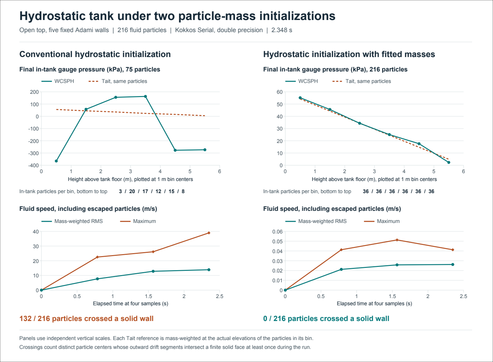

# WCSPH 固定壁与三维静水箱历史对照

本文保存原始 `h=1 m` 水箱的常规质量与校准质量轨迹对照。物理质量基线包含四组初始场。现行验收另以三档推进后的场量评价连续性积分。[当前修复验收](hydrostatic-continuity-repair.md) [物理质量静水初态验收](hydrostatic-initial-resolution.md)

三维 WCSPH 在 Kokkos Serial 的 `Simulation` 窗口内使用恒定重力和 Adami 固定壁粒子。验证对象是开顶长方体水箱。常规初始化和质量校准初始化使用同一底面、四面侧壁、粒子坐标、重力、压力算子、时间积分和观测终点。

## 算法与状态

调用者提供全 owned 流体初态、按输入行排列的初速，以及另一组固定壁粒子的位置、质量和稳定 ID。ID 在两组间唯一。积分模式可按算例指定固定平滑长度 `h`，默认值为 1 m。以下参数显式指定本历史 SI 算例的长度。

```cpp
sph::WcsphVerletParameters parameters{{1000., 80., 7.}, 0.5, {0., 0., -9.81}, 1.0};
sph::FixedWallParticles3D walls{wall_positions, wall_masses, wall_ids};
sph::Participant3D water(fluid_fields, 10000, parameters, initial_velocity, walls);
Simulation simulation(water);
```

1. 初始化将两组粒子复制到同一 `cellBegin` 格索引中。固定壁源参与邻域求和，只有流体拥有速度和积分结果行。流体密度按三维 M₄ 核计算，质量求和包括支持半径 `2h` 内的壁源。流体表压由 Tait 方程给出，保留负值。
2. 每次力评估都从本阶段的流体密度、表压重算参与受力的壁源。对固定壁粒子 $b$，用核权重 $W_{bf}$ 计算

   $$
   p_b=\frac{\sum_f W_{bf}\,[p_f+\rho_f\,\mathbf g\cdot(\mathbf x_b-\mathbf x_f)]}{\sum_f W_{bf}},
   \qquad
   \rho_b=\rho_0(1+p_b/B)^{1/\gamma},\quad B=\rho_0 c_0^2/\gamma .
   $$

   仅流体向壁面外推。干壁不参与受力。若所需壁压无法反解出正密度，试算返回数值失败。外供几何模式中用于 halo 的普通 ghost 继续遵循其完整邻域密度重构契约。[Adami、Hu 与 Adams](https://doi.org/10.1016/j.jcp.2012.05.005) · [公式及重力符号](https://pysph.readthedocs.io/en/1.0a1/reference/equations.html) · [压力算子](../../src/methods/sph/Pressure3D.cpp)
3. 对流体使用既有对称压力梯度，壁源贡献使用 $p_b/\rho_b^2$。两次 Velocity Verlet 半步均使用 $\mathbf a_p+\mathbf g$。壁源坐标在漂移时原样保留，流体跨格后按置换找回同一粒子的半步速度。快照中的 `pressure_acceleration` 以 m/s² 单独提供压力项。声学 CFL 仍使用已提交的流体速度。[Verlet 算子](../../src/methods/sph/Verlet3D.cpp) · [窗口与字段归属](../../src/participants/sph/Participant3D.cpp)

格表和壁面工作区位于本机 Kokkos HostSpace，由同步 Serial 执行。每个阶段的壁压、逆状态方程和力系数使用临时工作区。提交或回滚作用于整份候选几何及流体状态，旧快照继续持有自己的存储。本次覆盖静止壁的无黏压力作用，MPI 壁源交换、设备执行、持久重启和壁面切向剪切仍无此项实测。

## 可重现的水箱

- 水箱尺寸为 $6\times6\times6$ m，$z$ 向上，顶部开放。216 个流体粒子布置在 1 m 立方单元中心，584 个壁源构成两层外壳。底面和侧面交界处每个格点只放一个壁源。$h=\Delta x=1$ m，支撑半径 2 m。
- $\rho_0=1000$ kg/m³，$c_0=80$ m/s，$\gamma=7$，$g=9.81$ m/s²，两组初速均为零。取 $p(H)=0$、$H=6$ m，求解 $dp/dz=-\rho(p)g$。箱内参考密度为 $\rho_*(z)=\rho_0[1+(\gamma-1)g(H-z)/c_0^2]^{1/(\gamma-1)}$，参考表压为 $p_*(z)=B[(\rho_*/\rho_0)^\gamma-1]$。压力误差采用 $\rho_0gH=58.86$ kPa 归一化。
- **常规初始化**使用 $m_i=\rho_*(z_i)\Delta x^3$。顶部缺少上方邻居，求和密度会低估自由面附近的初始压力。该组全箱初始压力 RMS 误差为 253.97 kPa。
- **质量校准初始化**保留壁质量，对流体各行迭代 200 次，使初态满足 $\sum_f W_{if}m_f+\sum_b W_{ib}m_b\approx\rho_*(z_i)$。每次按“目标流体贡献 / 当前流体贡献”的正比值更新质量，开窗后所有质量固定。流体总质量从 216,978.51 kg 增至 224,463.59 kg（+3.45%），单粒子质量范围从 1,000.76–1,008.26 kg 变为 910.13–1,359.41 kg。这项校准只用于定义试验初态，两组的差异同时包含质量分布和总质量的变化。校准改用了解析初态，因此评价以推进后的独立观测为主。[试验代码与初始化](../../tests/methods/sph/hydrostatic_tank_tests.cpp)
- 目标物理时刻为 2.34765625 s，相当于 $3.00188\sqrt{H/g}$。每步取 $\min(1/256\;\mathrm{s},\,0.9\,\Delta t_{\mathrm{CFL}},\,t_{\rm end}-t)$。求解过程采用原始 Tait 表压，不施加速度阻尼、碰撞反弹或坐标夹取。

每个接受步按稳定 ID 对齐粒子中心。用线性 Verlet 漂移段与五个有限矩形壁面求交，分别记录向外穿越事件和至少穿过一次壁面的不同流体粒子数。越过壁面所在平面的延长线与真正穿过壁面分别计数，越过开口上沿不会计为穿墙。RMS 按流体粒子质量加权。各步最大速度与各步 RMS 速度的峰值分别统计。

## 两种初始化的历史实测对照

以下采用 Release double。终点箱内压力剖面按实际坐标分成六个 1 m 高的区间，同时要求粒子仍在原水箱的长、宽、高范围内。参考值按同组同层粒子的实际高度和质量求平均。各组在层内的空间分布不同，因此各有自己的参考列。

| 距底高度 (m) | 常规组粒数 | 常规表压 (kPa) | 常规组参考 (kPa) | 校准组粒数 | 校准表压 (kPa) | 校准组参考 (kPa) |
|---|---:|---:|---:|---:|---:|---:|
| 0–1 | 3 | −365.322 | 55.671 | 36 | 55.155 | 54.176 |
| 1–2 | 20 | 57.192 | 44.622 | 36 | 45.578 | 44.297 |
| 2–3 | 17 | 155.119 | 35.269 | 36 | 34.318 | 34.427 |
| 3–4 | 12 | 162.362 | 23.735 | 36 | 25.070 | 24.572 |
| 4–5 | 15 | −277.374 | 15.546 | 36 | 17.612 | 14.726 |
| 5–6 | 8 | −273.404 | 4.871 | 36 | 2.323 | 4.914 |

| 指标 | 常规初始化 | 质量校准初始化 |
|---|---:|---:|
| 初始压力 RMS 误差 (kPa) | 253.971 | 4.51×10⁻⁸ |
| 初始加速度残差 RMS / $g$ | 25.698 | 0.0928 |
| 终点仍在箱内的粒子数 | 75/216 | 216/216 |
| 终点箱内粒子的压力 RMS 误差 (kPa) | 588.907 | 1.833 |
| 终点全部粒子的压力 RMS 误差 (kPa) | 518.702 | 1.833 |
| 全程全部粒子压力 RMS 误差峰值 (kPa) | 1,020.941 | 4.433 |
| 终点全部粒子的 RMS 速度 (m/s) | 13.8798 | 0.02617 |
| 全程 RMS 速度峰值 (m/s) | 15.1726 | 0.04897 |
| 全程单粒子最大速度 (m/s) | 44.2740 | 0.07575 |
| 至少向外穿过一个实体壁面的独立粒子数 | 132/216 (61.1%) | 0/216 |
| 实体壁面向外穿越事件 (x− / x+ / y− / y+ / 底) | 55 / 56 / 55 / 55 / 46 | 0 / 0 / 0 / 0 / 0 |
| 到达终点的接受步数 | 602 | 601 |

全部粒子的速度包含逃逸粒子。全粒子压力 RMS 对逃逸粒子沿用同高度的静水参考，超过初始液面时取零表压，低于底面时向下延拓参考解。该量描述偏离初态的程度。评价箱内压力分布应读箱内误差和剖面两项。终点仍在箱内的数量与全程穿墙的独立粒子数分别测量，可出现越过开口上沿或穿墙后再进入水箱的轨迹。



压力在质量校准组逐层向上递减，终点箱内 RMS 误差为 3.11% 静水压头（常规组误差约为其 321 倍）。校准组仍有可测的自由面偏差，最上层低估 2.59 kPa。在三个重力时间内，全部粒子的 RMS 速度峰值降至常规组的约 1/310。校准组粒子中心到侧壁、底壁的最小距离分别为 0.48426 m 与 0.49484 m，初始均为 0.5 m，最大穿透深度为零。

初始密度已经用于校准，接近解析解的初始压力本身不能证明壁面准确。独立的结果是相同离散在后续多步中能保持多好的压力梯度和法向约束。常规组在第一步前已有 $25.7g$ 的 RMS 加速度残差，开放自由面对密度求和的影响经 Tait 方程放大；即使启用相同的 Adami 固壁，也未维持静水。当前证据限于该粒距、初态和观测时长。两组对照不能分别估计总质量增加与局部质量重新分配的贡献。

Release float 重复计算时，校准组终点压力 RMS 为 1.833 kPa，RMS 速度峰值为 0.04897 m/s，穿墙粒子为 0/216。常规组终点仍在箱内的粒子为 115/216，箱内压力 RMS 为 598.75 kPa，穿墙粒子为 139/216。常规组的失稳趋势跨精度一致，逃逸后的具体轨迹对舍入敏感。

## 历史回归与复跑

四组从空目录进行的离线矩阵验证运行于 `2026-11-20T10:35:10+08:00` 至 `2026-11-20T10:37:15+08:00`。硬件为 Apple M2 Pro，系统为 macOS 27.2.1 arm64（26B131），工具链为 AppleClang 21.0.0.21000401、C++20、CMake 4.4.3、Ninja、Kokkos 5.2.2 Serial 和 GoogleTest 1.17.0。Debug 和 Release 的 float 各通过常规 CTest 122/122，double 各通过 123/123，四组均零跳过。每组均通过依赖边界、精度 oracle 和迁移安装包测试（1/1，包内消费者 3/3）。单独导出的四组 GoogleTest XML 各通过 6/6 项重力、壁面、水箱与大加速度检查；每种精度的 287 项观测属性在 Debug 和 Release 间一致。

本机 `results/wcsph-adami-20261120T102200/comparison/` 保存各组 JUnit、工具链与配置日志、`tank-{debug,release}-{float,double}.xml`，以及本次工作树的 145 项源码及验证输入摘要 `source-sha256.txt`。制作摘要时 HEAD 为 `3bd6d08b5910bae1a02e46e71f65339960396ebe`，清单的 SHA-256 为 `84d91ba148af0061c68f0f2de9935857deebc0fa6d9be122a8c3a75edacb7874`。双轨迹 Debug 水箱在并发验证时曾超过通用单测的 30 s 限制，CTest 对该用例单设 180 s。

固定壁回归使用三轴自由落体解析解核对两次重力半步。另一项从独立全扫描计算流体密度、重力修正壁压、逆 Tait 壁密度和逐流体压力力值，覆盖跨格、未润湿壁源、输入缓冲改写、保留快照、回滚和缩步重试。无正壁密度的试算必须失败并允许从原状态重试。[壁面回归](../../tests/methods/sph/adami_wall_tests.cpp)

水箱回归要求两组完整推进且字段有限。对校准组还检查初态相对压头 RMS 误差低于 $10^{-4}$，全程压力 RMS 峰值低于 0.25 倍压头，RMS 速度峰值及单粒子最大速度分别低于 $0.2\sqrt{gH}$ 和 $0.5\sqrt{gH}$，终点六层平均表压随高度递减，五面均有正净距且穿越次数为零。这些门限用于该粗分辨率算例的回归。常规组是负对照，完成推进不代表通过静水验收。

历史质量拟合驱动已退出当前构建。重放本文时，先根据修复报告恢复历史求和密度版本，再在该版本的仓库根目录执行以下命令。[历史版本复跑](hydrostatic-continuity-repair.md)

```sh
run=wcsph-adami-rerun
for config in Debug Release; do
  python3 tools/validate_serial.py --cc /usr/bin/cc --cxx /usr/bin/c++ \
    --config "$config" verify \
    --prefix ".cache/dependencies/gtest-validation/kokkos-$config" \
    --gtest-prefix ".cache/dependencies/gtest-validation/gtest-$config" \
    --work-dir "build/$run" --logs "results/$run/$config" \
    --jobs 4 --precisions float double --require-network-blocked || exit 1
done
"build/$run/release-double/tests/methods/sph/nexora_sph_tests" \
  --gtest_filter='SphHydrostaticTank.OpenFiveFaceTankUnderGravity' \
  --gtest_output="xml:results/$run/tank-release-double.xml"
```
