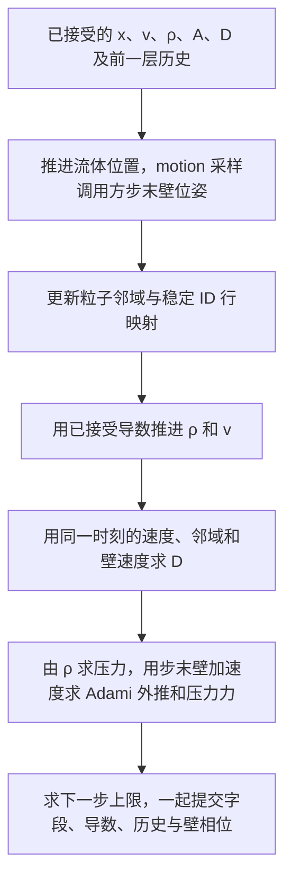
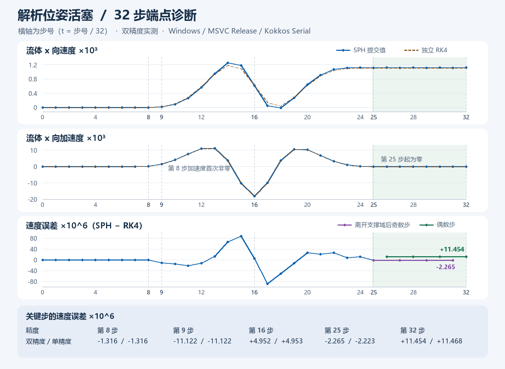

# 三维 WCSPH 中心差分积分与 Serial 验收

`Simulation::run` 驱动 `WcsphParticipant3D` 时默认使用本积分器。以粒子稳定 ID 区分流体状态。记压力加速度为 `a_p`，恒定重力为 `g`，总加速度为 `A = a_p + g`，连续性方程的密度变化率为 `D`。发布字段 `pressure_acceleration` 只含 `a_p`。公式适用于每个流体粒子和每个速度分量。[单步入口](../../src/participants/sph/WcsphStep3D.cpp) · [积分算子](../../src/methods/sph/Verlet3D.cpp)



## 时间离散与启动

设本步长为 `h`，上一步长为 `k`，二者取自请求时长。所有步的位置均按 `x[n+1] = x[n] + h (v[n] + ½ h A[n])` 推进。对 `(y,f) = (v,A)` 或 `(ρ,D)`，实现采用以下公式。

| 条件 | 更新 y |
| --- | --- |
| 首步，尚无前一层 | `y[n+1] = y[n] + h f[n]` |
| 连续等步长 | `y[n+1] = y[n−1] + 2 h f[n]` |
| 请求步长改变，或已连续完成 39 个中心差分步 | `y[n+1] = y[n] + h f[n] + h²/(2k) (f[n] − f[n−1])` |

首步由初态几何上的导数建立第二个时间层，速度和密度的一次启动局部误差为 O(h²)。等步长公式取自 DualSPHysics 式 30。该文献在式 31 附近指出奇偶层可能分离，并建议约每 40 步重新耦合。Nexora 对变步长与重新耦合使用二阶 Adams–Bashforth：将最近两个导数作线性外推，再对长度为 h 的新区间积分，即得表中最后一式。该式从当前值出发，导数恒为零时下一值与当前值相同。首步计为第 1 步，持续等步长时第 41、81、121 步再同步，变步长也重新开始计数。均匀步和具有限制步长比的平滑细化分别验证。没有对任意步长序列作稳定性保证。[DualSPHysics §3.7.1](https://github.com/DualSPHysics/DualSPHysics/wiki/3.-SPH-formulation#371-verlet-scheme)

变步长系数与独立文献式 13 等价。对光滑解，上述 AB2 步的主局部误差与 `h³/6 + h²k/4` 成正比。端点等距时系数归为 `5h³/12`。Spitfire 的变步长算例也以一次前向欧拉建立 AB2 历史。[变步长多步法的局部误差，式 13–14](https://link.springer.com/article/10.1007/s11075-020-00900-1) · [Spitfire 的 AB2 启动与变步长公式](https://spitfire.readthedocs.io/en/latest/demo/time_integration/explicit/customized_adaptive_stepping.html#variable-step-ab2-method)

历史保留一个已接受时间层的速度、密度、压力加速度和密度变化率。粒子跨格时，新行经格网排列映射到同一 ID 的旧行。同步 Serial 参与者持有相应 HostSpace 分配、读权和预算票据，重建格网或释放临时位置缓冲不丢弃历史。数值或预算失败保留先前的读权、时钟和历史。协调器按生命周期进入 failed；直接参与者在同一起点可提交较小请求。运动壁经 `motion` 单向采样，调用方保留已接受壁运动，失败时丢弃候选并按新请求重算；SPH 不恢复外部所有者的状态。持久化重启与分布式迁移需要另外定义历史字段、行映射和再同步计数的保存协议。[状态与历史](../../src/participants/sph/WcsphStep3D.hpp) · [提交](../../src/participants/sph/WcsphParticipant3D.cpp)

## 解析活塞 32 步速度误差的来源

在 `95e7987` 的运动壁迁移工作树上，用手写解析壁运行 32 个等步长（`h = 1/32`），导出初态及每个提交端点的流体速度、压力加速度、位置、密度和壁位置。该夹具的重力为零。参考速度取自独立的 16,384 步 RK4 积分，参考加速度在同一物理时刻、用 RK4 端点的位置和参考密度求值。以 8,192 步独立复算，全部 33 个端点与该参考的速度差小于 4.4e−15，加速度差小于 9.3e−15。下文的误差均为计算值减参考值。[两种精度的逐步实测与参考 CSV](piston-32-step-trace.csv)



| 步号（double） | 实测速度 | RK4 速度 | 实测加速度 | RK4 端点加速度 |
| ---: | ---: | ---: | ---: | ---: |
| 7 | 0 | 0 | 0 | 0 |
| 8 | 0 | 1.315674e−6 | 1.968060e−4 | 1.968010e−4 |
| 9 | 1.230038e−5 | 2.342252e−5 | 1.427700e−3 | 1.427293e−3 |
| 16 | 6.167863e−4 | 6.118343e−4 | −1.812664e−2 | −1.816537e−2 |
| 17 | 4.616529e−5 | 1.343763e−4 | −1.003696e−2 | −1.005684e−2 |
| 25 | 1.111018e−3 | 1.113283e−3 | 0 | 0 |
| 32 | 1.124737e−3 | 1.113283e−3 | 0 | 0 |

**第 8 步出现偏差，第 9 步首次越过 2e−6。** 流体在首次接触前静止。壁越过核支持边界的时刻为 `t ≈ 0.22940195`，落在第 7 步端点 0.21875 与第 8 步端点 0.25 之间。中心差分给出 `v₈ = v₆ + 2h·a₇ = 0`，RK4 积累了这段时间的非零加速度。第 8 步已正确发布接触加速度；第 9 步以 `v₇ + 2h·a₈` 近似两个步长上的速度增量，低估 1.11221e−5。原断言只在第 16 和 32 步采样。

**用参考加速度回放速度公式，两个原验收点依然超限。** 取相同的初始速度和启动公式，从第 2 步起用 `w[n+1] = w[n−1] + 2h·a_RK4[n]`。这样消除流体离散状态对力的影响，单独测出两步中点求积的误差。表中最后一列是实测速度减回放速度；它反映离散位置、密度反馈到力后的累计影响及舍入。

| 步号 | 实测速度误差 float / double | 参考加速度回放误差 | 实测减回放 float / double |
| ---: | ---: | ---: | ---: |
| 16 | +4.953082e−6 / +4.952023e−6 | +2.880952e−6 | +2.072131e−6 / +2.071072e−6 |
| 32 | +1.146752e−5 / +1.145399e−5 | +7.025379e−6 | +4.442142e−6 / +4.428607e−6 |

用实测加速度替换回放中的参考加速度，并在每个输出端点按本构建精度舍入，两个构建都逐步重现了全部已发布速度。另用实际流体和壁位置之差（在 `real` 精度求差）、实际密度、解析壁加速度以及单邻居 M4 核和 Adami 公式独立重算瞬时加速度，33 点最大绝对差为 float 1.35e−8、double 1.13e−17。作为求积对照，在相同的 RK4 加速度序列上逐步用两端点梯形求积，16、32 步的速度误差分别为 +4.67e−7、−1.02e−7。此项回放没有推进流体位置或密度。[生产速度更新](../../src/methods/sph/Verlet3D.cpp) · [原端点半踢方案的历史实测](sph-3d-refactor-serial.md)

接触中段加速度急剧变化并换号，第 17 步的速度绝对误差达到全周期最大值（double 为 8.82110e−5）。第 25 步起双方的加速度均为零，中心差分随之复制各自前两步的速度。奇步和偶步的 double 速度误差分别维持在 −2.26485e−6 和 +1.14540e−5。首个再同步步是第 41 步，位于本周期之外。该回归来自已配置速度积分公式在这个步宽的截断误差，以及随后的流体状态反馈。原速度门槛 2e−6 与生产积分公式均予以保留。

Windows x64、Intel Core i5-13600KF、MSVC 19.38.33133、Kokkos 5.2.2 Serial 的 float/double Release 于 `2026-11-26T21:57:07+08:00` 完成全部 `nexora_sph_tests`。float 通过 122/124，double 通过 121/123。两个失败均为手写解析位姿与 Lepton 位移表达式活塞在 32 步的速度断言。原解析活塞的 49 项误差记录逐项复现。以 `--gtest_filter=SphVerlet.RoundTripPistonResolvesTransientContact --gtest_output=xml:piston.xml` 可在 XML 属性 `endpoint_trace_uniform_32` 中取得本构建的全部端点。

## 历史实测范围

以下计数、误差表和执行矩阵取自 `95e7987` 收录的中心差分验收记录。调用方欧拉壁的迁移复验另有记录。[运动壁复验](velocity-driven-wall-serial.md)

## 常规步的实际工作量

用两个相邻流体粒子和两个固定壁粒子复测。两行流体都接触同一壁，另一壁在支持半径外。流体 x 为 0.25、0.75，壁 x 为 1.25、5，其余坐标为零。两流体初速为 0.03125、−0.015625，质量与密度为 1，平滑长度为 1。初始化后先完成一个 1/32 步，再单独统计第二个 1/32 步。[常规步计数夹具](../../tests/methods/sph/verlet_window_tests.cpp)

| 一个常规步 | 原实现 | 中心差分 |
| --- | ---: | ---: |
| 更新空间网格 | 1 | 1 |
| 密度变化率求值的时间层 | 步初、步末预测 | 步末 |
| 压力加速度求值的时间层 | 步末 | 步末 |
| 连续性遍历的流体中心 / 邻居回调 | 4 / 8 | 2 / 4 |
| 压力力遍历的流体中心 / 邻居回调 | 2 / 4 | 2 / 4 |
| Adami 遍历的壁中心 / 邻居回调 | 1 / 2 | 1 / 2 |

对基线 `c3c1553231571b5356cfea49c1cd8f53a463a9be` 与改动后的 float Debug 均启用 Clang `-fprofile-instr-generate -fcoverage-mapping`，在启动步后重置计数。用 `llvm-cov export` 读取 `CellGrid::update_positions` 与不同调用者实例化的 `NeighborView3D::for_each_neighbor_impl` 次数，并读取邻居回调所在行的执行次数。仓内回归另以 Kokkos Tools 核对一次网格检查、一次连续性求值和一次压力加速度求值。一般情况下每个流体行执行两次邻域遍历，每个实际参与压力外推的不同壁粒子另需一次。主动驱逐格网后，下次步进还需从旧几何重建派生索引。此计数不衡量墙钟提速。

## 数值结果

往返活塞采用独立 RK4 时间参考和解析密度关系，在一个周期内逐步记录结果。以下是半周期和整周期两个采样点中的最大速度绝对误差。“交替”表示步长 3:1 交替，平均步长与同表等步长相同。[独立活塞参考与误差采样](../../tests/methods/sph/verlet_window_tests.cpp)

| 每周期步数 | 等步长 float | 等步长 double | 交替 float | 交替 double |
| ---: | ---: | ---: | ---: | ---: |
| 32 | 1.147e−5 | 1.145e−5 | — | — |
| 64 | 1.262e−6 | 1.227e−6 | 2.535e−5 | 2.532e−5 |
| 128 | 2.997e−7 | 3.149e−7 | 3.287e−6 | 3.239e−6 |
| 256 | 6.418e−8 | 7.500e−8 | 4.735e−7 | 4.482e−7 |

**每周期 32 个等步长未达到既有速度误差上限 2e−6；64 步在两种精度下均达标。** 初始活塞在作用半径外，启动时该粒子的导数为零。在独立标量活塞参考中，将重新同步间隔从 1 到 41 逐一取值，单步 Euler 和 AB2 两种再同步都未使 32 步的两个采样点同时达标。等步长 256 步时，脱离接触并完成再同步后的最后两个时间层速度、密度逐位相等。

| 256 步全周期最大绝对误差（奇步 / 偶步） | 速度 | 密度 |
| --- | ---: | ---: |
| 等步长 float | 1.205e−6 / 1.224e−6 | 1.097e−6 / 9.991e−7 |
| 等步长 double | 1.208e−6 / 1.225e−6 | 3.721e−8 / 3.560e−8 |
| 交替 float | 3.528e−6 / 3.533e−6 | 1.551e−6 / 1.624e−6 |
| 交替 double | 3.517e−6 / 3.522e−6 | 1.014e−7 / 1.014e−7 |

光滑粒子对的密度细化在 double 的两档观测阶为 2.00001、2.00000。与按稳定 ID 计算的独立全粒子扫描对照，不等质量轨迹的位置、速度、密度最大误差依次为 float 的 1.192e−7、1.788e−7、2.980e−8，以及 double 的 1.110e−16、1.110e−16、0。恒定重力下的抛物轨迹、跨格后行序翻转、释放临时工作区和运动壁时钟另有回归。字节预算失败用例在已建立历史后试算大步，随后在同一预算下缩步，与直接小步的结果逐项相等。该夹具的预算为 float 551 字节、double 871 字节。[连续性与恒加速度](../../tests/methods/sph/continuity_tests.cpp) · [重排与失败重试](../../tests/methods/sph/verlet_window_tests.cpp)

现行速度驱动算例由调用方欧拉推进，再经 `motion` 供数；沿用相同活塞参考记录流体误差并检验壁位置的一阶收敛。32 步流体绝对误差门槛用于解析位姿活塞。[速度驱动壁验收](velocity-driven-wall-serial.md)

## 执行环境与复验

本轮中心差分矩阵完成于 `2026-11-26T16:15:31+08:00`。环境为 macOS 27.2.1 arm64（Darwin T6020）、Apple Clang 21.0.0、C++20、CMake 4.4.3、Ninja 1.13.2，使用本地 Kokkos 5.2.2 Serial 和 GoogleTest 1.17.0。`libkokkoscore.a` 的 SHA-256 为 `b02d99a10f3397d9e2ee8e119ba7f219717e422fe44cac1db7370c3506765a98`。基线以上述 Git 修订为准，本次 `git diff -- src tests tools/validate_serial.py` 的 SHA-256 为 `b715ab04c38fb8e960040806de454159409b818142d6a946ce3f9ff5b7b0b4af`。[依赖来源与许可](../../third_party/README.md)

| Nexora 配置 | 完整 CTest 通过数 | 唯一失败 |
| --- | ---: | --- |
| float Debug | 188 / 189 | 往返活塞，等步长 1/32 速度 |
| float Release | 188 / 189 | 同上 |
| double Debug | 186 / 187 | 同上 |
| double Release | 186 / 187 | 同上 |

四组均编译成功，通过依赖边界检查、安装消费和 Reference 的 Decimal 校验。步末压力求值后的 10 处主机分配在四组配置各自逐一触发失败，已验证历史和当前状态保留、额度回收及恢复后的计算结果。Doxygen 1.9.8 生成了维护者文档，并核对了历史字段与可复用位置缓冲的说明。当前证据限于单进程 CPU Serial。

在已配置的每个独立构建目录中复验，`precision` 取 `float` 或 `double`。CTest 的非零退出与上表所列失败对应。

```sh
cmake --build "$build" --parallel 3
python3 tools/check_dependencies.py --graph "$build/nexora-target-graph.json"
ctest --test-dir "$build" --output-on-failure --output-junit "$build/central-difference-ctest.xml"
python3 tools/check_reference_precision.py --log "$build/Testing/Temporary/LastTest.log" \
    --precision "$precision" --output "$build/central-difference-reference.json"
```
