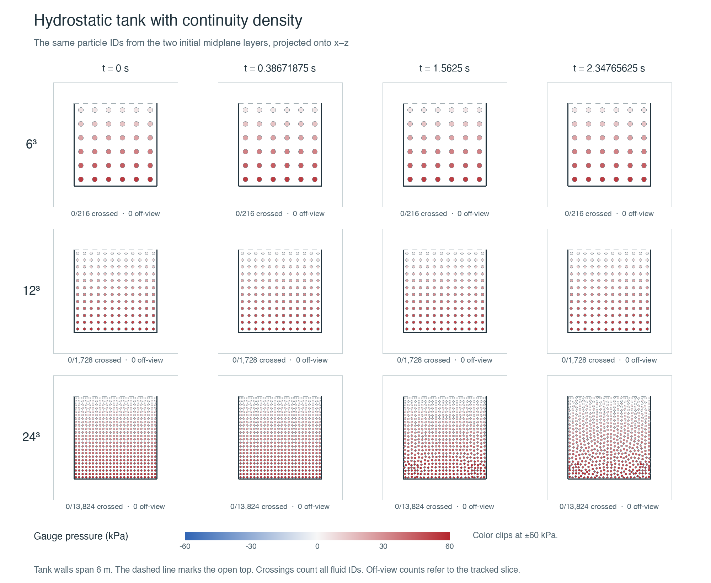
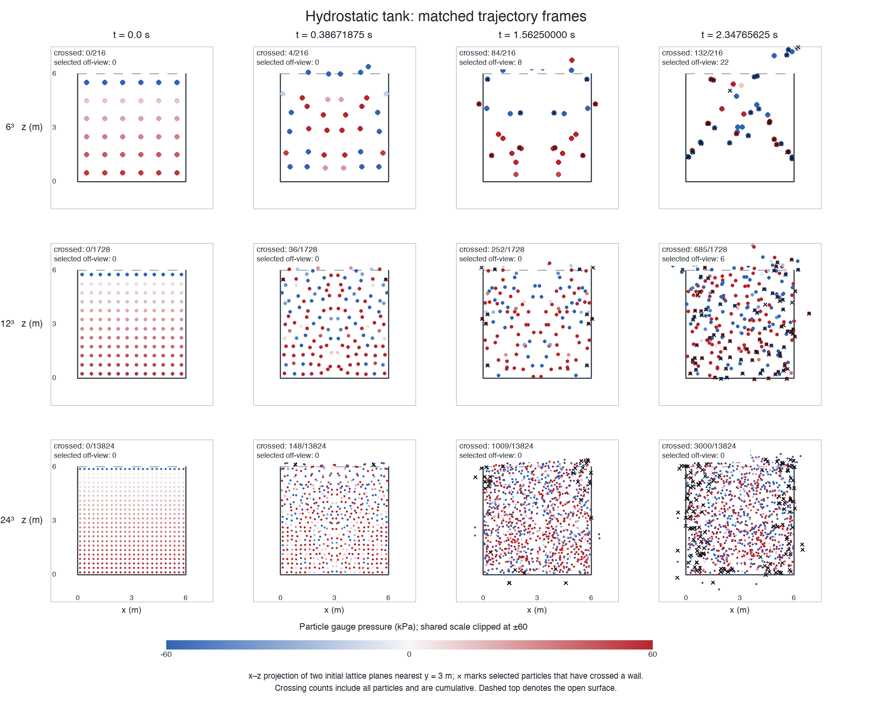
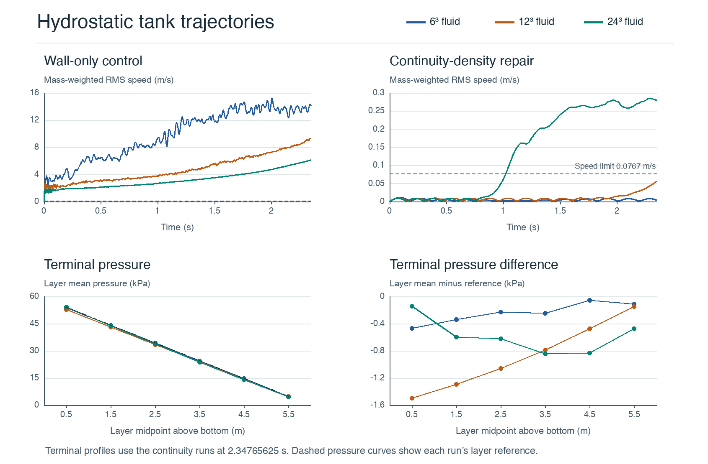

# WCSPH 开顶静水箱的壁层覆盖与连续性密度验证

在 6 m 开顶立方水箱中，以相同的常规物理质量分别重放原算法、只修改铺壁的算法、再加入连续性密度的算法。三档都推进至 **2.34765625 s**。只修改铺壁时，原算例已有两层完整壁粒子，三档轨迹全部复现。再加入物理初始密度及其时间积分后，三档五面穿墙事件均降至零。6³ 和 12³ 同时通过压力及速度门限。24³ 的终点压力 RMS 误差为 **4.637 kPa**，全程 RMS 速度峰值为 **0.28433 m/s**，两项均超标。修复后，三档加密的压力误差和速度峰值均递增，本算例没有给出静水空间收敛证据。

## 同时刻的实际粒子





从左至右取 0、0.38671875、1.5625、2.34765625 s 的实际接受步。两图视角、视野与 ±60 kPa 表压色标一致，截取各分辨率初始最靠近 y=3 m 的两层流体粒子，始终跟踪同一批 ID 并投影到 x–z 平面。面板下方的累计穿墙数覆盖全体。原实现三档最后均有逃逸。修复后的 24³ 到 1.5625 s 已出现肉眼可见的排布扰动，终点尤其明显，13,824 个流体粒子均在箱内。

## 三种算法的同条件对比

终点压力 RMS 取仍在箱内的粒子，将数值压力与各粒子实际高度处的 Tait 静水参考压力逐一相减，再按质量计算 RMS。速度 RMS 为全体流体（含逃逸粒子）的质量加权三维速度模 RMS，全程峰值遍历每个接受步。净加速度为压力加速度与重力的矢量和，表中的净加速度 RMS 取终点全体粒子。三组门限分别为压力 RMS ≤ 2.943 kPa，速度峰值 ≤ 0.0767203 m/s，以及五个实体面全程零向外穿越事件。

| 分辨率 | 算法 | 接受步数 | 终点箱内 / 全部 | 终点压力 RMS 误差 (kPa) | 全程 RMS 速度峰值 (m/s) | 终点净加速度 RMS (m/s²) | 穿墙并集 / 占比 | 向外事件数 |
|---|---|---:|---:|---:|---:|---:|---:|---:|
| 6³ | 原算法 | 602 | 77/216 | 497.995 | 15.17313 | 577.825 | 132 / 61.11% | 268 |
| 6³ | 只改壁层 | 602 | 77/216 | 497.995 | 15.17313 | 577.825 | 132 / 61.11% | 268 |
| 6³ | 壁层＋连续性密度 | 601 | 216/216 | 0.284 | 0.01069 | 0.119 | 0 / 0% | 0 |
| 12³ | 原算法 | 1,203 | 1,417/1,728 | 404.412 | 9.27233 | 650.890 | 685 / 39.64% | 1,099 |
| 12³ | 只改壁层 | 1,203 | 1,417/1,728 | 404.412 | 9.27233 | 650.890 | 685 / 39.64% | 1,099 |
| 12³ | 壁层＋连续性密度 | 1,202 | 1,728/1,728 | 1.398 | 0.05509 | 0.255 | 0 / 0% | 0 |
| 24³ | 原算法 | 2,407 | 12,347/13,824 | 260.777 | 6.09394 | 834.749 | 3,000 / 21.70% | 4,970 |
| 24³ | 只改壁层 | 2,407 | 12,347/13,824 | 260.777 | 6.09394 | 834.749 | 3,000 / 21.70% | 4,970 |
| 24³ | 壁层＋连续性密度 | 2,404 | 13,824/13,824 | 4.637 | 0.28433 | 6.073 | 0 / 0% | 0 |

三档修复后的全程逐粒子压力 RMS 峰值依次为 1.308、1.398、5.871 kPa。24³ 相对原算法的终点压力 RMS 降低 98.22%，速度峰值降低 95.33%，仍分别为各自门限的 1.58 和 3.71 倍。新初态直接输入解析密度，三档初始压力 RMS 均小于 10⁻⁹ Pa，初始净加速度 RMS 仍有 0.195–0.197 m/s²。只改壁层与原轨迹在三档的步骤、关键帧、剖面、事件共 12 份 CSV 的全部既有字段逐行完全相同。旧文件缺少加速度分量，表中原算法的加速度取自该相同轨迹的加速度复测。[逐步指标汇总](hydrostatic-repair-summary.csv)

### 五个实体面的穿墙

每格依次为穿过该面的去重 ID 数、占初始全部粒子比例和向外穿越事件数。按相邻接受步同一 ID 的直线漂移段与有限矩形实体面的交点计数。重复向外穿越可增加事件数，跨面 ID 在并集仅计一次。顶部为大气开口。

| 实体面 | 原算法与只改壁层 6³ | 原算法与只改壁层 12³ | 原算法与只改壁层 24³ | 壁层＋连续性密度，三档各自结果 |
|---|---:|---:|---:|---:|
| x=0 | 35 / 16.20% / 56 | 149 / 8.62% / 212 | 778 / 5.63% / 1,163 | 0 / 0% / 0 |
| x=6 | 36 / 16.67% / 56 | 157 / 9.09% / 230 | 712 / 5.15% / 1,088 | 0 / 0% / 0 |
| y=0 | 35 / 16.20% / 54 | 153 / 8.85% / 213 | 732 / 5.30% / 1,092 | 0 / 0% / 0 |
| y=6 | 34 / 15.74% / 54 | 169 / 9.78% / 236 | 719 / 5.20% / 1,135 | 0 / 0% / 0 |
| z=0 底面 | 32 / 14.81% / 48 | 156 / 9.03% / 208 | 408 / 2.95% / 492 | 0 / 0% / 0 |
| 五面并集 | 132 / 61.11% / 268 | 685 / 39.64% / 1,099 | 3,000 / 21.70% / 4,970 | 0 / 0% / 0 |

[逐档逐面统计与首次穿越时间](hydrostatic-repair-crossings.csv)

### 终点压力剖面和逐层净加速度

每格依次为箱内该层的**实测平均表压 / 解析平均表压**（kPa）及**净加速度 RMS**（m/s²），均按该层粒子质量加权。解析压力按每个粒子实际高度取值。

| 离底高度 (m) | 修复后 6³ | 修复后 12³ | 修复后 24³ |
|---|---:|---:|---:|
| 0–1 | 53.71 / 54.18 / 0.123 | 52.68 / 54.18 / 0.289 | 54.01 / 54.15 / 7.537 |
| 1–2 | 43.95 / 44.29 / 0.095 | 43.00 / 44.29 / 0.339 | 43.69 / 44.29 / 7.118 |
| 2–3 | 34.19 / 34.42 / 0.142 | 33.36 / 34.42 / 0.302 | 33.81 / 34.44 / 6.467 |
| 3–4 | 24.32 / 24.57 / 0.122 | 23.78 / 24.57 / 0.229 | 23.76 / 24.61 / 5.604 |
| 4–5 | 14.67 / 14.73 / 0.122 | 14.25 / 14.73 / 0.166 | 13.97 / 14.80 / 4.824 |
| 5–6 | 4.79 / 4.90 / 0.103 | 4.75 / 4.90 / 0.141 | 4.48 / 4.96 / 4.130 |

原算法和只改壁层的 24³ 底部两层平均表压分别为 63.92、76.74 kPa，出现倒置。修复后的各档平均压力均随高度递减，但均值会掩盖层内波动。以 24³ 底层为例，平均偏差仅 −0.143 kPa，该层逐粒子压力 RMS 误差却有 5.994 kPa。完整表给出三组共 54 个高度区间的粒子数、质量、压力均值、参考均值、压力 RMS 与净加速度 RMS。[三组完整分层数值](hydrostatic-repair-layers.csv)



## 24³ 晚期残差

将名义步长与 CFL 安全系数同时减半，保持物理参数、初态、终点及输出时刻相同。

| 24³ 同终点对照 | 接受步数 | 终点压力 RMS 误差 (Pa) | 全程速度 RMS 峰值 (m/s) | 终点净加速度 RMS (m/s²) | 穿墙事件 |
|---|---:|---:|---:|---:|---:|
| 标准步长 | 2,404 | 4,636.841 | 0.284328 | 6.072669 | 0 |
| 半步长 | 4,808 | 4,638.470 | 0.284347 | 6.072211 | 0 |

标准步长下，24³ 的速度 RMS 在 1.0234375 s 首次超过 0.0767203 m/s，压力 RMS 在 1.091796875 s 首次超过 2.943 kPa。步长减半后终点压力误差改变 0.035%，全程速度峰值改变 0.0067%。同一中间时刻 1.5625 s，两者的压力 RMS 也十分接近（5,791.76 与 5,791.89 Pa）。本次步长试验中，细档的晚期误差对时间离散不敏感。[半步长逐项指标](../../results/wcsph-continuity-repair/half-dt-summary.csv) · [半步长分层指标](../../results/wcsph-continuity-repair/half-dt-profiles.csv)

在修复后的 0、1.5625、2.34765625 s，从各粒子位置、质量和压力重新构造邻域，按来源分解压力加速度，并与生产求解器导出的每个 ID、每个分量核对。三档共九帧最大闭合差为 2.99×10⁻¹³ m/s²。

| 24³ 终点全体粒子 | 竖向质量加权均值 (m/s²) | 矢量 RMS (m/s²) |
|---|---:|---:|
| 流体对流体压力 | 约 0 | 70.304 |
| 固壁对流体压力 | +9.74161 | 70.913 |
| 重力 | −9.81000 | 9.810 |
| 合力产生的净加速度 | −0.06839 | 6.07267 |

终点水平净加速度 RMS 达 4.822 m/s²，竖向为 3.692 m/s²。远离边界、无直接壁力的内部区域仍有 5.849 m/s²；底部非底角区域为 7.577，侧壁为 6.589，自由面带为 3.835 m/s²。固定终点粒子位置和质量，把所有流体密度和压力换成该高度的解析值再求力，净加速度 RMS 为 6.619064 m/s²。把壁压也换成解析值后为 6.619068 m/s²。说明在已经扰动的粒子排布上，压力梯度的空间离散本身就留下明显失衡。这个瞬时对照无法确定最早是哪种扰动触发增长。[逐区域力分解与解析场替换](hydrostatic-continuity-forces.csv) · [独立重构程序](hydrostatic_force_balance.py)

## 架构与算法

本算例固定箱边长 H=6 m，粒距 Δx=6/n，M₄ 核的 h=Δx，重力为 (0,0,−9.81) m/s²。Tait 参数为 ρ₀=1000 kg/m³、c₀=80 m/s、γ=7。约定大气表压 p(H)=0。平衡参考满足 dp/dz=−ρg，其解析密度为 ρ*(z)=ρ₀[1+(γ−1)g(H−z)/c₀²]^(1/(γ−1))，p*(z) 由同一 Tait EOS 得到。流体与固定壁均取常规质量 mᵢ=ρ*(zᵢ)Δx³，同一 ID 的质量在推进期间恒定。6³、12³、24³ 的总流体质量分别为 216,978.512、216,978.436、216,978.417 kg。壁粒子静止，流体从零速开始。两种密度路径的对比同时改变了初始密度的来源和以后的密度更新，不能将收益进一步分摊给这两项。

1. **算例几何**。开顶箱的共享生成器按 ⌈2h/Δx壁⌉ 层填满底部、四侧及交棱、角点。顶缘以上保留空气侧空域。独立参考取更厚的六层实体点阵，用实际距离 r<2h 筛选，再逐流体 ID 比对生产邻域返回的完整壁格心坐标集合。验证覆盖三档 h=Δx、h/Δx壁=1.3（三层），以及固定 h=0.5 m、Δx壁=0.25 m（四层）；另把探针移到壁、棱、底角的支撑范围并移出。在 d/h=0.5 的自由面内侧，连续核质量仅约 0.81224，离散权重和约 0.85029。零大气表压是自由面参考条件，液内粒子的压力仍由 EOS 求得。实体侧补足壁粒子后，空气侧的核截断依然存在。[共享几何](../../tests/methods/sph/hydrostatic_tank_fixture.hpp) · [独立覆盖检查](../../tests/methods/sph/hydrostatic_initial_tests.cpp) · [自由面核截断实测](hydrostatic-initial-resolution.md)
2. **已接受状态**。时间积分入口接收与输入流体顺序对应的显式物理密度。初始化时将密度映射到已排序的流体行，与位置、速度、质量及稳定 ID 对应。省略初始密度时，参与者可提供核求和初态诊断，开窗返回 `unsupported`。独立评估可直接在给定格表上调用 `evaluate_density_3d` 或 `evaluate_pressure_3d`。普通 ghost 在压力算子中按本阶段完整邻域重构密度。[Participant3D 接口](../../src/participants/sph/Participant3D.hpp)
3. **一步推进**。令 aₙ 为已接受状态的压力加速度与重力之和。在已接受位置、速度上计算 Dₙ=Σⱼmⱼ(vᵢ−vⱼ)·∇ᵢWᵢⱼ，源包括流体与速度为零的固定壁。先半踢 v½=vₙ+Δt·aₙ/2，再漂移至 xₙ₊₁=xₙ+Δt·v½。用 v*=vₙ+Δt·aₙ 与新位置计算 D*，按 ρₙ₊₁=ρₙ+Δt(Dₙ+D*)/2 校正。用新密度求 Tait 表压，外推 Adami 壁压和反解壁密度，计算原有对称压力力，最后半踢 vₙ₊₁=v½+Δt·aₙ₊₁/2。两阶段共用原 M₄ 核梯度与实际格邻域。全程未使用阻尼、压力限幅或质量拟合。[连续性算子](../../src/methods/sph/Verlet3D.cpp) · [窗口推进](../../src/participants/sph/Participant3D.cpp) · [Adami 外推和压力力](../../src/methods/sph/Pressure3D.cpp)
4. **所有权与失败处理**。实现使用 Kokkos Serial 的受预算管理临时 View，按试算置换对应到同一粒子的质量、上一步已接受密度和第一阶段密度率。成功步的工作区可在下一步复用。创建候选字段或为保留的试算快照准备提交副本遇到预算不足时，参与者可释放已完成用途的工作区后重试。只有校正密度正值、有限且可由所选精度表示，且新压力和末速度均有效，窗口才可提交。失败保留上一已提交快照和仿真时钟，可从该状态缩小步长重试。本次执行范围为单进程 CPU Serial；跨 rank 交换、GPU 执行和持久 checkpoint 尚无本次实测。

固定壁的外推与流体压力力采用下面两式。下标 b 表示固定壁粒子，f 表示其流体邻居，j 遍历流体目标 i 的所有有贡献邻居。壁压反解 Tait EOS 后得到壁密度，随后与流体邻居一起参与压力求和。

$$
p_b=\frac{\sum_f W_{bf}[p_f+\rho_f\,\mathbf g\!\cdot\!(\mathbf x_b-\mathbf x_f)]}{\sum_f W_{bf}},
\qquad
\mathbf a_{p,i}=-\sum_j m_j
\left(\frac{p_i}{\rho_i^2}+\frac{p_j}{\rho_j^2}\right)\nabla_i W_{ij}.
$$

## 算子与轨迹核验

- 静止非核求和值的密度保持不变。受控固定壁压缩与膨胀分别给出预期的密度变化符号与大小。双粒子平滑相互作用在实际终点坐标处独立求核和差，检验 ρᵢ(t)−ρᵢ(0) 与 Σⱼmⱼ[Wᵢⱼ(t)−Wᵢⱼ(0)] 的一致性。Release double 在 Δt=0.375、0.1875、0.09375 s 时，误差依次为 0.01258929、0.00314733、0.00078683，观测阶 2.0000、2.0000。这个测试针对连续性时间积分。
- 不等质量粒子跨格重排后仍通过稳定 ID 对应到各自质量和密度。非正和超范围的校正密度引发数值失败，原状态可重试，缩步重试与干净启动的同一步结果相同。[连续性与失败回滚测试](../../tests/methods/sph/continuity_tests.cpp)
- Apple M2 Pro，macOS 27.2.1 arm64 (26B131)，Apple Clang 21.0.0，C++20，CMake 4.4.3，Ninja 1.13.2，Kokkos 5.2.2 Serial。三档正式轨迹使用 Release double。只改壁层与修复后的测量始于 2026-11-20T13:33:52+08:00，全部完结于 2026-11-20T13:35:37+08:00。24³ 半步长运行于 2026-11-20T13:37:53+08:00 至 2026-11-20T13:40:53+08:00。最终源码干净构建的名义步长 24³ 复跑，四个 CSV 与正式输出逐字节一致。独立从冻结补丁重建的原算法、只改壁层 6³ 共八个 CSV 也与正式输出逐字节一致。
- 最终轨迹驱动从已接受快照读取实际质量并与同 ID 初始质量逐粒子精确比较。三档名义步长与 24³ 半步长共做 101,935,152 次比对（含初态），全部相等；四次复跑的 16 个 CSV 全部与正式测量逐字节相同。最后一次结束于 2026-11-20T13:48:05+08:00。[质量逐步验证与复跑摘要](../../results/wcsph-continuity-repair/lifetime-mass-check/data-comparison.log)
- Debug 和 Release 各自通过 float 的 134 项、double 的 135 项常规 CTest，四组另各通过 1 项安装后消费测试。最终完整增量复验于 2026-11-20T13:42:49+08:00 结束，含安装测试共 135/135（float）和 136/136（double）。数值门限按独立的轨迹验收脚本判定，24³ 的超限项保留在结果与退出状态中。[Debug 验证记录](../../results/wcsph-continuity-repair/verified/Debug/validation-debug.json) · [Release 验证记录](../../results/wcsph-continuity-repair/verified/Release/validation-release.json)

<a id="solver-cleanup-trajectory"></a>
## 三维窗口入口清理后的 6³ 复验

在 macOS 27.2.1 arm64、AppleClang 21.0.0、Kokkos 5.2.2 Serial、Release double 下，分别用清理后的工作树和提交 `a9af3bf6a3fdbcac8675a0d258cb5aa9f1967cdf` 构建并运行同一轨迹驱动。两次均以 601 步到达 2.34765625 s，216 个流体粒子全部留在箱内，五面向外穿越事件为零。两次生成的 `steps.csv`、`frames.csv`、`profiles.csv` 和 `crossings.csv` 逐字节相同，比较覆盖已接受步的 CFL、受控字节数和关键帧逐粒子场。执行及比对时间为 `2026-11-20T19:22:38+08:00` 至 `2026-11-20T19:23:04+08:00`，两版 `steps.csv` 的 SHA-256 均为 `9a83a2724f2fe5d4bf786eb44be96f1fc57c5d4af263b20364027a46ef04cfc3`。

## 下载与复跑

原始包包含原算法、只改壁层、连续性密度三档全部接受步与四帧粒子字段、逐层剖面、穿越交点与 ID，以及 24³ 半步长数据、运行日志和重建材料。包内以 SHA256SUMS 校验 148 个文件。压缩包 SHA-256 为 `94776532703292460d093c60cda75a4755aad40e0d541f45b0bf5c28aa8e0b71`。[下载原始数据与重建材料](../../results/wcsph-continuity-repair/evidence.tar.gz)

用本地预供给的 Kokkos 5.2.2 Serial 和 GoogleTest 安装从仓库根目录运行。以下用新目录保存复跑数据，保留证据包中的三组原始对照。

```sh
deps="$PWD/.cache/dependencies/gtest-validation"
evidence="$PWD/results/wcsph-continuity-repair/evidence.tar.gz"
out=$(mktemp -d)
tar -xzf "$evidence" -C "$out"
(cd "$out" && shasum -a 256 -c SHA256SUMS)
build_dir="$out/build"
cmake -S . -B "$build_dir" -G Ninja -DCMAKE_BUILD_TYPE=Release \
  -DCMAKE_CXX_COMPILER=/usr/bin/c++ -DBUILD_TESTING=ON \
  -DNEXORA_ENABLE_DOUBLE_PRECISION=ON -DNEXORA_ENABLE_MPI=OFF \
  -DKokkos_DIR="$deps/kokkos-Release/lib/cmake/Kokkos" \
  -DGTest_DIR="$deps/gtest-Release/lib/cmake/GTest"
cmake --build "$build_dir" --target nexora_sph_tests nexora_sph_tank_trajectory
ctest --test-dir "$build_dir" --no-tests=error -R 'Sph(Continuity|HydrostaticInitial)\.' --output-on-failure
for n in 6 12 24; do
  python3 "$out/replay/run-tank.py" "$build_dir/tests/methods/sph/nexora_sph_tank_trajectory" \
    "$n" "$out/rerun/continuity/n$n" || exit 1
done
ln -s "$out/wall-only" "$out/rerun/wall-only"
python3 validation/sph/summarize_hydrostatic_repair.py "$out/original" "$out/rerun" --output-dir "$out"
python3 validation/sph/hydrostatic_force_balance.py "$out/rerun/continuity" "$out/forces.csv"
python3 tools/plot_sph_hydrostatic_repair.py "$out/rerun" --output "$out/comparison.png"
python3 tools/plot_sph_hydrostatic_repair_keyframes.py "$out/rerun" --output "$out/keyframes.png"
```

汇总仅依赖 Python 标准库，独立力分解使用 NumPy，绘图使用 Pillow。给汇总命令加 `--require-targets` 会因 24³ 两项超标返回 1。

重建两组修复前对照时，在单独工作目录解出仓库提交 `3bd6d08b5910bae1a02e46e71f65339960396ebe`，应用证据包内的 `replay/prechange.patch`，用同样参数构建轨迹程序，得到原实现。接着在这个历史源码目录执行 `bash "$out/replay/build-wall-only.sh" "$old_build" "$deps/kokkos-Release" "$old_build/wall-only"`，其中 `old_build` 为历史树的构建目录绝对路径。与正式复跑一样，用 `run-tank.py` 分别运行两个程序的 6、12、24 三档。半步长驱动及命令见证据包内 `replay/half-dt-replay.md`。[复跑说明](../../results/wcsph-continuity-repair/replay/README.md) · [三组核算脚本](summarize_hydrostatic_repair.py)
