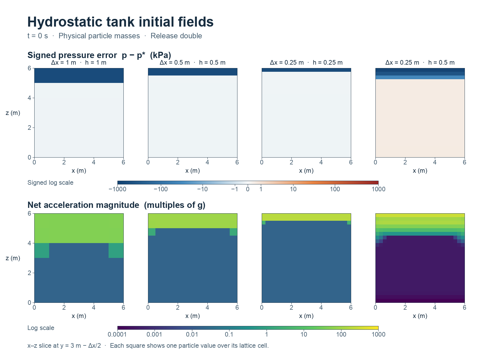

# 三维开顶静水箱的初始核插值与静水平衡

四组都按物理体积赋质量。固定 $h/\Delta x=1$，从 $6^3$ 加密至 $24^3$，全箱压力 RMS 误差下降 50.2%，自由面第一层的压力误差仅下降 0.33%，全箱净加速度 RMS 增至原来的 2.00 倍。主要初始失衡位于开口处。结果取自 Kokkos Serial、Release double 在 $t=0$ 发布的粒子场。

## 算例与实现

边长 6 m 的立方水箱开顶，液面 $H=6$ m。初速为零，$\mathbf g=(0,0,-9.81)\,\mathrm{m/s^2}$，$\rho_0=1000\,\mathrm{kg/m^3}$，$c_0=80\,\mathrm{m/s}$，$\gamma=7$。流体及固定壁粒子均在格心，各自的质量为 $m_i=\rho_*(z_i)\Delta x^3$。底部、四侧和交角铺满 $2h$ 厚的壁层。质量随格心高度取 Tait 静水解，延拓至底部以下。液面处表压为零。

$$
 \rho_*(z)=\rho_0\left[1+\frac{(\gamma-1)g(H-z)}{c_0^2}\right]^{1/(\gamma-1)},\qquad
 p_*(z)=\frac{\rho_0 c_0^2}{\gamma}\left[\left(\frac{\rho_*}{\rho_0}\right)^\gamma-1\right].
$$

| 工况 | 流体粒子 | 壁粒子 | $\Delta x$ (m) | $h$ (m) | 壁层数 | 初态声学步长上限 (s) |
|---|---:|---:|---:|---:|---:|---:|
| $6^3$ | 216 | 584 | 1 | 1 | 2 | 0.00625 |
| $12^3$ | 1,728 | 1,856 | 0.5 | 0.5 | 2 | 0.003125 |
| $24^3$ | 13,824 | 6,560 | 0.25 | 0.25 | 2 | 0.0015625 |
| $24^3$ 固定 $h$ 对照 | 13,824 | 14,848 | 0.25 | 0.5 | 4 | 0.003125 |

每个 WCSPH/Verlet 参与者持有一个常量 $h$，默认值为 1。初始网格记录该值，每次更新沿用同一半径与格宽 $2h$。令 $q=|\mathbf r_i-\mathbf r_j|/h$，$w(q)=[(2-q)_+^3-4(1-q)_+^3]/(4\pi)$。密度求和使用 $W=w(q)/h^3$。压力梯度算子用到的核梯度为 $\nabla_i W=[-w'(q)/q](\mathbf r_j-\mathbf r_i)/h^5$，Adami 壁压外推的归一化加权平均消去共同的 $h^{-3}$。声学限制为 $0.5h/(c_0+\max|\mathbf v|)$。流体从正常参与者入口初始化，经求和密度、Tait 压力、Adami 壁压和对称压力加速度计算后读取初态快照。参与者仍拥有数值字段，结果在 Serial 完成后按稳定 ID 导出。本次测量在第一个时间步之前结束。后端范围为单进程 Serial，跨进程和 checkpoint 重启沿用原任务边界。[核定义](../../src/methods/sph/Density3D.hpp) · [壁压与压力力](../../src/methods/sph/Pressure3D.cpp) · [四组实测夹具](../../tests/methods/sph/hydrostatic_initial_tests.cpp)

## 误差量及连续参照

- 常数场权重和 $S_i=\sum_{j\in\mathrm{fluid+wall}}\Delta x^3 W_{ij}$ 包含自身。$I_i$ 是同一核在全部流体及壁格所代表的连续体积上的积分。表中分别给出有符号均值 $\langle S-I\rangle$ 和 $\langle I-1\rangle$，相加为平均归一化误差。汇总 CSV 也提供两项各自的 RMS。
- 填满交角后，体积为 $[-2h,H+2h]^2\times[-2h,H]$。从流体中心出发，支撑球仅可能被顶部平面截断。设 $s=(H-z_i)/h$ 与 $L_a=(a-s)_+$。积分球冠得到 $I(s)=1-[F(2)-4F(1)]/2$，其中 $F(a)=sL_a^5/20+L_a^6/60$。该连续参照只用核和几何，独立于粒子求和。它在液面处为 0.5，在 $s\ge2$ 为 1。九个深度以独立角向数值积分复核，最大绝对差 $1.4\times10^{-14}$。
- 线性场 $f=z$ 采用差分形式 $\sum_j\Delta x^3(z_j-z_i)\nabla_iW_{ij}$。表中 $E_\nabla$ 是其与 $\mathbf e_z$ 的向量差的 RMS。几何量在同一工况内等体积平均。压力列是 $p_i-p_*(z_i)$ 的质量加权 RMS，净加速度列是 $\|\mathbf a_{p,i}+\mathbf g\|$ 的质量加权 RMS 除以 $g=9.81\,\mathrm{m/s^2}$。
- 分区互斥。先取 $d=H-z<2h$ 的自由面区，包含其邻壁交线。对于余下粒子，$z<2h$ 且同时靠近一面 x 壁和一面 y 壁的为底角，其余 $z<2h$ 为其余底区。再取其余靠近任一侧壁的粒子为侧壁区，剩余为内部。“靠近”均指到实体平面的距离小于 $2h$。

## 按分辨率及区域的实测值

| 工况 ($h$ 以 m 计) | 区域 | 粒子数 | $\langle S\rangle$ | $\langle S-I\rangle$ | $\langle I-1\rangle$ | $E_\nabla$ | 压力 RMS (kPa) | 净加速度 RMS / $g$ |
|---|---|---:|---:|---:|---:|---:|---:|---:|
| 6³ | 全箱 | 216 | 0.975025 | 0.00653545 | -0.0315104 | 0.200868 | 253.971 | 25.6977 |
| 6³ | 内部 | 8 | 0.999972 | -2.753e-5 | 0 | 0.0200417 | 0.192891 | 0.0199178 |
| 6³ | 自由面 | 72 | 0.92513 | 0.0196614 | -0.0945313 | 0.346757 | 440.549 | 44.573 |
| 6³ | 侧壁 | 64 | 0.999972 | -2.753e-5 | 0 | 0.0200417 | 0.192891 | 0.59111 |
| 6³ | 底角 | 32 | 0.999972 | -2.753e-5 | 0 | 0.0200417 | 0.196533 | 0.0197857 |
| 6³ | 其余底区 | 40 | 0.999972 | -2.753e-5 | 0 | 0.0200417 | 0.196533 | 0.0197791 |
| 12³ | 全箱 | 1728 | 0.987499 | 0.00325396 | -0.0157552 | 0.14274 | 179.15 | 36.3476 |
| 12³ | 内部 | 512 | 0.999972 | -2.753e-5 | 0 | 0.0200417 | 0.184655 | 0.0199054 |
| 12³ | 自由面 | 288 | 0.92513 | 0.0196614 | -0.0945313 | 0.346757 | 439.651 | 89.197 |
| 12³ | 侧壁 | 640 | 0.999972 | -2.753e-5 | 0 | 0.0200417 | 0.184655 | 0.51296 |
| 12³ | 底角 | 32 | 0.999972 | -2.753e-5 | 0 | 0.0200417 | 0.189345 | 0.0198609 |
| 12³ | 其余底区 | 256 | 0.999972 | -2.753e-5 | 0 | 0.0200417 | 0.189345 | 0.0198565 |
| 24³，h=0.25 | 全箱 | 13824 | 0.993736 | 0.00161321 | -0.0078776 | 0.101923 | 126.525 | 51.4051 |
| 24³，h=0.25 | 内部 | 8000 | 0.999972 | -2.753e-5 | 0 | 0.0200417 | 0.182604 | 0.0199023 |
| 24³，h=0.25 | 自由面 | 1152 | 0.92513 | 0.0196614 | -0.0945313 | 0.346757 | 439.202 | 178.438 |
| 24³，h=0.25 | 侧壁 | 3520 | 0.999972 | -2.753e-5 | 0 | 0.0200417 | 0.182604 | 0.608753 |
| 24³，h=0.25 | 底角 | 32 | 0.999972 | -2.753e-5 | 0 | 0.0200417 | 0.187795 | 0.0199013 |
| 24³，h=0.25 | 其余底区 | 1120 | 0.999972 | -2.753e-5 | 0 | 0.0200417 | 0.187795 | 0.0198985 |
| 24³，h=0.5 | 全箱 | 13824 | 0.982892 | 0.000723571 | -0.0178311 | 0.122076 | 193.663 | 68.3492 |
| 24³，h=0.5 | 内部 | 4096 | 1.00008 | 7.918e-5 | 0 | 4.935e-5 | 0.520535 | 1.6684 |
| 24³，h=0.5 | 自由面 | 2304 | 0.896959 | 0.00394552 | -0.106986 | 0.299023 | 475.266 | 167.692 |
| 24³，h=0.5 | 侧壁 | 5120 | 1.00008 | 7.918e-5 | 0 | 4.935e-5 | 0.520535 | 2.08715 |
| 24³，h=0.5 | 底角 | 256 | 1.00008 | 7.918e-5 | 0 | 4.935e-5 | 0.534218 | 0.000264726 |
| 24³，h=0.5 | 其余底区 | 2048 | 1.00008 | 7.918e-5 | 0 | 4.935e-5 | 0.534218 | 0.000264569 |

固定 $h/\Delta x=1$ 时，内部单粒子支撑始终含 33 个格点，包括自身与权重为零的截止点。内部 $E_\nabla$ 保持 0.02004。自由面区的粒子占比则由 $1/3$ 降至 $1/12$，其压力 RMS 始终在 439–441 kPa。全箱压力 RMS 的下降主要来自这层在物理空间内变薄。同一族中，底角初始净加速度约 $0.020g$，侧壁区约 $0.51$–$0.61g$，自由面区则从 $44.6g$ 增至 $178.4g$。

## 自由面逐层及固定位置对照

| 工况 | $d/h$ | $\langle S\rangle$ | $I$ | $\langle S-I\rangle$ | $I-1$ | $E_\nabla$ | 压力 RMS (kPa) | 净加速度 RMS / $g$ |
|---|---:|---:|---:|---:|---:|---:|---:|---:|
| 6³ | 0.5 | 0.850288 | 0.81224 | 0.0380483 | -0.18776 | 0.489979 | 623.268 | 45.3691 |
| 6³ | 1.5 | 0.999972 | 0.998698 | 0.00127455 | -0.00130208 | 0.0200417 | 0.190166 | 43.7636 |
| 12³ | 0.5 | 0.850288 | 0.81224 | 0.0380483 | -0.18776 | 0.489979 | 621.879 | 90.0159 |
| 12³ | 1.5 | 0.999972 | 0.998698 | 0.00127455 | -0.00130208 | 0.0200417 | 0.180418 | 88.3712 |
| 24³，h=0.25 | 0.5 | 0.850288 | 0.81224 | 0.0380483 | -0.18776 | 0.489979 | 621.185 | 179.282 |
| 24³，h=0.25 | 1.5 | 0.999972 | 0.998698 | 0.00127455 | -0.00130208 | 0.0200417 | 0.177613 | 177.59 |
| 24³，h=0.5 | 0.25 | 0.675032 | 0.669926 | 0.00510623 | -0.330074 | 0.500025 | 856.946 | 290.142 |
| 24³，h=0.5 | 0.75 | 0.918877 | 0.911072 | 0.00780516 | -0.0889282 | 0.320406 | 409.993 | 100.418 |
| 24³，h=0.5 | 1.25 | 0.993848 | 0.991101 | 0.00274675 | -0.00889893 | 0.0705351 | 38.8723 | 127.133 |
| 24³，h=0.5 | 1.75 | 1.00008 | 0.999955 | 0.000123941 | -4.476e-5 | 4.935e-5 | 0.508845 | 45.8116 |

在前三档共用的 $d/h=0.5$ 处，连续截断造成 18.776% 的亏损，粒子求积多给 3.805%，离散权重和约 0.85029。三档首层的计算表压分别为 −618.36、−619.43、−619.96 kPa，对应解析值为 +4.91、+2.45、+1.23 kPa。第二层的压力误差仅约 0.18 kPa，但仍受到相邻首层低压的作用，解释了压力场与净加速度在深度上的不同分布。

固定 $h=0.5$ m 并将粒距从 0.5 m 减半，内部格点数由 33 增至 257，粒子上的内部 $E_\nabla$ 由 0.02004 降至 0.00004935。全箱求积误差 RMS 由 0.01099 降至 0.001986。新的首层粒子处在更靠近液面的 $d/h=0.25$，该处连续核亏损达 33.007%，首层压力误差为 856.95 kPa。

为隔离格心深度变化，另在 $x=y=2.75$ m 的相同物理位置直接对两个格子求和。以下为几何探针值，细格子会在非粒子位置取样。压力和力只从上表真实粒子读取。

| $d/h$ | $z$ (m) | $I$ | $S-I$，$12^3$ | $S-I$，$24^3$ | $E_\nabla$，$12^3$ | $E_\nabla$，$24^3$ |
|---:|---:|---:|---:|---:|---:|---:|
| 0.5 | 5.75 | 0.812240 | +0.0380483 | +0.00791977 | 0.489979 | 0.443666 |
| 1.5 | 5.25 | 0.998698 | +0.00127455 | +0.00095326 | 0.0200417 | 0.0139833 |
| 5.5 | 3.25 | 1.000000 | −0.00002753 | +0.00008495 | 0.0200417 | 0.00213068 |

在 $d/h=0.5$ 的同点探针，求积误差下降 79.2%，连续核亏损保持 18.776%。更密的采样改善了两个近表面探针的积分和三个探针的线性梯度，深处探针的常数场绝对求积误差反而略有增加。固定 $h$ 对照的底角力残差降至 $0.000265g$，而内部区域总体为 $1.668g$。该区域包含紧贴自由面带下缘的粒子。离四侧至少 $2h$ 的粒子在 $d/h=2.25$ 仍有 $6.67g$ 的 RMS 残差，到 $d/h=3.25$ 已降至 $0.000351g$。这里即使自身的密度求和具有完整支撑，压力梯度算子仍会取到上层邻居的压力。

这些初态数据能区分求积误差与自由面截断，并指出最大净力失衡发生的位置。区分流体压力梯度与 Adami 壁压各自的力贡献，还需要分别输入解析压力做受力对照。三档分辨率同物理时长的压力、速度漂移及穿墙测量见第二步报告。[三档轨迹对照](hydrostatic-trajectory-resolution.md) · [早先的质量校准对照](adami-hydrostatic-serial.md)

## 基线与复跑

按 ID 对照旧 $6^3$ 常规组 $t=0$ 的 216 个流体粒子，坐标逐项相同，表压最大绝对差 $2.22\times10^{-9}$ Pa，按公式重建的粒子质量最大绝对差 $2.28\times10^{-13}$ kg。新旧全箱压力误差均为 253.971 kPa，净加速度残差均为 $25.698g$。夹具另用独立整数格点模板核对每个粒子的邻居数、核权重和、线性场梯度及密度，并检查 Tait 压力。压力/净加速度聚合回归使用 2 Pa 和 $0.002g$ 的复现容差。它们用于检测实现漂移，物理误差由上表单列。

工作树基于 `3bd6d08b5910bae1a02e46e71f65339960396ebe`。原始 CSV 于 `2026-11-20T11:21:09+08:00` 导出，含 29,592 条流体记录，其未压缩字节的 SHA-256 为 `0c18a3a1dd26688f4967aff802d7711a12982b2fcbb8955327134a1fdd7303db`。从干净的 Release double 构建再次导出逐字节一致。[区域和分层汇总 CSV](hydrostatic-initial-regions.csv) · [原始粒子 CSV.gz](../../results/wcsph-initial-resolution/particles-release-double.csv.gz) · [汇总脚本](../../tools/summarize_sph_initial.py)

验证在 Apple M2 Pro、macOS 27.2.1 arm64 (26B131) 上运行，使用 Apple Clang 21.0.0、C++20、CMake 4.4.3、Ninja 1.13.2、Kokkos 5.2.2 Serial 与 GoogleTest 1.17.0。离线验证自 `2026-11-20T11:23:22+08:00` 开始，Release 于 `2026-11-20T11:24:38+08:00` 完成，Debug 于 `2026-11-20T11:25:05+08:00` 完成。两种构建的 float 均通过 126 项 CTest、double 均通过 127 项。每组另通过 1 项迁移安装包测试。四组均通过依赖边界及精度 oracle。常规测试运行四档物理质量初态。拟合质量的旧对照仅供显式历史重放。[Release 记录](../../results/wcsph-initial-resolution/matrix/Release/validation-release.json) · [Debug 记录](../../results/wcsph-initial-resolution/matrix/Debug/validation-debug.json)

从仓库根目录复跑。依赖路径对应本项目预供给的离线软件包，构建及日志选用新目录。

~~~sh
run=wcsph-initial-rerun
for config in Debug Release; do
  python3 tools/validate_serial.py --cc /usr/bin/cc --cxx /usr/bin/c++ \
    --config "$config" verify \
    --prefix ".cache/dependencies/gtest-validation/kokkos-$config" \
    --gtest-prefix ".cache/dependencies/gtest-validation/gtest-$config" \
    --work-dir "build/$run" --logs "results/$run/$config" \
    --jobs 5 --precisions float double --require-network-blocked || exit 1
done
out="results/$run"
NEXORA_SPH_HYDROSTATIC_INITIAL_CSV="$out/particles.csv" \
  "build/$run/release-double/tests/methods/sph/nexora_sph_tests" \
  --gtest_filter=SphHydrostaticInitial.ConventionalMassFourCases
python3 tools/summarize_sph_initial.py "$out/particles.csv" "$out/regions.csv" \
  --matched-probes "$out/probes.csv"
~~~
