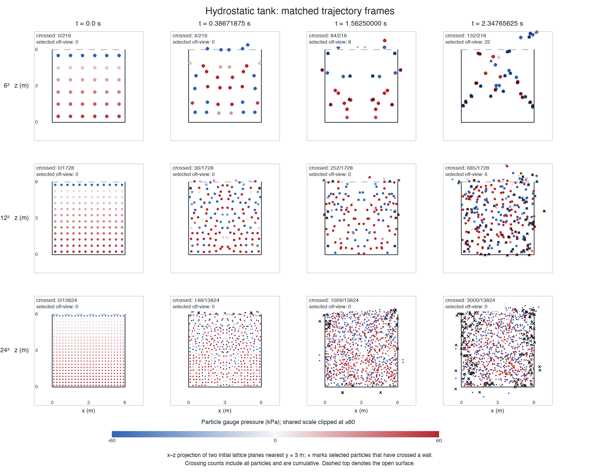
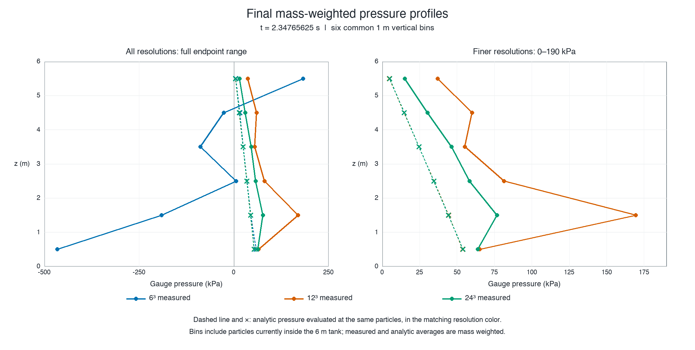

# 常规物理质量的 WCSPH 静水箱三档轨迹

三档都推进到同一物理时间 **2.34765625 s**。从 6³ 加密至 24³，全程质量加权 RMS 速度峰值下降 59.8%，终点箱内压力 RMS 误差下降 47.6%，累计穿过任一实体壁面的流体粒子占比下降 39.41 个百分点。24³ 仍有 3,000 个粒子穿墙，终点各层平均压力均偏高，底部两层还出现压力倒置。

## 同时刻关键帧



每行追踪初始最靠近中心面 $y=3$ m 的两层流体粒子，按 ID 固定选取 72、288、1,152 个粒子并投影到 $x$–$z$ 平面。三档采用相同的视野与 ±60 kPa 压力色标，超出色标的表压用端点颜色显示。顶部虚线为开口，叉号标记曾穿过任何实体壁面的示踪粒子。每格穿墙计数覆盖全体，视野外计数仅针对该格选定的示踪粒子。图中各列均取实际接受步，无时间插值。

| 时刻 (s) | 6³ 累计穿墙 / 216 | 12³ 累计穿墙 / 1,728 | 24³ 累计穿墙 / 13,824 |
|---:|---:|---:|---:|
| 0 | 0 | 0 | 0 |
| 0.38671875 | 4 | 36 | 148 |
| 1.5625 | 84 | 252 | 1,009 |
| 2.34765625 | 132 | 685 | 3,000 |

## 压力、速度及穿墙对照

| 量 | 6³ | 12³ | 24³ |
|---|---:|---:|---:|
| 粒距与 $h$ (m) | 1 | 0.5 | 0.25 |
| 接受步数 | 602 | 1,203 | 2,407 |
| 初始压力误差 RMS (kPa) | 253.97 | 179.15 | 126.52 |
| 终点箱内压力误差 RMS (kPa) | 497.99 | 404.41 | 260.78 |
| 终点箱内粒子 / 初始全部粒子 | 77 / 216 (35.65%) | 1,417 / 1,728 (82.00%) | 12,347 / 13,824 (89.32%) |
| 全程 RMS 速度峰值 (m/s) | 15.173 | 9.272 | 6.094 |
| 该峰值所在物理时刻 (s) | 2.006945 | 2.341788 | 2.343766 |
| 全程单粒子最大速度 (m/s) | 40.02 | 35.75 | 55.77 |
| 首次穿任一实体壁面的物理时刻 (s) | 0.383584 | 0.151147 | 0.074138 |
| 首次穿底的物理时刻 (s) | 0.383584 | 0.949349 | 1.253439 |
| $x=0$ 穿墙粒子 | 35 (16.20%) | 149 (8.62%) | 778 (5.63%) |
| $x=6$ 穿墙粒子 | 36 (16.67%) | 157 (9.09%) | 712 (5.15%) |
| $y=0$ 穿墙粒子 | 35 (16.20%) | 153 (8.85%) | 732 (5.30%) |
| $y=6$ 穿墙粒子 | 34 (15.74%) | 169 (9.78%) | 719 (5.20%) |
| $z=0$ 穿底粒子 | 32 (14.81%) | 156 (9.03%) | 408 (2.95%) |
| 五面并集，按 ID 去重 | 132 (61.11%) | 685 (39.64%) | 3,000 (21.70%) |
| 向外穿越事件总数，计入重复穿越 | 268 | 1,099 | 4,970 |

每个接受步对全体流体粒子（含已逃逸者）计算 $\sqrt{\sum_i m_i |v_i|^2/\sum_i m_i}$，然后取全程最大值。穿墙统计按 ID 连接相邻两步的粒子中心，求 Velocity Verlet 直线漂移段与有限矩形面的向外交点。只有落在实体面范围内的交点计入穿墙，四侧壁高度均为 0–6 m，开口上方的穿越单独排除。首次穿墙时刻按该步内的交点比例换算。逐面的分母均为初始全部流体粒子数，同一 ID 可进入多个面的计数。终点箱内粒子数按该时刻的位置独立统计，包含曾穿墙又回到箱内的粒子。[逐面穿墙与事件表](hydrostatic-trajectory-crossings.csv) · [全程诊断汇总](hydrostatic-trajectory-summary.csv)

加密后，五个面的穿墙比例均下降。24³ 的侧壁首次穿越比 6³ 更早，首次穿底却延后至 1.2534 s。全程 RMS 速度峰值随这三档加密而下降，单粒子最大速度在 24³ 反而达到最高值 55.77 m/s。这些观测限定于该水箱和该物理时段。

## 终点静水压力剖面



各档以相同的 1 m 物理高度区间统计终点仍在原水箱内的粒子。表中每格依次为实测平均表压和同一批粒子的解析平均表压，单位 kPa。两者都按质量加权，解析 Tait 静水压力按粒子的**实际高度**逐个求值。因此三个工况各有自己的解析列。上述 RMS 对粒子压力误差的平方取平均，包含同一层内的压力波动。

| 离底高度 (m) | 6³ 实测 / 解析 | 12³ 实测 / 解析 | 24³ 实测 / 解析 |
|---|---:|---:|---:|
| 0–1 | −465.50 / 58.95 | 65.14 / 53.71 | 63.92 / 53.95 |
| 1–2 | −190.20 / 44.90 | 169.34 / 44.37 | 76.74 / 44.22 |
| 2–3 | 6.63 / 34.89 | 81.32 / 34.50 | 58.30 / 34.41 |
| 3–4 | −88.20 / 24.89 | 55.27 / 24.59 | 46.42 / 24.59 |
| 4–5 | −26.51 / 15.84 | 60.15 / 14.62 | 30.34 / 14.76 |
| 5–6 | 182.74 / 5.12 | 37.07 / 4.81 | 15.10 / 4.91 |

24³ 的 1–2 m 层高于底层，平均表压从底层的 63.92 kPa 上升至 76.74 kPa，同一批粒子的解析压力则从 53.95 降至 44.22 kPa。各层平均值较 6³ 更接近参考，层内残差仍大。24³ 最上层的逐粒子压力 RMS 误差为 234.76 kPa，而该层平均压力误差为 10.19 kPa。6³ 终点底层只剩 4 个粒子，读其剖面时需同时考虑采样数量。[各层粒子数、质量、实测、解析和 RMS](hydrostatic-trajectory-profiles.csv)

## 算例与核验

- 三档共用边长 6 m 的开顶水箱和三维 M₄ 核。粒距及光滑长度 $h=\Delta x=6/n$，初速为零，重力为 $(0,0,-9.81)$ m/s²，参考密度 1,000 kg/m³，参考声速 80 m/s，Tait 指数 7。流体与两层固定壁粒子均按其格心高度赋物理质量 $m_i=\rho_*(z_i)\Delta x^3$，全部常规轨迹都保持各自的粒子质量。壁层覆盖四侧、底部和交角。[第一步初始场与解析解](hydrostatic-initial-resolution.md)
- 从生产代码的 Simulation 和 Participant3D 入口推进，使用求和密度、Tait EOS、Adami 固定壁和两次重力半步。沿用 6³ 的步长策略，将名义上限按 $h$ 同比缩放（1/256、1/512、1/1024 s），每步取该上限、参与者声学 CFL 上限的 90% 和下一帧剩余时长中的最小值。声学 CFL 系数为 0.5。三档都保留逃逸粒子。验证驱动允许最多 5,000 万格、受控存储上限 1 GiB，以容纳粒子逸出后扩张的包围盒。[轨迹驱动](../../tests/methods/sph/hydrostatic_trajectory.cpp)
- 第一步与第二步的三档初始位置按 ID 完全相同，初始逐粒子密度最大差为 $2.28\times10^{-13}$ kg/m³，表压最大差为 $1.49\times10^{-9}$ Pa。分析程序从粒子帧重算质量加权剖面，并从穿墙事件的 ID、交点、方向面及分数重建逐步累计计数。[分析程序](summarize_hydrostatic_trajectory.py)
- 在当前 Release double 构建上显式重放原 6³ 测试，初始与终点压力、速度、穿墙和分层数据等 40 个共同指标与新驱动在 $10^{-12}$ 相对容差内一致。较早归档的 6³ 终点有 75 个粒子在箱内，箱内压力 RMS 为 588.91 kPa。本次为 77 个和 497.99 kPa，两次累计穿墙均为 132 个。两次初始质量逐位相同，初始压力最大差约 $2.22\times10^{-9}$ Pa。在 1.5625 s 时，各坐标的最大差约 $1.42\times10^{-6}$ m，到终点已超过 2 m。当前三档的对比统一取本次同一可执行文件的结果。[当前旧驱动的重放 XML](../../results/wcsph-trajectory-resolution/tank-current-release-double.xml) · [早期 6³ 记录](adami-hydrostatic-serial.md)

源码清单记录本次运行涉及的 SPH 数值与参与者代码、模拟控制接口、算例驱动及后处理脚本。[工作树文件 SHA-256](../../results/wcsph-trajectory-resolution/source-sha256.txt)

工作树基于 HEAD `3bd6d08b5910bae1a02e46e71f65339960396ebe`。三档的最终复跑始于 `2026-11-20T11:37:22+08:00`，完成于 `2026-11-20T11:38:52+08:00`。使用 Apple M2 Pro、macOS 27.2.1 arm64 (26B131)、Apple Clang 21.0.0、C++20、CMake 4.4.3、Ninja 1.13.2 和 Kokkos 5.2.2 Serial。全部正式轨迹以 Release double 执行。三档的 12 份原始 CSV 在独立重复运行中逐字节一致。另在本机通过 Release double 的 128 项 CTest 和 Debug float 的 127 项 CTest，均含迁移安装包消费测试。[原始 CSV 压缩包](../../results/wcsph-trajectory-resolution/trajectories-release-double.tar.gz) · [Release double 日志](../../results/wcsph-trajectory-resolution/ctest-release-double.log) · [Debug float 日志](../../results/wcsph-trajectory-resolution/ctest-debug-float.log)

## 复跑

以下命令针对当时的每步求和密度实现。先按修复报告中的历史重建方式恢复该版本；现行轨迹驱动采用连续性密度。[原实现重建与修复复跑](hydrostatic-continuity-repair.md)

从对应版本的仓库根目录执行。配置使用本机已预供给的离线依赖。结果目录下每档的 steps.csv 含每个接受步的诊断，frames.csv 含四个共同时刻的全部流体粒子，profiles.csv 含四帧的箱内压力剖面，crossings.csv 含每次穿越的 ID、面及交点。压缩包 SHA-256 为 `5d7ba86e629ee5515997d131824d02bb68ed1aa0cf704beba9a55280ce64d735`。

```sh
build_dir=build/wcsph-trajectory-rerun
out=results/wcsph-trajectory-rerun
cmake -S . -B "$build_dir" -G Ninja -DCMAKE_BUILD_TYPE=Release \
  -DCMAKE_CXX_COMPILER=/usr/bin/c++ -DBUILD_TESTING=ON -DNEXORA_ENABLE_DOUBLE_PRECISION=ON \
  -DKokkos_DIR="$PWD/.cache/dependencies/gtest-validation/kokkos-Release/lib/cmake/Kokkos" \
  -DGTest_DIR="$PWD/.cache/dependencies/gtest-validation/gtest-Release/lib/cmake/GTest"
cmake --build "$build_dir" --target nexora_sph_tank_trajectory
for n in 6 12 24; do
  "$build_dir/tests/methods/sph/nexora_sph_tank_trajectory" "$n" "$out/n$n" || exit 1
done
python3 validation/sph/summarize_hydrostatic_trajectory.py "$out" --precision double
python3 tools/plot_sph_hydrostatic_trajectories.py "$out"
```

绘图使用 Pillow，数值分析脚本仅依赖 Python 标准库。[绘图源代码](../../tools/plot_sph_hydrostatic_trajectories.py)
