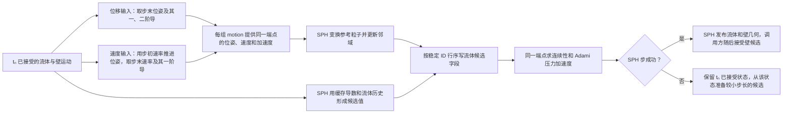

# 三维 WCSPH 规定运动壁与往返活塞

## 现行输入与位姿归属

所有运动壁统一使用 `PrescribedWallTrajectory3D::motion`。回调接收组的初始相位、从初始化起累计的历时，以及用于周期运动的折返相位。调用方在请求时刻提供绝对平移、转角、参考中心、固定轴及物理导数。SPH 用位姿变换壁粒子，用壁速度求连续性，用壁加速度求 Adami 壁压。[轨迹类型](../../src/methods/sph/PrescribedMovingWall3D.hpp)

调用方欧拉算例从已接受位姿出发，以 `dₙ₊₁ = dₙ + Δt Vₙ`、`θₙ₊₁ = θₙ + Δt ωₙ` 形成候选，再经 `motion` 提供端点位姿和物理导数。整组粒子共用同一刚体变换。壁速度含转动切向分量，Adami 使用线加速度、切向加速度和向心加速度。

### 用表达式装配壁组

C++ 算例为每个独立运动的壁组建立一个 `app::MotionConfig`，在装配时调用 `PrescribedMotion::create`。四个表达式依次对应 x、y、z 和绕固定轴的角度（弧度），或它们的速率。Lepton 在主机端解析表达式并对物理时间 `t` 符号求导。平移和转角的位姿输入须在使用区间内二阶可微，速度输入须一阶可微。组内粒子共享采样结果。[调用方接口](../../apps/prescribed_motion/PrescribedMotion.hpp)

| 输入 | 本算例的 x 分量 | 候选位姿 | 步末速度和加速度 |
| --- | --- | --- | --- |
| `MotionMode::pose` | `2*(t*(1-t))^4` | 直接取步末位移 | 位移的一阶导、二阶导 |
| `MotionMode::velocity` | `8*(t*(1-t))^3*(1-2*t)` | 从 `initial_pose` 起逐步累加 `Δt·v(tₙ)` | 步末速度、速度的一阶导 |

`initial_time` 与模拟初始物理时间一致。表达式的 `t` 随物理时钟前进，即使轨迹设置了周期也不会折返。调用方将 `owner->trajectory(sample_step_limit)` 交给壁组，并保证 owner 的寿命覆盖轨迹。涉及非精确表示的时间间隔时，按算例时钟精度设置轨迹的 `time_resolution`。每个实际步长都从各组的 `prepare(dt)` 开始。所有组准备完毕后才执行 SPH 单步，成功后逐组 `commit()`。准备或求解失败时对各组 `discard()`。已接受时刻和候选时刻均可重复读取。

## 单步的物理时间层



采样只读取指定时刻的运动，重复读取同一候选得到相同结果。失败时 SPH 保留已接受的流体、历史、壁几何和时钟。调用方保留已接受的位姿与速率，从同一起点按较小步长重新准备候选。`Simulation` 遇错进入 failed，缩步重试通过参与者的 `step` 入口执行。

未来 MBD 可拥有并积分刚体状态，经 `motion` 提供运动。流体载荷回传及两侧联合恢复属于后续双向耦合工作。[MBD 后续任务](../../docs/architecture/follow-on-task-plan.md)

同一组带时间戳的壁样本也用于独立流体冲量对照。测试专用的双刚体算例进一步检验界面载荷反馈和交换间隔细化，两项实测见[离散壁回放与双向交换](wall-exchange-serial.md)。

速度驱动活塞在每个端点核对壁位姿、壁速度和加速度，并用实际粒壁距离独立核对流体的密度变化率与压力加速度。每周期步数取 32、64、128、256，逐档检验壁位置的一阶收敛。[速度驱动用例](../../tests/methods/sph/verlet_window_tests.cpp)

## 引入 Lepton 表达式时的历史实测

在 Windows x64、Intel Core i5-13600KF、MSVC 19.38.33133、CMake 3.27.2、Ninja 1.11.0 上，用本地 Kokkos 5.2.2 Serial 和 GoogleTest 1.17.0 构建 float 与 double Release。位移表达式与手写位姿用同一条连续轨迹，速度表达式与手写速率用同一条欧拉离散壁轨迹。流体参考采用独立手写的 16,384 步 RK4。下表取每周期 32 个均匀步，在半周期和周期末记录流体误差的最大绝对值，壁位置误差取全周期逐步最大值。

| 输入 | 结果（两精度） | 壁位置误差 float / double | 流体速度误差 float / double | 流体密度误差 float / double |
| --- | --- | ---: | ---: | ---: |
| Lepton 位移 | 速度超限 | 1.19209e−7 / 0 | 1.14675e−5 / 1.14540e−5 | 2.17020e−6 / 2.36723e−6 |
| Lepton 速度、调用方欧拉 | 通过 | 4.64991e−4 / 4.65014e−4 | 2.34946e−4 / 2.34954e−4 | 4.66108e−5 / 4.66472e−5 |
| 原手写解析位姿 | 速度超限 | 1.19209e−7 / 0 | 1.14675e−5 / 1.14540e−5 | 2.17020e−6 / 2.36723e−6 |

每种精度下，位移表达式与原解析用例的 49 项 XML 指标逐项相同，两个用例都仅在 32 步的半周期及周期末超过原速度门槛 2e−6。密度满足原门槛 3e−6。速度表达式与手写调用方欧拉的 12 项指标逐项相同。它在 32、64、128、256 步下通过壁位置一阶收敛、逐步端点时间与速度、加速度核对，以及实际几何上的连续性和 Adami 压力加速度校验。表中的流体误差同时包含流体积分误差与采用欧拉壁轨迹的影响。[活塞用例与独立参考](../../tests/methods/sph/verlet_window_tests.cpp)

运动壁检查还覆盖固定轴角度的两阶物理时间导数、平移及转角的一阶收敛、重复读取候选、非零时间原点、错误表达式与非有限端点。真实 Adami 反算失败后，从已接受位姿缩小步长连续重试两次，每次的流体行、壁和导数字段均与直接走小步相同。两组构建均通过目标依赖边界检查和安装后独立消费端测试。[Lepton 源码锁定与补丁](../../third_party/lepton/README.md)

在 `95e7987` 工作树于 `2026-11-26T21:52:15+08:00` 完成受影响的运动壁、连续性与压力测试，float 通过 83/85，double 通过 82/84。随后于 `2026-11-26T21:52:16+08:00` 跑完整个 `nexora_sph_tests`，float 通过 122/124，double 通过 121/123。两次运行各精度均仅失败上述两个解析位姿活塞用例。

## 调用方欧拉迁移后的 Serial 复验（引入表达式前）

在 `95e7987` 的迁移工作树上，用 Windows x64、Intel Core i5-13600KF、MSVC 19.38.33133、Kokkos 5.2.2 Serial 和 GoogleTest 1.17.0 重新编译并运行 `nexora_sph_tests`。使用 Release 和过滤器 `SphVerlet.*:SphCallerEulerWall.*:SphAdamiWall.*:SphContinuity.*:SphWcsphOperators.*`。两组均于 `2026-11-26T21:29:34+08:00` 完成。

| 精度 | 通过 / 执行 | 调用方欧拉活塞 | 解析位姿活塞的 32 步最大采样速度误差 |
| --- | ---: | --- | ---: |
| float | 78 / 79 | 通过 | 1.1468e−5，超出 2e−6 |
| double | 77 / 78 | 通过 | 1.1454e−5，超出 2e−6 |

两组退出码均为 1，唯一失败均为解析位姿活塞的速度断言。对照同机迁移前的 GoogleTest XML，每种精度下，欧拉活塞的 12 个记录值均逐项相同，涵盖 32、64、128、256 步的壁位置误差和相对独立 RK4 的流体速度、密度误差。每一步也通过了壁位置、端点时间、连续性及 Adami 压力加速度检查。解析位姿活塞的 49 个记录值也与迁移前相同。[活塞与运动壁用例](../../tests/methods/sph/verlet_window_tests.cpp)

恒速平移与旋转、变速一阶收敛、重复读取同一候选、调用方拒绝非有限速率，以及 Adami 拒绝大步后缩步重试均通过。重试所得的流体行、壁位置与导数和直接走小步的结果相同。

另在迁移前后各自的临时测试副本中，用相同的十六进制浮点格式逐步记录欧拉活塞轨迹。比较于 `2026-11-26T21:32:15+08:00` 完成。每种精度覆盖四档步长，共 480 个端点。每个端点核对 17 个数值，包括壁与流体各自的时间戳、壁位置、流体位置和速度、压力加速度、密度、压力及密度变化率。float 和 double 分别与各自迁移前的记录逐值完全相同。

## 原 SPH 自管速度驱动实现的历史记录

以下恒速、变速、失败重试、误差表及执行结果保留 `95e7987` 和随后仅修订活塞判据时的实测。该版本的 `velocity_driven`、`initial_pose`、`rates` 由 SPH 积分壁位姿，以下相关名称与归属均为历史描述。现行实现统一 `motion`、调用方欧拉推进；旧数字不作为本次迁移后的运行证据。

## 恒速、变速与失败重试

混合组试验将旧的绝对位姿壁与自管刚体壁同时推进。自管组用非零初始平移、转角和固定转轴，在不等步长后按解析位姿核对三个粒子，两个端粒子的距离保持 √5。旧壁只给定随时间变化的平移。变速试验取 Vₓ = 1+t、ω = 0.5+t，在 t=1 读取平移和角度。4、8、16 步的两项绝对误差依次为 0.125、0.0625、0.03125，对应一阶收敛。[运动壁集成用例](../../tests/methods/sph/verlet_window_tests.cpp)

Adami 反算失败用例记录的组内采样历时为 0、1/16、5/16、5/64、3/32。第三个时刻是被拒绝的大步终点。已接受位姿、流体字段和历史均保留，驱逐工作区后直接重试的两个小步与从同一初态只走小步的结果逐项相同。另一用例验证没有流体邻居时，无法用于下一步推进的非有限端点速率同样使候选步被拒绝。[失败与重试回归](../../tests/methods/sph/verlet_window_tests.cpp)

## 往返活塞对照

两种输入使用同一物理轨迹、流体初态和独立的 16,384 步 RK4 流体参考。`motion` 输入使用解析位姿；`velocity_driven` 只接收解析速度与加速度。流体速度、密度误差取半周期和周期末两个采样点的最大绝对差；壁面位置误差取全周期各步相对于连续解析壁位置的最大绝对差。用全周期最大值可避免回程端点误差抵消。每个端点另由单邻居的连续性方程与 Adami 公式核对已发布导数。[活塞参考和测试](../../tests/methods/sph/verlet_window_tests.cpp)

| 每周期 32 步 | 流体速度误差 float / double | 流体密度误差 float / double | 壁面位置误差 float / double |
| --- | ---: | ---: | ---: |
| 解析绝对位姿 | 1.147e−5 / 1.145e−5 | 2.170e−6 / 2.367e−6 | 1.192e−7 / 0 |
| 速度驱动欧拉壁 | 2.349e−4 / 2.350e−4 | 4.661e−5 / 4.665e−5 | 4.650e−4 / 4.650e−4 |

解析位姿活塞在 32 步时仍要求流体速度误差 ≤ 2e−6、密度误差 ≤ 3e−6，表中速度误差超限。速度驱动活塞用步初速度推进壁面，有限步长下的壁位置与解析轨迹有偏差，核梯度也随之改变。因此该用例记录相对于同一 RK4 参考的流体误差，验收逐步欧拉壁位置、流体与壁的端点时间戳、实际端点几何上的连续性与 Adami 压力加速度，以及壁位置误差的一阶收敛。

| 欧拉壁每周期步数 | 壁面位置最大误差 float / double | 流体速度误差 float / double |
| ---: | ---: | ---: |
| 32 | 4.650e−4 / 4.650e−4 | 2.349e−4 / 2.350e−4 |
| 64 | 2.325e−4 / 2.325e−4 | 1.267e−4 / 1.267e−4 |
| 128 | 1.162e−4 / 1.162e−4 | 6.512e−5 / 6.513e−5 |
| 256 | 5.814e−5 / 5.811e−5 | 3.297e−5 / 3.297e−5 |

步长逐次减半后，双精度的壁位置误差按 2.0003、2.0002、2.0001 倍缩小。解析位姿模式下的流体误差与奇偶步结果另见[中心差分验收](central-difference-serial.md)。

## 修订判据前的 Serial 执行结果

矩阵于 `2026-11-26T17:03:24+08:00` 在 macOS 27.2.1 arm64（T6020）完成，使用 Apple Clang 21.0.0、C++20、CMake 4.4.3、Ninja 1.13.2、本地 Kokkos 5.2.2 Serial 与 GoogleTest 1.17.0。基线是 `c3c1553231571b5356cfea49c1cd8f53a463a9be`，本次 `git diff -- src tests tools/validate_serial.py` 的 SHA-256 为 `e0d4dfb5fcaf9fff7acc33389e263f92162b00fdf69ccbf03d343a4ed4e531d8`。

| 配置 | 完整 CTest 通过数 | 失败用例 |
| --- | ---: | --- |
| float Debug | 192 / 194 | 解析位姿活塞、速度驱动活塞 |
| float Release | 192 / 194 | 同上 |
| double Debug | 190 / 192 | 同上 |
| double Release | 190 / 192 | 同上 |

四组均编译成功，通过目标依赖检查、安装消费测试和 Reference 的 Decimal 校验。上表两项失败均来自 32 步流体误差断言，Debug 与 Release 的对应误差一致。各精度的恒速刚体几何、变速壁一阶细化、失败回滚、端点速率与已有预算回归均通过。维护者 Doxygen 已生成，可在 `VelocityDrivenWall3D` 页看到位姿归属与速率的约定。本次实测范围为单进程 CPU Serial；持久化重启与跨进程迁移还需定义壁组位姿、速率及流体历史的传输格式。

当时的复验沿用[中心差分 Serial 命令](central-difference-serial.md#执行环境与复验)，并用以下过滤器保存了旧用例的误差。

```sh
"$build/tests/methods/sph/nexora_sph_tests" \
    '--gtest_filter=*VelocityDriven*:*RoundTripPiston*' \
    --gtest_output="xml:$build/wall-errors.xml"
```

## 修订判据后的活塞复验（迁移前历史记录）

在 `95e7987` 上移除速度驱动用例末尾的两条 32 步流体误差断言后，用 Windows x64、Intel Core i5-13600KF、MSVC 19.38.33133、CMake 3.27.2、Ninja 1.11.0、Kokkos 5.2.2 Serial 和 GoogleTest 1.17.0 构建 Release。以 `--gtest_filter=SphVerlet.*Piston*` 可复跑这两个用例。

| 精度与完成时间 | 速度驱动活塞 | 解析位姿活塞 |
| --- | --- | --- |
| double，`2026-11-26T21:17:46+08:00` | 通过 | 失败，32 步采样速度最大误差 1.1454e−5 |
| float，`2026-11-26T21:18:11+08:00` | 通过 | 失败，32 步采样速度最大误差 1.1468e−5 |

每种精度各执行两个用例，退出码均为 1。解析位姿活塞在 32 步的半周期和周期末都超出 2e−6 的速度门槛。速度驱动活塞在 32、64、128、256 步继续记录流体误差，并通过逐步端点校验与壁位置一阶收敛检查。
