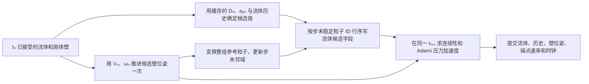

# 三维 WCSPH 速度驱动刚体壁

## 输入与位姿归属

在每个运动壁组的 `PrescribedWallTrajectory3D` 上选择一个位姿来源。两种输入共用原有的相位、周期、时间分辨率及采样步长上限。[轨迹类型](../../src/methods/sph/PrescribedMovingWall3D.hpp)

| 输入 | 所有者提供什么 | 谁更新位姿 |
| --- | --- | --- |
| `motion` | 当前时刻的平移、转角、中心、轴及物理导数 | 调用方。SPH 直接使用采样位姿，适用于解析位姿、历史位姿输入或外部所有者 |
| `velocity_driven` | `initial_pose` 给出初始平移、角度、固定参考中心与轴；`rates` 给出各整数时刻的平移速度、加速度、角速度和角加速度 | SPH。每个成功步推进一次组的平移与转角 |

旧输入只提供位姿时，几何继续使用该绝对位姿。其未赋值的导数按原结构缺省为零。需要计算流体连续性和 Adami 壁压时，调用方应提供对应的物理导数。稀疏位姿采样本身不能唯一确定这些导数。速度驱动壁要求有限初始位姿、非零固定轴、速率回调以及有限的线速度和角速度。重复指定位姿来源或缺少速率回调会在初始化时被拒绝。[参数检查与欧拉推进](../../src/methods/sph/PrescribedMovingWall3D.cpp)

## 单步的物理时间层



设墙组平移为 d，固定轴转角为 θ，则 `dₙ₊₁ = dₙ + Δt Vₙ`、`θₙ₊₁ = θₙ + Δt ωₙ`。端点速率回调在候选位姿算出后执行，每个非空运动组每个尝试的端点采样一次。所有粒子共享同一刚体变换并作用于原始参考位置，因此不会逐个累积旋转位移。物理速度包含角速度产生的切向分量，Adami 使用端点的线加速度、切向加速度和向心加速度。中心差分的力和密度变化率位于整数时刻。实现先建立候选几何获得正确行序，再写入由已接受导数确定的流体候选值。[步进入口](../../src/participants/sph/WcsphStep3D.cpp)

存在非空速度驱动组时，已接受状态持有带预算票据的 HostSpace 组运动数组，供下一步读取。释放工作区保留该数组，试算或预算失败丢弃候选数组。外部位姿提供者负责推进自己的物理状态；本实现仅集成 SPH 本地壁。显式分区交换的参考流程在第 9 页，那里由 Chrono 解刚体并返回运动量；本地壁的前向欧拉公式来自本仓库的本步约定。[DualSPHysics–Chrono coupling，第 9 页](https://dual.sphysics.org/6thworkshop/user/pages/03.workshop/05.Programme/6DSW_CHRONO_Martinez-Estevez.pdf#page=9)

## 恒速、变速与失败重试

混合组试验将旧的绝对位姿壁与自管刚体壁同时推进。自管组用非零初始平移、转角和固定转轴，在不等步长后按解析位姿核对三个粒子，两个端粒子的距离保持 √5。旧壁只给定随时间变化的平移。变速试验取 Vₓ = 1+t、ω = 0.5+t，在 t=1 读取平移和角度。4、8、16 步的两项绝对误差依次为 0.125、0.0625、0.03125，对应一阶收敛。[运动壁集成用例](../../tests/methods/sph/verlet_window_tests.cpp)

Adami 反算失败用例记录的组内采样历时为 0、1/16、5/16、5/64、3/32。第三个时刻是被拒绝的大步终点。已接受位姿、流体字段和历史均保留，驱逐工作区后直接重试的两个小步与从同一初态只走小步的结果逐项相同。另一用例验证没有流体邻居时，无法用于下一步推进的非有限端点速率同样使候选步被拒绝。[失败与重试回归](../../tests/methods/sph/verlet_window_tests.cpp)

## 往返活塞对照

两种输入使用同一物理轨迹、流体初态和独立的 16,384 步 RK4 流体参考。`motion` 输入使用解析位姿；`velocity_driven` 只接收解析速度与加速度。流体速度、密度误差取半周期和周期末两个采样点的最大绝对差；壁面位置误差取全周期各步相对于连续解析壁位置的最大绝对差。用全周期最大值可避免回程端点误差抵消。每个端点另由单邻居的连续性方程与 Adami 公式核对已发布导数。[活塞参考和测试](../../tests/methods/sph/verlet_window_tests.cpp)

| 每周期 32 步 | 流体速度误差 float / double | 流体密度误差 float / double | 壁面位置误差 float / double |
| --- | ---: | ---: | ---: |
| 解析绝对位姿 | 1.147e−5 / 1.145e−5 | 2.170e−6 / 2.367e−6 | 1.192e−7 / 0 |
| 速度驱动欧拉壁 | 2.349e−4 / 2.350e−4 | 4.661e−5 / 4.665e−5 | 4.650e−4 / 4.650e−4 |

原速度门槛为 2e−6，原密度门槛为 3e−6。32 步时，解析位姿条件下的原流体速度超限仍存在。速度驱动时，耦合轨迹的流体速度和密度均超限；壁面位置误差单独报告。两种输入均在测试中实际执行原门槛断言。

| 欧拉壁每周期步数 | 壁面位置最大误差 float / double | 流体速度误差 float / double |
| ---: | ---: | ---: |
| 32 | 4.650e−4 / 4.650e−4 | 2.349e−4 / 2.350e−4 |
| 64 | 2.325e−4 / 2.325e−4 | 1.267e−4 / 1.267e−4 |
| 128 | 1.162e−4 / 1.162e−4 | 6.512e−5 / 6.513e−5 |
| 256 | 5.814e−5 / 5.811e−5 | 3.297e−5 / 3.297e−5 |

步长逐次减半后，双精度的壁位置误差按 2.0003、2.0002、2.0001 倍缩小。解析位姿模式下的流体误差与奇偶步结果另见[中心差分验收](central-difference-serial.md)。

## Serial 执行结果

矩阵于 `2026-11-26T17:03:24+08:00` 在 macOS 27.2.1 arm64（T6020）完成，使用 Apple Clang 21.0.0、C++20、CMake 4.4.3、Ninja 1.13.2、本地 Kokkos 5.2.2 Serial 与 GoogleTest 1.17.0。基线是 `c3c1553231571b5356cfea49c1cd8f53a463a9be`，本次 `git diff -- src tests tools/validate_serial.py` 的 SHA-256 为 `e0d4dfb5fcaf9fff7acc33389e263f92162b00fdf69ccbf03d343a4ed4e531d8`。

| 配置 | 完整 CTest 通过数 | 失败用例 |
| --- | ---: | --- |
| float Debug | 192 / 194 | 解析位姿活塞、速度驱动活塞 |
| float Release | 192 / 194 | 同上 |
| double Debug | 190 / 192 | 同上 |
| double Release | 190 / 192 | 同上 |

四组均编译成功，通过目标依赖检查、安装消费测试和 Reference 的 Decimal 校验。上表两项失败均来自 32 步流体误差断言，Debug 与 Release 的对应误差一致。各精度的恒速刚体几何、变速壁一阶细化、失败回滚、端点速率与已有预算回归均通过。维护者 Doxygen 已生成，可在 `VelocityDrivenWall3D` 页看到位姿归属与速率的约定。本次实测范围为单进程 CPU Serial；持久化重启与跨进程迁移还需定义壁组位姿、速率及流体历史的传输格式。

完整复验沿用[中心差分 Serial 命令](central-difference-serial.md#执行环境与复验)。用已构建的测试程序可单独生成包含各档误差的 GoogleTest XML。

```sh
"$build/tests/methods/sph/nexora_sph_tests" \
    '--gtest_filter=*VelocityDriven*:*RoundTripPiston*' \
    --gtest_output="xml:$build/wall-errors.xml"
```
