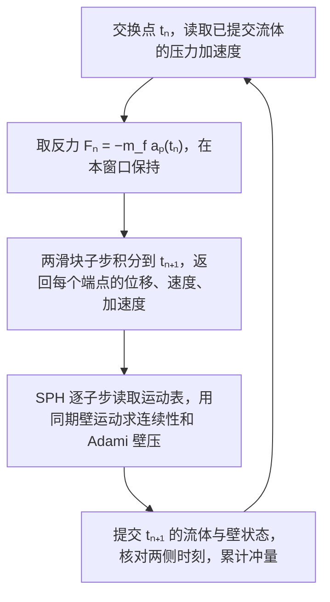

# 离散壁运动回放与双刚体交换间隔细化

两个算例都通过 `Simulation::run` 推进三维 WCSPH，观测同一物理区间的轴向冲量。第一个算例向 SPH 和独立参考提供相同的离散壁运动。第二个算例由测试驱动程序在 SPH 和双刚体动力学之间传递运动和反力。

## 已有接口和适用范围

生产接口 `PrescribedWallTrajectory3D::motion` 接收调用方给出的位姿、速度和加速度。SPH 使用壁速度计算连续性方程，使用壁加速度计算 Adami 壁压。参与者可读出已提交流体行的质量、速度、压力加速度，以及壁粒子的位置和时间戳。其 `ports()` 返回空列表；`Simulation` 只拥有一个参与者的推进权。[壁运动类型](../../src/methods/sph/PrescribedMovingWall3D.hpp) · [SPH 字段与接口](../../src/participants/sph/WcsphParticipant3D.hpp) · [协调器](../../include/nexora/simulation/Simulation.hpp)

单流体粒子、单壁源、零重力条件下，流体所受界面力可由流体行唯一确定，沿轴向有 `F_fluid = m_f a_pressure`，作用在刚体上的反力为 `−F_fluid`。流体实际获得的冲量可独立从已提交动量变化 `m_f (v_end − v_start)` 读出。多个壁组的分项载荷、关于指定参考点的力矩、通用 MBD 引擎适配器及两侧联合回滚，在当前生产代码中均未实现。[压力算子输出](../../src/methods/sph/Pressure3D.hpp) · [MBD-005、009、010 及其前置](../../docs/architecture/follow-on-task-plan.md#mbd-task-ids)

## 1. 回放同一份离散壁运动

记录给出四个物理时刻与轴向壁速度 `(t, v) = (0, 0), (1/4, 1/32), (5/8, −1/64), (1, 0)`。SPH 回调和参考积分器共用这一份记录。记相邻样本间隔为 `h`，局部时间为 `u = (t − t_i)/h`，速度差为 `Δv = v_{i+1} − v_i`。每段采用两端斜率为零的三次 Hermite 速度插值，初始平移为零。

| 壁运动量 | 在任意物理采样时刻的取值 |
| --- | --- |
| 速度，供连续性方程使用 | `v = v_i + Δv u²(3 − 2u)` |
| 位姿，从前一节点位移精确积分 | `x = x_i + h [v_i u + Δv u³(1 − u/2)]` |
| 加速度，供 Adami 壁压使用 | `a = 6 Δv u(1 − u)/h` |

每段末端加速度为零，段与段衔接时速度和加速度连续。测试在第二段中点独立核对三项运动量以及流体密度。参考以 double 精度在每个 RK4 子阶段读同一插值，用单邻居 M4 密度关系、Adami 壁压和压力力独立积分单位质量流体的速度。参考密度随核函数 W(r) 变化，分离距离的导数为流体速度减同一条插值壁速度。SPH 在 256 个等步长上运行；两侧均从静止流体出发，比较整个 `[0, 1]` 的冲量。[回放及参考实现](../../tests/methods/sph/verlet_window_tests.cpp)

| SPH 精度 | RK4 参考冲量 | SPH 端点压力力梯形积分 | SPH 实际动量变化 |
| --- | ---: | ---: | ---: |
| float | 0.006185772269 | 0.006185925754 | 0.006185934413 |
| double | 0.006185772269 | 0.006185916064 | 0.006185915141 |

RK4 从 4,096 步细化到 8,192 步，冲量变化为 `6.15×10⁻¹⁵`。SPH 两种冲量度量都在独立参考的 0.01% 以内，实测最大相对偏差为 0.00263%。

## 2. 双滑块与 SPH 的双向交换

质量为 1.5 kg 的滑块承载壁，另一个 1 kg 滑块经刚度 6 N/m 的弹簧与它连接。两者沿世界 x 轴无摩擦平动，初始静止且弹簧无预载。用位移 `q₁, q₂` 表示两个自由度，机械方程为 `M₁ q̈₁ = F_wall + k(q₂ − q₁)`、`M₂ q̈₂ = −k(q₂ − q₁)`。测试内机械积分器用 Kokkos Serial、double 和速度 Verlet 推进。流体粒子质量 0.75 kg，初始 x 为 0，速度为 −0.5 m/s；壁采样粒子初始 x 为 −1 m，SPH 求积质量为 1 kg。初始流体密度等于参考密度，界面载荷从零起步。[双向测试实现](../../tests/methods/sph/mbd_exchange_tests.cpp)



在交换点，位移和速度连续。SPH 已提交的端点加速度沿用上一窗口的末值。机械侧从该点起按新保持载荷和弹簧力推进；SPH 从下一子步端点起读取这次机械积分得到的加速度。窗内 SPH 子步的压力力用于积分诊断，在下一交换点才更新施加于刚体的载荷。

主序列固定两侧内步 `δt = 1/512 s`，仅减半交换间隔 `H`。下表为 double Release 在同一末时 `T = 0.5 s` 的读数。两个位移单位为 m，三个冲量单位为 N·s。刚体冲量 `J_b = Σ H Fₙ` 由两滑块的总动量变化独立核对；流体一侧分别读取已提交的动量变化和对子步端点压力力的梯形积分。

| H (s) | 壁滑块位移 | 从动滑块位移 | 刚体冲量 J_b | 流体动量变化 Δp_f | 流体压力力积分 |
| ---: | ---: | ---: | ---: | ---: | ---: |
| 1/8  | −0.001766954 | −0.000094370 | −0.01913713 | +0.02511531 | +0.02512418 |
| 1/16 | −0.002129774 | −0.000133523 | −0.02189205 | +0.02481831 | +0.02482857 |
| 1/32 | −0.002314970 | −0.000154548 | −0.02322614 | +0.02467381 | +0.02468476 |
| 1/64 | −0.002408307 | −0.000165280 | −0.02388254 | +0.02460253 | +0.02461382 |

用相邻三档的差值计算观测阶 `p = log₂(|Q_H − Q_{H/2}| / |Q_{H/2} − Q_{H/4}|)`。double 的两个观测阶依次为壁位移 0.970、0.989，刚体冲量 1.046、1.023，流体动量变化 1.039、1.019。float 的最后一组分别为 0.989、1.023、1.023。显式保持载荷使两侧交换冲量存在时间离散差，double 的 `|J_b + Δp_f|` 从 0.00597818 降至 0.00071999 N·s。关闭反馈后两个滑块全程静止，末端流体动量增量从闭环的 0.02460253 变为 0.027147 N·s。

在最细交换档上，先单独减半机械内步，再保持机械步宽、单独减半 SPH 内步。表中均为 double 末时绝对差。两种精度下，各项内步变化都小于最后两档交换细化差的 10%。

| 量 | 交换间隔 1/32 → 1/64 s | 仅机械内步减半 | 再将 SPH 内步减半 |
| --- | ---: | ---: | ---: |
| 壁滑块位移 (m) | 9.33×10⁻⁵ | 1.92×10⁻⁹ | 5.12×10⁻⁹ |
| 从动滑块位移 (m) | 1.07×10⁻⁵ | 2.84×10⁻⁹ | 2.43×10⁻¹⁰ |
| 刚体冲量 (N·s) | 6.56×10⁻⁴ | 4.32×10⁻¹⁰ | 5.98×10⁻⁸ |
| 流体动量变化 (N·s) | 7.13×10⁻⁵ | 4.56×10⁻¹⁰ | 9.83×10⁻⁸ |
| 流体压力力积分 (N·s) | 7.09×10⁻⁵ | 4.56×10⁻¹⁰ | 5.56×10⁻⁶ |

## 执行与复跑

完整 CTest 复验于 `2026-11-27T09:03:22+08:00` 完成。环境为 macOS 27.2.1 arm64（T6020）、Apple Clang 21.0.0、C++20、CMake 4.4.3、Ninja 1.13.2、Kokkos 5.2.2 Serial、GoogleTest 1.17.0。源码基线为 `c0f3ac22cd516e5c3d1a4b3bd350bfc53fb8a99f`。本次实测的回放测试源与双滑块测试源 SHA-256 分别为 `9d41508438f95d0f2ccf4037ca75714ef0a24b98fb670188a57f557d18258b94`、`35d9da651046e76b56d218c012cfbe06213de0d919fa32a57db88dd73f162cbf`。

移除手写解析位移活塞及 Lepton 位移活塞与连续 RK4 轨迹的对比后，float Debug 和 Release 各通过 200/200 项，double Debug 和 Release 各通过 198/198 项，四组 CTest 退出码均为 0。每组都运行了离散壁冲量回放、双滑块双向交换和安装消费测试。四组的依赖边界与 Reference Decimal 校验均通过。

对一个已按项目要求配置的构建目录设置 `build` 后运行以下命令。GoogleTest XML 保留每种交换间隔的测量值和内部步长敏感性，便于在其他机器上比较。

```sh
cmake --build "$build" --target nexora_sph_tests
"$build/tests/methods/sph/nexora_sph_tests" \
  '--gtest_filter=SphVerlet.DiscreteWallReplayMatchesReferenceFluidImpulse:SphMbdExchange.TwoSlidersRefinePressureLoadAndReturnedMotion' \
  --gtest_output="xml:$build/wall-exchange.xml"
```
